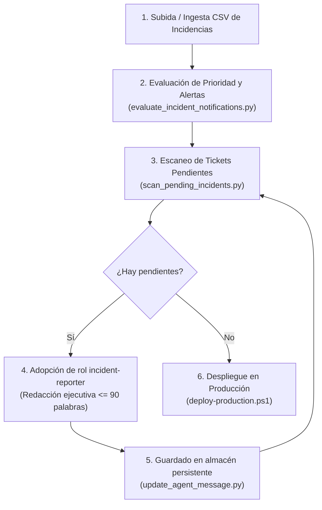

# Skill: Síntesis y Notificaciones Ejecutivas de Incidencias IT (`incident-executive-notifications`)

Esta skill orquesta el flujo integral de detección, redacción ejecutiva y publicación de comunicaciones oficiales para incidencias IT críticas (P1, P2 y discrepancias de prioridad) en el Release Dashboard.

Garantiza que **ninguna notificación dependa de plantillas genéricas o mecánicas (Vía A descartada)** y que cada ticket de alta prioridad cuente con una redacción contextualizada elaborada por el agente oficial `incident-reporter`.

---

## Cuándo activar esta skill

- Tras subir un nuevo fichero CSV/Excel de incidencias Remedy.
- Cuando el usuario solicite: *"redacta las incidencias pendientes"*, *"genera los mensajes ejecutivos"*, *"actualiza las notificaciones ejecutivas"* o *"procesa el fichero de incidencias"*.
- Cuando se agreguen nuevos tickets a `data/incidents.json` o `data/output/high_priority_notifications.json`.

---

## Flujo Operativo Paso a Paso



---

### Paso 1: Evaluación y triaje del catálogo

Si se acaba de recibir o subir un nuevo CSV/archivo de incidencias, ejecuta la evaluación ITIL de severidad:

```powershell
python converters/evaluate_incident_notifications.py
```

Esto generará o actualizará `data/output/high_priority_notifications.json`, identificando todos los tickets P1, P2 y discrepancias activas, integrando el almacén persistente `data/agent_executive_messages.json`.

---

### Paso 2: Escaneo de incidencias pendientes de redacción

Para comprobar qué incidencias activas no tienen aún redacción oficial de agente, ejecuta el script auxiliar de la skill:

```powershell
python .agents/skills/incident-executive-notifications/scripts/scan_pending_incidents.py
```

Para obtener el listado en formato JSON estructurado:

```powershell
python .agents/skills/incident-executive-notifications/scripts/scan_pending_incidents.py --json
```

Para ver el contexto técnico completo y el prompt ensamblado de una incidencia concreta:

```powershell
python .agents/skills/incident-executive-notifications/scripts/scan_pending_incidents.py --id INC000004168038
```

---

### Paso 3: Redacción adoptando el rol `incident-reporter`

Para cada incidencia pendiente detectada, el asistente debe adoptar las reglas de [`agents/it-incidents/incident-reporter.md`](file:///c:/Users/jose.delafuente/proyectos/release-dashboard-application/agents/it-incidents/incident-reporter.md) y apoyarse en `it-severity-matrix`:

#### Reglas de Redacción Obligatorias:
1. **Dos niveles de salida:**
   - **Mensaje para Dirección (versión completa):** Exactamente **un único párrafo** (monopárrafo), máximo **90 palabras**. Sin viñetas, sin encabezados internos.
   - **Versión aún más breve:** Máximo **30 palabras**, formato apto para SMS o canal de guardia (`P1/P2: <Impacto>. <Acción>. <Próxima actualización>`).
2. **Priorizar síntesis técnica de Epsilon IA:** Si la incidencia cuenta con bloque Epsilon IA (`resumen_ia`: problema, impacto de negocio, solución en curso), úsalo como fuente de verdad técnica. Si no dispone de Epsilon IA, redacta a partir del título y sistemas Remedy.
3. **Regla Anti-Alucinación:** No inventar horas, causas raíz ni métricas de clientes afectados no respaldadas en los datos del ticket.

#### Plantilla esperada de salida del agente:
```markdown
**Mensaje para Dirección (versión completa):**
<Párrafo único formal de máximo 90 palabras que explica el servicio afectado, el alcance comercial/operativo, las acciones inmediatas en curso y el próximo hito de seguimiento.>

**Versión aún más breve:**
<Alerta telegráfica de máximo 30 palabras: Criticidad, sistema, impacto clave, estado de soporte y ventana de reporte.>
```

---

### Paso 4: Ingesta en el almacén persistente

Una vez redactado el texto para una incidencia, ingéstalo en el almacén oficial usando el CLI `update_agent_message.py`:

#### Vía A (Directa por parámetro `--raw`):
```powershell
python converters/cli/update_agent_message.py --id <ID_INCIDENCIA> --phase apertura --raw "**Mensaje para Dirección (versión completa):**
Se ha detectado una incidencia crítica en el sistema X...

**Versión aún más breve:**
P1: Caída de X. Impacto en facturación. Soporte investigando. Próxima actualización 30 min."
```

#### Vía B (Desde archivo temporal o borrador):
```powershell
python converters/cli/update_agent_message.py --id <ID_INCIDENCIA> --phase apertura --file "ruta/al/borrador.txt"
```

#### Vía C (Parámetros separados):
```powershell
python converters/cli/update_agent_message.py --id <ID_INCIDENCIA> --phase apertura --completo "Texto completo..." --breve "Texto breve..."
```

> [!NOTE]
> El comando valida automáticamente que la versión completa sea un único párrafo y no supere las 90 palabras, y que la versión breve no supere las 30 palabras. Tras guardar en `data/agent_executive_messages.json`, regenera automáticamente `data/output/high_priority_notifications.json`.

---

### Paso 5: Verificación y Despliegue en Producción

1. Verifica con los tests unitarios:
   ```powershell
   pytest converters/tests/unit/test_update_agent_message.py converters/tests/unit/test_evaluate_incident_notifications.py -v
   ```
2. Ejecuta el escáner final:
   ```powershell
   python .agents/skills/incident-executive-notifications/scripts/scan_pending_incidents.py
   ```
   Debe reportar: `✅ Todas las incidencias activas disponen de mensajes ejecutivos oficiales.`
3. Despliega la versión en el servidor de producción:
   ```powershell
   powershell -ExecutionPolicy Bypass -File scripts/deploy-production.ps1 -AgentsLibraryPath . -BypassSandbox true
   ```

---

## Estructura de Ficheros Relacionados

- **Instrucciones de la skill:** [`.agents/skills/incident-executive-notifications/SKILL.md`](file:///c:/Users/jose.delafuente/proyectos/release-dashboard-application/.agents/skills/incident-executive-notifications/SKILL.md)
- **Escáner de pendientes:** [`.agents/skills/incident-executive-notifications/scripts/scan_pending_incidents.py`](file:///c:/Users/jose.delafuente/proyectos/release-dashboard-application/.agents/skills/incident-executive-notifications/scripts/scan_pending_incidents.py)
- **Utilidad CLI de ingestión:** [`converters/cli/update_agent_message.py`](file:///c:/Users/jose.delafuente/proyectos/release-dashboard-application/converters/cli/update_agent_message.py)
- **Generador de notificaciones:** [`converters/evaluate_incident_notifications.py`](file:///c:/Users/jose.delafuente/proyectos/release-dashboard-application/converters/evaluate_incident_notifications.py)
- **Almacén persistente:** [`data/agent_executive_messages.json`](file:///c:/Users/jose.delafuente/proyectos/release-dashboard-application/data/agent_executive_messages.json)
- **Salida para el frontend:** [`data/output/high_priority_notifications.json`](file:///c:/Users/jose.delafuente/proyectos/release-dashboard-application/data/output/high_priority_notifications.json)
