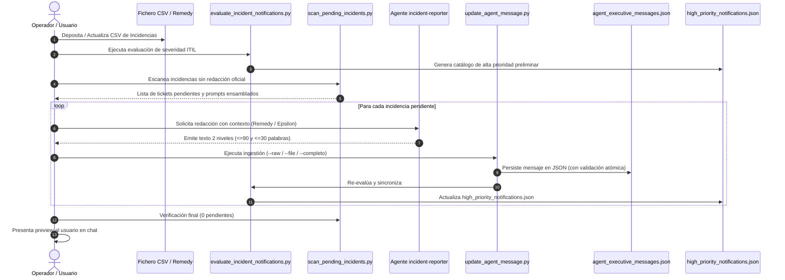

# Síntesis y Notificaciones Ejecutivas de Incidencias IT (`incident-executive-notifications`) — v1.4

Esta skill orquesta el ciclo de vida de **detección, redacción ejecutiva estructurada y persistencia local** de comunicaciones oficiales para incidencias IT críticas (P1, P2 y discrepancias de prioridad) en el Release Dashboard.

Garantiza que **ninguna comunicación dependa de plantillas genéricas mecánicas (Vía A descartada)** y que cada ticket cuente con una redacción personalizada elaborada por el agente oficial [`incident-reporter`](../../../agents/it-incidents/incident-reporter.md).

> [!IMPORTANT]
> **Aislamiento de Entorno y Límite de Seguridad (Local vs Producción):**  
> Esta skill opera exclusivamente sobre el **entorno de trabajo local**. Su cometido finaliza al auditar, redactar y persistir los mensajes en el almacén `data/agent_executive_messages.json`. **Nunca ejecuta despliegues autónomos a producción**. La publicación al servidor central es un acto deliberado, supervisado por el operador mediante `scripts/deploy-production.ps1`.

---

## 1. Arquitectura del Pipeline de Datos Local

El flujo de información se ejecuta de forma secuencial y auditable:



---

## 2. Salvaguardas de Seguridad e Integridad de Datos

### 2.1 Validación Estricta de Parámetros
- **Identificador de Incidencia:** Debe validar el formato estándar de Remedy (`INC\d{12}` o identificador alfanumérico corporativo).
- **Fase Operativa:** Únicamente se aceptan los valores canónicos: `apertura`, `seguimiento`, `reapertura` y `cierre`.
- **Límites Físicos de Longitud:**
  - Versión completa: Validada como **un único párrafo** (sin caracteres `\n` intermedios) y longitud $\le 90$ palabras.
  - Versión breve: Validada en **una sola línea** y longitud $\le 30$ palabras.

### 2.2 Integridad y Escritura Atómica
- La persistencia en `data/agent_executive_messages.json` utiliza serialización segura (`json.dump` con codificación UTF-8 e indentación de 2 espacios) para evitar corrupción de fichero por concurrencia.
- Los mensajes persisten con metadatos de auditoría: `fecha_actualizacion`, `fase`, `generado_por_agente: true`, `origen: "incident-reporter"` y conteo verificado de palabras.

### 2.3 Tratamiento de Errores y Recuperación
- **Fallo por formato Markdown incorrecto en modo `--raw`:** Si el CLI reporta `Error: No se pudo extraer la versión completa o breve`, utilizar la modalidad de parámetros directos (`--completo "..." --breve "..."`) o volcar el borrador a un archivo de texto e invocar `--file`.
- **Fallo por exceso de palabras:** Reducir la redacción eliminando detalles técnicos redundantes y reintentar.

---

### 2.4 Modo Auto-Borrador Provisional (Auto-Draft Mode) y Fase Reapertura
- **Eliminación de la Ventana Ciega de Comunicación:** Durante ingestas masivas de ficheros, puede existir un lapso entre la detección técnica del incidente y la redacción personalizada por el operador. Con el flag `--auto-draft`, el evaluador genera de forma determinista un **borrador provisional** seguro:
  - Marcado con `borrador_provisional: true` en metadatos y encabezado con el prefijo `[BORRADOR PROVISIONAL]`.
  - Cumple estrictamente el contrato de dos niveles ($\le 90$ palabras monopárrafo, $\le 30$ palabras telegráfico) sin conjeturar causas raíz (estricta regla anti-alucinación).
- **Soporte Canónico de Fase `reapertura`:** Diseñado específicamente para notificar recurrencias activas en tickets reactivados tras haber sido resueltos.
- **Identificación en el Escáner:** `scan_pending_incidents.py` clasifica los tickets pendientes distinguiendo entre `[📝 BORRADOR PROVISIONAL]` (cobertura temporal activa) y `[⏳ PENDIENTE]` (sin comunicación).

## 3. Guía de Ejecución Paso a Paso

### Paso 1: Evaluación y triaje del catálogo local
Tras cargar o depositar un nuevo CSV de incidencias en local, ejecuta el evaluador:

```powershell
python converters/cli/evaluate_incident_notifications.py --auto-draft
```

Este comando:
1. Aplica la matriz de severidad ITIL y los umbrales de la skill `it-severity-matrix`.
2. Cruza los tickets con el almacén histórico `data/agent_executive_messages.json`.
3. Genera o refresca `data/output/high_priority_notifications.json`.

---

### Paso 2: Escaneo de incidencias pendientes de redacción
Ejecuta el escáner de la skill para identificar tickets activos que carecen de redacción oficial:

```powershell
python .agents/skills/incident-executive-notifications/scripts/scan_pending_incidents.py
```

**Modos de escaneo avanzados:**
- Formato JSON estructurado para automatización:
  ```powershell
  python .agents/skills/incident-executive-notifications/scripts/scan_pending_incidents.py --json
  ```
- Inspección detallada y prompt ensamblado de una incidencia específica:
  ```powershell
  python .agents/skills/incident-executive-notifications/scripts/scan_pending_incidents.py --id INC000004168038
  ```

---

### Paso 3: Redacción adoptando el rol `incident-reporter`
Para cada ticket pendiente, genera los mensajes siguiendo las reglas de [`agents/it-incidents/incident-reporter.md`](../../../agents/it-incidents/incident-reporter.md):

#### Reglas Obligatorias:
1. **Dos niveles estricto:**
   - **Mensaje para Dirección (versión completa):** Exactamente **un único párrafo** (monopárrafo), máximo **90 palabras**.
   - **Versión aún más breve:** Máximo **30 palabras**, en una sola línea, apto para SMS/Teams.
2. **Priorizar síntesis técnica de Epsilon IA:** Si la incidencia dispone de `resumen_ia` (problema, impacto, solución), úsalo como fuente de verdad técnica. Si no dispone de él, redacta a partir de los datos Remedy en Modo Restringido.
3. **Regla Anti-Alucinación Estricta:** No inventar causas no demostradas ni cifras de afectados. En Modo Restringido indicar siempre que la causa está en fase de investigación por el grupo resolutor.

#### Plantilla de Salida:
```markdown
**Mensaje para Dirección (versión completa):**
<Párrafo único cohesionado de hasta 90 palabras que explica el servicio afectado, el impacto en clientes o negocio, las acciones en curso y la próxima ventana de actualización.>

**Versión aún más breve:**
<Alerta telegráfica de hasta 30 palabras: Criticidad, servicio, impacto clave, estado de soporte y ventana de reporte.>
```

---

### Paso 4: Ingesta en el almacén persistente local

Ingesta los mensajes generados a través del CLI oficial `update_agent_message.py`:

#### Modalidad 1: Vía directa `--raw` (Markdown completo copiado)
```powershell
python converters/cli/update_agent_message.py --id <ID_INCIDENCIA> --phase apertura --raw "**Mensaje para Dirección (versión completa):**
Se ha detectado una incidencia crítica en el sistema X...

**Versión aún más breve:**
P1: Caída de X. Impacto en facturación. Soporte investigando. Próxima actualización 30 min."
```

#### Modalidad 2: Desde fichero borrador `--file`
```powershell
python converters/cli/update_agent_message.py --id <ID_INCIDENCIA> --phase apertura --file "scratch/borrador_INC000004168038.txt"
```

#### Modalidad 3: Por parámetros separados `--completo` y `--breve`
```powershell
python converters/cli/update_agent_message.py --id <ID_INCIDENCIA> --phase apertura --completo "Texto completo monopárrafo..." --breve "Texto telegráfico breve..."
```

---

### Paso 5: Verificación Local y Entrega

1. Ejecuta la suite de pruebas unitarias relevante:
   ```powershell
   python -m pytest converters/tests/unit/test_update_agent_message.py converters/tests/unit/test_evaluate_incident_notifications.py -v
   ```
2. Comprueba que el escáner confirma el cierre de todas las redacciones:
   ```powershell
   python .agents/skills/incident-executive-notifications/scripts/scan_pending_incidents.py
   ```
   *Salida esperada:* `✅ Todas las incidencias activas disponen de mensajes ejecutivos oficiales.`
3. **Presenta el preview de los mensajes redactados al usuario en el chat.** La skill concluye aquí.

---

### Paso Posterior Opcional: Despliegue Supervisado a Producción
Cuando el usuario valide los textos y decida sincronizar con producción:
1. Subir el CSV oficial mediante la consola web (`/dashboards/massive-incidents/`).
2. Ejecutar el despliegue supervisado:
   ```powershell
   powershell -ExecutionPolicy Bypass -File scripts/deploy-production.ps1 -AgentsLibraryPath . -BypassSandbox true
   ```
