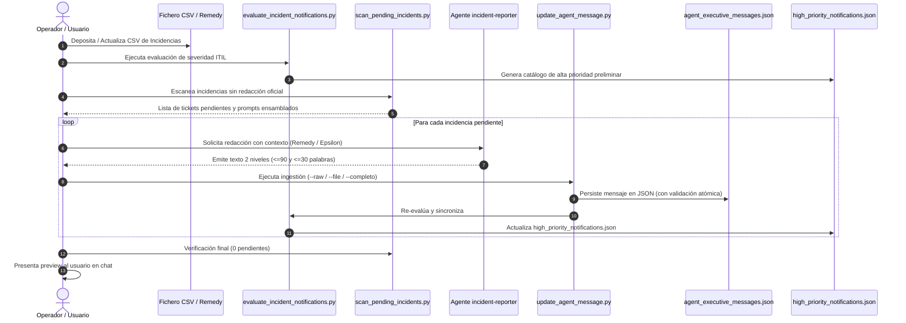

# Síntesis y Notificaciones Ejecutivas de Incidencias IT (`incident-executive-notifications`) — v1.4.1

Esta skill orquesta el ciclo de vida de **detección, redacción ejecutiva estructurada y persistencia local** de comunicaciones oficiales para incidencias IT críticas (P1, P2 y discrepancias de prioridad) en el Release Dashboard.

Garantiza que **ninguna comunicación dependa de plantillas genéricas mecánicas (Vía A descartada)** y que cada ticket cuente con una redacción personalizada elaborada por el agente oficial [`incident-reporter`](../../../agents/it-incidents/incident-reporter.md).

> [!IMPORTANT]
> **Aislamiento de Entorno y Límite de Seguridad (Local vs Producción):**  
> Esta skill opera exclusivamente sobre el **entorno de trabajo local**. Su cometido finaliza al auditar, redactar y persistir los mensajes en el almacén `data/agent_executive_messages.json`. **Nunca ejecuta despliegues autónomos a producción**. La publicación al servidor central es un acto deliberado, supervisado por el operador mediante `scripts/deploy-production.ps1`.

---

## 1. Arquitectura del Pipeline de Datos Local

El flujo de información se ejecuta de forma secuencial y auditable:



---

## 2. Terminología y Definiciones Clave

Para evitar ambigüedad en la ejecución, estos términos tienen un significado único y obligatorio dentro de esta skill:

| Término | Definición |
| --- | --- |
| **P1 / P2 / Discrepancia de prioridad** | Niveles de severidad calculados por la skill `it-severity-matrix` a partir de la matriz ITIL corporativa. Esta skill **consume** esa clasificación tal como aparece en `data/output/high_priority_notifications.json`; **no recalcula ni reinterpreta** la severidad. |
| **Modo Restringido** | Modo de redacción obligatorio cuando el ticket **no dispone** de `resumen_ia` (síntesis de Epsilon IA). El mensaje se construye únicamente con los campos disponibles en Remedy, sin conjeturar causa, impacto cuantificado ni solución; debe declarar explícitamente que la causa está en fase de investigación por el grupo resolutor. |
| **Modo Epsilon (por defecto)** | Modo de redacción cuando el ticket **sí dispone** de `resumen_ia` (problema, impacto, solución). Esa síntesis técnica es la fuente de verdad y debe usarse como base principal de la redacción. |
| **Borrador Provisional** | Mensaje generado automáticamente por `evaluate_incident_notifications.py --auto-draft` para cubrir la ventana ciega de comunicación. Se marca con `borrador_provisional: true` y el prefijo `[BORRADOR PROVISIONAL]`. Es un mensaje transitorio, no una redacción definitiva. |
| **Fases canónicas** | `apertura`, `seguimiento`, `reapertura`, `cierre`. Son los únicos cuatro valores válidos para el parámetro `--phase` / `--fase` (ver §3.1). |

---

## 3. Salvaguardas de Seguridad e Integridad de Datos

### 3.1 Validación Estricta de Parámetros
- **Identificador de Incidencia:** Debe validar el formato estándar de Remedy (`INC\d{12}` o identificador alfanumérico corporativo).
- **Fase Operativa:** Únicamente se aceptan los valores canónicos: `apertura`, `seguimiento`, `reapertura` y `cierre`.
- **Límites Físicos de Longitud:**
  - Versión completa: Validada como **un único párrafo** (sin caracteres `\n` intermedios) y longitud $\le 90$ palabras.
  - Versión breve: Validada en **una sola línea** y longitud $\le 30$ palabras.

### 3.2 Integridad y Escritura Atómica
- La persistencia en `data/agent_executive_messages.json` utiliza serialización segura (`json.dump` con codificación UTF-8 e indentación de 2 espacios) para evitar corrupción de fichero por concurrencia.
- Los mensajes persisten con metadatos de auditoría: `fecha_actualizacion`, `fase`, `generado_por_agente: true`, `origen: "incident-reporter"` y conteo verificado de palabras.

### 3.3 Tratamiento de Errores y Recuperación
- **Fallo por formato Markdown incorrecto en modo `--raw`:** Si el CLI reporta `Error: No se pudo extraer la versión completa o breve`, utilizar la modalidad de parámetros directos (`--completo "..." --breve "..."`) o volcar el borrador a un archivo de texto e invocar `--file`.
- **Fallo por exceso de palabras:** Reducir la redacción eliminando detalles técnicos redundantes y reintentar.

### 3.4 Modo Auto-Borrador Provisional (Auto-Draft Mode) y Fase Reapertura
- **Eliminación de la Ventana Ciega de Comunicación:** Durante ingestas masivas de ficheros, puede existir un lapso entre la detección técnica del incidente y la redacción personalizada por el operador. Con el flag `--auto-draft`, el evaluador genera de forma determinista un **borrador provisional** seguro:
  - Marcado con `borrador_provisional: true` en metadatos y encabezado con el prefijo `[BORRADOR PROVISIONAL]`.
  - Cumple estrictamente el contrato de dos niveles ($\le 90$ palabras monopárrafo, $\le 30$ palabras telegráfico) sin conjeturar causas raíz (estricta regla anti-alucinación).
- **Soporte Canónico de Fase `reapertura`:** Diseñado específicamente para notificar recurrencias activas en tickets reactivados tras haber sido resueltos.
- **Identificación en el Escáner:** `scan_pending_incidents.py` clasifica los tickets pendientes distinguiendo entre `[📝 BORRADOR PROVISIONAL]` (cobertura temporal activa) y `[⏳ PENDIENTE]` (sin comunicación).

---

## 4. Reglas y Prohibiciones Explícitas ("Nunca hagas esto")

1. **Nunca** ejecutes `scripts/deploy-production.ps1` ni publiques datos a producción como parte de esta skill. Es un paso posterior opcional (§6) que solo inicia el operador tras validar los textos.
2. **Nunca** inventes causas raíz, cifras de afectados, nombres de sistemas, horas o cronologías que no estén confirmadas en Remedy o en `resumen_ia` de Epsilon IA (regla anti-alucinación, §3.4). En Modo Restringido, declara siempre que la causa está en investigación.
3. **Nunca** te saltes el Paso 2 (escaneo con `scan_pending_incidents.py`) antes de redactar. No asumas qué tickets carecen de mensaje oficial sin confirmarlo con el escáner.
4. **Nunca** edites manualmente `data/agent_executive_messages.json`. Usa siempre `update_agent_message.py` para garantizar escritura atómica y metadatos de auditoría (§3.2).
5. **Nunca** excedas los límites de 90 palabras (versión completa) o 30 palabras (versión breve), ni dividas el mensaje completo en varios párrafos (`\n` intermedios prohibidos en la versión completa).
6. **Nunca** dejes un Borrador Provisional (`--auto-draft`) como redacción definitiva de un ticket; debe sustituirse por una versión personalizada por el agente `incident-reporter` antes del cierre.
7. **Nunca** uses un valor de `--phase` distinto de los cuatro canónicos (`apertura`, `seguimiento`, `reapertura`, `cierre`).
8. **Nunca** concluyas la skill sin presentar al usuario el preview de los mensajes redactados en el chat (Paso 5, punto 3).

---

## 5. Guía de Ejecución Paso a Paso

### Paso 1: Evaluación y triaje del catálogo local
Tras cargar o depositar un nuevo CSV de incidencias en local, ejecuta el evaluador:

```powershell
python converters/cli/evaluate_incident_notifications.py --auto-draft
```

Este comando:
1. Aplica la matriz de severidad ITIL y los umbrales de la skill `it-severity-matrix`.
2. Cruza los tickets con el almacén histórico `data/agent_executive_messages.json`.
3. Genera o refresca `data/output/high_priority_notifications.json`.

---

### Paso 2: Escaneo de incidencias pendientes de redacción
Ejecuta el escáner de la skill para identificar tickets activos que carecen de redacción oficial:

```powershell
python .agents/skills/incident-executive-notifications/scripts/scan_pending_incidents.py
```

**Modos de escaneo avanzados:**
- Formato JSON estructurado para automatización:
  ```powershell
  python .agents/skills/incident-executive-notifications/scripts/scan_pending_incidents.py --json
  ```
- Inspección detallada y prompt ensamblado de una incidencia específica:
  ```powershell
  python .agents/skills/incident-executive-notifications/scripts/scan_pending_incidents.py --id INC000004168038
  ```

**Condición de parada temprana:** si la salida indica `0 pendientes` (ningún `[⏳ PENDIENTE]` ni `[📝 BORRADOR PROVISIONAL]` que deba finalizarse), omite los Pasos 3 y 4 y continúa directamente en el Paso 5.

---

### Paso 3: Redacción adoptando el rol `incident-reporter`
Para cada ticket pendiente, genera los mensajes siguiendo las reglas de [`agents/it-incidents/incident-reporter.md`](../../../agents/it-incidents/incident-reporter.md):

#### Reglas Obligatorias:
1. **Dos niveles estricto:**
   - **Mensaje para Dirección (versión completa):** Exactamente **un único párrafo** (monopárrafo), máximo **90 palabras**.
   - **Versión aún más breve:** Máximo **30 palabras**, en una sola línea, apto para SMS/Teams.
2. **Priorizar síntesis técnica de Epsilon IA:** Si la incidencia dispone de `resumen_ia` (problema, impacto, solución), úsalo como fuente de verdad técnica (Modo Epsilon). Si no dispone de él, redacta a partir de los datos Remedy en Modo Restringido (§2).
3. **Regla Anti-Alucinación Estricta:** No inventar causas no demostradas ni cifras de afectados. En Modo Restringido indicar siempre que la causa está en fase de investigación por el grupo resolutor.
4. **Prefijo de criticidad en la versión breve:** La versión telegráfica debe iniciar con la etiqueta de severidad tal como la reporta `high_priority_notifications.json` (p. ej. `P1:`, `P2:`).

#### Plantilla de Salida (formato exacto)

```markdown
**Mensaje para Dirección (versión completa):**
<Párrafo único cohesionado de hasta 90 palabras que explica el servicio afectado, el impacto en clientes o negocio, las acciones en curso y la próxima ventana de actualización.>

**Versión aún más breve:**
<Alerta telegráfica de hasta 30 palabras: Criticidad, servicio, impacto clave, estado de soporte y ventana de reporte.>
```

#### Ejemplo relleno (datos ficticios, incidencia P1 en Modo Epsilon)

Supón que `resumen_ia` para `INC000004198765` reporta: problema = timeout en el microservicio de facturación tras el último despliegue; impacto = ~12.000 cuentas empresariales sin acceso a sus facturas desde las 09:15h; solución en curso = rollback del despliegue y reinicio de instancias por Soporte Nivel 2.

```markdown
**Mensaje para Dirección (versión completa):**
Se ha detectado una incidencia crítica (P1) en el Portal de Facturación Online: un timeout en el microservicio de facturación impide a clientes empresariales descargar sus facturas desde las 09:15h, afectando aproximadamente a 12.000 cuentas. El equipo de Soporte Nivel 2 ha identificado la causa en el último despliegue y está ejecutando un rollback controlado junto con el reinicio de instancias afectadas. Se mantiene monitorización activa del servicio. Próxima actualización de estado prevista en 30 minutos o ante cualquier cambio relevante.

**Versión aún más breve:**
P1: Caída parcial del Portal de Facturación Online. ~12.000 clientes empresariales sin acceso a facturas. Rollback en curso. Próxima actualización en 30 min.
```

*(Verificación: versión completa = 81 palabras, un solo párrafo sin `\n` intermedios; versión breve = 23 palabras, una sola línea con prefijo de criticidad `P1:`. Ambas cumplen los límites de §3.1.)*

---

### Paso 4: Ingesta en el almacén persistente local

Ingesta los mensajes generados a través del CLI oficial `update_agent_message.py`:

#### Modalidad 1: Vía directa `--raw` (Markdown completo copiado)
```powershell
python converters/cli/update_agent_message.py --id <ID_INCIDENCIA> --phase apertura --raw "**Mensaje para Dirección (versión completa):**
Se ha detectado una incidencia crítica en el sistema X...

**Versión aún más breve:**
P1: Caída de X. Impacto en facturación. Soporte investigando. Próxima actualización 30 min."
```

#### Modalidad 2: Desde fichero borrador `--file`
```powershell
python converters/cli/update_agent_message.py --id <ID_INCIDENCIA> --phase apertura --file "scratch/borrador_INC000004168038.txt"
```

#### Modalidad 3: Por parámetros separados `--completo` y `--breve`
```powershell
python converters/cli/update_agent_message.py --id <ID_INCIDENCIA> --phase apertura --completo "Texto completo monopárrafo..." --breve "Texto telegráfico breve..."
```

---

### Paso 5: Verificación Local y Entrega

1. Ejecuta la suite de pruebas unitarias relevante:
   ```powershell
   python -m pytest converters/tests/unit/test_update_agent_message.py converters/tests/unit/test_evaluate_incident_notifications.py -v
   ```
2. Comprueba que el escáner confirma el cierre de todas las redacciones:
   ```powershell
   python .agents/skills/incident-executive-notifications/scripts/scan_pending_incidents.py
   ```
   *Salida esperada:* `✅ Todas las incidencias activas disponen de mensajes ejecutivos oficiales.`
3. **Presenta el preview de los mensajes redactados al usuario en el chat.** La skill concluye aquí.

---

## 6. Ejemplo End-to-End Completo (datos ficticios)

Este ejemplo recorre los 5 pasos de principio a fin para un único ticket P1 recién detectado, usando el mismo caso ficticio del Paso 3 (`INC000004198765`, Portal de Facturación Online).

1. **Evaluación** — El operador deposita el CSV diario y ejecuta:
   ```powershell
   python converters/cli/evaluate_incident_notifications.py --auto-draft
   ```
   El evaluador clasifica `INC000004198765` como **P1** y, al no existir aún redacción oficial, genera un Borrador Provisional en `data/output/high_priority_notifications.json`.

2. **Escaneo** — El operador confirma el pendiente:
   ```powershell
   python .agents/skills/incident-executive-notifications/scripts/scan_pending_incidents.py --id INC000004198765
   ```
   Salida: `[📝 BORRADOR PROVISIONAL] INC000004198765 — fase: apertura — resumen_ia: disponible`.

3. **Redacción** — Adoptando el rol `incident-reporter` en Modo Epsilon (hay `resumen_ia` disponible), se produce el texto de dos niveles mostrado en el Paso 3 (81 palabras / 23 palabras).

4. **Ingesta** — El operador persiste la redacción definitiva, sustituyendo el borrador provisional, con la Modalidad 3:
   ```powershell
   python converters/cli/update_agent_message.py --id INC000004198765 --phase apertura --completo "Se ha detectado una incidencia crítica (P1) en el Portal de Facturación Online: un timeout en el microservicio de facturación impide a clientes empresariales descargar sus facturas desde las 09:15h, afectando aproximadamente a 12.000 cuentas. El equipo de Soporte Nivel 2 ha identificado la causa en el último despliegue y está ejecutando un rollback controlado junto con el reinicio de instancias afectadas. Se mantiene monitorización activa del servicio. Próxima actualización de estado prevista en 30 minutos o ante cualquier cambio relevante." --breve "P1: Caída parcial del Portal de Facturación Online. ~12.000 clientes empresariales sin acceso a facturas. Rollback en curso. Próxima actualización en 30 min."
   ```
   El CLI valida ambos límites de palabras, escribe atómicamente en `data/agent_executive_messages.json` con `generado_por_agente: true`, `origen: "incident-reporter"`, `borrador_provisional: false`, y re-ejecuta el evaluador para refrescar `high_priority_notifications.json`.

5. **Verificación** — El operador repite el escaneo:
   ```powershell
   python .agents/skills/incident-executive-notifications/scripts/scan_pending_incidents.py
   ```

   Salida esperada: `✅ Todas las incidencias activas disponen de mensajes ejecutivos oficiales.` A continuación, la skill presenta el preview de ambos niveles del mensaje al usuario en el chat y concluye.

---

## 7. Paso Posterior Opcional: Despliegue Supervisado a Producción

Cuando el usuario valide los textos y decida sincronizar con producción:
1. Subir el CSV oficial mediante la consola web (`/dashboards/massive-incidents/`).
2. Ejecutar el despliegue supervisado:
   ```powershell
   powershell -ExecutionPolicy Bypass -File scripts/deploy-production.ps1 -AgentsLibraryPath . -BypassSandbox true
   ```
