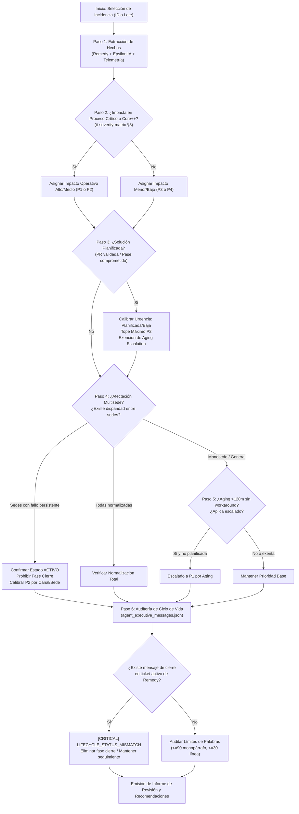

# Revisión y Calibración de Triaje de Incidencias IT (`incident-triage-review`) — v1.0

Esta skill proporciona el marco de auditoría, las reglas metodológicas y las herramientas automatizadas para **revisar, auditar y calibrar el triaje técnico y operativo de cualquier incidencia IT** en el entorno de Orange Tech Operations.

Sistematiza de forma rigurosa los aprendizajes y patrones extraídos de incidencias complejas reales:

1. **Resoluciones Planificadas con Pase a Producción Programado** (Caso [`INC000004122710`](file:///c:/Users/jose.delafuente/proyectos/release-dashboard-application/data/.epsilon_cache/INC000004122710.json)): Tratamiento de PRs validadas en espera de ventana de release, calibración de urgencia a nivel planificado, establecimiento de techo P2 y exención de *Aging Escalation* descontrolado.
2. **Resoluciones Parciales Multisede y Falsos Cierres Alucinados** (Caso [`INC000004156790`](file:///c:/Users/jose.delafuente/proyectos/release-dashboard-application/data/.epsilon_cache/INC000004156790.json)): Detección de bloqueos persistentes en sedes operativas pese a la normalización de otras, erradicación de discrepancias de ciclo de vida (`LIFECYCLE_STATUS_MISMATCH`) y corrección de infratriaje administrativo en Remedy.

> [!IMPORTANT]
> **Aislamiento de Entorno y Límite de Seguridad (Local vs Producción):**  
> Esta skill opera exclusivamente sobre el **entorno de trabajo local y herramientas de soporte a la decisión**. Audita ficheros locales (`data/output/*-massive.json`, `data/output/high_priority_notifications.json`, `data/agent_executive_messages.json` y `.epsilon_cache/`). **Nunca realiza mutaciones directas sobre la base de datos de BMC Remedy ni realiza llamadas externas automáticas**. Toda recomendación debe ser aplicada o escalada por el operador humano o Incident Manager.

---

## 0. Delimitación de Alcance, Límites Operativos y Fronteras del Rol

Esta Skill actúa bajo un marco estricto de **Auditoría Técnica y Soporte Especializado a la Decisión (Decision Support Engine)**:

### 0.1 Capacidades en Alcance (In-Scope)

- **Auditoría de Clasificación ITIL:** Evaluar si la prioridad asignada en Remedy (P1 a P4) refleja fielmente el impacto en Procesos Críticos de Negocio ([`it-severity-matrix`](file:///c:/Users/jose.delafuente/proyectos/release-dashboard-application/.agents/skills/it-severity-matrix/SKILL.md) §3).
- **Detección de Resoluciones Planificadas:** Identificar si la incidencia cuenta con una solución técnica desarrollada y validada en PR/testing a la espera de ventana de mantenimiento, ajustando la urgencia operativa para evitar falsas emergencias.
- **Auditoría de Afectación Multisede:** Comprobar si existen sedes, canales o segmentos de usuarios con bloqueos activos no mitigados cuando se reporta normalización en otros centros.
- **Auditoría de Coherencia de Ciclo de Vida:** Detectar inconsistencias críticas donde tickets activos en Remedy (`Asignado`, `En curso`, `Pendiente`) cuentan con mensajes de cierre oficial en la consola (`LIFECYCLE_STATUS_MISMATCH`).
- **Verificación de Envejecimiento (*Aging Escalation*):** Controlar si el tiempo transcurrido sin workaround justifica la elevación a P1 o si aplica una exención por despliegue comprometido.
- **Prescripción de Acciones Operativas:** Formular las recomendaciones exactas para la Mesa de Incidencias, equipos resolutores e Incident Manager (IM-CSO).

### 0.2 Capacidades Fuera de Alcance y Salvaguardas (Out-of-Scope / Non-Goals)

- ❌ **Modificación Directa en BMC Remedy ITSM:** La skill diagnostica y formula la recomendación de reclasificación; la modificación en la herramienta de ticketing es responsabilidad del operador o gestor de incidencias.
- ❌ **Cierre Administrativo Ficticio:** Jamás dar por resuelta o cerrada una incidencia mientras el ticket continúe abierto en Remedy o exista al menos una sede con reporte "NO RESUELTO".
- ❌ **Alucinación de Causas o Métricas:** Estrictamente prohibido conjeturar fechas de pase a producción, horas de normalización o causas raíz sin respaldo en Epsilon IA o notas técnicas.

---

## 1. Arquitectura de Decisión del Triaje

El proceso de auditoría y revisión de triaje sigue el siguiente árbol algorítmico jerárquico:



---

## 2. Lecciones Aprendidas y Casos Canónicos Fundacionales

### 2.1 Caso de Estudio 1: Despliegues Planificados (`INC000004122710`)

- **Contexto**: Incidencia en Ficha de Cliente por fallo en propagación de teléfono en recogidas de fijo hacia PeopleSoft y Siebel 8 (interfaz 92007).
- **Problema previo**:
  - Al llevar semanas abierta en Remedy (>30.000 min), el motor de notificaciones la escalaba automáticamente a **P1** por envejecimiento (*Aging Escalation*), activando alarmas ficticias de emergencia inmediata.
  - Adicionalmente, existía un mensaje oficial de "cierre" afirmando que la interfaz ya estaba desplegada y normalizada, cuando en realidad la subida a producción estaba planificada para el **17/11/2026**.
- **Solución y Aprendizaje**:
  - **Calibración de Urgencia**: Una incidencia con causa raíz identificada y solución correctiva (PR) validada para un pase programado **NO es una emergencia en caliente**, sino una evolución planificada.
  - **Tope Máximo P2**: Nunca debe clasificarse como P1 por envejecimiento. Su prioridad queda acotada como máximo a P2 (o P3 si la operativa alternativa mitiga el impacto).
  - **Exención de Aging**: Queda exenta del escalado temporal de 120 minutos.
  - **Erradicación del Falso Cierre**: Se eliminó la fase `"cierre"` y se redactó la fase `"seguimiento"` indicando explícitamente la fecha de despliegue comprometida y la supervisión preventiva.

### 2.2 Caso de Estudio 2: Resolución Parcial Multisede y Falsos Cierres (`INC000004156790`)

- **Contexto**: Fallo en endpoint `xpldocumentlist` en ApiGee que impedía descargar comprobantes de venta desde el inyector en Ficha Cliente a dos centros de atención (Bosch-Vigo y Madison-Valladolid).
- **Problema previo**:
  - Remedy la tenía en **P3 (Media)**, a pesar de paralizar la contratación a 60 operadores de un call center.
  - Tras corregir el endpoint, Vigo confirmó resolución (26/10 12:18), pero Valladolid reportó **NO RESUELTO** (26/10 12:51).
  - En la consola se había redactado un mensaje de "cierre" alucinando que todas las sedes operaban sin problemas y el proceso de venta estaba restablecido.
- **Solución y Aprendizaje**:
  - **Resolución Parcial $\neq$ Cierre**: Mientras una sede mantenga un reporte de "NO RESUELTO" o bloqueo en la operativa, el incidente sigue **ACTIVO**. Prohibido generar o mantener un mensaje de cierre.
  - **Infratriaje Administrativo**: La afectación de venta en sede telefónica corresponde a un **SL2 / P2 Mayor** (§3.1 de [`it-severity-matrix`](file:///c:/Users/jose.delafuente/proyectos/release-dashboard-application/.agents/skills/it-severity-matrix/SKILL.md)), no a un P3 de Remedy.
  - **Alarma de Estancamiento**: Al superar 2 horas en estado no resuelto en una sede activa, aplica el protocolo de escalado telefónico con IM-CSO y activación del grupo especialista (`DES_SOE_FICHA`).

---

## 3. Pipeline Secuencial de Revisión (6 Fases Obligatorias)

Para auditar cualquier incidencia de forma determinista, sigue este pipeline:

### Fase 1: Extracción de Hechos Objetivos

1. Extraer identificador, estatus Remedy, prioridad Remedy, impacto, urgencia, grupo asignado y fecha de envío desde el último fichero masivo (`data/output/*-massive.json`).
2. Consultar el extracto técnico en `data/.epsilon_cache/{INC}.json` (o invocar `retry_epsilon_ia.py` si no existe caché).
3. Contrastar notas técnicas: ¿Se menciona alguna sede específica? ¿Hay confirmación de prueba funcional de usuario?

### Fase 2: Determinación del Impacto Real de Negocio

Contrastar con el catálogo de [`it-severity-matrix`](file:///c:/Users/jose.delafuente/proyectos/release-dashboard-application/.agents/skills/it-severity-matrix/SKILL.md):

- **SL1 / P1**: Caída total o degradación $\ge 20\%$ en Procesos Críticos (Ventas, Cobros, Portabilidad, Provisión, ATC). Caída total de infraestructuras Core++ sin HA.
- **SL2 / P2**: Afectación parcial o degradación del 5% al 20%. Fallo funcional en una sede comercial/call center (ej. Madison-Valladolid). Pérdida de redundancia en sistemas CORE.
- **SL3 / P3**: Incidencias funcionales aisladas con método alternativo operativo o impacto administrativo menor.
- **SL4 / P4**: Consultas, peticiones o anomalías cosméticas.

### Fase 3: Evaluación de la Urgencia y Factor Temporal

Determinar si aplica la regla de **Resolución Planificada**:

- Si la solución técnica está en PR o pendiente de despliegue en ventana comprometida:
  - Clasificar con bandera `es_planificada: true`.
  - Urgencia = *Planificada / Baja*.
  - Tope de prioridad = **P2**.

### Fase 4: Evaluación de Envejecimiento (*Aging*) y Exenciones

- Si el ticket supera los 120 minutos sin workaround autorizado por IM-CSO:
  - Si es incidencia activa y no planificada $\rightarrow$ Se evalúa escalado por envejecimiento.
  - Si es **planificada** con fecha comprometida $\rightarrow$ **Exenta de escalado a P1**.

### Fase 5: Auditoría de Coherencia de Ciclo de Vida y Mensajes

Verificar en [`data/agent_executive_messages.json`](file:///c:/Users/jose.delafuente/proyectos/release-dashboard-application/data/agent_executive_messages.json):

1. **Regla de Oro del Ciclo de Vida:** Si el ticket está en estado activo en Remedy (`Asignado`, `En curso`, `Pendiente`), **NO PUEDE TENER FASE `cierre`**.
2. **Límites Físicos:**
   - Versión completa: $\le 90$ palabras, estrictamente **monopárrafo** (sin `\n`).
   - Versión breve: $\le 30$ palabras, en **una sola línea**.
3. **Concordancia de Prioridad:** El texto del mensaje no debe contradecir la prioridad evaluada.

### Fase 6: Prescripción Operativa y Recomendaciones

Generar el informe de diagnóstico, detallando acciones correctivas automáticas y recomendaciones operativas para la Mesa de Incidencias.

---

## 4. Catálogo de Anomalías de Triaje y Matriz de Mitigación

| Código de Anomalía | Gravedad | Condición Disparadora | Impacto Operativo | Acción Correctora Recomendada |
| :--- | :--- | :--- | :--- | :--- |
| `LIFECYCLE_STATUS_MISMATCH` | **CRITICAL** | Ticket activo en Remedy con fase `cierre` en mensajes. | Falsa sensación de resolución en Dirección mientras el servicio sigue fallando. | Eliminar fase `cierre` de `agent_executive_messages.json` y reactivar fase `seguimiento`. |
| `CIERRE_PREMATURO_MULTI_SEDE` | **CRITICAL** | Fase `cierre` presente mientras al menos una sede reporta `NO RESUELTO`. | Ocultación de incidencias activas en sedes y abandono de soporte técnico. | Retirar fase `cierre`, redactar `seguimiento` reflejando afectación dispar e intervenir sede. |
| `INFRATRIAJE_REMEDY` | **HIGH** | Remedy clasifica como P3/P4 pero la evaluación técnica determina P1/P2. | Falta de foco en N1/N2 y riesgo de superación de SLAs de negocio. | Solicitar a la Mesa de Incidencias e IM-CSO elevar la prioridad en Remedy a P1/P2. |
| `AGING_ESCALATION_INDEBIDO` | **HIGH** | Ticket planificado escalado a P1 por superar 120 minutos. | Falsa alarma de emergencia a Dirección por tareas en espera de ventana de release. | Calibrar urgencia a Planificada/Baja en el motor de triaje y aplicar tope P2. |
| `SOBRETIAJE_REMEDY` | **MEDIUM** | Remedy clasifica nominalmente P1/P2 pero la telemetría no evidencia impacto. | Distracción de recursos críticos en incidencias menores. | Solicitar reevaluación técnica y ajuste de prioridad en Remedy. |
| `EXCESSIVE_WORD_COUNT` | **WARNING** | Versión completa $>90$ palabras o breve $>30$ palabras. | Ruptura de directivas ejecutivas y degradación visual en paneles de control. | Resumir el mensaje eliminando jerga redundante. |
| `MULTI_PARAGRAPH_COMPLETO` | **WARNING** | Versión completa contiene saltos de línea intermedios. | Inconsistencia de formato en visualización del dashboard. | Reemplazar saltos de línea por redacción en un único párrafo continuo. |

---

## 5. Herramientas CLI y Scripts Automatizados

Esta skill proporciona herramientas integradas en la consola:

### 5.1 Script Especializado de Revisión (`scripts/review_incident_triage.py`)

Permite auditar de forma inmediata una incidencia concreta o el catálogo completo:

```powershell
# Revisión detallada de una incidencia concreta
python .agents/skills/incident-triage-review/scripts/review_incident_triage.py --id INC000004156790

# Salida en formato Markdown para copiar en informes
python .agents/skills/incident-triage-review/scripts/review_incident_triage.py --id INC000004122710 --markdown

# Auditoría en lote de todas las incidencias del catálogo
python .agents/skills/incident-triage-review/scripts/review_incident_triage.py --all

# Exportación estructurada en JSON
python .agents/skills/incident-triage-review/scripts/review_incident_triage.py --all --json
```

### 5.2 Scripts Complementarios del Repositorio

- **Evaluación Global de Notificaciones**:

  ```powershell
  python converters/cli/evaluate_incident_notifications.py
  ```

- **Auditoría de Fidelidad de Mensajes Ejecutivos**:

  ```powershell
  python converters/cli/audit_executive_messages_coherence.py --id INC000004156790
  ```

- **Actualización Atómica de Mensajes**:

  ```powershell
  python converters/cli/update_agent_message.py --id INC000004156790 --fase seguimiento --completo "..." --breve "..."
  ```

- **Validación de la Suite de Pruebas Unitarias**:

  ```powershell
  powershell -Command "cd converters; python -m pytest tests/unit/test_incident_triage_review.py"
  ```

---

## 6. Plantilla Estándar del Informe de Revisión de Triaje

Al presentar la revisión de una incidencia al usuario o Incident Manager, utiliza estrictamente esta estructura:

```markdown
### 📋 Informe de Revisión de Triaje: `[INC_ID]` — [✅ CONFORME | ⚠️ INCONSISTENCIAS DETECTADAS]

#### 1. Ficha Técnica y Estado Operativo
- **Aplicación / Componente:** [Nombre de la aplicación y servicio afectado]
- **Estado Remedy:** `[Asignado | En curso | Pendiente | Resuelto | Cerrado]`
- **Grupo Resolutor:** `[Grupo asignado]`
- **Prioridad Nominal Remedy:** `[P1 | P2 | P3 | P4]`
- **Prioridad Técnica Evaluada:** `[P1 | P2 | P3 | P4]` [¿Discrepancia detectada?]
- **Tiempo Abierto / Envejecimiento:** `[X minutos / días]` [¿Aging Escalated aplicado?]

#### 2. Hallazgos y Diagnóstico Técnico
- **Afectación Real de Negocio:** [Resumen objetivo del proceso afectado y métricas reales]
- **Factor Temporal / Despliegue:** [¿Solución planificada en PR? ¿Fecha comprometida de release?]
- **Alcance Geográfico / Multisede:** [¿Afecta a múltiples sedes? ¿Existen sedes con reporte NO RESUELTO?]

#### 3. Inconsistencias Identificadas
- `[CÓDIGO_ANOMALÍA]`: [Descripción exacta de la discrepancia y riesgo operativo]

#### 4. Acciones Ejecutadas en la Consola Local
- [Saneamiento de mensajes ejecutivos / Corrección de fase / Calibración de urgencia]

#### 5. Recomendaciones Operativas para la Mesa de Incidencias e IM-CSO
1. **Acción en Remedy:** [Recomendación de reclasificación o actualización de estado en Remedy]
2. **Acción Operativa / Escalado:** [Activación de War Room, escalado telefónico o seguimiento de despliegue]
```

---

## 7. Integración con el Ecosistema de Skills

Esta skill se articula de forma sinérgica con las demás capacidades especializadas:

- [`it-severity-matrix`](file:///c:/Users/jose.delafuente/proyectos/release-dashboard-application/.agents/skills/it-severity-matrix/SKILL.md): Proporciona los umbrales cuantitativos de procesos críticos y las reglas maestras de severidad ITIL.
- [`orange-it-emergency-management`](file:///c:/Users/jose.delafuente/proyectos/release-dashboard-application/.agents/skills/orange-it-emergency-management/SKILL.md): Dictamina los protocolos de escalado telefónico obligatorio de Emergencias (45 min, 1h 45 min, Alarma >2h) y la gobernanza de workarounds con IM-CSO.
- [`incident-executive-notifications`](file:///c:/Users/jose.delafuente/proyectos/release-dashboard-application/.agents/skills/incident-executive-notifications/SKILL.md): Gestiona el almacenamiento local en `data/agent_executive_messages.json` y el ciclo de vida de los borradores ejecutivos.
- [`incident-reporter`](file:///c:/Users/jose.delafuente/proyectos/release-dashboard-application/agents/it-incidents/incident-reporter.md): Agente oficial para la redacción de mensajes de apertura, seguimiento, reapertura y cierre en dos niveles.
- [`postmortem-pir-workflow`](file:///c:/Users/jose.delafuente/proyectos/release-dashboard-application/.agents/skills/postmortem-pir-workflow/SKILL.md): Canaliza la información de incidencias cerradas para el análisis retrospectivo y plan de acciones CAPA.
