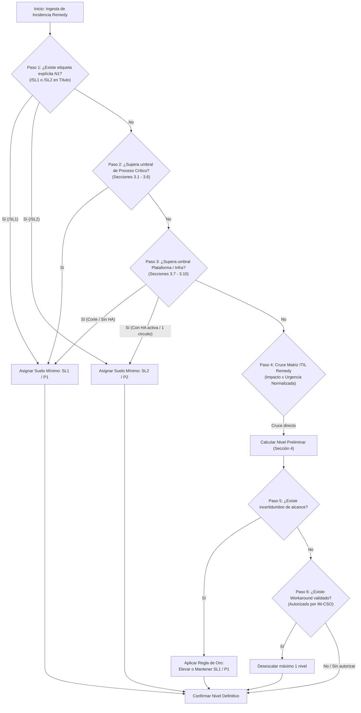

# Matriz de Severidad, Prioridad y Protocolo de Escalados IT (Orange) — v2.2

Esta skill actúa como el **Motor Determinista de Clasificación y Fuente Única de Verdad (SSOT)** para auditar, calcular y justificar el nivel objetivo de severidad y prioridad operativa (SL1/P1 a SL4/P4) en el ecosistema de incidentes de Orange Tech Operations.

---

## 0. Delimitación de Alcance, Límites Operativos y Fronteras del Rol

Esta Skill opera bajo un marco estricto de **Soporte a la Decisión Técnica y Triaje Determinista (Decision Support Engine)**. Sus fronteras operativas están claramente delimitadas:

### 0.1 Capacidades en Alcance (In-Scope)
- **Triaje y Clasificación Determinista:** Calcular y justificar el nivel objetivo de severidad y prioridad (SL1/P1 a SL4/P4) mediante reglas reproducibles y umbrales cuantitativos.
- **Detección de Discrepancias y Tampering:** Identificar subescalaciones o inconsistencias entre la prioridad nominal de Remedy y el impacto real del incidente.
- **Cronometría y Prescripción de Escalados:** Auditar tiempos de envejecimiento (*aging*) y prescribir con exactitud los hitos de escalado telefónico obligatorio (T+45 min, T+1h 45 min, Alarma >2h) y activación de *War Room*.
- **Generación de Síntesis Técnica:** Proveer el contexto técnico normalizado para la toma de decisiones y redacción de comunicaciones ejecutivas.

### 0.2 Capacidades Fuera de Alcance y Salvaguardas (Out-of-Scope / Non-Goals)
- ❌ **Modificación Directa en BMC Remedy ITSM:** La skill NO realiza mutaciones directas sobre bases de datos ni APIs de Remedy. Toda reclasificación o cambio de estado es una recomendación formal que debe ser validada y aplicada por el operador humano.
- ❌ **Llamadas Telefónicas Automatizadas (PBX / SIP / IVR):** La skill NO realiza llamadas telefónicas ni emite audio a centralitas. La ejecución de las llamadas obligatorias de guardia recae exclusivamente en el Incident Manager o equipo de N1/N2.
- ❌ **Autorización Unilateral de Workarounds:** La skill NO tiene potestad para autorizar soluciones de contingencia; únicamente verifica si cuentan con la aprobación explícita y documentada de IM-CSO.
- ❌ **Cierre Administrativo de Incidentes:** La skill evalúa condiciones técnicas de mitigación, pero el cierre formal del ticket requiere validación operativa humana.

### 0.3 Cláusula de Transparencia ante el Usuario
Si el usuario o el flujo de trabajo consulta sobre la ejecución de una acción externa, el modelo debe explicitar siempre su naturaleza asesora:
> *"He determinado la criticidad SL1/P1 y el requerimiento de escalado telefónico inmediato; dicha llamada y la actualización en Remedy deben ser ejecutadas por el operador de guardia / Incident Manager."*

---

## 1. Arquitectura de Decisión y Árbol Algorítmico

El triaje no se basa en apreciaciones subjetivas ni en la urgencia percibida por el usuario final, sino en la evaluación jerárquica y determinista de las siguientes etapas:



---

## 2. Principios de Seguridad y Gobernanza de Datos

### 2.1 Protección frente a Manipulación de Prioridad (Tampering Defense)
- En muchas ocasiones, tickets de Remedy son registrados erróneamente con prioridades rebajadas (`Media` o `Baja`) por operadores noveles o por falta de datos en la apertura.
- **Principio de Severidad Objetiva:** Si los parámetros técnicos del incidente (ej. indisponibilidad de IVR >20%, o fallo de APIGEE) superan los umbrales de la Sección 3, la clasificación **prevalece sobre el campo `Prioridad` de Remedy**, declarándose como discrepancia de severidad obligatoria.

### 2.2 Trazabilidad y Contrato de Justificación
- Toda determinación de severidad emitida por esta skill debe estar explícitamente indexada a un artículo de la Sección 3 o al cruce formal de la Sección 4.
- Queda prohibido emitir clasificaciones genéricas sin indicar el umbral numérico o funcional que motivó la decisión.

### 2.3 Tratamiento de Campos Remedy
- `Urgencia = Crítica` en Remedy equivale siempre a **Urgencia Alta**.
- `Urgencia = Medio` (masculino) equivale siempre a **Urgencia Media**.
- El estatus administrativo `Pendiente` (ej. espera de proveedor, ventana de intervención) **nunca reduce la severidad ni la urgencia** mientras el servicio permanezca afectado.

---

## 3. Catálogo Canónico de Criterios y Umbrales Objetivos (3.1 a 3.10)

Cualquier incidencia que cumpla las condiciones descritas se cataloga **automáticamente como Emergencia (`SL1 / P1`)** o como **Mayor (`SL2 / P2`)** según la condición técnica explícita:

### 3.1 Atención al Cliente (ATC) y Canales Digitales
* **IVR y CTI:** Indisponibilidad o degradación en `IVR` o `CTI` (`SOP_TECNICO_CALL_CENTER`) que colapse o impida atender a **>20% de las llamadas** para cualquier marca/segmento, o cualquier IVR **descartando >20% de llamadas durante 1 hora**.
* **Frontales / CRM y Asistentes:** Indisponibilidad o degradación con desviación de **>20% en 30 minutos** en volumen o errores en frontales y herramientas de operación: `Ficha de Cliente Orange` (`DES_SOE_FICHA` / `APL_MOV_SOE`), `CRM Jazztel` (`SOP_BSS_JAZZTEL`), `CRM4TELCO`, `Siebel 8`, `POLAR`, `LIVEPERSON` (`SOP_ASISTENTE`), `DJINGO` (`DES_DJINGO`), `ONURIS` (`SOP_ONURIS`), `ONCONNECT`, `NABOO`, `BOREAL`.
* **Canales de Autogestión Digital (`SL2 / P2` $\rightarrow$ `SL1 / P1`):** Degradación o indisponibilidad en `APP MI ORANGE`, `MIJAZZTEL` o `Web Mantenedores` (`SL2 / P2` en degradación funcional parcial; `SL1 / P1` si provoca corte total de acceso o supera los umbrales de ventas/recargas).

### 3.2 Ventas
* **Volumen de Operaciones:** Afectación en cualquier canal, segmento o marca que suponga un impacto en **más del 30% del volumen de operaciones**.
* **Caída Diaria:** Registrar **menos del 15% de ventas diarias** respecto al promedio de los 4 días equivalentes anteriores.
* **Sistemas Críticos de Ventas:** Indisponibilidad o bloqueo en campañas, renoves y altas en `CERES` (`APL_MOV_CERES` / `NEG_CAMP_CERES`), grabación/cierre de `Actos Comerciales` (`updateCommercialActSPA`), firma y contratación en `ECONTRATO` (`Econtrato_N2`), `PANGEA` (altas/portas/migras) o `Televenta`.

### 3.3 Portabilidad
* **Flujo Nocturno:** Imposibilidad de iniciar el flujo de portabilidad a las **2:00 AM**.
* **Entidad de Referencia:** Fallos de comunicación con la entidad de referencia entre las **8:00 AM y las 8:00 PM** (indisponibilidad total o degradación con **>2 horas de retraso**).
* **Sistemas Asociados:** Nodos de portabilidad fija/móvil y flujos de portabilidad en `PANGEA` / `TEIDE`.

### 3.4 Prepago
* **Recargas:** **>10% de errores** o **>30 minutos sin actividad** por marca o canal (incluyendo `RECARGAS APRS`, `Recargas Web - App` y pasarelas de recarga).
* **Alta de Líneas y eSIM Prepago:** **>10% de errores** o **>30 minutos sin altas** (incluyendo flujos de `Altas eSIM Prepago` y aprovisionamiento en `OCS`).

### 3.5 Provisión y Cobertura
* **Beneficios:** Indisponibilidad del **100% de renovaciones de beneficios**.
* **Órdenes de Móvil:** **>20% de errores** o el **100% de provisiones en error por >10 minutos** (incluyendo `PROVISIÓN MÓVIL`, `Cambio de eSIM`, `POMV` / `SOP_TEC_PROVISION`, `SIGMA` / `SOP_TMC_SIGMA`).
* **Órdenes de Fijo y Fibra:** **>30% de errores** o el **100% de provisiones en error por >30 minutos** (incluyendo `TEIDE` / `SOP_SMC_TEIDE`, `IP24`, `LUNA` / `Fijo Activacion LUNA`, `ALTAIR` / llamada `ALTAIR a BRÚJULA`, `MYADDRESS` / consulta de cobertura, `GIS FIBRA`, `SGA` / `SOP_TMC_HPE`, `Prerreserva Numeración Fijo` y `Provisión Fijo contra Adamo`).

### 3.6 Facturación, Mediación y Cobros
* **Fecha de Cobro / Tarificación Batch:** Desviación **>1 día en la fecha de cobro** o en la tarificación batch por marca.
* **Tarificación Online y Mediación:** Más de **3 horas sin tarificación online** por marca o caída/degradación crítica en `MEDIACIÓN` (`APL_FIJ_HP-IUM_OSP` / `HP-IUM`) u `OCS` (`SOP_TMC_OCS`).
* **Ciclo de Facturación y Sistemas de Cobro:** Indisponibilidad o degradación severa en la ventana de **±3 días de cada ciclo**, o bloqueo operativo en `BSCS` / `BSCS Online` (`SOP_TMC_BSCS_ONLINE`), `OPEN COBROS` (`COBROS Y RECOBROS - CONTROL`), `EXCALIBUR` (`SOP_TMC_EXCALIBUR`), `HPFMS` (`FRAUDE` - propagación de bloqueos/desbloqueos de líneas a red) y `SAP` facturación.

### 3.7 Capa de Integración / Middleware Transversal
* **Middleware / Bus de Servicios / Pasarelas API:** Indisponibilidad, errores masivos de integración (`HTTP 404/500`, rechazos de payload) o timeouts en `APIGEE` / `OPENAPI` (`SOP_TMC_APIGEE`), `TIBCO`, `GC MIDDLEWARE`, `Datapower`, conectores `OCCI`, procesos batch de integración (`SBL_EAI`), microservicios transversales (`DES_SOE_MICROSERVICIOS`) o sincronización entre `PeopleSoft` (`FIJO APL Soporte PS`) y `Siebel 8` que afecten la comunicación entre dos o más Procesos Críticos o frontales multicanal.
  * **Condición `SL1 / P1`:** Corte o fallo de integración sin redundancia que bloquea operaciones en vivo hacia clientes o agentes (requiere **Escalado en Paralelo obligatorio**).
  * **Condición `SL2 / P2`:** Indisponibilidad parcial de nodos donde la redundancia de infraestructura mantiene activos los canales, o desincronización acotada de campos secundarios.

### 3.8 Conectividad de Sedes, Call Centers (`MSC`) y Tiendas (`RTV-TECSE RED DATOS` / `GNOC`)
* **Condición de disparo `SL1 / P1` (Emergencia):**
  * **Aislamiento de Sede / Call Center / MSC:** Indisponibilidad total de conectividad de voz o datos en una o varias sedes operativas o plataformas de Call Center / `MSC` (ej. `Sede Málaga MSC`, `Sede Zaragoza Pilar`, `Bilbao Zamudio-MSC`, `Sedes Barcelona 1 / Mataró`, `La Finca`).
  * **Doble Caída de Circuitos:** Caída simultánea de ambos circuitos de comunicaciones de una sede (`Circuito Ulises + Meneses`).
* **Condición de disparo `SL2 / P2` (Mayor):**
  * **Pérdida de Redundancia de Circuito:** Caída o degradación de **un único circuito** (`Ulises`, `Meneses`, `Palos-Bogotá`, `Palos-ISGF Lezama`) manteniendo el servicio operativo a través del circuito de respaldo.
  * **Electrónica de Red Local o Tienda Física:** Degradación de switch/firewall local (`FW Torrejón`, `Switch central Yécora`) con camino alternativo, o **indisponibilidad completa de una Tienda física individual** (ej. `Tienda Calle Alcalá 149`, `Tienda Córdoba`).

### 3.9 Infraestructura Core IT, Hipervisores (`ESX`), Servidores (`PSeries`), Almacenamiento (`SAN`), BBDD (`Exadata`) y Cloud (`OCI`/`GCP`)
* **Condición de disparo `SL1 / P1` (Emergencia):**
  * **Interconexión Cloud (`OCI` / `GCP` / `ITX`):** Caída o flapeo severo de enlaces troncales `ITX` con `GCP` y `OCI` (`OPER_COE_CLOUD` / `Atlas_Soporte_CLOUD`, ej. `ITX OCI GCP ULI-MEN`, `Conectividad GCP`, `Flapeos OCI`).
  * **Cómputo y Virtualización sin HA efectiva (`PSeries Power9` / `ESX`):** Indisponibilidad de servidores críticos `PSeries Power9` (`Atlas_Soporte_Unix`) o hipervisores `ESX` (`Atlas_Soporte_Linux_Vmware`, ej. `ESX aotlxprvin...`) que provoque indisponibilidad de aplicativos sin absorción por Alta Disponibilidad.
  * **Almacenamiento SAN, BBDD Críticas y Backups (`HWSAN` / `Exadata` / `Data Mart Fiscal` / `BACKUP OSP`):** Caída de switches troncales de almacenamiento (`ADM. HWSAN`), indisponibilidad de `DATA MART FISCAL` (`Atlas_Soporte_BBDD`) o fallo global en `BACKUP OSP` (`T.S. BYR`).
* **Condición de disparo `SL2 / P2` (Mayor):**
  * Caída, reinicio o degradación de un nodo individual `ESX`, un servidor `PSeries`, una cabina de discos (`SPAIN ALMACENAMIENTO`, `es3iba02fte`), un filesystem `SAP BASIS` o un nodo de clúster (`Cluster Exadata Yécora`) cuando la **Alta Disponibilidad (HA) mantiene el servicio productivo arriba**, pero con pérdida de tolerancia a fallos.

### 3.10 Autenticación / Gestión de Identidad (`GDU` / `EVIDIAN`) y Automatización Operativa (`ROBOTFACTORY`)
* **Condición de disparo `SL1 / P1` (Emergencia):**
  * **Identidad y Control de Accesos (`GDU` / `EVIDIAN`):** Indisponibilidad global de `GDU` (`OPER_Soporte_GdU`) o del sistema Single Sign-On `EVIDIAN` que impide el login de operadores y usuarios en aplicaciones críticas.
  * **Automatización RPA (`ROBOTFACTORY`):** Indisponibilidad total de `ROBOTFACTORY` que paraliza los flujos automáticos de provisión (`Fijo Activacion LUNA` / `Atlas_Soporte_BBDD`) sin alternativa operativa inmediata.
* **Condición de disparo `SL2 / P2` (Mayor):**
  * Degradación parcial, lentitud de acceso o errores funcionales acotados en módulos de `GDU` (`GDU/ACM`) o `EVIDIAN`, o fallo parcial de robots existiendo contingencia manual.

---

## 4. Matriz Determinista de Cruce (Impacto x Urgencia) y Desempate

Para incidencias no descritas en los umbrales explícitos de la Sección 3, se evalúa el cruce matricial normalizado:

| Impacto \ Urgencia | Urgencia Alta (`Crítica` / `Alta`) | Urgencia Media (`Media` / `Medio`) | Urgencia Baja (`Baja`) |
| :--- | :---: | :---: | :---: |
| **Alto (Proceso core / indisponibilidad masiva sin redundancia)** | **SL1 / P1** | **SL1 / P1** *(SL2 si hay workaround validado)* | **SL2 / P2** |
| **Medio (Infraestructura con HA / 1 circuito / 1 sede / degradación parcial)** | **SL2 / P2** | **SL2 / P2** *(SL3 si hay workaround validado)* | **SL3 / P3** |
| **Bajo (Fallo aislado o entorno no productivo)** | **SL3 / P3** | **SL3 / P3** | **SL4 / P4** |

### 4.1 La Regla de Oro del Triaje N1 (Principio de Precaución)
> Ante cualquier duda o falta de telemetría completa sobre el impacto real, **la incidencia se clasifica inmediatamente como Emergencia (`SL1 / P1`)**. La severidad únicamente se podrá reducir cuando se certifique con datos fehacientes que el alcance no compromete procesos críticos.

### 4.2 Gobernanza de Workarounds
- Un workaround técnico solo autoriza la desescalada de **un único nivel** (ej. de P1 a P2, o de P2 a P3) si y solo si:
  1. Se encuentra técnicamente desplegado y verificado.
  2. Ha sido formalmente **autorizado por Customer & Service Ops (IM-CSO)**.
  3. No traslada una fricción inasumible hacia el cliente final ni hacia los agentes de atención.

---

## 5. Protocolo Operativo de Tiempos y Escalados

| Hito Temporal | Acción Operativa Obligatoria | Responsable |
| :--- | :--- | :--- |
| **$T_0$** | Detección, asignación de severidad y apertura de War Room en < 10 min. | N1 / Incident Manager |
| **$T+20\text{ min}$** | Envío de la primera comunicación oficial a Dirección. | Incident Manager |
| **$T+45\text{ min}$ (1er Escalado)** | Si no hay avances significativos en diagnóstico, **escalado telefónico** al siguiente nivel de proveedores y grupos resolutores. | Incident Manager |
| **$T+1\text{h }45\text{ min}$ (2º Escalado)** | Si tras 1 hora adicional desde el primer escalado persiste la falta de avances, **segundo escalado telefónico** a estamentos superiores. | Incident Manager |
| **$T > 2\text{ horas}$ (Alarma de Estancamiento)** | Ticket P1 en diagnóstico sin plan de acción validado $\rightarrow$ **Escalado de Dirección hacia Customer & Service Ops (IM-CSO)** y reconvocatoria de urgencia. | Incident Manager / IM-CSO |

### 5.1 Reglas Clave de Escalado
- **Canal Telefónico Obligatorio:** En Emergencias SL1, todos los escalados se realizan por llamada telefónica en HL y FHL.
- **Escalado en Paralelo:** Ante incidentes estructurales (Middleware APIGEE/TIBCO, BBDD RAC/Exadata, cabinas SAN o racks de infraestructura), los grupos resolutores se convocan de forma simultánea en paralelo.
- **Repositorios de Contacto:** Entornos Orange/Jazztel en **GRIAL**; entornos MasMóvil/KRT en **Confluence**.

---

## 6. Formato de Salida y Contrato de Justificación

Al ejecutar el triaje o auditar un ticket, esta skill devuelve obligatoriamente este bloque estructurado:

```markdown
- **Severidad / Prioridad:** [SL1/P1 | SL2/P2 | SL3/P3 | SL4/P4] - [Emergencia / Mayor / Menor / Informativa]
- **Proceso / Entorno Afectado:** [3.1 ATC | 3.2 Ventas | 3.3 Portabilidad | 3.4 Prepago | 3.5 Provisión | 3.6 Facturación/Cobros | 3.7 Middleware/Integración | 3.8 Sedes/Circuitos/Tiendas | 3.9 Infraestructura Core/Cloud | 3.10 Identidad/Automatización]
- **Justificación del Criterio:** [Citar umbral específico de la Sección 3 / Etiqueta explícita N1 / Cruce de Matriz / Regla de Oro]
- **Estado de Workaround:** [No viable / En investigación / Redundancia HA activa / Operativo validado por IM-CSO]
- **Protocolo Requerido:** [War Room + Escalado telefónico IM (45 min) | Escalado en Paralelo | Escalado Dirección IM-CSO (>2h sin avance) | Guardia N2/N3 | Cola estándar]
- **Matriz de Contacto de Referencia:** [GRIAL (Orange/Jazztel) | Confluence (MasMóvil/KRT)]
```
