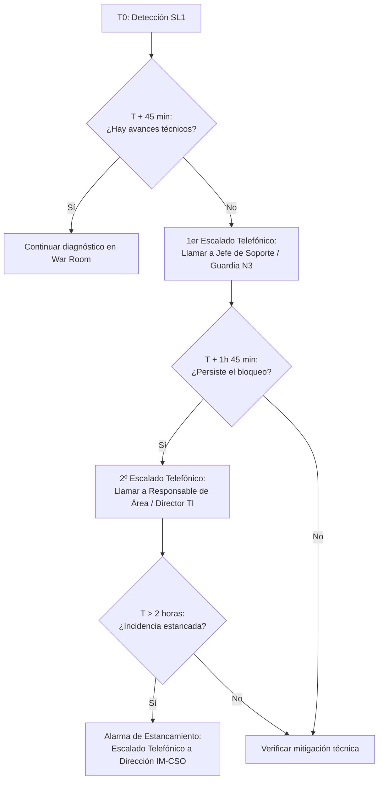

# Directorio de Escalados, Guardias y Matrices de Contacto (IT Emergency Management)

Este documento contiene el directorio operativo de contactos, colas de BMC Remedy ITSM y procedimientos de guardia para la gestión de crisis y emergencias SL1/SL2 en Orange Tech Operations.

> [!IMPORTANT]
> **Directriz de Carga Bajo Demanda (Context Optimization):** Este documento debe ser consultado por la IA mediante `read_file` únicamente cuando se requiera identificar al grupo resolutor específico, localizar el canal de guardia o activar un escalado telefónico programado (T+45 min, T+1h 45 min, Alarma >2h o Escalado en Paralelo).

---

## 1. Fuentes Oficiales de Información de Guardias

El mantenimiento de las personas de guardia, números telefónicos directos y calendarios de retén se gestiona de forma descentralizada en los portales corporativos de operaciones:

1. **Perímetro Orange / Jazztel:**
   - **Repositorio Oficial:** **GRIAL** (*Portal de Operación y Soporte de Sistemas Orange*).
   - **Ruta de Acceso:** `GRIAL > Soporte Operativo > Guardias y Turnos > Calendario Activo`.
   - **Cobertura:** Aplicativos BSS, Frontales ATC, Sistemas de Facturación, Middleware TIBCO/APIGEE, Infraestructura Core y Redes WAN.
2. **Perímetro MasMóvil / KRT / Xfera:**
   - **Repositorio Oficial:** **Confluence IT Operations**.
   - **Ruta de Acceso:** `Confluence > IT Operations > Guardias y Escalados MasMóvil`.
   - **Cobertura:** CRM MasMóvil, Pilas de Provisión KRT, BSS Xfera y entornos específicos de marca.

---

## 2. Directorio Operativo por Dominio Técnico y Colas Remedy

### 2.1 Atención al Cliente (ATC) y Canales Digitales
* **Aplicativos:** Ficha de Cliente Orange, CRM Jazztel, CRM4TELCO, Siebel 8, POLAR, LivePerson, Djingo, Onuris, Onconnect, Naboo, Boreal, App Mi Orange, MiJazztel.
* **Colas BMC Remedy Principales:**
  - `DES_SOE_FICHA` / `APL_MOV_SOE`: Frontales Ficha de Cliente y aplicaciones móviles de tienda/operador.
  - `SOP_BSS_JAZZTEL`: CRM Jazztel y soporte específico de atención.
  - `DES_CRM4T` / `SOP_CRM4TELCO`: Plataforma transversal CRM4TELCO.
  - `SOP_ASISTENTE`: Plataforma LivePerson y mensajería omnicanal.
  - `DES_DJINGO` / `SOP_ONURIS`: Asistentes virtuales y bots cognitivos.
  - `SOP_TECNICO_CALL_CENTER`: Infraestructura de CTI / IVR y enrutamiento de llamadas.
* **Procedimiento de Guardia:** Localización en GRIAL > Guardias Frontales & ATC. En caídas masivas de IVR/CTI (>20%), convocar conjuntamente a soporte CTI y soporte de redes de voz.

### 2.2 Ventas, Contratación y Portabilidad
* **Aplicativos:** CERES, Actos Comerciales, ECONTRATO, PANGEA (Ventas/Portas), Televenta, Teide.
* **Colas BMC Remedy Principales:**
  - `APL_MOV_CERES` / `NEG_CAMP_CERES`: Motor comercial de ventas, renoves y catálogo CERES.
  - `Econtrato_N2`: Plataforma de firma electrónica y contratación digital.
  - `SOP_SMC_TEIDE`: Nodos de portabilidad fija y móvil y transacciones con la entidad de referencia.
  - `PANGEA_SUPP`: Flujos integrados de altas, portabilidades y migraciones.
* **Procedimiento de Guardia:** Localización en GRIAL > Guardias Comercial & Portabilidad. Ante bloqueo de portabilidad a las 2:00 AM o demoras >2h con la Entidad de Referencia, alertar inmediatamente a la guardia de TEIDE y al Incident Manager de turno.

### 2.3 Provisión, Activaciones y Cobertura
* **Aplicativos:** POMV, SIGMA, TEIDE, LUNA, ALTAIR, BRÚJULA, MYADDRESS, GIS FIBRA, SGA.
* **Colas BMC Remedy Principales:**
  - `SOP_TEC_PROVISION` / `POMV`: Provisión de líneas móviles, cambios de SIM/eSIM y bonos.
  - `SOP_TMC_SIGMA`: Plataforma SIGMA de provisión masiva móvil.
  - `Fijo Activacion LUNA`: Activación de líneas fijas y servicios sobre red FTTH/Cobre.
  - `SOP_TMC_HPE` / `SGA`: Plataforma SGA de gestión de abonados y aprovisionamiento.
  - `GIS_FIBRA_N2` / `MYADDRESS`: Consultas de cobertura de fibra y asignación de red.
* **Procedimiento de Guardia:** Localización en GRIAL > Guardias Provisión & Red de Acceso.

### 2.4 Facturación, Mediación y Cobros
* **Aplicativos:** BSCS, HP-IUM, OCS, OPEN COBROS, EXCALIBUR, HPFMS.
* **Colas BMC Remedy Principales:**
  - `SOP_BSCS_BILLING`: Núcleo de facturación BSCS y tarificación batch.
  - `OCS_MEDIATION` / `HP-IUM`: Mediación y tarificación online de datos y voz.
  - `SOP_OPEN_COBROS`: Pasarelas de cobro bancario, pagos con tarjeta y remesas.
  - `EXCALIBUR_OPER` / `HPFMS_SUPP`: Prevención de fraude y control financiero.
* **Procedimiento de Guardia:** Localización en GRIAL > Guardias Billing & Mediación. En desvíos >1 día en la facturación batch o parálisis de tarificación online >3h, activar al responsable de sistemas de cobros de inmediato.

### 2.5 Middleware Transversal e Integraciones Core (Escalado en Paralelo)
* **Aplicativos:** APIGEE API Gateway, TIBCO ESB, GC Middleware, OCCI, Sincronización PeopleSoft ↔ Siebel 8.
* **Colas BMC Remedy Principales:**
  - `SOP_TMC_APIGEE`: Pasarela corporativa de APIs y microservicios expuestos.
  - `SOP_TIBCO_ESB`: Bus corporativo de integración empresarial.
  - `GC_MIDDLEWARE_OPS`: Componentes middleware Google Cloud / híbridos.
  - `SOP_PEOPLESOFT_INTEGRATION`: Conectores y sincronizaciones de backoffice con Siebel.
* **Protocolo de Escalado:** **Escalado en Paralelo Obligatorio**. Ante caídas de APIGEE o TIBCO, convocar simultáneamente a los grupos de middleware y a los grupos de las aplicaciones cliente afectadas.

### 2.6 Infraestructura Core, Hipervisores y Cloud (OCI / GCP)
* **Aplicativos:** Servidores IBM Power9 / PSeries, Hipervisores VMware ESX, Bases de Datos Oracle RAC / Exadata, Cabinas de Almacenamiento SAN, Interconexión Cloud ITX (OCI / GCP).
* **Colas BMC Remedy Principales:**
  - `SOP_SYS_POWER9` / `SOP_AIX`: Sistemas operativos AIX y servidores de misión crítica.
  - `SOP_VMWARE_ESX`: Clústeres de virtualización ESXi y gestión vCenter.
  - `SOP_DB_ORACLE_EXADATA`: Administración de BBDD Oracle de alta capacidad y rendimiento.
  - `SOP_CLOUD_OCI` / `SOP_CLOUD_GCP`: Infraestructura Cloud, VPCs, transit gateways y enlaces dedicados ITX.
  - `SOP_SAN_STORAGE`: Switches Brocade / Cisco MDS y cabinas de almacenamiento corporativo.
* **Procedimiento de Guardia:** Localización en GRIAL > Guardias Infraestructura Core & Cloud.

### 2.7 Identidad, Seguridad y Automatización
* **Aplicativos:** Directorio Activo / GDU, Evidian SSO, RobotFactory (RPA).
* **Colas BMC Remedy Principales:**
  - `SOP_GDU_IDENTITY`: Gestión de identidades y accesos corporativos.
  - `SOP_EVIDIAN_SSO`: Autenticación única para operadoras, tiendas y sedes.
  - `ROBOTFACTORY_AUTOMATION`: Plataformas de robots de procesamiento desatendido.
* **Procedimiento de Guardia:** Localización en GRIAL > Guardias Ciberseguridad & RPA.

---

## 3. Protocolo de Ejecución de Escalados Telefónicos

Durante una Emergencia SL1, el medio oficial e imperativo de escalado es **la llamada telefónica directa**:

### 3.1 Pautas para el Operador en la Llamada Telefónica
1. **Identificación Inmediata:** Identificarse como el Incident Manager / Operador de Emergencias de Orange Tech Operations.
2. **Contexto Estructurado:**
   - Indicar el ID del ticket Remedy (ej. `INC000004171670`).
   - Indicar el servicio impactado y la severidad confirmada (`Emergencia SL1 / P1`).
   - Indicar el tiempo transcurrido desde la apertura y el motivo del escalado (falta de diagnóstico / estancamiento).
3. **Convocatoria a War Room:** Proporcionar el enlace o canal de la sesión de Teams activa para su incorporación inmediata.
4. **Registro en Remedy:** Dejar constancia formal e inmediata en las *Notas de Trabajo* de Remedy con:
   - Fecha y hora exacta de la llamada.
   - Persona contactada (o indicación de *sin respuesta en primer intento* y llamada al sustituto de guardia).
   - Acuerdos alcanzados y tiempo estimado de conexión.
