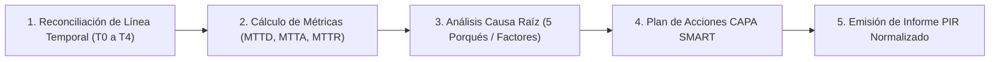
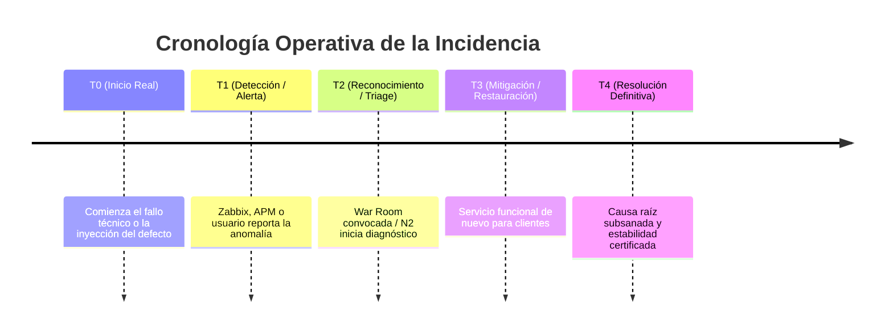

# Flujo de Trabajo para Post-Incident Review (PIR / Blameless Post-Mortem) — v2.0

Esta skill establece el estándar oficial y la metodología de ingeniería para transformar los datos de una incidencia crítica resuelta (SL1/P1 o SL2/P2) en un **informe de aprendizaje organizacional riguroso, sistemático y libre de culpas (*Blameless Post-Mortem*)**.

El objetivo de un PIR no es determinar responsabilidades individuales ni justificar errores, sino **descubrir las debilidades del sistema, fortalecer los controles automáticos y evitar la recurrencia de fallos**.



---

## 1. Principios de Cultura Blameless (Sin Culpa) y Seguridad

### 1.1 Prohibición Estricta de Señalar Individuos
- **Error humano como síntoma, no como causa:** En sistemas complejos, si un ser humano comete un error, el fallo de ingeniería radica en que el sistema carecía de salvaguardas que impidieran o mitigaran dicha acción.
- **Sustitución de nombres por roles funcionales:** Nunca escribas *"Juan ejecutó un script sin permisos"* o *"Fallo del operador X"*. Emplea siempre formulaciones sistémicas: *"El ingeniero de soporte de guardia ejecutó la tarea de mantenimiento..."*, identificando la brecha de control (*"La herramienta de despliegue carecía de validación sintáctica de entorno antes de la ejecución"*).

### 1.2 Privacidad de Datos y Sanitización Operativa (PII & Security)
- En el informe PIR queda prohibido incluir:
  - Teléfonos de clientes (MSISDN), DNI/CIF o datos bancarios.
  - Credenciales maestras, contraseñas, tokens JWT o claves de API.
  - Información contractual confidencial de terceros proveedores.
- Las referencias a bases de datos o servidores se citarán por su nombre lógico o clúster corporativo (ej. `Exadata Yécora`, `BSS Jazztel DB`), omitiendo claves de acceso o contraseñas en scripts adjuntos.

---

## 2. Reconciliación de Marcas Temporales y Cálculo de Métricas

Toda incidencia mayor debe reconstruir su cronología verificada sobre los siguientes 5 hitos fundamentales:



### 2.1 Hitos Clave de Tiempo
1. **$T_0$ — Inicio Real del Fallo:** Momento exacto en que comenzó la degradación funcional o se ejecutó el cambio anómalo.
2. **$T_1$ — Detección y Alerta:** Momento en que saltó la primera alarma sintética (Zabbix, APM, Dynatrace) o entró el primer reporte en N1.
3. **$T_2$ — Reconocimiento e Intervención:** Momento en que el Incident Manager o el equipo de guardia abrió la War Room e inició el triaje activo.
4. **$T_3$ — Mitigación y Restauración:** Momento en que el servicio volvió a estar operativo para los usuarios finales (mediante workaround validado, rollback o bypass).
5. **$T_4$ — Resolución Definitiva:** Momento en que se aplicó el parche final y se dio por cerrado el ticket Remedy.

### 2.2 Fórmulas Operativas de Desempeño
- **MTTD (Mean Time To Detect):**  
  $$\text{MTTD} = T_1 - T_0$$  
  *Mide la efectividad de la monitorización sintética y la observabilidad preventiva.*
- **MTTA (Mean Time To Acknowledge):**  
  $$\text{MTTA} = T_2 - T_1$$  
  *Mide la agilidad del triaje N1 y la velocidad de convocatoria de la mesa de crisis.*
- **MTTR (Mean Time To Restore / Duración del Impacto):**  
  $$\text{MTTR} = T_3 - T_0$$  
  *Mide el tiempo total en que el negocio y los clientes sufrieron la afectación.*
- **TTR (Total Time to Resolve):**  
  $$\text{TTR} = T_4 - T_0$$  
  *Mide el ciclo completo hasta la remediación estructural definitiva.*

*(Si alguna hora exacta no está disponible en la telemetría, debe consignarse como `[PENDIENTE RECONCILIACIÓN LOGS]` sin inventar valores ficticios).*

---

## 3. Metodología de Análisis Causa Raíz (5 Porqués y Factores)

Para evitar quedarse en la causa inmediata (ej. *"El disco se llenó"* o *"El microservicio cayó"*), aplica la técnica de los **5 Porqués** para profundizar hasta la raíz arquitectónica:

1. **¿Por qué falló el servicio?** $\rightarrow$ *El microservicio de provisión no respondía peticiones.*
2. **¿Por qué no respondía?** $\rightarrow$ *Se agotó el pool de conexiones a la base de datos.*
3. **¿Por qué se agotó el pool?** $\rightarrow$ *Una consulta no indexada lanzada por el nuevo batch retuvo los locks durante más de 10 minutos.*
4. **¿Por qué se lanzó esa consulta sin índice?** $\rightarrow$ *El cambio en el modelo de datos de la release no incluyó el script de creación de índices.*
5. **¿Por qué el pipeline de CI/CD permitió el paso a producción sin índice?** $\rightarrow$ *La validación automática de schemas en staging solo comprobaba sintaxis y no planes de ejecución.*

### Dimensiones de Factores Contribuyentes
- **Técnico / Código:** Bugs, fugas de memoria, falta de índices, timeouts incorrectos.
- **Observabilidad / Monitorización:** Alarma inexistente, umbral de saturación mal configurado o ruido excesivo que enmascaró la alerta.
- **Proceso / Despliegue:** Falta de pruebas de carga, rollback tardío o ventanas de cambio no coordinadas.
- **Resiliencia / Arquitectura:** Ausencia de circuit breakers, falta de failover automático o dependencias cruzadas acopladas.

---

## 4. Marco SMART de Acciones CAPA (Correctivas y Preventivas)

Cada acción correctiva debe ser concreta, verificable y contar con un propietario claro. Se dividen en tres horizontes técnicos:

1. **Mitigación Inmediata (Short-Term):** Acciones aplicadas durante la crisis para estabilizar el entorno (ej. rollback, ampliación de CPU, purga de colas).
2. **Detección y Observabilidad (Medium-Term):** Qué alerta, métrica o probe sintética debe implementarse para detectar este patrón antes de que impacte a clientes.
3. **Prevención Estructural (Long-Term):** Qué refactorización, test automatizado o cambio de arquitectura garantizará que esta clase de fallo no vuelva a repetirse.

### Matriz de Prioridad y SLAs de Implementación CAPA

| Prioridad | Tipo de Acción | SLA Compromiso | Criterio de Asignación |
| :---: | :--- | :---: | :--- |
| **P1** | **Prevención Crítica / Hard Blocker** | **$\le 7$ días naturales** | Elimina el riesgo directo de recurrencia en procesos críticos de negocio. |
| **P2** | **Observabilidad / Test Automatizado** | **$\le 30$ días naturales** | Añade probes sintéticas, alertas de saturación o pruebas de integración en CI/CD. |
| **P3** | **Optimización / Documentación** | **$\le 60$ días naturales** | Mejoras de rendimiento secundarias, actualización de runbooks o refactor de deuda técnica. |

### Tabla Estándar de Acciones CAPA:
| ID Acción | Tipo | Descripción de la Acción Técnica | Propietario / Rol | Prioridad | Fecha Límite (SLA) |
| :--- | :--- | :--- | :--- | :---: | :---: |
| `CAPA-01` | Detección | Crear alarma en Zabbix para alertar cuando las conexiones superen el 75%. | Equipo Monitorización | P2 | 2026-11-20 |
| `CAPA-02` | Prevención | Incorporar paso obligatorio de `EXPLAIN PLAN` en pipeline de CI/CD para migraciones SQL. | DevOps / DBA | P1 | 2026-11-11 |
| `CAPA-03` | Mitigación | Documentar procedimiento de escalado de réplicas en Runbook de GRIAL. | Soporte N2 BSS | P3 | 2026-12-15 |

---

## 5. Plantilla Oficial de Informe PIR (Markdown Estándar)

Utiliza la siguiente plantilla para generar o validar el informe final:

```markdown
# Informe Post-Incident Review (PIR) — [CÓDIGO_INCIDENCIA]

## 1. Resumen Ejecutivo
- **Incidencia Remedy:** [INC00000XXXXXXX]
- **Severidad / Prioridad:** [SL1/P1 | SL2/P2]
- **Servicio / Aplicativo Afectado:** [Nombre del aplicativo / proceso crítico]
- **Fecha y Hora del Incidente:** [AAAA-MM-DD HH:MM a HH:MM]
- **Duración Total del Impacto (MTTR):** [X horas Y minutos]
- **Resumen para Dirección:** [1 párrafo que explica sin tecnicismos qué falló, cuál fue el impacto en clientes o negocio, cómo se restauró el servicio y la principal lección aprendida.]

## 2. Impacto en Negocio y Operaciones
- **Clientes / Usuarios Afectados:** [Cifra de clientes, transacciones fallidas o porcentaje de desviación]
- **Canales Afectados:** [ATC / Tiendas / Canales Digitales / Portabilidad / Facturación]
- **Sistemas Involucrados:** [Listado de sistemas: ej. APIGEE, BSCS, Siebel 8]
- **Impacto Financiero / Facturación:** [Nulo / Retraso en tarificación / Pérdida estimada si aplica]

## 3. Métricas de Rendimiento Operativo
- **$T_0$ (Inicio Real del Fallo):** AAAA-MM-DD HH:MM
- **$T_1$ (Detección / Alerta):** AAAA-MM-DD HH:MM
- **$T_2$ (Intervención / War Room):** AAAA-MM-DD HH:MM
- **$T_3$ (Restauración del Servicio):** AAAA-MM-DD HH:MM
- **$T_4$ (Resolución Definitiva):** AAAA-MM-DD HH:MM
- **MTTD ($T_1 - T_0$):** [X min]
- **MTTA ($T_2 - T_1$):** [Y min]
- **MTTR ($T_3 - T_0$):** [Z horas W min]

## 4. Cronología Detallada de Eventos
| Marca de Tiempo | Evento / Acción | Tipo (Alerta / Humano / Sistema) | Fuente de Evidencia |
| :--- | :--- | :---: | :--- |
| HH:MM | Se inicia el despliegue de la release en el entorno productivo. | Humano | PaP / Bitácora |
| HH:MM | Incremento de timeouts HTTP 504 en pasarela APIGEE. | Sistema | Logs APIGEE |
| HH:MM | Alerta automática en monitorización y apertura de ticket N1. | Alerta | Zabbix |
| HH:MM | IM convoca War Room ejecutiva con equipos N2 y N3. | Humano | Teams IM |
| HH:MM | Se ejecuta Rollback del PaP autorizado por IM-CSO. | Humano | IM-CSO |
| HH:MM | Normalización de tráfico y tiempos de respuesta. Fin de impacto. | Sistema | Telemetría APM |

## 5. Análisis Causa Raíz (5 Porqués)
1. *¿Por qué ocurrió el fallo?* ...
2. *¿Por qué?* ...
3. *¿Por qué?* ...
4. *¿Por qué?* ...
5. *¿Por qué?* ...
- **Causa Raíz Determinante:** [Síntesis precisa del fallo estructural subyacente]

## 6. ¿Qué funcionó bien y qué falló?
- **Aspectos Positivos:** [Respuesta rápida en War Room, detección temprana, rollback sin incidencias]
- **Oportunidades de Mejora:** [Falta de pruebas de estrés previas, retraso en primer escalado telefónico]

## 7. Plan de Acciones CAPA (Correctivas y Preventivas)
| ID | Categoría | Acción Técnica Concreta | Responsable | Prioridad | Fecha Límite |
| :--- | :--- | :--- | :--- | :---: | :---: |
| CAPA-01 | Mitigación | ... | ... | P1 | AAAA-MM-DD |
| CAPA-02 | Detección | ... | ... | P2 | AAAA-MM-DD |
| CAPA-03 | Prevención | ... | ... | P1 | AAAA-MM-DD |
```

---

## 6. Checklist de Control de Calidad del PIR

Antes de archivar o presentar el informe PIR al comité de dirección, comprueba:
- [ ] ¿El informe es estrictamente **blameless** (sin nombres personales de ingenieros ni juicios de culpabilidad)?
- [ ] ¿Se han expurgado todos los datos personales de clientes (MSISDN, DNI, datos de pago)?
- [ ] ¿Los hitos temporales ($T_0$ a $T_4$) y las métricas (MTTD, MTTA, MTTR) están justificados con telemetría?
- [ ] ¿El resumen ejecutivo puede ser entendido íntegramente por Dirección en menos de 1 minuto?
- [ ] ¿El análisis de 5 Porqués alcanza la causa raíz sistémica y no se detiene en la causa aparente?
- [ ] ¿Todas las acciones CAPA tienen asignado un rol responsable, una prioridad (P1/P2/P3) y una fecha límite comprometida?
