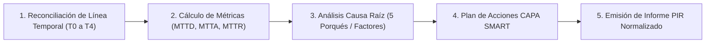
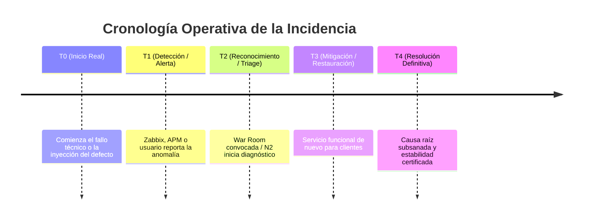

# Flujo de Trabajo para Post-Incident Review (PIR / Blameless Post-Mortem) — v2.1

Esta skill establece el estándar oficial y la metodología de ingeniería para transformar los datos de una incidencia crítica resuelta (SL1/P1 o SL2/P2) en un **informe de aprendizaje organizacional riguroso, sistemático y libre de culpas (*Blameless Post-Mortem*)**.

El objetivo de un PIR no es determinar responsabilidades individuales ni justificar errores, sino **descubrir las debilidades del sistema, fortalecer los controles automáticos y evitar la recurrencia de fallos**.



---

## 0. Terminología y Alcance

| Término | Definición |
| :--- | :--- |
| **PIR (Post-Incident Review)** | Informe retrospectivo y proceso de aprendizaje organizacional que se elabora tras el cierre de una incidencia mayor; sinónimo operativo de *Blameless Post-Mortem* en este documento. |
| **Blameless (Sin Culpa)** | Cultura de análisis que trata el error humano como síntoma de un fallo sistémico, nunca como causa final; prohíbe sanciones o señalamientos individuales. |
| **SL1/P1, SL2/P2** | Niveles de severidad/prioridad Remedy: SL1/P1 = incidencia crítica con impacto masivo o de negocio; SL2/P2 = incidencia mayor con impacto significativo pero acotado. |
| **War Room** | Sala (física o virtual, p. ej. Teams) donde se reúnen los equipos N2/N3 y el Incident Manager (IM) para coordinar el diagnóstico y la resolución en tiempo real. |
| **IM (Incident Manager) / IM-CSO** | Responsable de coordinar la respuesta a la incidencia y autorizar decisiones críticas (rollback, escalados); IM-CSO es el IM del Centro de Soporte y Operaciones. |
| **N1 / N2 / N3** | Niveles de soporte: N1 = monitorización y primer triaje; N2 = soporte técnico especializado; N3 = desarrollo/arquitectura o proveedor. |
| **PaP (Puesta a Producción)** | Despliegue de un cambio o release en el entorno productivo. |
| **Workaround** | Solución temporal que restaura el servicio sin corregir la causa raíz; debe quedar marcada como pendiente de erradicación en el PIR. |
| **CAPA (Corrective and Preventive Actions)** | Conjunto de acciones correctivas (corrigen el fallo ya ocurrido) y preventivas (evitan su recurrencia) derivadas del PIR. |
| **SMART** | Criterio de calidad de una acción CAPA: Específica, Medible, Alcanzable, Relevante y con plazo Temporal definido. |
| **Triaje** | Proceso de clasificación y diagnóstico inicial de una incidencia para determinar severidad, sistemas afectados y siguiente responsable. |
| **MTTD / MTTA / MTTR / TTR** | Ver fórmulas exactas en la §2.2. No son sinónimos intercambiables: cada uno mide un tramo distinto de la cronología. |
| **Causa Raíz** | Condición estructural (técnica, de proceso o de arquitectura) cuya corrección habría evitado el incidente; nunca es "un empleado cometió un error". |

---

## 1. Principios de Cultura Blameless (Sin Culpa) y Seguridad

### 1.1 Prohibición Estricta de Señalar Individuos

- **Error humano como síntoma, no como causa:** En sistemas complejos, si un ser humano comete un error, el fallo de ingeniería radica en que el sistema carecía de salvaguardas que impidieran o mitigaran dicha acción.
- **Sustitución de nombres por roles funcionales:** Nunca escribas *"Juan ejecutó un script sin permisos"* o *"Fallo del operador X"*. Emplea siempre formulaciones sistémicas: *"El ingeniero de soporte de guardia ejecutó la tarea de mantenimiento..."*, identificando la brecha de control (*"La herramienta de despliegue carecía de validación sintáctica de entorno antes de la ejecución"*).

### 1.2 Privacidad de Datos y Sanitización Operativa (PII & Security)

- En el informe PIR queda prohibido incluir:
  - Teléfonos de clientes (MSISDN), DNI/CIF o datos bancarios.
  - Credenciales maestras, contraseñas, tokens JWT o claves de API.
  - Información contractual confidencial de terceros proveedores.
- Las referencias a bases de datos o servidores se citarán por su nombre lógico o clúster corporativo (ej. `Exadata Yécora`, `BSS Jazztel DB`), omitiendo claves de acceso o contraseñas en scripts adjuntos.

### 1.3 Prohibiciones Explícitas (Nunca Hagas Esto)

- **Nunca** nombres, identifiques o hagas identificable a una persona física en el cuerpo del informe (nombre propio, usuario corporativo, extensión telefónica personal, correo nominal). Usa siempre rol funcional (ej. "el ingeniero de guardia N2", "el DBA de turno").
- **Nunca** publiques o dejes sin expurgar PII de clientes (MSISDN, DNI/CIF, IBAN, tarjetas) ni credenciales (contraseñas, tokens, claves API, certificados) en ningún bloque del PIR, incluidos logs o capturas adjuntas.
- **Nunca** inventes, estimes a ojo o redondees una marca temporal ($T_0$–$T_4$) sin respaldo de telemetría o bitácora. Si no hay evidencia, consigna literalmente `[PENDIENTE RECONCILIACIÓN LOGS]`; no dejes el campo en blanco ni pongas una hora aproximada sin marcarla como estimada.
- **Nunca** cierres el análisis de causa raíz en el primer o segundo "porqué" (causa aparente). El 5 Porqués debe llegar a una condición estructural (proceso, arquitectura o control ausente), no a "el sistema falló".
- **Nunca** registres una acción CAPA sin propietario (rol), prioridad (P1/P2/P3) y fecha límite explícita; una acción sin estos tres campos no es una acción CAPA válida.
- **Nunca** des por cerrado un PIR mientras exista un workaround activo sin plan de erradicación explícito o sin autorización formal de IM-CSO para mantenerlo temporalmente.
- **Nunca** uses un tono de juicio, sanción o reproche (ej. "el equipo no revisó bien", "fallo por negligencia"); reformula siempre en términos de brecha de control o salvaguarda ausente.
- **Nunca** mezcles MTTD, MTTA, MTTR y TTR como si fueran el mismo número: cada uno tiene un punto de inicio y fin distinto (ver §2.2) y deben reportarse todos por separado.

---

## 2. Reconciliación de Marcas Temporales y Cálculo de Métricas

Toda incidencia mayor debe reconstruir su cronología verificada sobre los siguientes 5 hitos fundamentales:



### 2.1 Hitos Clave de Tiempo

1. **$T_0$ — Inicio Real del Fallo:** Momento exacto en que comenzó la degradación funcional o se ejecutó el cambio anómalo.
2. **$T_1$ — Detección y Alerta:** Momento en que saltó la primera alarma sintética (Zabbix, APM, Dynatrace) o entró el primer reporte en N1.
3. **$T_2$ — Reconocimiento e Intervención:** Momento en que el Incident Manager o el equipo de guardia abrió la War Room e inició el triaje activo.
4. **$T_3$ — Mitigación y Restauración:** Momento en que el servicio volvió a estar operativo para los usuarios finales (mediante workaround validado, rollback o bypass).
5. **$T_4$ — Resolución Definitiva:** Momento en que se aplicó el parche final y se dio por cerrado el ticket Remedy.

### 2.2 Fórmulas Operativas de Desempeño

- **MTTD (Mean Time To Detect):**  
  $$\text{MTTD} = T_1 - T_0$$  
  *Mide la efectividad de la monitorización sintética y la observabilidad preventiva.*
- **MTTA (Mean Time To Acknowledge):**  
  $$\text{MTTA} = T_2 - T_1$$  
  *Mide la agilidad del triaje N1 y la velocidad de convocatoria de la mesa de crisis.*
- **MTTR (Mean Time To Restore / Duración del Impacto):**  
  $$\text{MTTR} = T_3 - T_0$$  
  *Mide el tiempo total en que el negocio y los clientes sufrieron la afectación.*
- **TTR (Total Time to Resolve):**  
  $$\text{TTR} = T_4 - T_0$$  
  *Mide el ciclo completo hasta la remediación estructural definitiva.*

*(Si alguna hora exacta no está disponible en la telemetría, debe consignarse como `[PENDIENTE RECONCILIACIÓN LOGS]` sin inventar valores ficticios).*

### 2.3 Ejemplo End-to-End Resuelto (Incidente Ficticio `INC000009999001`)

El siguiente caso ilustra el flujo completo, desde la cronología cruda hasta el cálculo de métricas, usando datos y horas **ficticios** con fines exclusivamente didácticos.

**Contexto simulado:** una release introduce un cambio de esquema en `BSS Jazztel DB` sin el índice correspondiente; a las 09:58 un batch nocturno lanza una consulta sin índice que retiene locks y agota el pool de conexiones del microservicio de provisión.

**Cronología cruda capturada (evidencias ficticias):**

| Hora | Evento | Fuente |
| :---: | :--- | :--- |
| 09:58 | Inicio real del fallo: el batch ejecuta la consulta sin índice y empieza a agotar el pool de conexiones. | Logs de base de datos |
| 10:03 | Zabbix dispara alerta de saturación del pool de conexiones (>95%). | Zabbix |
| 10:07 | N1 escala la alerta y el IM-CSO convoca War Room con N2/N3. | Teams IM |
| 10:41 | Se autoriza y ejecuta rollback del cambio de esquema; el servicio vuelve a responder a clientes. | IM-CSO / Bitácora |
| 11:15 | Se aplica el índice correctivo definitivo en producción y se certifica estabilidad; se cierra el ticket Remedy. | Logs APIGEE / Remedy |

**Hitos T0–T4 resultantes:**

- $T_0$ = 09:58 (inicio real del fallo)
- $T_1$ = 10:03 (detección/alerta Zabbix)
- $T_2$ = 10:07 (reconocimiento / War Room)
- $T_3$ = 10:41 (mitigación / restauración vía rollback)
- $T_4$ = 11:15 (resolución definitiva)

**Cálculo de métricas aplicando las fórmulas de §2.2:**

- **MTTD** $= T_1 - T_0$ = 10:03 − 09:58 = **5 minutos**
- **MTTA** $= T_2 - T_1$ = 10:07 − 10:03 = **4 minutos**
- **MTTR** $= T_3 - T_0$ = 10:41 − 09:58 = **43 minutos**
- **TTR** $= T_4 - T_0$ = 11:15 − 09:58 = **1 hora 17 minutos**

**Lectura del resultado:** la detección (MTTD = 5 min) y el reconocimiento (MTTA = 4 min) fueron rápidos gracias a la alarma sintética de saturación de pool; el grueso del impacto a cliente (MTTR = 43 min) corresponde al tiempo de diagnóstico y ejecución del rollback, y el cierre estructural completo (TTR = 1 h 17 min) incluye además el tiempo para aplicar el índice correctivo definitivo. Este patrón alimentaría directamente las acciones CAPA-01/CAPA-02 de la tabla de la §4 (alarma de pool ya existente a reforzar, y validación de `EXPLAIN PLAN` en CI/CD como prevención estructural).

---

## 3. Metodología de Análisis Causa Raíz (5 Porqués y Factores)

Para evitar quedarse en la causa inmediata (ej. *"El disco se llenó"* o *"El microservicio cayó"*), aplica la técnica de los **5 Porqués** para profundizar hasta la raíz arquitectónica:

1. **¿Por qué falló el servicio?** $\rightarrow$ *El microservicio de provisión no respondía peticiones.*
2. **¿Por qué no respondía?** $\rightarrow$ *Se agotó el pool de conexiones a la base de datos.*
3. **¿Por qué se agotó el pool?** $\rightarrow$ *Una consulta no indexada lanzada por el nuevo batch retuvo los locks durante más de 10 minutos.*
4. **¿Por qué se lanzó esa consulta sin índice?** $\rightarrow$ *El cambio en el modelo de datos de la release no incluyó el script de creación de índices.*
5. **¿Por qué el pipeline de CI/CD permitió el paso a producción sin índice?** $\rightarrow$ *La validación automática de schemas en staging solo comprobaba sintaxis y no planes de ejecución.*

### Dimensiones de Factores Contribuyentes

- **Técnico / Código:** Bugs, fugas de memoria, falta de índices, timeouts incorrectos.
- **Observabilidad / Monitorización:** Alarma inexistente, umbral de saturación mal configurado o ruido excesivo que enmascaró la alerta.
- **Proceso / Despliegue:** Falta de pruebas de carga, rollback tardío o ventanas de cambio no coordinadas.
- **Resiliencia / Arquitectura:** Ausencia de circuit breakers, falta de failover automático o dependencias cruzadas acopladas.

---

## 4. Marco SMART de Acciones CAPA (Correctivas y Preventivas)

Cada acción correctiva debe ser concreta, verificable y contar con un propietario claro. Se dividen en tres horizontes técnicos:

1. **Mitigación Inmediata (Short-Term):** Acciones aplicadas durante la crisis para estabilizar el entorno (ej. rollback, ampliación de CPU, purga de colas).
2. **Detección y Observabilidad (Medium-Term):** Qué alerta, métrica o probe sintética debe implementarse para detectar este patrón antes de que impacte a clientes.
3. **Prevención Estructural (Long-Term):** Qué refactorización, test automatizado o cambio de arquitectura garantizará que esta clase de fallo no vuelva a repetirse.

### Matriz de Prioridad y SLAs de Implementación CAPA

| Prioridad | Tipo de Acción | SLA Compromiso | Criterio de Asignación |
| :---: | :--- | :---: | :--- |
| **P1** | **Prevención Crítica / Hard Blocker** | **$\le 7$ días naturales** | Elimina el riesgo directo de recurrencia en procesos críticos de negocio. |
| **P2** | **Observabilidad / Test Automatizado** | **$\le 30$ días naturales** | Añade probes sintéticas, alertas de saturación o pruebas de integración en CI/CD. |
| **P3** | **Optimización / Documentación** | **$\le 60$ días naturales** | Mejoras de rendimiento secundarias, actualización de runbooks o refactor de deuda técnica. |

### Tabla Estándar de Acciones CAPA

| ID Acción | Tipo | Descripción de la Acción Técnica | Propietario / Rol | Prioridad | Fecha Límite (SLA) |
| :--- | :--- | :--- | :--- | :---: | :---: |
| `CAPA-01` | Detección | Crear alarma en Zabbix para alertar cuando las conexiones superen el 75%. | Equipo Monitorización | P2 | 2026-11-20 |
| `CAPA-02` | Prevención | Incorporar paso obligatorio de `EXPLAIN PLAN` en pipeline de CI/CD para migraciones SQL. | DevOps / DBA | P1 | 2026-11-11 |
| `CAPA-03` | Mitigación | Documentar procedimiento de escalado de réplicas en Runbook de GRIAL. | Soporte N2 BSS | P3 | 2026-12-15 |

---

## 5. Plantilla Oficial de Informe PIR (Markdown Estándar)

Utiliza la siguiente plantilla para generar o validar el informe final:

```markdown
# Informe Post-Incident Review (PIR) — [CÓDIGO_INCIDENCIA]

## 1. Resumen Ejecutivo
- **Incidencia Remedy:** [INC00000XXXXXXX]
- **Severidad / Prioridad:** [SL1/P1 | SL2/P2]
- **Servicio / Aplicativo Afectado:** [Nombre del aplicativo / proceso crítico]
- **Fecha y Hora del Incidente:** [AAAA-MM-DD HH:MM a HH:MM]
- **Duración Total del Impacto (MTTR):** [X horas Y minutos]
- **Resumen para Dirección:** [1 párrafo que explica sin tecnicismos qué falló, cuál fue el impacto en clientes o negocio, cómo se restauró el servicio y la principal lección aprendida.]

## 2. Impacto en Negocio y Operaciones
- **Clientes / Usuarios Afectados:** [Cifra de clientes, transacciones fallidas o porcentaje de desviación]
- **Canales Afectados:** [ATC / Tiendas / Canales Digitales / Portabilidad / Facturación]
- **Sistemas Involucrados:** [Listado de sistemas: ej. APIGEE, BSCS, Siebel 8]
- **Impacto Financiero / Facturación:** [Nulo / Retraso en tarificación / Pérdida estimada si aplica]

## 3. Métricas de Rendimiento Operativo
- **$T_0$ (Inicio Real del Fallo):** AAAA-MM-DD HH:MM
- **$T_1$ (Detección / Alerta):** AAAA-MM-DD HH:MM
- **$T_2$ (Intervención / War Room):** AAAA-MM-DD HH:MM
- **$T_3$ (Restauración del Servicio):** AAAA-MM-DD HH:MM
- **$T_4$ (Resolución Definitiva):** AAAA-MM-DD HH:MM
- **MTTD ($T_1 - T_0$):** [X min]
- **MTTA ($T_2 - T_1$):** [Y min]
- **MTTR ($T_3 - T_0$):** [Z horas W min]

## 4. Cronología Detallada de Eventos
| Marca de Tiempo | Evento / Acción | Tipo (Alerta / Humano / Sistema) | Fuente de Evidencia |
| :--- | :--- | :---: | :--- |
| HH:MM | Se inicia el despliegue de la release en el entorno productivo. | Humano | PaP / Bitácora |
| HH:MM | Incremento de timeouts HTTP 504 en pasarela APIGEE. | Sistema | Logs APIGEE |
| HH:MM | Alerta automática en monitorización y apertura de ticket N1. | Alerta | Zabbix |
| HH:MM | IM convoca War Room ejecutiva con equipos N2 y N3. | Humano | Teams IM |
| HH:MM | Se ejecuta Rollback del PaP autorizado por IM-CSO. | Humano | IM-CSO |
| HH:MM | Normalización de tráfico y tiempos de respuesta. Fin de impacto. | Sistema | Telemetría APM |

## 5. Análisis Causa Raíz (5 Porqués)
1. *¿Por qué ocurrió el fallo?* ...
2. *¿Por qué?* ...
3. *¿Por qué?* ...
4. *¿Por qué?* ...
5. *¿Por qué?* ...
- **Causa Raíz Determinante:** [Síntesis precisa del fallo estructural subyacente]

## 6. ¿Qué funcionó bien y qué falló?
- **Aspectos Positivos:** [Respuesta rápida en War Room, detección temprana, rollback sin incidencias]
- **Oportunidades de Mejora:** [Falta de pruebas de estrés previas, retraso en primer escalado telefónico]

## 7. Plan de Acciones CAPA (Correctivas y Preventivas)
| ID | Categoría | Acción Técnica Concreta | Responsable | Prioridad | Fecha Límite |
| :--- | :--- | :--- | :--- | :---: | :---: |
| CAPA-01 | Mitigación | ... | ... | P1 | AAAA-MM-DD |
| CAPA-02 | Detección | ... | ... | P2 | AAAA-MM-DD |
| CAPA-03 | Prevención | ... | ... | P1 | AAAA-MM-DD |
```

---

## 6. Checklist de Control de Calidad del PIR

Antes de archivar o presentar el informe PIR al comité de dirección, comprueba:

- [ ] ¿El informe es estrictamente **blameless** (sin nombres personales de ingenieros ni juicios de culpabilidad)?
- [ ] ¿Se han expurgado todos los datos personales de clientes (MSISDN, DNI, datos de pago)?
- [ ] ¿Los hitos temporales ($T_0$ a $T_4$) y las métricas (MTTD, MTTA, MTTR) están justificados con telemetría?
- [ ] ¿El resumen ejecutivo puede ser entendido íntegramente por Dirección en menos de 1 minuto?
- [ ] ¿El análisis de 5 Porqués alcanza la causa raíz sistémica y no se detiene en la causa aparente?
- [ ] ¿Todas las acciones CAPA tienen asignado un rol responsable, una prioridad (P1/P2/P3) y una fecha límite comprometida?
