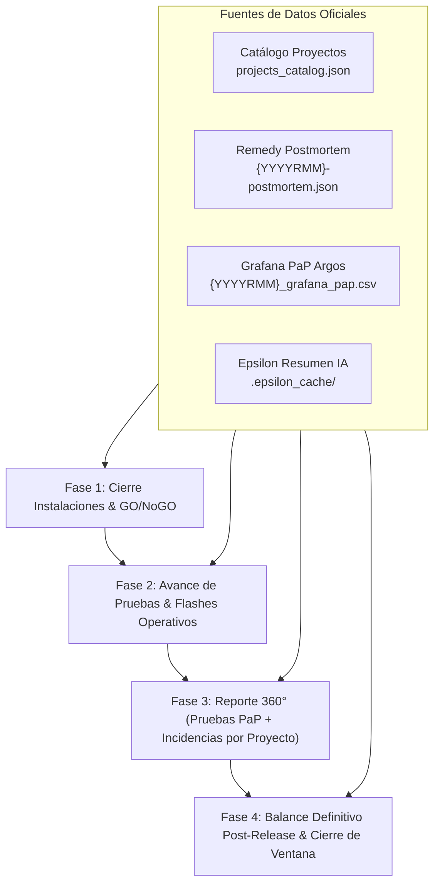

# Comunicación Global de Releases e Incidencias por Proyecto (`release-project-communication`) — v2.7.0

Esta skill define las directrices maestras, fuentes de datos requeridas, formatos corporativos, modelos de datos y heurísticas de redacción para elaborar **comunicaciones ejecutivas y operativas sobre las Releases Mensuales IT** de MasOrange / Orange Tech Operations.

Cubre todo el ciclo de vida de la Release: desde el **cierre de instalaciones y balance GO/NoGO**, pasando por los **flashes operativos en caliente**, el **seguimiento de ejecución de pruebas PaP en Producción (Grafana Argos)**, hasta el **Reporte Ejecutivo Global 360° de Incidencias agrupadas por Proyecto** respaldado por la telemetría de Remedy y el análisis de **Epsilon Resumen IA**, garantizando trazabilidad y visibilidad en **Microsoft Teams** y comités de Dirección.

---

## 1. Principios y Reglas de Oro Inquebrantables

1. **Destino Oficial de Seguimiento — Mesa de Release**:
   - Todo comunicado oficial **debe enrutar obligatoriamente a la consola de Mesa de Release** (`/dashboards/release-desk/`, URL corporativa: `http://10.132.26.96:8081/dashboards/release-desk/?release={YYYYRMM}`).
   - **Regla Estricta**: Queda prohibido referenciar genéricamente "el dashboard" o enlazar a consolas descontextualizadas (como `release-kpis`). El centro de mando operativo del seguimiento de la ventana y post-release es exclusivamente **Mesa de Release**.

2. **Regla Anti-Alucinación (Cero Tolerancia)**:
   - Prohibido conjeturar o inventar fechas de resolución, causas técnicas, grupos asignados, proyectos o afectaciones no respaldadas expresamente por la evidencia de los ficheros de datos (`projects_catalog.json`, `*-postmortem.json`, `*_grafana_pap.csv`, `*-massive.json` o Epsilon IA).
   - Todo dato ausente o pendiente de acuerdo debe marcarse explícitamente como `Pendiente de acordar` o `En análisis`.

3. **Cuadre Numérico y Estadístico Estricto (100%)**:
   - Las cifras del balance de proyectos deben cuadrar matemáticamente sin discrepancias:
     $$\text{Total Proyectos} = \text{GO} (\text{Completo} + \text{Piloto} + \text{Modo Oculto}) + \text{PAP Técnico} + \text{Replanificados/NoGO}$$
   - Las métricas de incidencias deben totalizar con precisión:
     $$\text{Total Incidencias} = \text{Activas} (\text{P1} + \text{P2} + \text{P3 Masivas} + \text{P3} + \text{P4}) + \text{Resueltas/Cerradas}$$
   - Las métricas de pruebas en Grafana deben cuadrar:
     $$\text{Total Pruebas} = \text{Pass} + \text{Pending} + \text{Block} + \text{Executing} + \text{Verify}$$

4. **Aislamiento de Avisos Operativos (Blindaje de Confianza)**:
   - Cuando se reporte un retraso o anomalía que impacte a un subsistema (ej. refresco de KRATOS, incidencia en Ficha Cliente, pruebas bloqueadas en un proyecto):
     - Destacarlo claramente en un bloque de advertencia (`> ⚠️`).
     - Indicar de inmediato que **el resto de sistemas, proyectos y servicios continúan operando con normalidad** (🟢 *"El resto de aplicaciones y sistemas están OK e inician pruebas con normalidad"*).

5. **Doble Nivel de Comunicación (Ejecutivo vs Operativo)**:
   - **Nivel Ejecutivo (Dirección / Canales Generales)**: Síntesis de alto nivel, visión global del negocio, salud de proyectos, impacto en clientes y próximos hitos (conciso, sin tecnicismos innecesarios).
   - **Nivel Operativo (Mesa de Release / Resolutores)**: Códigos unívocos de proyecto (`PRJ-*`, `AB2CJ-*`, `OCA-*`), números de incidencia Remedy (`INC*`), criticidad nominal y real, componentes técnicos, grupos asignados y fecha acordada.

---

## 2. Requisitos y Fuentes de Datos para Generar el Informe

Para elaborar el **Informe Global 360°**, el sistema cruza datos preexistentes en el repositorio con datos de ejecución aportados por el usuario:

```
  ┌────────────────────────────────────────────────────────┐
  │     FUENTES PREEXISTENTES (AUTÓNOMAS EN REPOSITORIO)   │
  │  • Catálogo de Proyectos: data/config/projects_catalog.json │
  │  • Histórico CSV: data/storage/projects/{YYYYRMM}.csv  │
  │  • Incidencias Remedy: data/output/{YYYYRMM}-postmortem.json│
  │  • Incidencias Masivas: data/output/*-massive.json     │
  │  • Diagnóstico IA: data/.epsilon_cache/INC*.json       │
  │  • Trabajos PaP: data/config/scheduled_changes_pap.json│
  └────────────────────────────────────────────────────────┘
                              ▲
                              │ Cruce Relacional
                              ▼
  ┌────────────────────────────────────────────────────────┐
  │         DATOS QUE DEBE APORTAR EL USUARIO              │
  │  • Export Grafana PaP:                                 │
  │    data/storage/projects/{YYYYRMM}_grafana_pap.csv     │
  │    (o pegado del texto CSV directo en el chat)         │
  │  • Acuerdos Verbales / War Room (Opcional)             │
  └────────────────────────────────────────────────────────┘
```

### 2.1. Datos Disponibles en el Repositorio (No requieren aporte del usuario)
El agente/skill lee de manera inmediata y sin intervención del usuario:
1. **Catálogo Oficial de Proyectos**: [projects_catalog.json](file:///c:/Users/jose.delafuente/proyectos/release-dashboard-application/data/config/projects_catalog.json) y `data/storage/projects/{YYYYRMM}.csv`. Contiene códigos JIRA (`PRJ-*`, `AB2CJ-*`, `OCA-*`), nombres oficiales, metodologías (`Fast Track`, `Agile E2E`, `Bimodal`, `OCA`, `WF`), decisiones (GO/NoGO/PaP) y alcance de despliegue.
2. **Telemetría e Incidencias en Caliente (Remedy / Montmc)**: `data/output/{YYYYRMM}-postmortem.json`. Contiene todos los tickets de la release con ID, estado (`Asignado`, `Pendiente`, `Resuelto`, `Cerrado`), severidad, urgencia, impacto/sistema y fechas.
3. **Diagnósticos de Epsilon Resumen IA**: `data/.epsilon_cache/INC*.json`. Síntesis estructurada del problema, causa raíz preliminar y afectación a clientes.
4. **Acuerdos y Overrides Locales**: `data/storage/state.overrides` (compromisos de fecha prevista acordados en la Mesa).
5. **Replanificaciones y Cambios PaP**: `data/config/scheduled_changes_pap.json`.

### 2.2. Datos que Debe Aportar el Usuario
1. **Export de Ejecución de Pruebas PaP (Grafana Argos)**:
   * **Fichero destino:** `data/storage/projects/{YYYYRMM}_grafana_pap.csv` (o copiar y pegar el contenido CSV en el mensaje).
   * **¿Por qué se aporta?** El servidor corporativo `https://grafana.tools.cloud.orange.es` está protegido tras la autenticación federada de **Google OAuth / SSO de Orange**. Al no poder un agente de consola interactuar con la pantalla de login del navegador web de Google, el usuario obtiene el export fácilmente:
     > **Pasos para exportar desde Grafana:**
     > 1. Acceder al dashboard de Seguimiento PaP de la release.
     > 2. En el panel de ejecución de pruebas, hacer clic en el menú del panel (tres puntos $\rightarrow$ *Inspect* $\rightarrow$ *Data*).
     > 3. Pulsar *Download CSV* o copiar la tabla de datos y pegarla en el chat.
   * **Columnas esperadas en el CSV:** `num_test`, `pass`, `pending`, `block`, `verify`, `executing`, `prj`, `resumen_test_plan`, `sistema_test`, `tipologia_prueba`, `agrupacion_funcional`, `blocking_comment`.

---

## 3. Formas de Invocación y Parámetros

### 3.1. Invocación mediante el Agente Especialista (`release-communicator`)
El agente dedicado [`release-communicator`](../../agents/it-releases/release-communicator.md) es el orquestador principal:
* `@release-communicator dame los avances de 2026R11`
* `@release-communicator genera el informe global de release 2026R11`
* `@release-communicator balance de pruebas e incidencias 2026R11`

### 3.2. Invocación Contextual Directa (Vía Skill)
Puedes invocar la skill directamente en cualquier conversación con Antigravity mediante frases clave:
* *"dame los avances de 2026R11"*
* *"informe global de release 2026R11"*
* *"estado de pruebas e incidencias de la release"*
* Comando / alias: `/comunicacion-global-release`

### 3.3. Comportamiento Inteligente ante Parámetros Faltantes
* **Si no se indica la Release (`YYYYRMM`):** El sistema detecta automáticamente la release activa más reciente buscando en `data/output/*-postmortem.json` y `data/config/projects_catalog.json`.
* **Si no se dispone del CSV de Grafana:** El sistema genera de forma transparente el **Informe de Incidencias y Salud de Proyectos (Remedy)** y añade un recordatorio amable indicando los pasos para aportar el CSV de Grafana y obtener el informe completo 360°.

---

## 4. Mapa del Ciclo de Vida y Plantillas Oficiales



---

### 4.1. Plantilla A: Cierre de Instalaciones e Inicio de Pruebas
Uso: Al finalizar los despliegues técnicos en la ventana de release.

```markdown
✅ **Cierre de Instalaciones e Inicio de Pruebas – Release {YYYYRMM}**

Se comunica que han **finalizado con éxito las instalaciones de los proyectos de la release {YYYYRMM} sin incidencias reseñables**, encontrándose los sistemas estables y operativos.

🧪 **A partir de este momento dan comienzo las pruebas de regresión y validación de proyectos** (con **{N_Pruebas} proyectos** con pruebas activas programadas).

> ⚠️ **Aviso Operativo de Pruebas (si aplica):**
> [Detalle del impacto o refresco, ej. Refresco de KRATOS con demora prevista de 20 min que afecta a frontales web].
> 🟢 **El resto de aplicaciones y sistemas están OK** e inician pruebas con absoluta normalidad.

---

### 📊 Balance Definitivo del Despliegue ({Total} Proyectos)

* 🟢 **GO: {N_GO} proyectos ({%_GO}%)**
  * **{N_Comp} en Despliegue Completo** (Operativos para el 100% de canales)
  * **{N_Pil} en Piloto** (Apertura progresiva y controlada)
  * **{N_Ocu} en Modo Oculto** (Desplegados técnicamente con visibilidad desactivada)
* ⚙️ **Trabajos Programados (PaP): {N_PAP} proyectos ({%_PAP}%)**
  * Despliegue replanificado para ventana técnica autorizada (con CRQ asociada).
* 🛑 **NoGO: {N_NoGO} proyectos**

---

### 📋 Proyectos con Pruebas Activas en Ventana
| JIRA | Iniciativa | Despliegue | Metodología | Responsable |
|---|---|---|---|---|
| {JIRA} | {Summary} | {Despliegue} | {Metodologia} | {Responsable} |

🔍 *El seguimiento operativo y de incidencias se realiza en la [Mesa de Release](http://10.132.26.96:8081/dashboards/release-desk/?release={YYYYRMM}).*
```

---

### 4.2. Plantilla B: Flash Operativo / Alerta de Bloqueo
Uso: Ante un bloqueo durante las pruebas o detección de ticket crítico.

```markdown
⚠️ **[FLASH OPERATIVO] Incidencia en Pruebas – Release {YYYYRMM}**

* **Componente / Sistema afectado:** {Sistema} (Proyecto: {JIRA} - {Summary})
* **Incidencia Remedy:** [{INC_ID}](http://10.132.26.96:8081/dashboards/release-desk/?release={YYYYRMM}&search={INC_ID}) | Prioridad: **{Prioridad}**
* **Impacto Detectado:** {Breve resumen del problema, ej. Error en volcado de facturación en pedidos de migración}.
* **Acción en Curso:** El equipo {Grupo_Asignado} se encuentra analizando trazas / aplicando hotfix.
* **Tiempo Estimado de Resolución:** {ETA / Pendiente de diagnóstico}.

> 🟢 **Aislamiento Operativo:** El resto de pruebas y aplicaciones ({Sistemas_OK}) continúan ejecutándose con normalidad y sin afectación.

🔍 *Evolución en vivo disponible en la [Mesa de Release](http://10.132.26.96:8081/dashboards/release-desk/?release={YYYYRMM}).*
```

---

### 4.3. Plantilla C: Informe Global 360° (Pruebas PaP Grafana + Incidencias Remedy)
Uso: Seguimiento integral de la ventana (domingo tarde / avances de release).

```markdown
# 📢 [RELEASE {YYYYRMM}] INFORME GLOBAL DE AVANCE EN PRODUCCIÓN
### *Cruce Unificado: Ejecución PaP (Grafana Argos) $\times$ Telemetría de Incidencias (Remedy)*

> 📅 **Fecha y hora de corte:** {DD/MM/YYYY – HH:mm}h | **Entorno:** Producción E2E (`{PRODUCCION}`)  
> 🔗 **Consola Oficial de Seguimiento:** [Mesa de Release {YYYYRMM}](http://10.132.26.96:8081/dashboards/release-desk/?release={YYYYRMM})

---

### 1. Resumen Ejecutivo Global

  ┌────────────────────────────────────────────────────────────────────────┐
  │                        PRUEBAS PAP (GRAFANA ARGOS)                     │
  │  Total Planificadas: {Total_Pruebas} │ Superadas (Pass):  {Pass} ({%_Pass}%) 🟢   │
  │  En Curso (Run):      {Run}          │ Bloqueadas (Block): {Block} ({%_Block}%) 🔴 │
  │  Pendientes (Wait):   {Pend}         │ Avance Ejecución:  {Avance} ({%_Avance}%)🚀│
  ├────────────────────────────────────────────────────────────────────────┤
  │                       INCIDENCIAS EN VENTANA (REMEDY)                  │
  │  Total Registradas:   {Total_Inc}    │ Resueltas/Cerradas: {Res} ({%_Res}%) 🟢     │
  │  P1 (Críticas / Caída): {N_P1}       │ Activas en Curso:   {Act} ({%_Act}%) 🟡     │
  │  P2 (Alta severidad):  {N_P2}        │ P3/P4 Funcionales:  {N_P3} / {N_P4}        │
  └────────────────────────────────────────────────────────────────────────┘

* 🚀 **Ritmo de Ejecución:** El {%_Avance}% del plan de pruebas ya ha sido abordado.
* 🛡️ **Estabilidad Global:** {N_P1} incidencias P1 y {N_P2} P2. {Comentario_Estabilidad_Core}.
* ⚠️ **Foco Crítico:** {Resumen_Foco_Critico}.

---

### 2. Progresión de Proyectos (`PRJ-*`): Salud y Bloqueos

| Proyecto / Iniciativa | Total | Pass | Block | Run | Pend | Estado / Fricción Detectada |
|---|:---:|:---:|:---:|:---:|:---:|---|
| **🔴 {PRJ}** ({Summary}) | {T} | {P} | **{B}** | {R} | {Pd} | **{Diagnostico}**. Correlaciona con tickets Remedy: {INC_IDs}. |
| **🟢 {PRJ}** ({Summary}) | {T} | {P} | 0 | {R} | {Pd} | **{Diagnostico}**. |

---

### 3. Regresión General por Sistemas ({Total_Regresion} pruebas)

* 🟢 **Canales de Ventas y Provisión:** {%_Pass_Canales}% de pruebas superadas ({Pass}/{Total}).
* 🟢 **Sistemas Core / Backend:** Sistemas al 100% (OCS, SIRES, ALTAMIRA, SIEBEL M2M).
* 🟡 **Sistemas en Validación Activa:** Detalle de frontales (TEIDE, CRM B2B, PANGEA) y pruebas en ejecución activa.

---

### 4. Plan de Acción y Próximos Pasos en Mesa de Release

1. **Foco en Desbloqueos Críticos:** [Acción concreta con equipos resolutores].
2. **Retest de Incidencias Cerradas:** [Pruebas bloqueadas cuyos tickets ya están cerrados].
3. **Cierre de Pruebas en Ejecución:** [Seguimiento de pruebas activas].
```

---

### 4.4. Plantilla D: Balance Definitivo y Cierre de Ventana
Uso: Fin de la ventana intensiva / paso a régimen BAU.

```markdown
🏁 **Balance Definitivo y Cierre de Ventana – Release {YYYYRMM}**

Se da por **concluida oficialmente la ventana intensiva de la Release {YYYYRMM}**, pasando los sistemas y aplicaciones a régimen de operación ordinaria (BAU).

### 📈 Indicadores Clave de Cierre

* 🚀 **Efectividad del Despliegue:** **{%_GO}% de éxito en despliegue** ({N_GO}/{Total} proyectos implantados).
* 🛡️ **Índice de Estabilidad:** **{%_Limpios}% de proyectos limpios** sin afectación en servicio.
* 🎫 **Balance de Incidencias:**
  * **Total reportadas:** {Total_Historico} incidencias.
  * **Resueltas en ventana:** {N_Resueltas} ({%_Resolucion}% resueltas).
  * **Remanentes en seguimiento ordinario:** {Total_Activas} incidencias (0 P1 críticas, {N_Altas} P2 acordadas para PaP técnico).
* ⚙️ **Trabajos Programados (PaP):** {N_PAP} proyectos replanificados con ventana técnica autorizada.

Agradecemos a todos los equipos de Desarrollo, Arquitectura, Infraestructura, Calidad, Operaciones y Soporte su dedicación y compromiso para el éxito de esta release.

---
🔍 *El histórico y postmortem consolidado permanece accesible en la [Mesa de Release](http://10.132.26.96:8081/dashboards/release-desk/?release={YYYYRMM}).*
```

---

## 5. Matriz de Atributos y Normalización de Proyectos

Al procesar proyectos desde hojas de cálculo, correos, capturas o ficheros CSV:

| Atributo | Formato / Valores Válidos | Regla de Normalización y Comportamiento |
|---|---|---|
| **JIRA / Código** | `PRJ-\d+`, `AB2CJ-\d+`, `OCA-\d+` | Clave unívoca en `by_release[YYYYRMM]`. Mayúsculas obligatorias. |
| **Summary** | Texto conciso | Título de la iniciativa o capacidad de negocio. |
| **Despliegue** | `Completo`, `Piloto`, `Modo Oculto`, `PAP Técnico` | Tipo de puesta en producción. Si la decisión fue PaP, normalizar a `PAP Técnico`. |
| **Metodología** | `Fast Track`, `Agile E2E`, `Bimodal`, `OCA`, `WF` | Marco de entrega del proyecto. |
| **Responsable** | Nombre y Apellidos | Delivery Lead o Jefe de Proyecto asignado. |
| **Pruebas** | `Si` / `No` | Indica si el proyecto realiza pruebas de regresión en la ventana. |
| **Decisión** | `GO`, `PaP Tecnico`, `NoGO` | Decisión de paso a producción. |

---

## 6. Procedimiento Técnico de Actualización y Persistencia

Para mantener el ecosistema completamente sincronizado con las comunicaciones emitidas:

1. **Actualizar Catálogo de Proyectos (`data/config/projects_catalog.json`)**:
   - Registrar cada nuevo proyecto, metodología corregida (ej. `Fast Track`, `OCA`) y resumen en `by_release[YYYYRMM]`.
   - Mantener el histórico de releases anteriores (`by_release` no destructivo).

2. **Actualizar CSV Histórico (`data/storage/projects/{YYYYRMM}.csv`)**:
   - Cabecera: `JIRA;Summary;Despliegue;Descripcion;Pruebas;Responsable;Metodologia;Decision`.

3. **Registrar Trabajos Programados (`data/config/scheduled_changes_pap.json`)**:
   - Si un proyecto se replanifica a ventana PaP, dar de alta la entrada con `crq: "PAP-{JIRA}"`, fecha y hora pactada.

4. **Almacenar Datos de Pruebas Grafana (`data/storage/projects/{YYYYRMM}_grafana_pap.csv`)**:
   - Al recibir datos de Grafana, persistirlos con el prefijo `{YYYYRMM}_grafana_pap.csv` para análisis recurrentes e históricos.

5. **Sincronización con Servidor Central (VPS `10.132.26.96`)**:
   - Si el usuario autoriza la subida, sincronizar catálogos hacia `/infocodes/var/storage/release-dashboard/config/`.
   - Cuando el usuario indique *"hago yo la subida cuando esté preparada"*, limitar la acción a commits limpios en Git y tests unitarios aprobados.

---

## 7. Generación de Informes Ejecutivos HTML e Integración en Mesa de Release

Además de las plantillas de texto formateado para Microsoft Teams, el agente genera automáticamente una página HTML autocontenida y enlazable para la navegación de Dirección y comités de seguimiento.

### 7.1. Script Generador y Rutas Canónicas
- **Script oficial:** `converters/cli/generate_release_report_html.py`
- **Invocación:**
  ```bash
  python converters/cli/generate_release_report_html.py --release {YYYYRMM} --force
  ```
- **Ruta de salida:** `dashboards/informes/comunicado-release-{YYYYRMM}/index.html`
- **URL canónica:** `/dashboards/informes/comunicado-release-{YYYYRMM}/`

### 7.2. Contenido y Secciones del Informe HTML
1. **Cabecera Oficial y Enrutamiento**:
   - Topbar corporativo (`mo-topbar-root` con `data-active="informes"`).
   - Metadatos: Fecha PaP, Fecha/Hora de generación, Total de proyectos en release.
   - Botón CTA directo a la consola interactiva: `📊 Abrir en Mesa de Release ↗`.
2. **Banner de 5 KPIs Clave**:
   - Total de Proyectos (con balance de GO / PaP Técnico / NoGO).
   - Avance global de pruebas PaP (% Pasadas y conteo).
   - Pruebas bloqueadas (destacado con alerta crítica si > 0).
   - Incidencias Remedy activas en seguimiento (con desglose P1/P2/P3/P4).
   - Incidencias resueltas/cerradas en ventana PaP (% de éxito).
3. **Sección de Pruebas PaP y Bloqueos (Grafana Argos)**:
   - **Discriminación Obligatoria Progresión vs Regresión:** Banner comparativo con tarjetas dedicadas para **Progresión por Proyectos (`PRJ-*`)** y **Regresión Transversal E2E (Sistemas Core)** que muestran volumen total, % de superación, bloqueos, ejecuciones en curso y pendientes.
   - **Tabla de Resumen Agregado de Bloqueos:** Ranking consolidado con badge de tipología (`PROGRESIÓN` / `REGRESIÓN`), nombre de iniciativa, % de bloqueo relativo, desglose de pasadas/pendientes, sistemas impactados, Delivery Lead responsable y chips de incidencias Remedy asociadas enlazadas (incluyendo tanto las asignadas explícitamente a la iniciativa como las incidencias sin proyecto cuyo producto/sistema coincida con la columna *Sistemas Impactados* de la iniciativa, excluyendo en todos los casos las incidencias en estado «Cerrado»). Se suprimen desgloses técnicos individuales a nivel de plan para priorizar la síntesis ejecutiva.
4. **Tarjetas de Proyecto con Telemetría e IA**:
   - Para cada iniciativa (`PRJ-*`): resumen, alcance de despliegue, badges de decisión GO/NoGO y metodología.
   - Píldora de avance de pruebas PaP del proyecto (pasadas, pendientes, bloqueadas).
   - Lista de incidencias Remedy abiertas o en resolución (excluyendo estrictamente las incidencias en estado «Cerrado» o «Closed», tanto de las tarjetas de proyecto como de la tarjeta transversal; los tickets cerrados se computan solo en el KPI general *Resueltas / Cerradas*). Si un proyecto no tiene incidencias abiertas (o todas se han cerrado), se muestra: `✅ Sin incidencias Remedy abiertas para este proyecto.`
   - Para cada incidencia mostrada: ID enlazado, prioridad, estado operativo, sistema, fecha prevista y bloque completo de diagnóstico de **Epsilon Resumen IA** (*Impacto en Servicio y Negocio*, *Problema detectado*, *Causa raíz / Solución*, *Próxima acción* y *Bloqueos*).

### 7.3. Integración en la Consola Mesa de Release
- En `dashboards/release-desk/index.html` (barra inferior `.rd-card-footer` junto a `btnCopyBriefing`):
  ```html
  <button id="btnViewReportHtml" class="rd-btn" title="Ver el informe ejecutivo HTML de la release seleccionada">🌐 Ver informe HTML</button>
  ```
- **Comportamiento interactivo (`release-desk.js`)**:
  - Al pulsar, realiza una comprobación previa (`HEAD`/`GET`) a la ruta `/dashboards/informes/comunicado-release-{release}/`.
  - Si el informe ya existe, lo abre inmediatamente en una pestaña nueva del navegador (`window.open(url, '_blank')`).
  - Si aún no se ha generado, emite un aviso elegante mediante toast informativo (`UIFeedback.toast` / `Toast.warning`) indicando:
    *"El informe HTML de la release {release} aún no ha sido generado. Puedes generarlo con el agente @release-communicator."*
