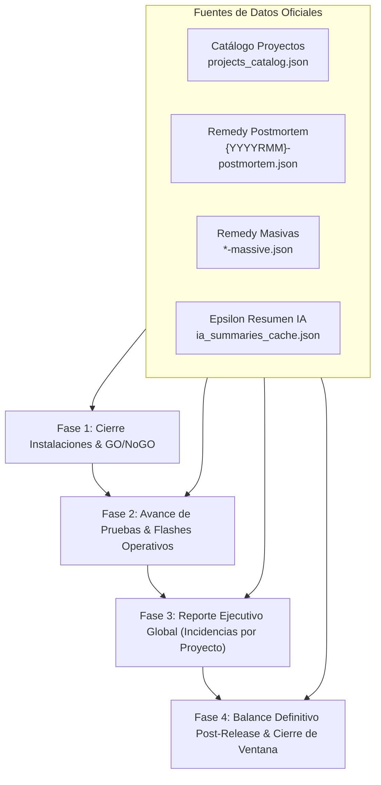

# Comunicación Global de Releases e Incidencias por Proyecto (`release-project-communication`) — v2.0.0

Esta skill define las directrices maestras, formatos corporativos, modelos de datos y heurísticas de redacción para elaborar **comunicaciones ejecutivas y operativas sobre las Releases Mensuales IT** de MasOrange / Orange Tech Operations.

Cubre todo el ciclo de vida de la Release: desde el **cierre de instalaciones y balance GO/NoGO**, pasando por los **flashes operativos en caliente**, hasta el **Reporte Ejecutivo Global de Incidencias agrupadas por Proyecto** respaldado por la telemetría de Remedy y el análisis de **Epsilon Resumen IA**, garantizando trazabilidad y visibilidad en **Microsoft Teams** y comités de Dirección.

---

## 1. Principios y Reglas de Oro Inquebrantables

1. **Destino Oficial de Seguimiento — Mesa de Release**:
   - Todo comunicado oficial **debe enrutar obligatoriamente a la consola de Mesa de Release** (`/dashboards/release-desk/`, URL corporativa: `http://10.132.26.96:8081/dashboards/release-desk/?release={YYYYRMM}`).
   - **Regla Estricta**: Queda prohibido referenciar genéricamente "el dashboard" o enlazar a consolas descontextualizadas (como `release-kpis`). El centro de mando operativo del seguimiento de la ventana y post-release es exclusivamente **Mesa de Release**.

2. **Regla Anti-Alucinación (Cero Tolerancia)**:
   - Prohibido conjeturar o inventar fechas de resolución, causas técnicas, grupos asignados, proyectos o afectaciones no respaldadas expresamente por la evidencia de los ficheros de datos (`projects_catalog.json`, `*-postmortem.json`, `*-massive.json` o Epsilon IA).
   - Todo dato ausente o pendiente de acuerdo debe marcarse explícitamente como `Pendiente de acordar` o `En análisis`.

3. **Cuadre Numérico y Estadístico Estricto (100%)**:
   - Las cifras del balance de proyectos deben cuadrar matemáticamente sin discrepancias:
     $$\text{Total Proyectos} = \text{GO} (\text{Completo} + \text{Piloto} + \text{Modo Oculto}) + \text{PAP Técnico} + \text{Replanificados/NoGO}$$
   - Las métricas de incidencias deben totalizar con precisión:
     $$\text{Total Incidencias} = \text{Activas} (\text{P1} + \text{P2} + \text{P3 Masivas} + \text{P3} + \text{P4}) + \text{Resueltas/Cerradas}$$
     $$\text{Total Proyectos} = \text{Proyectos Limpios (Sin Incidencias)} + \text{Proyectos con Incidencias}$$

4. **Aislamiento de Avisos Operativos (Blindaje de Confianza)**:
   - Cuando se reporte un retraso o anomalía que impacte a un subsistema (ej. refresco de KRATOS, incidencia en Ficha Cliente):
     - Destacarlo claramente en un bloque de advertencia (`> ⚠️`).
     - Indicar de inmediato que **el resto de sistemas, proyectos y servicios continúan operando con normalidad** (🟢 *"El resto de aplicaciones y sistemas están OK e inician pruebas con normalidad"*).

5. **Doble Nivel de Comunicación (Ejecutivo vs Operativo)**:
   - **Nivel Ejecutivo (Dirección / Canales Generales)**: Síntesis de alto nivel, visión global del negocio, salud de proyectos, impacto en clientes y próximos hitos (conciso, sin tecnicismos innecesarios).
   - **Nivel Operativo (Mesa de Release / Resolutores)**: Códigos unívocos de proyecto (`PRJ-*`, `AB2CJ-*`, `OCA-*`), números de incidencia Remedy (`INC*`), criticidad nominal y real, componentes técnicos, grupos asignados y fecha acordada.

---

## 2. Mapa del Ciclo de Vida de Comunicaciones de Release



| Fase | Momento / Disparador | Audiencia Principal | Enfoque Central |
|---|---|---|---|
| **Fase 1: Cierre de Instalaciones** | Fin de instalaciones de la release (sábado/domingo madrugada) | Dirección IT, Negocio, Teams Release | Balance GO/NoGO, proyectos con pruebas activas, avisos de pruebas, hitos desplegados |
| **Fase 2: Flash Operativo** | Detección de bloqueo o ticket crítico durante pruebas | War Room, Incident Managers, Teams | Aislamiento de impacto, tiempo estimado de corrección, estabilidad del resto |
| **Fase 3: Reporte Global de Incidencias/Proyecto** | Domingo tarde / Lunes mañana / Seguimiento post-release | Dirección Operaciones, CIO, Jefes de Proyecto | Matriz de proyectos afectados vs limpios, P1/P2/Masivas, diagnósticos IA, fechas previstas |
| **Fase 4: Balance Final de Release** | Cierre de ventana / Fin de soporte reforzado | Dirección, Comités de Calidad | Estabilidad global, balance definitivo de tickets, plan de fijación PaP |

---

## 3. Heurística de Cruce: Proyectos vs Incidencias

Para generar el **Reporte Ejecutivo Global**, se realiza un cruce relacional entre el catálogo de proyectos y las incidencias activas:

### 3.1. Extracción y Normalización de Proyecto
1. Se extrae la clave del proyecto a partir del campo `prj` o buscando patrones en la descripción: `PRJ-\d+`, `AB2CJ-\d+`, `OCA-\d+`.
2. Se resuelve la información en `projects_catalog.json` (`by_release[YYYYRMM]`):
   - `summary`: Título oficial de la iniciativa.
   - `despliegue`: `Completo`, `Piloto`, `Modo Oculto` o `PAP Técnico`.
   - `metodologia`: `Fast Track`, `Agile E2E`, `Bimodal`, `OCA`, `WF`.
   - `responsable`: Lead técnico / Delivery Manager.
3. Si una incidencia no contiene código de proyecto, se cataloga bajo **"Incidencias Transversales de Release / Sin Proyecto Asociado"**.

### 3.2. Clasificación de Salud del Proyecto (`Health Score`)

| Estado de Salud | Criterio de Clasificación | Icono / Etiqueta | Acción Requerida |
|---|---|:---:|---|
| **🔴 Crítico** | Tiene al menos 1 incidencia activa **P1 / Crítica** o catalogada como **Masiva** (`rd-badge-masiva`). | 🔴 **CRÍTICO** | War Room activa, seguimiento horario, escalado telefónico IM-CSO. |
| **🟡 En Alerta** | Tiene al menos 1 incidencia **P2 / Alta**, o incidencias con fecha prevista vencida (`overdue`), o más de 2 incidencias P3 activas. | 🟡 **ALERTA** | Seguimiento continuo de fecha prevista, mitigación mediante workaround validado. |
| **🟢 Estable / OK** | No tiene incidencias activas, o todas sus incidencias están en estado **Resuelto** o **Cerrado**. | 🟢 **ESTABLE** | Monitoreo estándar post-despliegue. |

---

## 4. Plantillas Oficiales de Comunicación

### 4.1. Plantilla A: Cierre de Instalaciones e Inicio de Pruebas

Uso: Al finalizar los despliegues técnicos en la ventana de release.

```markdown
✅ **Cierre de Instalaciones e Inicio de Pruebas – Release {YYYYRMM}**

Se comunica que han **finalizado con éxito las instalaciones de los proyectos de la release {YYYYRMM} sin incidencias reseñables**, encontrándose los sistemas estables y operativos.

🧪 **A partir de este momento dan comienzo las pruebas de regresión y validación de proyectos** (con **{N_Pruebas} proyectos** con pruebas activas programadas).

> ⚠️ **Aviso Operativo de Pruebas (si aplica):**
> [Detalle del impacto o refresco, ej. Refresco de KRATOS con demora prevista de 20 min que afecta a frontales web].
> 🟢 **El resto de aplicaciones y sistemas están OK** e inician pruebas con absoluta normalidad.

---

### 📊 Balance Definitivo del Despliegue ({Total} Proyectos)

* 🟢 **GO: {N_GO} proyectos ({%_GO}%)**
  * **{N_Comp} en Despliegue Completo** (Operativos para el 100% de canales)
  * **{N_Pil} en Piloto** (Apertura progresiva y controlada)
  * **{N_Ocult} en Modo Oculto** (Capacidad técnica preparatoria)
* ⚙️ **PAP Técnico: {N_PAP} proyectos ({%_PAP}%)**
  * `{JIRA}` – *{Título}* ({Responsable} / {Metodología})
* 🔄 **Replanificación PaP (si aplica):**
  * `{JIRA}` – *{Título}*: Replanificado PAP para el **{Día DD/MM a las HH:MMh}** ({Motivo resumido}).

---

### 🚀 Principales Hitos Desplegados

* ☁️ **Cloud, Core & Arquitectura:**
  * [Proyectos GCP, AWS, modernización arquitectura, optimizaciones de red/core]
* 🏢 **Empresas, B2B & Wholesale:**
  * [Operaciones corporativas, terminales, coberturas, flujos comerciales]
* 📱 **Residencial, Canales Digitales & Seguridad:**
  * [Ciberprotección, plataformas streaming, autogestión app, promociones]

---
🔍 *El seguimiento operativo y la evolución de las pruebas pueden consultarse en directo en la [Mesa de Release](http://10.132.26.96:8081/dashboards/release-desk/?release={YYYYRMM}).*
```

---

### 4.2. Plantilla B: Flash Operativo / Incidencia Crítica en Ventana

Uso: Notificación urgente ante una incidencia que degrade un servicio o bloquee pruebas de un proyecto.

```markdown
🚨 **FLASH OPERATIVO – Incidencia en Pruebas / Release {YYYYRMM}**

* **Proyecto / Sistema afectado:** {PRJ-XXXXX} – *{Nombre Proyecto}* | Sistema: `{SISTEMA}`
* **Incidencia:** `{INCXXXXXXX}` ({Prioridad/Urgencia} | {Estatus})
* **Problema Detectado (Epsilon IA):** {Problema conciso extraído de la IA o descripción funcional}.
* **Impacto en Pruebas/Negocio:** {Canal o sede afectada, usuarios o transacciones impactadas}.
* **Plan de Acción / Siguiente Paso:** {Equipo asignado analizando componente; despliegue de fix o workaround previsto para HH:MMh}.
* **Fecha Prevista Acordada:** {Fecha o "En curso de valoración"}.

> 🟢 **Aviso de Continuidad:**
> Esta afectación se encuentra circunscrita al componente `{SISTEMA}`. **El resto de proyectos y flujos de la release continúan operando con normalidad.**

🔍 *Detalle y seguimiento en tiempo real en la [Mesa de Release](http://10.132.26.96:8081/dashboards/release-desk/?release={YYYYRMM}).*
```

---

### 4.3. Plantilla C: Reporte Ejecutivo Global de Release (Incidencias por Proyecto)

Uso: Informe consolidado para Dirección, Comités de Seguimiento y canales ejecutivos. Presenta la salud de los proyectos y la radiografía completa de incidencias.

```markdown
📢 **Informe Ejecutivo de Estado – Release {YYYYRMM}**  
*Fecha de corte: {DD/MM/YYYY HH:MMh}*

---

### 1️⃣ Resumen Global de Despliegue y Estabilidad

* 📦 **Proyectos Desplegados:** **{Total_Proyectos} proyectos** ({N_GO} GO [{%_GO}%] | {N_PAP} PAP Técnico).
* 🛡️ **Salud de Proyectos:** **{N_Limpios} proyectos estables (sin incidencias)** ({%_Limpios}%) | **{N_Afectados} proyectos en seguimiento** ({%_Afectados}%).
* 🎫 **Incidencias Post-Release Activas:** **{Total_Activas} incidencias abiertas** ({N_Criticas} Críticas/P1 | {N_Altas} Altas/P2 | {N_Masivas} Masivas | {N_Medias} P3/P4).
* ✅ **Incidencias Resueltas:** **{N_Resueltas} incidencias solucionadas** durante la ventana.

---

### 2️⃣ Radiografía de Proyectos en Seguimiento e Incidencias Clave

#### 🔴 Proyectos Críticos / En Alerta (Requieren Atención Dirección)

* **{CODIGO_PROYECTO}** – *{Título del Proyecto}*  
  * **Metodología:** `{Metodologia}` | **Despliegue:** `{Despliegue}` | **Resp.:** {Responsable}  
  * **Incidencias Asociadas:** `{INCXXXXXXX}` ({Prioridad/Urgencia})  
  * ⚠️ **Problema Detectado (Resumen IA):** {Síntesis clara del fallo funcional o técnico detectado}.  
  * 🩺 **Impacto:** {Afectación operativa o canales sin servicio}.  
  * 🔧 **Solución / Siguiente Paso:** {Acción en curso por grupo resolutor}.  
  * 🗓️ **Fecha Prevista:** **{FechaPrevistaAcordada}** {EstadoFecha: En plazo / ⚠ Vencida}.  

*(Repetir bloque para cada proyecto crítico o en alerta)*

---

#### 🟡 Incidencias Transversales de Release / Soporte General (Sin Proyecto Directo)

* `{INCYYYYYYY}` ({Prioridad/Urgencia} | `{Sistema}`): *{Problema Detectado / Descripción}*.  
  * **Estado:** {Estatus} | **Resolutor:** `{GrupoResolutor}` | **Acción:** {Solución o siguiente paso} | **Prevista:** {Fecha}.

---

### 3️⃣ Proyectos Desplegados 100% Estables (Sin Incidencias Activas)

> 🟢 **{N_Limpios} proyectos sin incidencias reportadas**, operando en producción de forma conforme:
> * `{PRJ-1}` ({Summary1}), `{PRJ-2}` ({Summary2}), `{PRJ-3}` ({Summary3}), ...

---

### 4️⃣ Próximos Pasos y Acuerdos de Estabilización

1. **Revisión de Workarounds y PaP:** Verificación técnica de los cambios planificados ({N_PAP} proyectos) previstos para ejecución entre el {FechaInicioPaP} y {FechaFinPaP}.
2. **Cierre de Incidencias en Curso:** Seguimiento focalizado en los tickets con fecha comprometida para hoy.
3. **Mesa de Seguimiento:** Próxima sincronización operativa a las **{HH:MMh}**.

---
🔍 *Consola interactiva, filtros por sistema y actualización en vivo en la [Mesa de Release](http://10.132.26.96:8081/dashboards/release-desk/?release={YYYYRMM}).*
```

---

### 4.4. Plantilla D: Balance Definitivo de Release & Cierre de Ventana

Uso: Al dar por concluida la ventana de despliegue o la fase de soporte reforzado.

```markdown
🏁 **Balance Definitivo y Cierre de Ventana – Release {YYYYRMM}**

Se da por **concluida oficialmente la ventana intensiva de la Release {YYYYRMM}**, pasando los sistemas y aplicaciones a régimen de operación ordinaria (BAU).

### 📈 Indicadores Clave de Cierre

* 🚀 **Efectividad del Despliegue:** **{%_GO}% de éxito en despliegue** ({N_GO}/{Total} proyectos implantados).
* 🛡️ **Índice de Estabilidad:** **{%_Limpios}% de proyectos limpios** sin afectación en servicio.
* 🎫 **Balance de Incidencias:**
  * **Total reportadas:** {Total_Historico} incidencias.
  * **Resueltas en ventana:** {N_Resueltas} ({%_Resolucion}% resueltas).
  * **Remanentes en seguimiento ordinario:** {Total_Activas} incidencias (0 P1 críticas, {N_Altas} P2 acordadas para PaP técnico).
* ⚙️ **Trabajos Programados (PaP):** {N_PAP} proyectos replanificados con ventana técnica autorizada.

Agradecemos a todos los equipos de Desarrollo, Arquitectura, Infraestructura, Calidad, Operaciones y Soporte su dedicación y compromiso para el éxito de esta release.

---
🔍 *El histórico y postmortem consolidado permanece accesible en la [Mesa de Release](http://10.132.26.96:8081/dashboards/release-desk/?release={YYYYRMM}).*
```

---

## 5. Matriz de Atributos y Normalización de Proyectos

Al procesar proyectos desde hojas de cálculo, correos, capturas o ficheros CSV:

| Atributo | Formato / Valores Válidos | Regla de Normalización y Comportamiento |
|---|---|---|
| **JIRA / Código** | `PRJ-\d+`, `AB2CJ-\d+`, `OCA-\d+` | Clave unívoca en `by_release[YYYYRMM]`. Mayúsculas obligatorias. |
| **Summary** | Texto conciso | Título de la iniciativa o capacidad de negocio. |
| **Despliegue** | `Completo`, `Piloto`, `Modo Oculto`, `PAP Técnico` | Tipo de puesta en producción. Si la decisión fue PaP, normalizar a `PAP Técnico`. |
| **Metodología** | `Fast Track`, `Agile E2E`, `Bimodal`, `OCA`, `WF` | Marco de entrega del proyecto. |
| **Responsable** | Nombre y Apellidos | Delivery Lead o Jefe de Proyecto asignado. |
| **Pruebas** | `Si` / `No` | Indica si el proyecto realiza pruebas de regresión en la ventana. |
| **Decisión** | `GO`, `PaP Tecnico`, `NoGO` | Decisión de paso a producción. |

---

## 6. Procedimiento Técnico de Actualización y Persistencia

Para mantener el ecosistema completamente sincronizado con las comunicaciones emitidas:

1. **Actualizar Catálogo de Proyectos (`data/config/projects_catalog.json`)**:
   - Registrar cada nuevo proyecto, metodología corregida (ej. `Fast Track`, `OCA`) y resumen en `by_release[YYYYRMM]`.
   - Mantener el histórico de releases anteriores (`by_release` no destructivo).

2. **Actualizar CSV Histórico (`data/storage/projects/{YYYYRMM}.csv`)**:
   - Cabecera: `JIRA;Summary;Despliegue;Descripcion;Pruebas;Responsable;Metodologia;Decision`.

3. **Registrar Trabajos Programados (`data/config/scheduled_changes_pap.json`)**:
   - Si un proyecto se replanifica a ventana PaP, dar de alta la entrada con `crq: "PAP-{JIRA}"`, fecha y hora pactada.

4. **Verificación de Incidencias en Mesa de Release**:
   - Comprobar que las incidencias asociadas a proyectos reflejan su badge correspondiente (`.rd-badge-masiva` si es masiva, `.rd-badge-critica` para P1, `.rd-badge-alta` para P2).
   - Validar que las fechas comprometidas se guardan como acuerdos en `state.overrides` o fecha prevista acordada.

5. **Sincronización con Servidor Central (VPS `10.132.26.96`)**:
   - Si el usuario autoriza la subida, sincronizar catálogos hacia `/infocodes/var/storage/release-dashboard/config/`.
   - Cuando el usuario indique *"hago yo la subida cuando esté preparada"*, limitar la acción a commits limpios en Git y tests unitarios aprobados.
