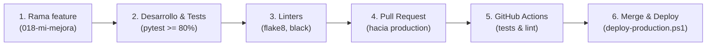

# Guía del Entorno de Desarrollo

Guía completa para la configuración, ejecución local, pruebas y flujo de trabajo de desarrollo en **Release Dashboard Application**.

---

## 📋 Requisitos Previos

- **Python 3.10 o superior** (compatible con Python 3.8+):
  ```bash
  python --version
  ```
- **Git**:
  ```bash
  git --version
  ```
- **PowerShell 5.1+** (Windows) o **Bash** (Linux/macOS).
- Editor de código recomendado: **Visual Studio Code** o **PyCharm**.

---

## 🚀 Configuración Inicial Paso a Paso

### Paso 1: Clonar el Repositorio

```bash
git clone <url-del-repositorio> release-dashboard-application
cd release-dashboard-application
```

### Paso 2: Crear y Activar el Entorno Virtual (`venv`)

#### Windows (PowerShell)
```powershell
python -m venv venv
venv\Scripts\Activate.ps1
```

> [!TIP]
> Si PowerShell bloquea la activación por directiva de scripts, ejecuta en la sesión actual:
> `Set-ExecutionPolicy -Scope Process -ExecutionPolicy Bypass`

#### Linux / macOS (Bash)
```bash
python3 -m venv venv
source venv/bin/activate
```

El indicador de la terminal mostrará el prefijo `(venv)`.

### Paso 3: Instalar Dependencias de Desarrollo

El archivo [`requirements-dev.txt`](../../requirements-dev.txt) incluye tanto las dependencias del servidor y generación de informes de producción (`python-pptx`, `matplotlib`, `plotly`, `kaleido`, `beautifulsoup4`) como las herramientas de test y calidad (`pytest`, `pytest-cov`, `black`, `flake8`, `pylint`, `bandit`):

```bash
pip install --upgrade pip
pip install -r requirements-dev.txt
```

### Paso 4: Configurar Variables de Entorno Locales

Copia la plantilla de configuración para tu entorno local:

```bash
# Windows (PowerShell)
Copy-Item config/.env.example .env

# Linux / macOS
cp config/.env.example .env
```

El archivo `.env` está en `.gitignore` para prevenir cualquier filtración de credenciales. Los valores por defecto son válidos para desarrollo local.

### Paso 5: Instalar el Hook de Pre-Commit Anti-Secretos

El repositorio incluye un hook que bloquea commits accidentales de credenciales, claves privadas o ficheros `.env`:

#### Linux / macOS / Git Bash
```bash
cp config/pre-commit-hook.sh .git/hooks/pre-commit
chmod +x .git/hooks/pre-commit
```

#### Windows (PowerShell con Git)
```powershell
Copy-Item config/pre-commit-hook.sh .git/hooks/pre-commit
```

---

## 💻 Ejecución del Servidor Local (`serve_app.py`)

Para probar los dashboards en local se utiliza [`serve_app.py`](../../serve_app.py), el servidor HTTP especializado del proyecto.

```bash
python serve_app.py
```

Acceso principal en el navegador:
👉 **`http://localhost:8080/dashboards/portal/`**

### ¿Por qué NO usar `python -m http.server` o Live Server?

> [!WARNING]
> No utilices servidores estáticos genéricos como `http.server` o extensiones de Live Server. Solo sirven archivos estáticos y rechazan peticiones `POST`. La subida interactiva de CSV (`/api/upload`) y la generación de reportes fallará con `Failed to fetch`.

### Capacidades del Servidor de Desarrollo (`serve_app.py`)

- **Puerto por defecto `8080`**: Evita colisiones con la API FastAPI hermana (`cso-incident-masivas-report`) que corre en el puerto `8000`.
- **Cambio de puerto si está ocupado**:
  ```bash
  python serve_app.py --port 8081
  ```
- **Persistencia inteligente (Fallback local)**: Si no detecta la ruta del VPS (`/infocodes/var/storage/`), redirige automáticamente la lectura y escritura a las carpetas locales `data/` (`data/input/`, `data/output/`, `data/reports/`).
- **Endpoint de subida `/api/upload`**: Recibe CSVs desde la interfaz del portal y dispara la conversión automática.
- **Proxy hacia microservicios hermanos**:
  - Redirige `/problemas` hacia la aplicación Next.js en `:3001` (o `:3000`).
  - Coexiste con la API FastAPI en `http://localhost:8000/docs`.

---

## 🔄 Ejecución y Depuración de Conversores (CLI)

Puedes ejecutar los scripts de conversión directamente desde la consola para depurar transformaciones de datos o procesar archivos de prueba:

### 1. Conversor de Incidencias Masivas
Transforma el CSV de incidencias operativas a formato JSON consumible por los dashboards:

```bash
# Ejecución estándar
python converters/cli/convert_incidents.py data/input/sample.csv

# Especificando destino personalizado
python converters/cli/convert_incidents.py data/input/sample.csv -o data/output/sample-massive.json
```

### 2. Conversor de Postmortems de Release
Procesa ficheros CSV de postmortem y genera los índices de releases:

```bash
python converters/cli/convert_postmortem.py data/input/sample_postmortem.csv
```

### 3. Pipeline de Generación por Lotes
Simula el proceso batch que ejecuta el cron de producción:

```bash
# Linux / Git Bash
./scripts/generate-dashboards.sh
```

---

## 🧪 Pruebas Automatizadas (Testing)

La suite de pruebas y su configuración ([`converters/pytest.ini`](../../converters/pytest.ini)) residen en el directorio `converters/tests/`.

### Ejecutar Pruebas

Debes situarte en `converters/` para ejecutar `pytest`:

```bash
cd converters

# Ejecutar toda la suite de tests
pytest tests/ -v

# Ejecutar una categoría específica
pytest tests/unit/ -v
pytest tests/integration/ -v
pytest tests/e2e/ -v

# Filtrar tests por nombre o patrón
pytest tests/ -k "encoding" -v
pytest tests/ -k "postmortem" -v
```

### Cobertura de Código (Mínimo 80% requerido en CI)

Tal como exige el pipeline de GitHub Actions ([`docs/CI.md`](../06-operaciones-y-gobernanza/integracion-continua-ci.md)), la cobertura mínima de código requerida es del **80%**:

```bash
cd converters

# Generar reporte de cobertura en consola y en HTML
pytest tests/ --cov=src --cov-report=term-missing --cov-report=html

# Abrir el informe visual generado
# Windows:
Start-Process htmlcov/index.html
# Linux/macOS:
xdg-open htmlcov/index.html || open htmlcov/index.html
```

---

## 🎨 Estilo y Calidad de Código (Linters)

El proyecto utiliza un conjunto estricto de comprobaciones alineadas con el workflow [`.github/workflows/lint.yml`](../../.github/workflows/lint.yml):

```bash
cd converters

# 1. Comprobar estilo con Flake8 (PEP 8)
flake8 src cli tests --statistics

# 2. Verificar formato con Black
black --check src cli tests --diff

# Para auto-formatear con Black:
black src cli tests

# 3. Comprobar orden de imports con isort
isort --check-only src cli tests --diff

# Para ordenar automáticamente los imports:
isort src cli tests

# 4. Análisis estático con Pylint
pylint src cli tests --disable=missing-docstring,too-many-arguments,too-few-public-methods

# 5. Auditoría de seguridad con Bandit
bandit -r src cli --skip B101,B601
```

---

## 🌿 Flujo de Trabajo con Git

El desarrollo sigue un ciclo de vida basado en ramas cortas y revisión rigurosa:



### 1. Crear Rama de Trabajo
Nombra las ramas según la especificación o tarea:
```bash
git checkout -b 018-portal-enhancements
```

### 2. Confirmar Cambios (Commits Convencionales)
```bash
git add converters/src/... dashboards/...
git commit -m "feat(portal): incorporar filtro por release en incidencias"
```

### 3. Validar Localmente Antes de Subir
Asegúrate de que los tests pasen y no haya fallos de linter antes de hacer push:
```bash
cd converters
pytest tests/
flake8 src cli tests
```

### 4. Publicar y Abrir Pull Request
```bash
git push origin 018-portal-enhancements
```
Abre el Pull Request hacia la rama `production`. El pipeline de CI validará automáticamente la cobertura y calidad.

---

## 🛠️ Solución de Problemas Comunes (Troubleshooting)

### El puerto 8080 ya está en uso
Si otro proceso tiene ocupado el puerto `8080`:
```bash
# Levantar en otro puerto alternativo (ej. 8081 o 9000):
python serve_app.py --port 8081
```
> Recuerda: **nunca** uses `python -m http.server`, ya que no procesará las subidas de CSV.

### No se encuentra el módulo `pytest` o dependencias
Verifica que el entorno virtual esté activo y vuelve a instalar las dependencias:
```bash
# Asegurarse de que el binario de python pertenece al venv:
where python     # En Windows
which python     # En Linux / macOS

pip install -r requirements-dev.txt
```

### Error de permisos al ejecutar scripts `.sh` en Linux / Git Bash
Otorga permisos de ejecución a los scripts:
```bash
chmod +x scripts/*.sh
chmod +x converters/scripts/bin/*.sh
```

### Los tests fallan con `ModuleNotFoundError`
Asegúrate de ejecutar `pytest` desde el subdirectorio `converters/`:
```bash
cd converters
pytest tests/ -v
```

---

## 🔗 Documentación Relacionada

- [**`CI.md`**](../06-operaciones-y-gobernanza/integracion-continua-ci.md): Pipeline de Integración Continua, cobertura y linters en GitHub Actions.
- [**`DEPLOYMENT.md`**](../06-operaciones-y-gobernanza/despliegue-vps.md): Despliegue en 1 clic a producción (`deploy-production.ps1`), topología VPS y rollback atómico.
- [**`LOGS.md`**](../06-operaciones-y-gobernanza/logs-y-auditoria.md): Arquitectura de logs, auditoría y comandos de diagnóstico en producción.
- [**`DASHBOARDS-API.md`**](../03-arquitectura-y-datos/dashboards-api.md): Catálogo de APIs, rutas y servicios consumidos por los frontends.
- [**`PROJECT-STRUCTURE.md`**](../03-arquitectura-y-datos/estructura-proyecto.md): Organización física del repositorio y convenciones de estructura.
- [**`VERSION-MANAGEMENT.md`**](../06-operaciones-y-gobernanza/gestion-versiones.md): Política de versionado semántico y etiquetado git.
- [**`QUICKSTART.md`**](QUICKSTART.md): Inicio rápido en 5 minutos para visualización local.
