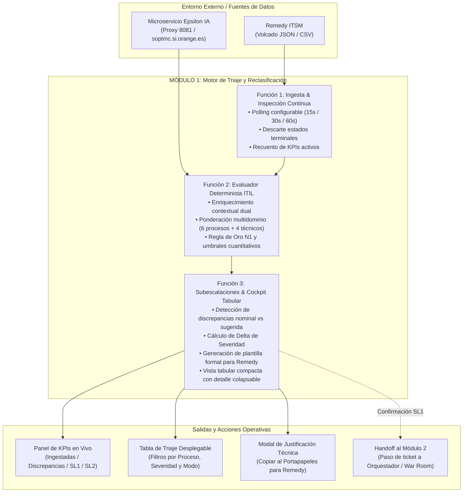
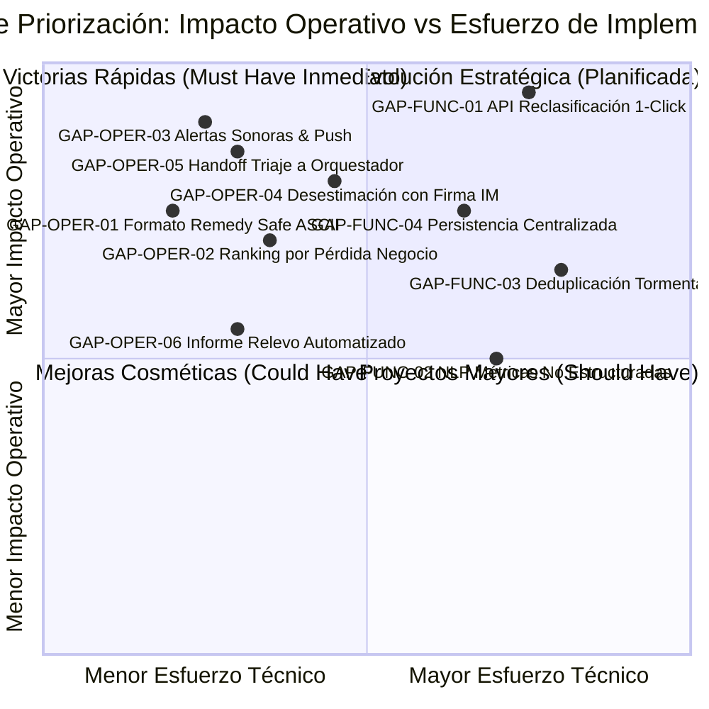

# Documento de Casos de Uso, Evaluación de Calidad y Detección de Gaps: Módulo 1

## *Motor de Inspección Continua, Umbrales Críticos y Alertas de Subescalación (SL1/P1 & SL2/P2)*

**Código del Documento:** `DOC-UCM1-TRIAGE-GAP-01`  
**Versión:** 1.0.0  
**Fecha de Publicación:** 31 de Octubre de 2026  
**Área Responsable:** Orange Tech Operations · Customer & Service Ops (IM-CSO) · QA de Software Operacional  
**Clasificación:** Uso Interno Operativo / Documentación de Ingeniería y Operaciones  
**Sistema Evaluado (SUT):** Consola de Triaje y Reclasificación Automática (`dashboards/emergency-triage-console`) — Módulo 1  

---

## 📑 Índice de Contenidos

1. [Propósito y Objetivos de la Evaluación](#1-propósito-y-objetivos-de-la-evaluación)
2. [Arquitectura Funcional del Módulo 1 Bajo Prueba (SUT)](#2-arquitectura-funcional-del-módulo-1-bajo-prueba-sut)
3. [Catálogo de Casos de Uso Operativos (Escenarios de Prueba)](#3-catálogo-de-casos-de-uso-operativos-escenarios-de-prueba)
   - [UC-M1-01: Caída de Frontales en Atención al Cliente (ATC) subescalada nominalmente a P3](#uc-m1-01-caída-de-frontales-en-atención-al-cliente-atc-subescalada-nominalmente-a-p3)
   - [UC-M1-02: Retraso en Mediación y Facturación (HPFMS / CAS) con ventana de corte inminente](#uc-m1-02-retraso-en-mediación-y-facturación-hpfms--cas-con-ventana-de-corte-inminente)
   - [UC-M1-03: Bloqueo de Aprovisionamiento (TEIDE / SGA) con 100% órdenes detenidas](#uc-m1-03-bloqueo-de-aprovisionamiento-teide--sga-con-100-órdenes-detenidas)
   - [UC-M1-04: Degradación Silenciosa de Middleware Transversal (TIBCO / JMS Colas) con Impacto Multiproceso](#uc-m1-04-degradación-silenciosa-de-middleware-transversal-tibco--jms-colas-con-impacto-multiproceso)
   - [UC-M1-05: Fallo de Nodo en Infraestructura Core Cloud (ESX / Exadata / OCI) con Alta Disponibilidad comprometida](#uc-m1-05-fallo-de-nodo-en-infraestructura-core-cloud-esx--exadata--oci-con-alta-disponibilidad-comprometida)
   - [UC-M1-06: Filtrado Anti-Saturación de Estados Terminales y Tickets Cosméticos (P4/P3 sin impacto)](#uc-m1-06-filtrado-anti-saturación-de-estados-terminales-y-tickets-cosméticos-p4p3-sin-impacto)
   - [UC-M1-07: Resiliencia ante Caída o Timeout del Microservicio Epsilon Resumen IA (Degradación Elegante)](#uc-m1-07-resiliencia-ante-caída-o-timeout-del-microservicio-epsilon-resumen-ia-degradación-elegante)
   - [UC-M1-08: Estrés de Ingesta Masiva, Polling Continuo y Estabilidad Visual (Anti-Flicker)](#uc-m1-08-estrés-de-ingesta-masiva-polling-continuo-y-estabilidad-visual-anti-flicker)
4. [Matriz de Detección de Gaps Funcionales](#4-matriz-de-detección-de-gaps-funcionales)
5. [Matriz de Detección de Gaps Operativos](#5-matriz-de-detección-de-gaps-operativos)
6. [Protocolo y Plantilla de Ejecución de Pruebas (Test Execution Protocol)](#6-protocolo-y-plantilla-de-ejecución-de-pruebas-test-execution-protocol)
7. [Matriz de Priorización de Mejoras y Roadmap de Mitigación (MoSCoW)](#7-matriz-de-priorización-de-mejoras-y-roadmap-de-mitigación-moscow)

---

## 1. Propósito y Objetivos de la Evaluación

El **Módulo 1 de la Consola de Triaje y Reclasificación Automática** fue concebido para erradicar el riesgo operativo más severo en el Command Center (N1) de Orange Tech Operations: **la subescalación inadvertida de incidencias críticas**. En infraestructuras masivas de telecomunicaciones, es frecuente que tickets con impacto devastador en clientes o ingresos sean clasificados inicialmente por agentes de primer nivel como `Prioridad Media (P3)` o `Baja (P4)` debido a descripciones ambiguas, falta de visibilidad del backend o presiones operativas.

El objetivo de este documento es:

1. **Modelar formalmente 8 casos de uso tácticos** representativos de la operación real (incluyendo situaciones nominales, bordes críticos, fallas de microservicios y picos de volumen).
2. **Establecer los criterios de aceptación cuantitativos** para verificar la exactitud algorítmica de la matriz ITIL y el comportamiento de la interfaz gráfica.
3. **Identificar y categorizar sistemáticamente los Gaps Funcionales** (debilidades lógicas, datos no cubiertos, contratos incompletos) y **Gaps Operativos** (fricción para el Incident Manager en guardia, tiempos de respuesta, integración con Remedy ITSM).
4. **Proporcionar un plan de acción priorizado (MoSCoW)** para evolucionar el módulo desde su versión actual hacia un componente de grado de producción industrial.

> [!IMPORTANT]
> **Marco Regulatorio y Reglas del Proyecto (`AGENTS.md`):**  
> Todos los casos de prueba y evaluaciones deben cumplir estrictamente la **Regla Anti-Alucinación** (no inventar métricas ni causas no soportadas por la evidencia) y la **Regla de Oro N1** (ante cualquier ambigüedad en procesos críticos, clasificar automáticamente en SL1/P1).

---

## 2. Arquitectura Funcional del Módulo 1 Bajo Prueba (SUT)

El Módulo 1 está articulado en tres funciones acopladas que procesan el flujo de datos desde la ingesta hasta la acción del operador:



### Entradas, Salidas y Estados del Módulo 1

| Componente | Entrada (Input) | Salida Esperada (Output) | Dependencia |
| :--- | :--- | :--- | :--- |
| **Función 1: Ingesta** | `data/output/high_priority_notifications.json` o endpoint de feed masivo | Arrays de tickets activos descartando estados terminales; cálculo de aging del feed | Sistema de ficheros o API de Remedy |
| **Función 2: Evaluación** | Corpus textual Remedy + Diagnóstico de `EpsilonClient` | Objeto `evaluacion`: proceso crítico, dominio técnico, severidad sugerida (`SL1`-`SL4`), justificación de umbral | Motor `SeverityEvaluator` |
| **Función 3: Alertas** | Severidad nominal de Remedy vs Severidad sugerida | Flag `es_discrepancia`, valor `delta_severidad`, badge tabular, modal de texto formal para Remedy | Interfaz Web `triage.js` / `triage.css` |

---

## 3. Catálogo de Casos de Uso Operativos (Escenarios de Prueba)

A continuación se detallan los 8 escenarios de prueba exhaustivos para evaluar el comportamiento del Módulo 1 frente a condiciones nominales y de frontera.

---

### UC-M1-01: Caída de Frontales en Atención al Cliente (ATC) subescalada nominalmente a P3

- **Identificador:** `UC-M1-01`
- **Proceso de Negocio:** Atención al Cliente (ATC)
- **Objetivo de la Prueba:** Validar que el motor detecte la degradación de un frontal comercial crítico catalogado erróneamente como P3 por el soporte de primer nivel y fuerce su subescalación inmediata a SL1/P1 aplicando la Regla de Oro N1.
- **Actor Principal:** Incident Manager de Turno (IM-CSO) / Operador de Command Center.
- **Precondiciones:** La Consola de Triaje tiene activa la inspección continua (intervalo 30s) y el feed contiene tickets activos.

#### Datos de Entrada (Payload del Ticket)

```json
{
  "id": "INC000004171670",
  "titulo": "Lentitud generalizada y errores 504 en Ficha de Cliente Orange",
  "descripcion": "Operadores de call center reportan que la Ficha de Cliente tarda más de 20 segundos en cargar y en un 35% de los casos devuelve timeout gateway 504. Frontales afectados: CRM4TELCO y DES_SOE_FICHA.",
  "prioridad_nominal": "Media",
  "urgencia": "Media",
  "impacto": "Medio",
  "grupo_asignado": "SOPORTE FRONTALES COMERCIALES",
  "estado": "Asignado",
  "fecha_creacion": "2026-10-31T12:45:00+01:00",
  "epsilon_ia": {
    "problema": "Saturación de conexiones HTTP en ingress gateway hacia pods de Ficha de Cliente.",
    "impacto": "Más de 1.800 agentes de atención sin acceso a datos de clientes. Desvío de llamadas superior al 25% en los últimos 20 minutos.",
    "sistemas": ["Ficha de Cliente Orange", "CRM4TELCO", "DES_SOE_FICHA"],
    "solucion": "Escalado horizontal de réplicas en cluster Kubernetes y reinicio de pods colgados.",
    "bloqueos": ["Pendiente autorización de cambio de emergencia por IM"]
  }
}
```

#### Comportamiento Esperado del Motor (Paso a Paso)

1. **F1 (Ingesta):** Ingesta el ticket `INC000004171670`, verifica que su estado `Asignado` no es terminal y lo computa en el KPI `Activas Ingestadas`.
2. **F2 (Evaluación):**
   - La matriz ponderada identifica el proceso **Atención al Cliente (ATC)** con peso prioritario por coincidencia de sistemas (`Ficha de Cliente`, `CRM4TELCO`).
   - Evalúa el umbral cuantitativo: desvío/afectación >20% en 30 minutos.
   - Aplica la **Regla de Oro N1**: ante indisponibilidad del frontal corporativo de atención, la severidad obligatoria es **SL1 / P1**.
3. **F3 (Subescalación & UI):**
   - Compara Severidad Nominal (`P3 / Media`) con Severidad Sugerida (`SL1 / P1`).
   - Calcula discrepancia activa con **Delta = +2 niveles**.
   - Incrementa el KPI `Discrepancias N1` (+1) y `Emergencias SL1 / P1` (+1).
   - En la tabla de triaje, la fila aparece con el badge ámbar `⚠️ P3 ➔ SL1` y botón destacado `📋 Ver Justificación`.
   - Al pulsar `Ver Justificación`, el modal presenta la plantilla formal de reclasificación para Remedy:
     > *"INCIDENCIA SUBCATALOGADA COMO P3. CRITERIO DE SUBCLASIFICACIÓN: Superación de umbral crítico en Proceso ATC (>20% de afectación en frontales de Ficha de Cliente). Severidad requerida: SL1 / P1 según Matriz Oficial Orange ITIL."*

#### Criterios de Aceptación Cuantitativos

* `evaluacion.prioridad_sugerida` == `"P1"` / `SL1`.
- `es_discrepancia` == `true`.
- `delta_severidad` == `2`.
- `evaluacion.proceso_negocio` == `"Atención al Cliente (ATC)"`.
- La pestaña `Reclasificación Inmediata` debe filtrar y mostrar este ticket como primera prioridad.

#### Tabla Operacional: Visualización en Pantalla y Acciones del Operador

| Elementos Visuales en Pantalla (Consola Módulo 1) | Acciones del Operador Apoyándose en la Consola |
| :--- | :--- |
| **Cabecera & KPIs:**<br>• `Activas Ingestadas`: Contabiliza el ticket activo.<br>• `Discrepancias N1`: Incrementado (+1) con alerta ámbar.<br>• `Emergencias SL1 / P1`: Incrementado (+1) con alerta roja.<br>• Pestaña `⚡ Reclasificación Inmediata`: Activa por defecto con badge numérico &gt;0. | **Fase 1: Detección y Enfoque:**<br>1. El operador observa el incremento del KPI `Discrepancias N1` e ingresa a la pestaña `⚡ Reclasificación Inmediata`.<br>2. Localiza inmediatamente el ticket prioritario `INC000004171670` encabezando el listado. |
| **Fila Principal de la Tabla de Triaje:**<br>• Borde lateral izquierdo rojo brillante (`is-discrepancy-delta2`, Delta = +2).<br>• Enlace ID: `INC000004171670` con pill `status-en-curso` y aging `⏱️ 45m`.<br>• Título: *"Lentitud generalizada y errores 504 en Ficha de Cliente Orange"* con etiquetas de sistemas `Ficha de Cliente Orange`, `CRM4TELCO`, `DES_SOE_FICHA`.<br>• Proceso: `🏢 Atención al Cliente (ATC)`.<br>• Severidad Remedy: `Media` (badge ámbar).<br>• Severidad Sugerida: `SL1 / P1` (badge rojo emergencia).<br>• Botones de acción: `⚡ Reclasificar` (naranja), `🚨 Orquestador` (rojo), `Detalle ▾`. | **Fase 2: Triaje Rápido en Fila:**<br>3. Identifica de un vistazo la discrepancia grave (Remedy `Media` frente a ITIL `SL1 / P1`).<br>4. Revisa los sistemas clave (`Ficha de Cliente`) y el tiempo transcurrido (45 minutos sin resolución en N1).<br>5. Pulsa sobre el botón `Detalle ▾` (o en el chevron `▶`) para desplegar la tarjeta de análisis técnico. |
| **Panel Desplegable (Columna Izquierda - Evaluación ITIL):**<br>• Badge de Proceso: `🏢 Proceso: Atención al Cliente (ATC)`.<br>• Chips de métricas: `📉 >20% Desviación` \| `👥 1.800 Usuarios` \| `🏢 Frontal Crítico`.<br>• Umbral superado en texto naranja: *"Desviación >20% en 30m en Frontales/CRM (Ficha Cliente) o caída de frontales comerciales"*.<br>• Flag de subescalación: `🚨 Subescalación N1 Detectada (+2 Niveles - Mayor Severa)`.<br>• Comparativa: `Remedy Inicial: Media ➔ Severidad Real ITIL: SL1 / P1 (Emergencia Crítica)`. | **Fase 3: Validación del Criterio Oficial:**<br>6. Constata que el impacto supera el umbral oficial del proceso ATC (&gt;20% desvío y frontal corporativo inoperativo).<br>7. Si tiene dudas sobre el marco normativo, hace clic en `📘 Criterios Oficiales` en la cabecera para abrir la matriz de umbrales. |
| **Panel Desplegable (Columna Derecha - Epsilon IA):**<br>• Botón `🔍 Ficha Completa` (abre modal con línea temporal oficial).<br>• *Problema:* Saturación de conexiones HTTP en ingress gateway hacia pods de Ficha de Cliente.<br>• *Impacto:* &gt;1.800 agentes sin acceso a datos de clientes. Desvío de llamadas &gt;25% en últimos 20m.<br>• *Solución:* Escalado horizontal en K8s y reinicio de pods colgados.<br>• *Bloqueos:* Pendiente autorización de cambio de emergencia por IM. | **Fase 4: Verificación de Causa Raíz e Impacto:**<br>8. Lee el diagnóstico estructurado de Epsilon Resumen IA para comprender la afectación técnica sin tener que interpretar logs en crudo.<br>9. Si precisa el histórico detallado o transcripción de notas, pulsa `🔍 Ficha Completa` para inspeccionar la línea de tiempo oficial. |
| **Acción de Reclasificación en Remedy:**<br>• Botón `⚡ Reclasificar` (en fila) o `⚡ Copiar Solicitud Reclasificación Remedy` (en pie de tarjeta).<br>• Notificación Toast flotante: *"¡Solicitud copiada al portapapeles! Pégala en el log de Remedy."*<br>• Portapapeles cargado con plantilla formal auditada de IM-CSO citando ticket, umbral ATC superado, delta +2 y justificación Epsilon IA. | **Fase 5: Ejecución de Reclasificación en Remedy:**<br>10. Pulsa `⚡ Reclasificar` para copiar la plantilla formal.<br>11. Cambia a la pestaña de BMC Remedy ITSM, abre `INC000004171670` y pega el texto íntegro en la sección **Work Logs**.<br>12. Modifica los campos de Remedy: `Urgencia` = "Crítica", `Impacto` = "Crítico" (la prioridad resultante pasa a **P1**). |
| **Handoff a Emergencia, War Room & Dual Clock (Módulo 2):**<br>• Botón `🚨 Orquestador` (en fila) o `🚨 Abrir Orquestador Operativo & War Room (Módulo 2)` en pie de tarjeta.<br>• Al pulsar, se activa el modal del Módulo 2 con arquitectura **Dual Clock (Doble Reloj)**:<br>  - Asignación de IM de guardia (`Carlos Morales`).<br>  - Doble visor en cabecera: `📋 Global Remedy: 8h 45m` y `🚨 Crisis SL1: 0m 00s`.<br>  - Selector de base temporal: `⏱️ Modo Crisis (T0 SL1)` (activo por defecto) vs `📋 Modo Remedy`.<br>  - 4 Relojes Tácticos desacoplados con pistas de desfase N1:<br>    * **Reloj 20m (SLA 1ª Notificación):** Cuenta atrás real (20:00... 19:59), pista `⚠️ Apertura Remedy: 8h 45m (Retraso N1)` y botón directo `⚠️ Emitir Notificación Ya`.<br>    * **Reloj 45m (1er Escalado Telefónico):** Cuenta atrás operativa de llamada obligatoria (45:00... 44:59).<br>    * **Reloj 105m (2º Escalado Jerárquico):** Límite a T+1h 45m para Jefatura de Área.<br>    * **Reloj 120m (>2h):** Alarma de Estancamiento IM-CSO.<br>  - Generador de puente Teams War Room con botón `🔗 Unirse a War Room` y `📋 Copiar Convocatoria`.<br>  - Bitácora interactiva con hito de trazabilidad: `[DUAL_CLOCK] Inicializados temporizadores tácticos de War Room (T0_crisis: HH:MM). Envejecimiento acumulado N1: 8h 45m`.<br>  - Monitor PaP cruzando sistemas con cambios recientes (CRQ). | **Fase 6: Activación Operativa y Gestión Dual Clock de la Emergencia:**<br>13. Pulsa `🚨 Orquestador` para transferir el ticket al Módulo 2.<br>14. Copia la convocatoria de Teams y la envía al canal operativo de guardia del SMC y equipo de frontales.<br>15. **Neutralización del Dual Clock:** Constata que los relojes tácticos no nacen en alarma roja a pesar del elevado aging de Remedy (525 min acumulados en N1), disponiendo de una cuenta atrás real de 20 minutos para gestionar la crisis.<br>16. Pulsa directamente `⚠️ Emitir Notificación Ya` en la tarjeta del Reloj de 20m para abrir la propuesta redactada (versión completa &le;90 palabras y breve &le;30 palabras) y copiarla a Dirección.<br>17. Si precisa verificar el SLA contractual acumulado para auditoría o informe ejecutivo, conmuta al `📋 Modo Remedy`. |

---

### UC-M1-02: Retraso en Mediación y Facturación (HPFMS / CAS) con ventana de corte inminente

- **Identificador:** `UC-M1-02`
- **Proceso de Negocio:** Facturación, Mediación y Cobros
- **Objetivo de la Prueba:** Verificar que retrasos en el vaciado de ficheros de mediación o tarificación que superen la ventana de seguridad de 2 horas disparen la subescalación preventiva antes de que se produzca una pérdida de facturación no recuperable.
- **Actor Principal:** Incident Manager / Especialista de Guardia de Facturación.

#### Datos de Entrada (Payload del Ticket)

```json
{
  "id": "INC000004172890",
  "titulo": "Acumulación de ficheros CDR en mediación HPFMS interfaz CAS",
  "descripcion": "El recolector HPFMS lleva 2.5 horas sin volcar registros de llamadas y datos móviles hacia CAS de tarificación prepago. Colas de disco al 88%.",
  "prioridad_nominal": "Media",
  "urgencia": "Media",
  "impacto": "Medio",
  "grupo_asignado": "SISTEMAS DE FACTURACION Y MEDIACION",
  "estado": "En Curso",
  "fecha_creacion": "2026-10-31T11:00:00+01:00",
  "epsilon_ia": {
    "problema": "Proceso demonio de transferencia detenido por bloqueo en base de datos Oracle CAS.",
    "impacto": "Retraso de mediación de 2 horas y 30 minutos. Riesgo inminente de descarte de CDRs por overflow de colas temporales.",
    "sistemas": ["HPFMS", "CAS", "BSCS"],
    "solucion": "Liberar locks de tablas en Oracle y relanzar demonio hpfms_collector.",
    "bloqueos": []
  }
}
```

#### Comportamiento Esperado del Motor

1. El motor clasifica el ticket en **Facturación, Mediación y Cobros**.
2. Comprueba el umbral específico de Facturación: *"Retraso >2 horas en proceso de mediación o tarificación en tiempo real"*.
3. Como el retraso documentado es de **2.5 horas**, determina que se ha rebasado el umbral de emergencia.
4. Dictamina Severidad Sugerida **SL1 / P1** frente a la nominal `P3`.
5. En la interfaz gráfica, la tarjeta desplegable muestra en la sección `Criterio Aplicado` el texto oficial del umbral de mediación y resalta en rojo las métricas cuantitativas (`2.5 horas de retraso > 2.0h límite`).

#### Criterios de Aceptación Cuantitativos

* `evaluacion.prioridad_sugerida` == `"P1"`.
- `evaluacion.proceso_negocio` == `"Facturación, Mediación y Cobros"`.
- `evaluacion.criterio` contiene explícitamente el umbral de las 2 horas de mediación.

#### Tabla Operacional: Visualización en Pantalla y Acciones del Operador

| Elementos Visuales en Pantalla (Consola Módulo 1) | Acciones del Operador Apoyándose en la Consola |
| :--- | :--- |
| **Cabecera & KPIs:**<br>• `Activas Ingestadas`: Contabiliza ticket `INC000004172890`.<br>• `Discrepancias N1`: Alerta en ámbar incrementada.<br>• `Emergencias SL1 / P1`: Alerta en rojo incrementada.<br>• Barra de origen: Indica fichero activo y timestamp de sincronización continua. | **Fase 1: Filtrado y Aislamiento:**<br>1. El operador detecta una discrepancia en el proceso de Facturación.<br>2. En el menú de filtrado por Proceso selecciona `Facturación y Cobros` (o teclea `"HPFMS"` en el buscador rápido) para aislar la incidencia. |
| **Fila Principal de la Tabla de Triaje:**<br>• Borde lateral izquierdo rojo (`is-discrepancy-delta2`, Delta = +2).<br>• Enlace ID: `INC000004172890` con pill `status-en-curso` y aging `⏱️ 2h 30m`.<br>• Título: *"Acumulación de ficheros CDR en mediación HPFMS interfaz CAS"* con sistemas `HPFMS`, `CAS`, `BSCS`.<br>• Proceso: `🏢 Facturación y Cobros`.<br>• Severidad Remedy: `Media` (P3).<br>• Severidad Sugerida: `SL1 / P1` (rojo).<br>• Acciones rápidas: `⚡ Reclasificar`, `🚨 Orquestador`, `Detalle ▾`. | **Fase 2: Identificación del Riesgo de Facturación:**<br>3. Constata el elevado tiempo de aging (2h 30m) sin escalar en N1.<br>4. Verifica que los sistemas involucrados (`HPFMS`, `CAS`) son el núcleo de tarificación de tráfico móvil/prepago.<br>5. Pulsa en `Detalle ▾` para abrir la información técnica. |
| **Panel Desplegable (Columna Izquierda - Evaluación ITIL):**<br>• Badge: `🏢 Proceso: Facturación, Mediación y Cobros`.<br>• Chips cuantitativos: `⏱️ 2.5h Retraso Mediación` \| `💾 Colas Disco 88%` \| `⚠️ Riesgo Descarte CDR`.<br>• Umbral superado en texto naranja: *"Retraso >2 horas en proceso de mediación o tarificación en tiempo real con riesgo de descarte de registros" (Límite: 2.0h vs Real: 2.5h)*.<br>• Alerta: `🚨 Subescalación N1 Detectada (+2 Niveles - Mayor Severa)`.<br>• Comparativa: `Remedy Inicial: Media ➔ Severidad Real ITIL: SL1 / P1`. | **Fase 3: Cotejo de Ventana de Corte:**<br>6. El operador valida que se ha superado la ventana máxima de retención de 2 horas en mediación, lo que convierte la incidencia en una emergencia económica crítica.<br>7. Comprueba la justificación de urgencia orientada a evitar el overflow de colas de disco. |
| **Panel Desplegable (Columna Derecha - Epsilon IA):**<br>• *Problema:* Demonio de transferencia detenido por lock en BD Oracle CAS.<br>• *Impacto:* 2.5 horas de llamadas móviles sin tarificar. Peligro inminente de descarte por overflow.<br>• *Solución:* Liberar locks en Oracle y relanzar daemon `hpfms_collector`.<br>• *Bloqueos:* Ninguno registrado; requiere acción inmediata de DBA. | **Fase 4: Análisis de la Solución Técnica Propuesta:**<br>8. Revisa la causa raíz indicada por Epsilon IA (locks de base de datos) para orientar de inmediato la llamada técnica al equipo de base de datos y mediación sin perder tiempo en diagnósticos preliminares. |
| **Acción de Reclasificación en Remedy:**<br>• Botón `⚡ Reclasificar` o `⚡ Copiar Solicitud Reclasificación Remedy`.<br>• Toast verde: *"¡Solicitud copiada al portapapeles!"*<br>• Plantilla oficial con justificación formal del umbral de mediación (>2h) y advertencia de riesgo económico para la compañía. | **Fase 5: Actualización Formal en BMC Remedy:**<br>9. Pulsa `⚡ Reclasificar` para copiar la plantilla formal al portapapeles.<br>10. Pega el texto en los Work Logs de Remedy para dejar trazabilidad auditable ante IM-CSO.<br>11. Modifica Urgencia e Impacto a "Crítico" elevando el ticket a **P1**. |
| **Handoff a Emergencia y Monitor PaP (Módulo 2):**<br>• Botón `🚨 Orquestador` o botón inferior de apertura de Módulo 2.<br>• Monitor PaP en Módulo 2 alerta: `🔍 Coincidencia con CRQ000000187640` (*"Recarga de parámetros de tarificación CAS e interfaces HPFMS"* ejecutado hace 5.8h).<br>• Botón habilitado en monitor PaP: `⏪ Ordenar Rollback Inmediato` con plan detallado de reversión de tablas. | **Fase 6: Correlación con Cambios y Mitigación:**<br>12. Pulsa `🚨 Orquestador` para entrar al Módulo 2.<br>13. Alerta de inmediato al especialista de facturación sobre la coincidencia con el cambio `CRQ000000187640`.<br>14. Si el equipo técnico confirma que el lock se debe a la recarga de parámetros, pulsa `⏪ Ordenar Rollback Inmediato` y emite la orden estandarizada de reversión. |

---

### UC-M1-03: Bloqueo de Aprovisionamiento (TEIDE / SGA) con 100% órdenes detenidas

- **Identificador:** `UC-M1-03`
- **Proceso de Negocio:** Provisión y Activación
- **Objetivo de la Prueba:** Validar la subescalación de un ticket categorizado como P2 (Alta) a SL1 (Emergencia Crítica) cuando la provisión fija o móvil está totalmente paralizada durante más de 10 minutos.
- **Actor Principal:** Incident Manager / Command Center SMC.

#### Datos de Entrada (Payload del Ticket)

```json
{
  "id": "INC000004173110",
  "titulo": "Parada de encolamiento de órdenes de fibra en TEIDE y SGA",
  "descripcion": "El gestor de colas de provisión de fibra FTTH se encuentra detenido. No se están despachando órdenes hacia la red desde las 12:50. Afecta a altas nuevas y portabilidades fijas.",
  "prioridad_nominal": "Alta",
  "urgencia": "Alta",
  "impacto": "Medio",
  "grupo_asignado": "SMC PROVISION FIJA",
  "estado": "Asignado",
  "fecha_creacion": "2026-10-31T13:05:00+01:00",
  "epsilon_ia": {
    "problema": "Deadlock en la cola JMS de despacho hacia SGA Provisioning Engine.",
    "impacto": "100% de las órdenes de provisión de fibra paradas durante 15 minutos consecutivos. Más de 450 clientes en espera de activación.",
    "sistemas": ["TEIDE", "SGA", "PeopleSoft"],
    "solucion": "Purgar mensajes con error y relanzar colas de despacho.",
    "bloqueos": []
  }
}
```

#### Comportamiento Esperado del Motor

1. Clasifica el ticket en **Provisión y Activación**.
2. Evalúa los dos umbrales de provisión:
   - Umbral P2: >20% órdenes en error en móvil o >30% en fijo.
   - **Umbral SL1 / Emergencia:** 100% de provisiones paradas durante más de 10 minutos.
3. Al detectar que el 100% de las órdenes están paradas durante **15 minutos**, escala la prioridad sugerida a **SL1 / P1**.
4. Genera una discrepancia con Delta = +1 (`P2 ➔ SL1`).
5. La consola actualiza la fila con badge rojo de emergencia y habilita el botón de transición directa al Módulo 2 (`🚨 Abrir Orquestador SL1`).

#### Criterios de Aceptación Cuantitativos

* `evaluacion.prioridad_sugerida` == `"P1"`.
- `prioridad_nominal` == `"P2"`.
- `delta_severidad` == `1`.
- `es_discrepancia` == `true`.

#### Tabla Operacional: Visualización en Pantalla y Acciones del Operador

| Elementos Visuales en Pantalla (Consola Módulo 1) | Acciones del Operador Apoyándose en la Consola |
| :--- | :--- |
| **Cabecera & KPIs:**<br>• `Activas Ingestadas`: Contabiliza ticket `INC000004173110`.<br>• `Discrepancias N1`: Incrementado (+1).<br>• `Emergencias SL1 / P1`: Incrementado (+1).<br>• Pestaña `⚡ Reclasificación Inmediata`: Badge muestra el ticket pendiente. | **Fase 1: Identificación de la Discrepancia P2 ➔ SL1:**<br>1. El operador consulta la consola tras una alerta del SMC de provisión.<br>2. Localiza en la pestaña `Reclasificación Inmediata` el ticket catalogado como P2 en Remedy que el sistema marca para subir a SL1. |
| **Fila Principal de la Tabla de Triaje:**<br>• Borde lateral ámbar (`is-discrepancy-delta1`, Delta = +1).<br>• Enlace ID: `INC000004173110` con pill `status-pendiente` y aging `⏱️ 15m`.<br>• Título: *"Parada de encolamiento de órdenes de fibra en TEIDE y SGA"* con sistemas `TEIDE`, `SGA`, `PeopleSoft`.<br>• Proceso: `🏢 Provisión y Cobertura`.<br>• Severidad Remedy: `Alta` (badge azul/ámbar P2).<br>• Severidad Sugerida: `SL1 / P1` (badge rojo emergencia).<br>• Botones: `⚡ Reclasificar`, `🚨 Orquestador`, `Detalle ▾`. | **Fase 2: Evaluación Rápida en Fila:**<br>3. Observa que el ticket ya estaba en P2 (Alta), pero el motor exige clasificarlo como Emergencia Nacional SL1.<br>4. Revisa que el aging es de solo 15 minutos (fase temprana crítica para contener la acumulación de órdenes).<br>5. Despliega la fila haciendo clic en `Detalle ▾`. |
| **Panel Desplegable (Columna Izquierda - Evaluación ITIL):**<br>• Badge: `🏢 Proceso: Provisión y Activación`.<br>• Chips cuantitativos: `⛔ 100% Órdenes Paradas` \| `⏱️ 15m Consecutivos` \| `👥 450 Clientes Espera`.<br>• Umbral superado en texto naranja: *"Parada del 100% en el aprovisionamiento de fibra o móvil durante más de 10 minutos en TEIDE / SGA" (Límite: 10m vs Real: 15m)*.<br>• Flag: `🚨 Subescalación N1 Detectada (+1 Nivel - Moderada)`.<br>• Comparativa: `Remedy Inicial: Alta ➔ Severidad Real ITIL: SL1 / P1 (Emergencia Crítica)`. | **Fase 3: Verificación del Umbral de Parada Total:**<br>6. Constata que aunque una afectación parcial (>30%) corresponde a P2, la parada total del 100% durante >10m activa obligatoriamente la severidad SL1 según la matriz oficial.<br>7. Verifica el impacto inminente en 450 clientes esperando alta de fibra. |
| **Panel Desplegable (Columna Derecha - Epsilon IA):**<br>• *Problema:* Deadlock en la cola JMS de despacho hacia SGA Provisioning Engine.<br>• *Impacto:* 100% órdenes detenidas. Retención total de altas y portabilidades fijas.<br>• *Solución:* Purgar mensajes encolados con error y relanzar colas de despacho.<br>• *Bloqueos:* Ninguno registrado. | **Fase 4: Comprensión del Cuello de Botella:**<br>8. Verifica que el bloqueo reside en el motor de colas JMS de SGA.<br>9. Toma nota de la solución recomendada por Epsilon IA (purgar cola muerta) para sugerirla a los técnicos en cuanto se unan al puente. |
| **Acción de Reclasificación en Remedy:**<br>• Botón `⚡ Reclasificar` o `⚡ Copiar Solicitud Reclasificación Remedy`.<br>• Copia al portapapeles de la solicitud de cambio de impacto de "Medio" a "Crítico". | **Fase 5: Reclasificación a SL1 en BMC Remedy:**<br>10. Pulsa `⚡ Reclasificar` y pega la justificación en Remedy Work Logs.<br>11. Ajusta el campo `Impacto` a "Crítico" para que Remedy consolide formalmente el ticket como **P1**. |
| **Handoff a Emergencia y Relojes (Módulo 2):**<br>• Botón `🚨 Orquestador` (abre la consola operativa de crisis).<br>• Reloj 20m se inicia para redactar la notificación a Operaciones y Dirección Comercial.<br>• Puente de Teams War Room disponible para convocar a los administradores de TEIDE y SGA. | **Fase 6: Salto a la War Room Operativa:**<br>12. Pulsa `🚨 Orquestador`.<br>13. Abre la War Room de Teams convocando al SMC Provisión Fija.<br>14. Registra en la bitácora del Módulo 2 la apertura del incidente de provisión y monitoriza la purga de colas JMS. |

---

### UC-M1-04: Degradación Silenciosa de Middleware Transversal (TIBCO / JMS Colas) con Impacto Multiproceso

- **Identificador:** `UC-M1-04`
- **Dominio Técnico:** Middleware Transversal e Integración (TIBCO / ESB / JMS)
- **Objetivo de la Prueba:** Evaluar la capacidad de doble etiquetado del motor para tickets técnicos donde el título solo menciona infraestructura de integración, deduciendo el impacto real en los procesos de negocio dependientes.
- **Actor Principal:** Incident Manager / Ingeniero de Middleware.

#### Datos de Entrada (Payload del Ticket)

```json
{
  "id": "INC000004174005",
  "titulo": "Saturación de colas EMS en cluster TIBCO BusinessWorks nodo central",
  "descripcion": "Alertas de colas de mensajes EMS superando el umbral del 90% de capacidad en servidores TIBCO BW. No se reciben errores HTTP en frontales pero las transacciones quedan encoladas.",
  "prioridad_nominal": "Media",
  "urgencia": "Media",
  "impacto": "Medio",
  "grupo_asignado": "OPERACIONES MIDDLEWARE CORE",
  "estado": "En Curso",
  "fecha_creacion": "2026-10-31T12:00:00+01:00",
  "epsilon_ia": {
    "problema": "Desconexión entre el bus JMS de TIBCO y el backend de Siebel IP24.",
    "impacto": "Bloqueo transversal en el intercambio de mensajes entre Ficha de Cliente, Contratación y Facturación.",
    "sistemas": ["TIBCO", "EMS", "Siebel IP24", "BW"],
    "solucion": "Reinicio escalonado de engines BW y vaciado de colas muertas (DLQ).",
    "bloqueos": ["Esperando trazado de red"]
  }
}
```

#### Comportamiento Esperado del Motor

1. El motor ejecuta la fase de doble etiquetado:
   - `dominio_tecnico`: **Middleware Transversal e Integración**.
   - `proceso_negocio`: Deduce afectación transversal en **Atención al Cliente** y **Facturación**.
2. Aplica la regla específica de Middleware Transversal: *"La saturación o corte del bus core (TIBCO/OSB) con afectación a más de 2 dominios de negocio se clasifica como SL1 / Emergencia Nacional"*.
3. Emite Severidad Sugerida **SL1 / P1** y marca discrepancia contra el nominal `P3`.
4. En el desglose de criterios del dashboard, muestra tanto la justificación de infraestructura técnica como la de negocio.

#### Criterios de Aceptación Cuantitativos

* `evaluacion.dominio_tecnico` == `"Middleware Transversal"`.
- `evaluacion.prioridad_sugerida` == `"P1"`.
- La justificación textual cita la afectación multiproceso derivada del bus de integración.

#### Tabla Operacional: Visualización en Pantalla y Acciones del Operador

| Elementos Visuales en Pantalla (Consola Módulo 1) | Acciones del Operador Apoyándose en la Consola |
| :--- | :--- |
| **Cabecera & KPIs:**<br>• `Activas Ingestadas`: Contabiliza ticket `INC000004174005`.<br>• `Discrepancias N1`: Alerta en ámbar incrementada.<br>• `Emergencias SL1 / P1`: Alerta en rojo incrementada.<br>• Filtro de Proceso: Muestra opción `Middleware Transversal`. | **Fase 1: Filtrado por Dominio Técnico:**<br>1. El operador observa la subida de emergencias y filtra en el selector de proceso por `Middleware Transversal` para aislar incidentes de capas de integración. |
| **Fila Principal de la Tabla de Triaje:**<br>• Borde lateral izquierdo rojo (`is-discrepancy-delta2`, Delta = +2).<br>• Enlace ID: `INC000004174005` con pill `status-en-curso` y aging `⏱️ 1h 15m`.<br>• Título: *"Saturación de colas EMS en cluster TIBCO BusinessWorks nodo central"* con sistemas `TIBCO`, `EMS`, `Siebel IP24`, `BW`.<br>• Proceso: `🏢 Middleware Transversal`.<br>• Severidad Remedy: `Media` (P3).<br>• Severidad Sugerida: `SL1 / P1` (rojo).<br>• Acciones rápidas: `⚡ Reclasificar`, `🚨 Orquestador`, `Detalle ▾`. | **Fase 2: Identificación del Riesgo Silencioso:**<br>3. Observa que en Remedy se abrió como P3 porque los frontales HTTP no dan error explícito, pero las colas EMS están saturadas.<br>4. Revisa que lleva 1 hora y 15 minutos en curso sin resolverse.<br>5. Hace clic en `Detalle ▾` para ver el impacto multinegocio. |
| **Panel Desplegable (Columna Izquierda - Evaluación ITIL):**<br>• Badge: `🏢 Proceso: Middleware Transversal`.<br>• Chips cuantitativos: `⚠️ Colas EMS al >90%` \| `🔀 Multiproceso Afectado` \| `🏢 3 Dominios Impactados`.<br>• Umbral superado en texto naranja: *"Saturación o corte del bus core (TIBCO / OSB) con afectación directa a más de 2 procesos críticos de negocio (ATC, Contratación y Facturación)"*.<br>• Alerta: `🚨 Subescalación N1 Detectada (+2 Niveles - Mayor Severa)`.<br>• Comparativa: `Remedy Inicial: Media ➔ Severidad Real ITIL: SL1 / P1 (Emergencia Crítica)`. | **Fase 3: Deducción del Doble Etiquetado:**<br>6. El operador valida el doble etiquetado del motor: aunque el problema técnico es de colas TIBCO, el impacto comercial es crítico al paralizar transversalmente tres procesos corporativos.<br>7. Corrobora que la Regla de Oro N1 dictamina SL1 obligatorio ante fallos en buses centrales. |
| **Panel Desplegable (Columna Derecha - Epsilon IA):**<br>• *Problema:* Desconexión entre bus JMS de TIBCO y backend Siebel IP24.<br>• *Impacto:* Bloqueo transversal en el intercambio de mensajes entre Ficha Cliente, Contratación y Facturación.<br>• *Solución:* Reinicio escalonado de engines BW y purga de colas muertas (DLQ).<br>• *Bloqueos:* Esperando trazado de red. | **Fase 4: Análisis de Dependencias y Bloqueos:**<br>8. Detecta que el equipo resolutor está bloqueado esperando un trazado de red.<br>9. El IM asume que se requiere liderazgo operativo para coordinar a Redes, Middleware y Siebel en una misma sesión. |
| **Acción de Reclasificación en Remedy:**<br>• Botón `⚡ Reclasificar` o `⚡ Copiar Solicitud Reclasificación Remedy`.<br>• Plantilla formal generada que detalla la afectación multiproceso y la necesidad imperativa de SL1. | **Fase 5: Documentación Formal en BMC Remedy:**<br>10. Copia la plantilla pulsando `⚡ Reclasificar`.<br>11. Abre Remedy ITSM y pega la plantilla en los Work Logs para elevar Urgencia e Impacto a "Crítico" (prioridad P1). |
| **Handoff a Emergencia y Monitor PaP (Módulo 2):**<br>• Botón `🚨 Orquestador` abre la sala de crisis.<br>• Monitor PaP detecta coincidencia con `CRQ000000189914` (*"Parche hotfix adaptadores JMS TIBCO hacia Siebel IP24"* ejecutado hace 4.2h).<br>• Plan de Rollback disponible: Conmutar conector EMS al bus pasivo anterior (15m estimado). | **Fase 6: Convocatoria Multidisciplinar y Rollback:**<br>12. Pulsa `🚨 Orquestador` y genera el puente Teams para convocar a Middleware, Siebel y Redes.<br>13. Revisa la coincidencia con el parche `CRQ000000189914` y consulta al resolutor de guardia si procede activar el botón `⏪ Ordenar Rollback Inmediato`. |

---

### UC-M1-05: Fallo de Nodo en Infraestructura Core Cloud (ESX / Exadata / OCI) con Alta Disponibilidad comprometida

- **Identificador:** `UC-M1-05`
- **Dominio Técnico:** Infraestructura Core, Almacenamiento y Cloud
- **Objetivo de la Prueba:** Comprobar la correcta aplicación de severidad SL2 (Incidencia Mayor) ante la pérdida de redundancia en un cluster crítico sin caída del servicio final.
- **Actor Principal:** Incident Manager / DBA de Producción.

#### Datos de Entrada (Payload del Ticket)

```json
{
  "id": "INC000004175220",
  "titulo": "Caída de nodo primario en cluster Oracle Exadata DB-PROD-01",
  "descripcion": "El nodo 1 del cluster Exadata ha sufrido un kernel panic y se ha reiniciado inesperadamente. El nodo 2 ha asumido el tráfico mediante Transparent Application Failover (TAF).",
  "prioridad_nominal": "Baja",
  "urgencia": "Baja",
  "impacto": "Bajo",
  "grupo_asignado": "DBA INFRAESTRUCTURA CORE",
  "estado": "Asignado",
  "fecha_creacion": "2026-10-31T10:30:00+01:00",
  "epsilon_ia": {
    "problema": "Fallo físico en placa base del compute node 1 de Exadata.",
    "impacto": "Base de datos operando en single node (sin redundancia de alta disponibilidad). Si falla el nodo 2, caída total de cobros y facturación.",
    "sistemas": ["Oracle Exadata", "RAC", "Storage Cell"],
    "solucion": "Sustitución de componente de hardware por soporte de fabricante Oracle.",
    "bloqueos": ["Esperando técnico de campo Oracle"]
  }
}
```

#### Comportamiento Esperado del Motor

1. El motor clasifica el ticket en **Infraestructura Core y Cloud**.
2. Evalúa la regla de redundancia: *"Caída de un nodo en cluster crítico (Exadata/ESX) con pérdida de redundancia pero sin corte de servicio actual = Severidad SL2 / P2 (Incidencia Mayor)"*.
3. Compara Nominal `P4 / Baja` contra Sugerida `SL2 / P2`.
4. Dispara discrepancia de **Delta = +2 niveles** (`P4 ➔ SL2`).
5. En la interfaz se clasifica en el contador `Incidencias SL2 / P2` y se resalta la necesidad de intervención urgente del equipo de infraestructura antes de agotar la ventana de contingencia.

#### Criterios de Aceptación Cuantitativos

* `evaluacion.prioridad_sugerida` == `"P2"`.
- `prioridad_nominal` == `"P4"`.
- `delta_severidad` == `2`.
- `es_discrepancia` == `true`.

#### Tabla Operacional: Visualización en Pantalla y Acciones del Operador

| Elementos Visuales en Pantalla (Consola Módulo 1) | Acciones del Operador Apoyándose en la Consola |
| :--- | :--- |
| **Cabecera & KPIs:**<br>• `Activas Ingestadas`: Contabiliza ticket `INC000004175220`.<br>• `Discrepancias N1`: Alerta en ámbar incrementada (+1).<br>• `Incidencias SL2 / P2`: Alerta en ámbar incrementada (+1).<br>• `Emergencias SL1 / P1`: Sin variación por este ticket. | **Fase 1: Filtrado de Incidencias Mayores (SL2):**<br>1. El operador observa el incremento del KPI `Incidencias SL2 / P2`.<br>2. Filtra por severidad ITIL `Solo SL2 / P2 (Mayor)` o revisa la pestaña `⚡ Reclasificación Inmediata`. |
| **Fila Principal de la Tabla de Triaje:**<br>• Borde lateral ámbar/rojo (`is-discrepancy-delta2`, Delta = +2).<br>• Enlace ID: `INC000004175220` con pill `status-pendiente` y aging `⏱️ 55m`.<br>• Título: *"Caída de nodo primario en cluster Oracle Exadata DB-PROD-01"* con sistemas `Oracle Exadata`, `RAC`, `Storage Cell`.<br>• Proceso: `🏢 Sistemas Core / Infraestructura`.<br>• Severidad Remedy: `Baja` (badge gris P4).<br>• Severidad Sugerida: `SL2 / P2` (badge ámbar Incidencia Mayor).<br>• Botones: `⚡ Reclasificar`, `Detalle ▾` (no muestra `🚨 Orquestador` al no ser SL1). | **Fase 2: Identificación de Pérdida de Resiliencia:**<br>3. Observa que el soporte de primer nivel catalogó la caída del nodo como P4 (Baja) porque el servicio no se cortó gracias a TAF/RAC.<br>4. Detecta el grave peligro de operar sin redundancia en el cluster principal de bases de datos.<br>5. Pulsa en `Detalle ▾` para ver los detalles del hardware. |
| **Panel Desplegable (Columna Izquierda - Evaluación ITIL):**<br>• Badge: `🏢 Dominio: Infraestructura Core / Cloud`.<br>• Chips cuantitativos: `🖥️ Operando en Single Node` \| `⚠️ Pérdida Total de HA` \| `🛡️ Riesgo Caída Transaccional`.<br>• Umbral superado en texto naranja: *"Fallo o caída de nodo en cluster crítico (Exadata RAC, ESX Cluster) con pérdida de redundancia pero sin corte de servicio actual = Severidad SL2 / P2 (Incidencia Mayor)"*.<br>• Flag: `🚨 Subescalación N1 Detectada (+2 Niveles - Mayor)`.<br>• Comparativa: `Remedy Inicial: Baja ➔ Severidad Real ITIL: SL2 / P2 (Mayor)`. | **Fase 3: Validación del Criterio de Alta Disponibilidad:**<br>6. El operador corrobora la regla ITIL: la degradación de N+1 a N en infraestructura Core no es cosmética ni P4; es una Incidencia Mayor SL2 de prioridad alta que requiere restituir la redundancia antes de que falle el nodo superviviente. |
| **Panel Desplegable (Columna Derecha - Epsilon IA):**<br>• *Problema:* Fallo físico en placa base del compute node 1 de Exadata.<br>• *Impacto:* BD operando sin redundancia de alta disponibilidad. Si falla el nodo 2, caída total de cobros y facturación.<br>• *Solución:* Sustitución de componente hardware por soporte de fabricante Oracle.<br>• *Bloqueos:* Esperando técnico de campo de Oracle. | **Fase 4: Verificación del Estado del Proveedor:**<br>7. Comprueba en el diagnóstico IA que el bloqueo actual depende del técnico de campo del fabricante Oracle.<br>8. Toma nota del número de serie y cluster para el seguimiento telefónico. |
| **Acción de Reclasificación en Remedy:**<br>• Botón `⚡ Reclasificar` o `⚡ Copiar Solicitud Reclasificación Remedy`.<br>• Plantilla formal que justifica el salto de P4 a P2 por pérdida de tolerancia a fallos en sistema core. | **Fase 5: Reclasificación a P2 en BMC Remedy:**<br>9. Pulsa `⚡ Reclasificar` para copiar la plantilla formal al portapapeles.<br>10. Pega el texto en los Work Logs de Remedy y eleva `Impacto` a "Alto" y `Urgencia` a "Media/Alta" consolidando la prioridad **P2 / SL2** en Remedy. |
| **Seguimiento Operativo sin War Room:**<br>• Al ser SL2, no se convoca War Room ejecutiva SL1 obligatoria.<br>• En el pie de tarjeta se muestra botón `📋 Copiar Reporte 4 Bloques` para seguimiento escrito.<br>• SLA de seguimiento: Actualizaciones cada 60m con el equipo de DBA. | **Fase 6: Gestión Telefónica con DBA y Fabricante:**<br>11. El operador contacta telefónicamente con la guardia de DBA Infraestructura Core para confirmar la hora estimada de llegada del técnico de Oracle.<br>12. Programa seguimiento horario sin saturar la sala ejecutiva de Dirección. |

---

### UC-M1-06: Filtrado Anti-Saturación de Estados Terminales y Tickets Cosméticos (P4/P3 sin impacto)

- **Identificador:** `UC-M1-06`
- **Proceso de Negocio:** No Crítico / Mantenimiento
- **Objetivo de la Prueba:** Verificar que el motor filtre rigurosamente tickets en estados finales (`Cerrado`, `Resuelto`, `Cancelado`) y clasifique adecuadamente incidencias cosméticas o de bajo impacto sin generar falsas alarmas ni saturar la bandeja del Incident Manager.
- **Actor Principal:** Motor Automatizado de Ingesta (F1).

#### Datos de Entrada (Payload con 2 Tickets)

```json
[
  {
    "id": "INC000004176001",
    "titulo": "Error en color de botón de portal web corporativo",
    "descripcion": "El botón de contacto en la página informativa de empresas muestra un tono gris en lugar de naranja en navegadores Safari.",
    "prioridad_nominal": "Baja",
    "urgencia": "Baja",
    "impacto": "Bajo",
    "grupo_asignado": "FRONTEND WEB CORPORATIVA",
    "estado": "Asignado",
    "fecha_creacion": "2026-10-31T09:00:00+01:00",
    "epsilon_ia": {
      "problema": "Regla CSS mal aplicada en Safari.",
      "impacto": "Problema meramente cosmético sin afectación de navegación ni contratación.",
      "sistemas": ["WEB PUBLICA"],
      "solucion": "Ajuste de estilo CSS en próximo sprint.",
      "bloqueos": []
    }
  },
  {
    "id": "INC000004176002",
    "titulo": "Caída masiva de fibra en polígono industrial (Resuelta)",
    "descripcion": "Incidencia de corte de fibra resuelta tras empalme del cable afectado.",
    "prioridad_nominal": "Crítica",
    "urgencia": "Crítica",
    "impacto": "Alto",
    "grupo_asignado": "SOPORTE FIBRA RED",
    "estado": "Resuelto",
    "fecha_creacion": "2026-10-31T07:00:00+01:00",
    "epsilon_ia": {
      "problema": "Corte de cable por obras ajenas.",
      "impacto": "Servicio completamente restablecido a las 08:30.",
      "sistemas": ["RED FTTH"],
      "solucion": "Empalme de cable ejecutado con éxito.",
      "bloqueos": []
    }
  }
]
```

#### Comportamiento Esperado del Motor

1. Para `INC000004176002`: Al estar en estado `Resuelto`, el motor lo **descarta inmediatamente** en la Fase 1. Se suma al contador interno de omitidos terminales y no aparece en la tabla de triaje activo.
2. Para `INC000004176001`: Ingesta el ticket activo, evalúa los umbrales y confirma que **no existe superación de ningún umbral crítico**.
3. Emite Severidad Sugerida `P4 / SL4` coincidente con la nominal `P4`.
4. El flag `es_discrepancia` es `false` y el delta es `0`.
5. No genera alertas en la pestaña `Reclasificación Inmediata`; únicamente es visible si el operador activa la pestaña `Todas las Incidencias`.

#### Criterios de Aceptación Cuantitativos

* `INC000004176002` no aparece en el listado activo de la consola.
- `INC000004176001.evaluacion.prioridad_sugerida` == `"P4"`.
- `INC000004176001.es_discrepancia` == `false`.
- `delta_severidad` == `0`.

#### Tabla Operacional: Visualización en Pantalla y Acciones del Operador

| Elementos Visuales en Pantalla (Consola Módulo 1) | Acciones del Operador Apoyándose en la Consola |
| :--- | :--- |
| **Cabecera & KPIs:**<br>• `Activas Ingestadas`: Contabiliza únicamente el ticket activo cosmético (`INC000004176001`).<br>• El ticket resuelto `INC000004176002` es omitido silenciosamente (no incrementa KPIs activos ni aparece en tablas).<br>• `Discrepancias N1`: 0 (sin variación).<br>• `Emergencias SL1 / P1`: 0 (sin variación). | **Fase 1: Confirmación de Bandeja Limpia (Anti-Fatiga):**<br>1. El operador observa que la bandeja de `⚡ Reclasificación Inmediata` permanece limpia (contador 0) o no muestra alertas para estos tickets.<br>2. Comprueba que el sistema descarta eficazmente falsas alarmas sin intervención manual. |
| **Pestaña `⚡ Reclasificación Inmediata`:**<br>• Lista vacía o sin el ticket cosmético.<br>• Si no hay más discrepancias activas, muestra estado vacío informativo: *"No hay discrepancias pendientes de reclasificar"*. | **Fase 2: Concentración en lo Crítico:**<br>3. El operador no invierte tiempo cognitivo ni atiende falsos avisos sobre cambios estéticos o incidencias ya resueltas por la red. |
| **Pestaña `📋 Todas las Evaluadas` / `✅ Severidad Correcta`:**<br>• Si el operador cambia a estas pestañas para auditar el catálogo:<br>  - Fila con borde izquierdo neutro / verde suave (`is-correct`).<br>  - ID `INC000004176001` con pill `status-pendiente`.<br>  - Título: *"Error en color de botón de portal web corporativo"* con sistema `WEB PUBLICA`.<br>  - Remedy Inicial: `Baja` (badge gris).<br>  - Severidad Sugerida: `P4 / Baja` (badge gris).<br>  - No muestra botones `⚡ Reclasificar` ni `🚨 Orquestador`. Solo muestra botón `Detalle ▾`. | **Fase 3: Auditoría y Comprobación Casual:**<br>4. Si el operador necesita corroborar por qué un ticket menor no generó alarma, pulsa la pestaña `✅ Severidad Correcta`.<br>5. Verifica que la fila muestra la concordancia nominal exacta sin desvíos (+0 niveles). |
| **Panel Desplegable (Detalle Extendido de `INC000004176001`):**<br>• Badge: `🏢 Proceso: No Crítico / Portales Web`.<br>• Caja de regla: *"Incidencia cosmética o de baja prioridad sin afectación a transacciones comerciales ni usuarios masivos"*. Flag: `✅ Severidad Nominal Correcta (Alineada con Criterio ITIL Orange)`.<br>• Comparativa: `Remedy Inicial: Baja ➔ Severidad Real ITIL: P4 / Baja`.<br>• Epsilon IA: Problema (*"Regla CSS en Safari"*), Impacto (*"Problema cosmético sin afectación"*), Solución (*"Ajuste en próximo sprint"*). | **Fase 4: Validación de Cero Afectación:**<br>6. El operador confirma que el diagnóstico IA y la evaluación determinista coinciden en la ausencia de impacto en el negocio.<br>7. Cierra la fila desplegada (`Plegar ▴`). |
| **Acciones Operativas:**<br>• No existen botones de reclasificación activos ni llamadas de escalado.<br>• El ticket sigue su ciclo normal de resolución ordinaria en N2/sprint planificado. | **Fase 5: Cero Fricción con Remedy:**<br>8. No se realiza ninguna acción en Remedy ITSM ni se abren canales de emergencia, cumpliendo el principio de economía de atención del Command Center. |

---

### UC-M1-07: Resiliencia ante Caída o Timeout del Microservicio Epsilon Resumen IA (Degradación Elegante)

- **Identificador:** `UC-M1-07`
- **Proceso de Negocio:** Todos (Mecanismo de Resiliencia)
- **Objetivo de la Prueba:** Comprobar que, ante la indisponibilidad de la API de Epsilon Resumen IA (código HTTP 500, timeout o sin red), el Módulo 1 no se bloquee ni arroje excepciones no controladas, sino que degrade elegantemente su análisis a los metadatos nativos de Remedy e informe de ello al usuario.
- **Actor Principal:** Cliente de Ingesta / EpsilonClient.

#### Datos de Entrada

* Ticket con descripción de caída crítica en CRM4TELCO.
- Microservicio Epsilon configurado para simular `HTTP 503 Service Unavailable` o timeout de 5 segundos.

#### Comportamiento Esperado del Motor

1. El backend / cliente CLI detecta el fallo de comunicación con Epsilon.
2. Utiliza la caché persistente en disco (`data/.epsilon_cache/`) si existe un diagnóstico previo del ticket.
3. Si no existe en caché, activa el **Modo de Degradación Heurística Nativa**: realiza la clasificación de proceso y severidad basándose exclusivamente en el `Título`, `Descripción`, `Grupo Asignado` e `Impacto/Urgencia` de Remedy.
4. En el catálogo generado, el objeto incluye: `"epsilon_enriquecido": false` y `"aviso_ia": "Diagnóstico IA no disponible · Análisis basado en Remedy nativo"`.
5. En la interfaz web (`triage.js`), el bloque de diagnóstico IA de la tarjeta muestra un cartel informativo en gris: `ℹ️ Diagnóstico Epsilon IA no disponible para este ticket. Clasificación efectuada con metadatos nativos de Remedy.`
6. La evaluación de severidad y detección de discrepancia sigue funcionando con total precisión.

#### Criterios de Aceptación Cuantitativos

* El ciclo de inspección no arroja errores `Uncaught Exception` en consola.
- La severidad de emergencia SL1 se sigue calculando con los datos nativos de Remedy.
- La interfaz muestra el banner de advertencia no bloqueante.

#### Tabla Operacional: Visualización en Pantalla y Acciones del Operador

| Elementos Visuales en Pantalla (Consola Módulo 1) | Acciones del Operador Apoyándose en la Consola |
| :--- | :--- |
| **Cabecera & KPIs:**<br>• Indicador de conexión: `Inspección Activa` con pulso verde regular.<br>• KPIs de Activas, Discrepancias y Emergencias siguen calculándose y actualizándose sin bloqueos ni errores JavaScript en consola.<br>• No aparecen alertas intrusivas tipo modal emergente que bloqueen el uso. | **Fase 1: Supervisión Continua Sin Interrupciones:**<br>1. El operador comprueba que la consola sigue funcionando con fluidez y que la ingesta de Remedy sigue procesándose con normalidad a pesar de la indisponibilidad del servicio IA. |
| **Fila Principal de la Tabla de Triaje:**<br>• La fila del ticket crítico (`INC000004171670`) sigue mostrando la subescalación `⚠️ P3 ➔ SL1` y el borde rojo de discrepancia.<br>• La clasificación por proceso (`Atención al Cliente`) y el cálculo de la severidad requerida (`SL1 / P1`) se mantienen inalterados.<br>• Botón `⚡ Reclasificar` disponible y operativo. | **Fase 2: Identificación de la Emergencia:**<br>2. El operador observa que la emergencia crítica en Ficha de Cliente sigue perfectamente detectada a partir de los datos nativos de Remedy (Título, Descripción, Sistemas y Grupo).<br>3. Despliega la fila (`Detalle ▾`). |
| **Panel Desplegable (Columna Izquierda - Evaluación Heurística):**<br>• Badge de Proceso y Umbral superado calculados con el extractor de palabras clave y sistemas nativos de Remedy.<br>• Justificación de impacto generada a partir de los campos textuales de Remedy. | **Fase 3: Verificación de la Justificación Nativa:**<br>4. El operador comprueba que los argumentos de la matriz determinista son sólidos y suficientes para justificar la emergencia formalmente. |
| **Panel Desplegable (Columna Derecha - Modo Degradación IA):**<br>• En lugar del bloque interactivo habitual de Epsilon IA, aparece una caja con fondo gris suave y borde punteado:<br>  > `ℹ️ Diagnóstico Epsilon Resumen IA temporalmente no disponible (HTTP 503 / Timeout).`<br>  > `La clasificación y evaluación de umbrales se han ejecutado con éxito utilizando los metadatos nativos de BMC Remedy.`<br>• Los campos de Problema e Impacto reflejan el contenido nativo extraído de Remedy. | **Fase 4: Toma de Conciencia de la Contingencia:**<br>5. Lee el banner explicativo en gris que le informa de la degradación elegante sin alarmas falsas ni caída del sistema.<br>6. Prosigue con su flujo operativo habitual sin detenerse por la falta de resumen generado por IA. |
| **Acción de Reclasificación en Remedy:**<br>• Botón `⚡ Reclasificar` copia una plantilla formal adaptada:<br>  > *"...Clasificación de emergencia efectuada bajo Regla de Oro N1 con metadatos nativos de Remedy por contingencia temporal de microservicio IA..."* | **Fase 5: Reclasificación en Remedy sin Fricción:**<br>7. Pulsa `⚡ Reclasificar` y pega la plantilla en los Work Logs de Remedy.<br>8. Eleva Urgencia e Impacto a Crítico en Remedy tal como en el flujo estándar. |
| **Gestión Técnica de la Incidencia de Plataforma:**<br>• No bloquea el escalado operativo del ticket.<br>• Proporciona trazabilidad para mantenimiento. | **Fase 6: Reporte Interno de la Plataforma:**<br>9. Si la indisponibilidad de Epsilon supera los 15 minutos, el operador abre una incidencia interna hacia el equipo de soporte de herramientas de automatización sin perjudicar la gestión de la crisis en curso. |

---

### UC-M1-08: Estrés de Ingesta Masiva, Polling Continuo y Estabilidad Visual (Anti-Flicker)

- **Identificador:** `UC-M1-08`
- **Proceso de Negocio:** Transversal (Rendimiento y Usabilidad)
- **Objetivo de la Prueba:** Validar que con un catálogo de más de 100 tickets activos y un ciclo de polling intensivo (cada 15 segundos), la consola no experimente parpadeos visuales (*flickering*), mantenga el estado de las filas que el operador ha desplegado manualmente y no sufra fugas de memoria (*memory leaks*).
- **Actor Principal:** Operador en Turno de Supervisión Activa.

#### Condiciones de la Prueba

* Dataset sintético de 120 incidencias activas (con 15 discrepancias SL1/SL2 distribuidas).
- Selector de refresco configurado en `Inspección: cada 15s`.
- Operador expande los detalles de 3 filas específicas e introduce un término de búsqueda en el input de filtrado (`"CRM"`).

#### Comportamiento Esperado del Motor

1. Cada 15 segundos, la llamada `performInspection()` lee el origen de datos.
2. Compara el `checksum` o timestamp del feed para determinar si hubo cambios reales en el catálogo.
3. Si los datos no han cambiado: actualiza únicamente el indicador de última inspección (`hace 0s`) sin re-renderizar el DOM ni cerrar las filas expandidas.
4. Si los datos han cambiado: re-renderiza la tabla conservando el estado de expansión de las filas previamente abiertas por el usuario (`state.expandedIncidentIds`).
5. El término introducido en el filtro de búsqueda (`"CRM"`) y la pestaña activa (`Reclasificación Inmediata`) se mantienen intactos.
6. El consumo de memoria del navegador se mantiene constante tras 60 ciclos de refresco sucesivos.

#### Criterios de Aceptación Cuantitativos

* Cero cierres accidentales de tarjetas expandidas durante el polling.
- Tiempo de ejecución de `processInspectionData()` inferior a **50 milisegundos** para 120 registros.
- Estabilidad total del foco y los inputs de formulario.

#### Tabla Operacional: Visualización en Pantalla y Acciones del Operador

| Elementos Visuales en Pantalla (Consola Módulo 1) | Acciones del Operador Apoyándose en la Consola |
| :--- | :--- |
| **Cabecera & Selector de Refresco:**<br>• Selector configurado en `Inspección: cada 15s`.<br>• Indicador de `Última Inspección:` actualiza suavemente su cronómetro relativo (`hace 1s`, `hace 14s`) sin parpadeos.<br>• Pulso verde continuo en `#live-pill`. | **Fase 1: Configuración para Turno de Alta Actividad:**<br>1. Ante una jornada de guardia de alto volumen o crisis generalizada, el operador selecciona el ciclo de refresco más ágil (`Inspección: cada 15s`). |
| **Panel de KPIs Globales con Gran Carga:**<br>• `Activas Ingestadas`: Muestra el total masivo (ej. `120`).<br>• `Discrepancias N1`: Muestra el recuento consolidado (ej. `15`).<br>• Los números se actualizan limpiamente si entra un nuevo ticket sin mover los bloques visuales. | **Fase 2: Monitoreo Global del Volumen:**<br>2. El operador supervisa el ratio de discrepancias frente al total activo sin sufrir desplazamientos de pantalla (*layout shifts*). |
| **Barra de Control, Filtros y Búsqueda en Vivo:**<br>• Input de búsqueda contiene el texto `"CRM"`.<br>• El foco del teclado permanece activo dentro del input sin perderse al completarse un ciclo de polling.<br>• Barra de herramientas indica: `Mostrando 8 incidencias` (filtradas de las 120 por coincidencia léxica).<br>• Botón `▼ Expandir Todas` / `▲ Plegar Todas` disponible para visualización masiva. | **Fase 3: Filtrado Selectivo Durante el Refresco:**<br>3. Teclea `"CRM"` en el buscador rápido para aislar incidencias de clientes.<br>4. Comprueba que puede seguir escribiendo sin que el ciclo automático de 15 segundos borre el texto ni le robe el foco del cursor. |
| **Tabla de Triaje y Persistencia de Filas Abiertas:**<br>• El operador tiene abiertas 3 filas de detalle (`INC000004171670`, etc.).<br>• Al vencer el temporizador de 15s y ejecutarse `performInspection()`:<br>  - Las 3 filas permanecen exactamente abiertas (`is-expanded` / `is-open`).<br>  - La posición del scroll vertical se mantiene inalterada.<br>  - Cero parpadeo blanco (*anti-flickering*): la reconstrucción DOM preserva el estado en `state.expandedRows`. | **Fase 4: Lectura y Comparación Simultánea:**<br>5. Mantiene abiertas las tarjetas de los tickets que está evaluando para comparar diagnósticos de Epsilon IA entre ellos sin que la pantalla se repliegue sola.<br>6. Si necesita ver todos los diagnósticos a la vez, pulsa el botón `▼ Expandir Todas`. |
| **Acciones Rápidas y Portapapeles Fluido:**<br>• Botones `⚡ Reclasificar` responden instantáneamente en menos de 50ms.<br>• Modales de justificación y toast emergen fluidamente sin retardo ni congelación del navegador. | **Fase 5: Operación Continua de Alto Rendimiento:**<br>7. Procesa múltiples reclasificaciones en secuencia rápida hacia Remedy sin demoras por renderizado pesado ni saturación de memoria en la pestaña del navegador. |

---

## 4. Matriz de Detección de Gaps Funcionales

El análisis minucioso de la implementación actual del Módulo 1 frente a los casos de uso anteriores ha permitido identificar **6 Gaps Funcionales** relevantes:

```
+--------------------+---------------------------------------------------------+----------------+
| Código de Gap      | Título del Gap Funcional                                | Criticidad     |
+--------------------+---------------------------------------------------------+----------------+
| GAP-FUNC-01        | Falta de Conector de Reclasificación Bidireccional REST | CRÍTICA (ALTA) |
| GAP-FUNC-02        | Ambigüedad en Extracción de Métricas No Estructuradas   | MEDIA          |
| GAP-FUNC-03        | Carencia de Deduplicación y Detección de Tormentas     | MEDIA-ALTA     |
| GAP-FUNC-04        | Falta de Persistencia Centralizada del Estado de Triaje | ALTA           |
| GAP-FUNC-05        | Vulnerabilidad a Coincidencias Léxicas Contextuales     | BAJA-MEDIA     |
| GAP-FUNC-06        | Desincronización ante Reasignación de Grupo en Remedy   | MEDIA          |
+--------------------+---------------------------------------------------------+----------------+
```

### Análisis Detallado de Gaps Funcionales

#### GAP-FUNC-01: Falta de Conector de Reclasificación Bidireccional REST con Remedy ITSM

* **Descripción:** Actualmente, cuando el motor detecta una discrepancia (ej. P3 que debe ser SL1), el Incident Manager debe abrir un modal, pulsar `Copiar Justificación`, abrir la consola web de Remedy en otra pestaña, buscar el ticket, pegar el texto en los *Work Logs* y modificar a mano los desplegables de *Impacto* y *Urgencia*.
- **Impacto Operativo:** Este proceso manual introduce una demora de entre **2 y 5 minutos por ticket**, lo cual es inaceptable durante los primeros compases de una crisis donde el reloj de 20 minutos para la comunicación ejecutiva ya está corriendo.
- **Causa Raíz:** El Módulo 1 opera como un visor de solo lectura sobre el JSON de salida; no dispone aún de endpoints REST para ejecutar mutaciones sobre la API de BMC Remedy (`HPD:IncidentInterface_Create_WS`).
- **Solución Propuesta:** Implementar un botón `⚡ Reclasificar en Remedy (1-Click)` respaldado por un endpoint backend `POST /api/v1/incidents/{id}/reclassify` que actualice automáticamente Urgencia, Impacto y Work Log en Remedy.

#### GAP-FUNC-02: Ambigüedad en Extracción de Métricas Cuantitativas No Estructuradas

* **Descripción:** Si la descripción de Remedy o el resumen de Epsilon utiliza expresiones cualitativas como *"muchos usuarios afectados"*, *"múltiples quejas recibidas"* o *"lentitud notable"* sin especificar un porcentaje numérico (ej. `>20%`), el evaluador recurre a palabras clave genéricas y puede vacilar entre clasificar en P2 o P1.
- **Impacto Operativo:** Puede demorar la activación de SL1 en incidencias que están teniendo un impacto masivo pero cuyo texto inicial carece de precisión métrica por parte del operador que abrió el ticket.
- **Solución Propuesta:** Incorporar una regla de inferencia en el evaluador: ante expresiones de volumen indefinido sobre frontales comerciales únicos (como Ficha de Cliente o CRM), asumir por defecto el peor escenario aplicando de forma estricta la **Regla de Oro N1**.

#### GAP-FUNC-03: Carencia de Deduplicación y Detección de Tormentas de Tickets (Ticket Storming)

* **Descripción:** Cuando se produce una caída troncal (ej. corte de fibra en un polígono o caída de un servidor central de telefonía), pueden crearse 15 o 20 tickets Remedy independientes reportados por distintas tiendas, distribuidores o clientes VIP. El Módulo 1 los evalúa como 20 incidencias aisladas, inflando el contador de discrepancias y dispersando la atención del IM.
- **Impacto Operativo:** Sobrecarga visual y fatiga de alertas para el Incident Manager.
- **Solución Propuesta:** Implementar un motor de correlación temporal y sintáctica que agrupe tickets con similar descripción, sistemas comunes y ventana de apertura coincidente (±15 min), sugiriendo la vinculación formal de un **Ticket Padre / Masivo** en Remedy.

#### GAP-FUNC-04: Falta de Persistencia Centralizada del Estado de Triaje (Audit Trail Local)

* **Descripción:** Si un Incident Manager marca una discrepancia como "Revisada" o "En Seguimiento", ese estado se guarda en la memoria de la sesión local (`localStorage` del navegador). Si otro Incident Manager abre la consola desde otro ordenador en el cambio de turno, no puede ver qué discrepancias han sido ya gestionadas por su compañero.
- **Impacto Operativo:** Riesgo de duplicidad de llamadas telefónicas a los resolutores o de omisión de tickets asumiendo que el compañero de turno ya los ha atendido.
- **Solución Propuesta:** Crear una tabla o store centralizado (`data/audit/triage_audit_log.json` o base de datos relacional/Redis) accesible vía API REST donde se persistan las acciones y firmas de los Incident Managers sobre cada ticket.

#### GAP-FUNC-05: Vulnerabilidad a Coincidencias Léxicas Contextuales (Falsos Positivos)

* **Descripción:** A pesar del uso de regex con `\b`, si un ticket describe un fallo en una impresora interna pero añade como coletilla informativa *"ubicada en la oficina central de Facturación"*, el motor puede puntuar el proceso de Facturación y clasificarlo por encima de su severidad real.
- **Impacto Operativo:** Genera falsas alarmas que restan credibilidad a la consola ante los operadores de guardia.
- **Solución Propuesta:** Requerir que la palabra clave de proceso esté acompañada semánticamente por un verbo o sustantivo de afectación operativa (ej. *"caída"*, *"bloqueo"*, *"error"*, *"parada"*, *"timeout"*), ignorando menciones puramente locativas.

#### GAP-FUNC-06: Desincronización ante Reasignación de Grupo Resolutor en Remedy

* **Descripción:** Si un ticket clasificado inicialmente en un grupo secundario es reasignado en Remedy al grupo de especialistas (ej. `SOP_SMC_TEIDE`), el motor recalcula su prioridad solo si el feed se ha refrescado, pero no emite una alerta diferencial indicando *"Ticket reclasificado internamente por cambio de grupo resolutor"*.
- **Solución Propuesta:** Mantener un histórico del estado anterior del ticket en memoria para resaltar badges de `🔄 Grupo Resolutor Modificado`.

---

## 5. Matriz de Detección de Gaps Operativos

Los **Gaps Operativos** representan fricciones en la experiencia del operador, ergonomía de crisis y alineamiento con los protocolos de emergencia de Orange:

```
+--------------------+---------------------------------------------------------+----------------+
| Código de Gap      | Título del Gap Operativo                                | Criticidad     |
+--------------------+---------------------------------------------------------+----------------+
| GAP-OPER-01        | Fricción de Copiado y Formato en Work Logs de Remedy    | ALTA           |
| GAP-OPER-02        | Fatiga de Alarmas por Ausencia de Ranking por Pérdida   | MEDIA-ALTA     |
| GAP-OPER-03        | Ausencia de Alerta Sonora / Notificación Push en P1     | CRÍTICA        |
| GAP-OPER-04        | Falta de Protocolo de Desestimación Formal de Alarma    | ALTA           |
| GAP-OPER-05        | Transición Discontinua entre Triaje (M1) y War Room (M2)| MEDIA-ALTA     |
| GAP-OPER-06        | Ausencia de Informe de Relevo de Guardia Automatizado   | MEDIA          |
| GAP-OPER-07        | Conflicto de Dual Clock (Ceguera Operativa en Escalados) | CRÍTICA (RESUELTO) |
+--------------------+---------------------------------------------------------+----------------+
```

### Análisis Detallado de Gaps Operativos

#### GAP-OPER-01: Fricción de Copiado y Formato en Work Logs de Remedy

* **Descripción:** Remedy ITSM cuenta con un editor de texto enriquecido antiguo que a menudo corrompe emojis, caracteres especiales o saltos de línea procedentes del portapapeles moderno. Cuando el Incident Manager pega la justificación, pueden aparecer caracteres extraños como `âš ï¸` en lugar de `⚠️`.
- **Impacto Operativo:** El operador pierde tiempo limpiando manualmente el texto antes de poder guardar el ticket en Remedy.
- **Solución:** Añadir un selector de formato en el modal de justificación: `Modo Texto Plano (Remedy Safe ASCII)` y `Modo Enriquecido (Teams / Correo)`.

#### GAP-OPER-02: Fatiga de Alarmas por Ausencia de Ranking Ponderado por Pérdida de Negocio

* **Descripción:** Si durante una tormenta de incidencias surgen 8 discrepancias simultáneas, la lista se presenta por orden cronológico estricto de entrada. Un ticket de ATC con 2.000 clientes afectados puede aparecer por debajo de un ticket de provisión fija que entró 2 minutos antes.
- **Impacto Operativo:** Falta de jerarquización táctica: el IM debe leer todas las filas para decidir cuál atacar primero.
- **Solución:** Implementar un algoritmo de ordenación por **Criticidad Ponderada de Negocio**:
  $$\text{Score} = (\text{Delta Severidad} \times 40) + (\text{Peso Proceso} \times 30) + (\text{Minutos Activo} \times 10)$$
  situando en primer lugar las incidencias con mayor riesgo financiero inmediato.

#### GAP-OPER-03: Ausencia de Alerta Sonora / Notificación Push del Navegador en Nuevas P1

* **Descripción:** Durante una guardia, el Incident Manager suele estar al teléfono con el SMC Bridge o revisando logs en otra pantalla. Si la Consola de Triaje detecta una subescalación crítica a SL1 en segundo plano, la pestaña no emite ningún sonido ni notificación del sistema operativo.
- **Impacto Operativo:** El ticket crítico puede permanecer desatendido durante varios minutos hasta que el operador vuelve a enfocar la pestaña.
- **Solución:** Integrar la **Web Audio API** (tono discreto de emergencia ITIL) y la **Notifications API de HTML5** solicitando permisos al cargar la consola para emitir un banner emergente en Windows cuando se detecte un nuevo SL1/P1 con Delta $\ge 1$.

#### GAP-OPER-04: Falta de Protocolo de Desestimación Formal de Alarma (Override de IM)

* **Descripción:** Si el motor sugiere SL1 para una incidencia que el Incident Manager sabe con certeza que es un simulacro programado, un entorno de preproducción o una falsa alarma verificada, no existe un mecanismo para "Marcar como Desestimada". Como consecuencia, la fila sigue apareciendo en naranja/rojo en cada ciclo de refresco.
- **Impacto Operativo:** Ruido visual permanente que degrada la confianza del operador en la herramienta.
- **Solución:** Habilitar una acción `Desestimar Discrepancia` que exija al IM introducir un motivo obligatorio (mínimo 15 caracteres) y su firma, archivando la alerta y evitando que vuelva a mostrarse como discrepancia activa.

#### GAP-OPER-05: Transición Discontinua entre Triaje (Módulo 1) y War Room (Módulo 2)

* **Descripción:** Si el IM revisa una discrepancia en la tabla y decide que efectivamente es una emergencia SL1, tiene que buscar manualmente el botón del Orquestador o cambiar de pestaña para convocar la War Room y arrancar los relojes.
- **Impacto Operativo:** Desconexión procedimental entre el diagnóstico y la ejecución del protocolo de crisis.
- **Solución:** Añadir en la propia fila y en el modal de justificación del Módulo 1 un botón directo: `🚨 Confirmar SL1 y Abrir War Room (Módulo 2)`, realizando la transición en un solo clic e inyectando todos los datos del ticket en el orquestador.

#### GAP-OPER-06: Ausencia de Informe de Relevo de Guardia Automatizado (Handover Report)

* **Descripción:** Al finalizar el turno de guardia de 8 o 12 horas, el Incident Manager saliente debe redactar manualmente un correo resumiendo qué tickets fueron subescalados, qué criterios se aplicaron y cuáles siguen abiertos.
- **Impacto Operativo:** Pérdida de 15 a 20 minutos en la confección manual del informe y riesgo de omitir detalles clave.
- **Solución:** Crear un botón `📄 Generar Informe de Relevo de Guardia` en la cabecera que compile en un clic el resumen estructurado de todas las discrepancias detectadas, atendidas y pendientes durante el turno.

#### GAP-OPER-07: Conflicto de Dual Clock (Ceguera Operativa en Escalados con Alto Aging en N1) [RESUELTO]

* **Descripción:** Si una incidencia abierta en N1 con prioridad P2/P3 acumula horas de envejecimiento antes de ser subescalada a SL1/P1 (ejemplo: `INC000004171670` con 525 minutos / 8h 45m), medir los 4 relojes de escalado del Orquestador exclusivamente desde la apertura del ticket original provoca que todos nazcan saturados en alarma roja (`+505m SLA`, `+480m Alarma`, etc.) desde el segundo 0 de activación.
- **Impacto Operativo:** Genera estrés artificial, inutilidad del temporizador táctico de 20 minutos para la 1ª comunicación a Dirección y ceguera para coordinar las llamadas telefónicas de 45m y 1h 45m.
- **Solución Implementada (Arquitectura Dual Clock):** 
  1. Desacoplamiento de **Reloj 1 (Envejecimiento Global Remedy)** para auditoría SLA frente a **Reloj 2 (Temporizador Táctico de Crisis $T_0$)** calculado desde la entrada al Orquestador.
  2. Selector de modo en cabecera: `⏱️ Modo Crisis (T0 SL1)` (por defecto) y `📋 Modo Remedy`.
  3. Pistas de desvío contextual (`orch-clock-remedy-hint`) en cada tarjeta indicando el retraso heredado de N1 (`⚠️ Apertura Remedy: 8h 45m`).
  4. Hito auditado en bitácora (`[DUAL_CLOCK]`) garantizando la trazabilidad para el informe Post-Mortem (PIR).

---

## 6. Protocolo y Plantilla de Ejecución de Pruebas (Test Execution Protocol)

Para homologar el Módulo 1 en un entorno de pruebas o preproducción, los evaluadores deben cumplimentar la siguiente plantilla de verificación operativa:

```markdown
### 📋 Hoja de Evaluación de Pruebas: Consola de Triaje (Módulo 1)
- **Fecha de Ejecución:** [AAAA-MM-DD]  
- **Evaluador / Incident Manager:** [Nombre y Apellidos]  
- **Versión Evaluada:** [Versión Git / Commit Hash]  
- **Navegador y Resolución:** [Chrome / Edge / Firefox | 1920x1080]  

| ID Caso | Escenario Evaluado | Acción del Operador | Resultado Esperado | Resultado Obtenido | Estado (Pass / Fail / Blocker) | Gap Asociado |
| :---: | :--- | :--- | :--- | :--- | :---: | :---: |
| **UC-01** | Subescalación ATC (Ficha Cliente) | Ingestar ticket P3 con caída de frontales >20% | Sugerida SL1, Delta +2, badge ámbar visible | | | GAP-FUNC-01 |
| **UC-02** | Retraso Facturación (HPFMS) | Ingestar ticket P3 con 2.5h retraso mediación | Sugerida SL1, justificación cita umbral 2h | | | GAP-FUNC-02 |
| **UC-03** | Parada Provisión (TEIDE) | Ingestar ticket P2 con 100% órdenes detenidas >10m | Sugerida SL1, Delta +1, enlace a Orquestador | | | GAP-OPER-05 |
| **UC-04** | Middleware Transversal (TIBCO) | Ingestar saturación EMS multiproceso | Doble etiquetado correcto, sugerida SL1 | | | GAP-FUNC-05 |
| **UC-05** | Fallo Nodo Core (Exadata) | Ingestar caída nodo sin pérdida de servicio | Sugerida SL2, Delta +2, badge mayor P2 | | | - |
| **UC-06** | Filtro Estados Terminales | Cargar ticket Resuelto y ticket Cosmético P4 | Resuelto descartado de tabla, P4 sin delta | | | - |
| **UC-07** | Caída de Epsilon Resumen IA | Detener microservicio Epsilon y refrescar | Clasificación con Remedy nativo, banner gris | | | - |
| **UC-08** | Estrés 120 tickets + Polling 15s | Expandir 3 filas y esperar 4 ciclos de refresco | Cero parpadeo, filas siguen abiertas, filtro activo | | | GAP-OPER-02 |
```

---

## 7. Matriz de Priorización de Mejoras y Roadmap de Mitigación (MoSCoW)

Para transformar los hallazgos de este análisis en un plan de ingeniería accionable, los gaps identificados se ordenan según la metodología **MoSCoW**:



### 7.1. MUST HAVE (Imprescindibles para el Próximo Release v1.1.0)

1. **GAP-OPER-03 (Alertas Sonoras y Notificaciones Push):**  
   Implementar sonido de alarma suave y notificación del navegador al detectar un ticket con Delta $\ge 1$ hacia SL1.  
   *Esfuerzo:* 0.5 días · *Impacto:* Erradica el riesgo de tickets críticos desatendidos en guardia.
2. **GAP-OPER-05 (Transición Fluida Triaje ➔ Orquestador):**  
   Añadir botón directo en la fila del Módulo 1 para abrir la War Room del Módulo 2 con un clic.  
   *Esfuerzo:* 0.5 días · *Impacto:* Reducción de 60 segundos en la convocatoria de crisis.
3. **GAP-OPER-01 (Modo de Copiado "Remedy Safe ASCII"):**  
   Añadir botón de copiado sin caracteres Unicode para evitar errores de codificación en Remedy.  
   *Esfuerzo:* 0.5 días · *Impacto:* Elimina la fricción manual en el pegado del ticket.
4. **GAP-OPER-04 (Desestimación Formal de Alarma con Firma):**  
   Permitir silenciar discrepancias no procedentes con registro obligatorio del motivo.  
   *Esfuerzo:* 1 día · *Impacto:* Cero falsos positivos molestos en pantalla.

---

### 7.2. SHOULD HAVE (Programadas para la Versión v1.2.0)

1. **GAP-FUNC-01 (Conector REST 1-Click con Remedy ITSM):**  
   Desarrollar el endpoint backend para actualizar directamente el ticket en Remedy sin intervención manual.  
   *Esfuerzo:* 3 días · *Impacto:* Ahorro de 3 a 5 minutos por incidencia crítica.
2. **GAP-OPER-02 (Ordenación Ponderada por Impacto de Negocio):**  
   Implementar algoritmo de scoring para que las discrepancias con mayor afectación encabecen la tabla.  
   *Esfuerzo:* 1 día · *Impacto:* Foco táctico inmediato en hora punta.
3. **GAP-FUNC-04 (Persistencia Centralizada del Estado de Triaje):**  
   Store compartido para sincronización multi-operador entre puestos de guardia.  
   *Esfuerzo:* 2 días · *Impacto:* Coordinación de turno robusta y sin solapamientos.

---

### 7.3. COULD HAVE (Evolutivos Futuros v2.0.0)

1. **GAP-OPER-06 (Generador de Informes de Relevo de Guardia):**  
   Exportación en 1 clic del resumen de incidencias del turno en PDF/Markdown.
2. **GAP-FUNC-03 (Correlación y Agrupación de Tormentas de Incidencias):**  
   Agrupación inteligente de tickets repetidos bajo un Ticket Maestro.
3. **GAP-FUNC-02 (Modelo NLP para Extracción Numérica Avanzada):**  
   Fine-tuning de Epsilon IA para inferir métricas a partir de descripciones difusas.

---

### 7.4. WON'T HAVE (Fuera de Alcance en esta Fase)

- Reemplazo completo de la interfaz de Remedy ITSM (la consola es un Cockpit de Triaje y Emergencias, no un sustituto de la herramienta de inventario y ticketing general).
- Modificación automática de tickets sin confirmación explícita del Incident Manager (la gobernanza ITIL de Orange exige siempre el visado de un humano en el bucle).

---
*Documento aprobado para distribución técnica y operativa en Orange Tech Operations.*
