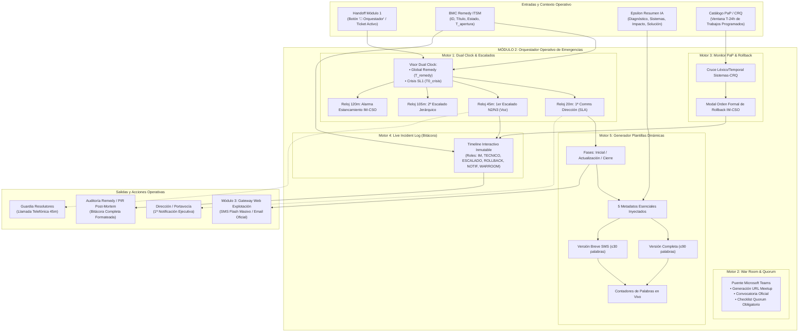
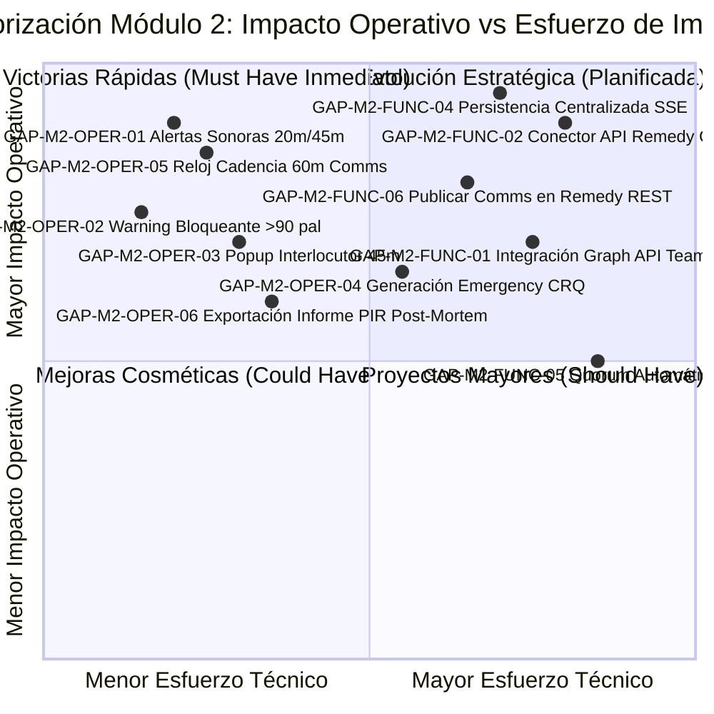

# Documento de Casos de Uso, Evaluación de Calidad y Detección de Gaps: Módulo 2

## *Orquestador del Proceso Operativo de Emergencias, War Room, Dual Clock y Comunicaciones de Crisis (SL1 / Emergencias Nacionales)*

**Código del Documento:** `DOC-UCM2-ORCH-GAP-01`  
**Versión:** 1.0.0  
**Fecha de Publicación:** 31 de Octubre de 2026  
**Área Responsable:** Orange Tech Operations · Customer & Service Ops (IM-CSO) · QA de Software Operacional  
**Clasificación:** Uso Interno Operativo / Documentación de Ingeniería y Operaciones  
**Sistema Evaluado (SUT):** Consola de Triaje y Orquestador de Emergencias (`dashboards/emergency-triage-console`) — Módulo 2: Orquestador Operativo, Dual Clock, War Room Teams, Monitor PaP / Rollback, Bitácora Live Incident Log y Generador de Plantillas Dinámicas de Emergencia  

---

## 📑 Índice de Contenidos

1. [Propósito y Objetivos de la Evaluación](#1-propósito-y-objetivos-de-la-evaluación)
2. [Arquitectura Funcional del Módulo 2 Bajo Prueba (SUT)](#2-arquitectura-funcional-del-módulo-2-bajo-prueba-sut)
3. [Catálogo de Casos de Uso Operativos (Escenarios de Prueba)](#3-catálogo-de-casos-de-uso-operativos-escenarios-de-prueba)
   - [UC-M2-01: Caída de Frontales en Atención al Cliente (ATC) subescalada a P3 (`INC000004171670`)](#uc-m2-01-caída-de-frontales-en-atención-al-cliente-atc-subescalada-a-p3-inc000004171670)
   - [UC-M2-02: Retraso en Mediación y Facturación (HPFMS / CAS) con ventana de corte inminente (`INC000004172890`)](#uc-m2-02-retraso-en-mediación-y-facturación-hpfms--cas-con-ventana-de-corte-inminente-inc000004172890)
   - [UC-M2-03: Bloqueo de Aprovisionamiento (TEIDE / SGA) con 100% órdenes detenidas (`INC000004173110`)](#uc-m2-03-bloqueo-de-aprovisionamiento-teide--sga-con-100-órdenes-detenidas-inc000004173110)
   - [UC-M2-04: Degradación Silenciosa de Middleware Transversal (TIBCO / JMS Colas) con Impacto Multiproceso (`INC000004174005`)](#uc-m2-04-degradación-silenciosa-de-middleware-transversal-tibco--jms-colas-con-impacto-multiproceso-inc000004174005)
   - [UC-M2-05: Fallo de Nodo en Infraestructura Core Cloud (ESX / Exadata / OCI) con Alta Disponibilidad comprometida (`INC000004175220`)](#uc-m2-05-fallo-de-nodo-en-infraestructura-core-cloud-esx--exadata--oci-con-alta-disponibilidad-comprometida-inc000004175220)
   - [UC-M2-06: Filtrado Anti-Saturación / No Activación de Orquestador para Estados Terminales y Tickets Cosméticos (`INC000004176001` y `INC000004176002`)](#uc-m2-06-filtrado-anti-saturación--no-activación-de-orquestador-para-estados-terminales-y-tickets-cosméticos-inc000004176001-y-inc000004176002)
   - [UC-M2-07: Resiliencia ante Caída o Timeout del Microservicio Epsilon Resumen IA (Degradación Elegante)](#uc-m2-07-resiliencia-ante-caída-o-timeout-del-microservicio-epsilon-resumen-ia-degradación-elegante)
   - [UC-M2-08: Gestión Concurrente de Crisis, Estrés de Temporizadores y Persistencia de Sesión](#uc-m2-08-gestión-concurrente-de-crisis-estrés-de-temporizadores-y-persistencia-de-sesión)
4. [Matriz de Detección de Gaps Funcionales](#4-matriz-de-detección-de-gaps-funcionales)
5. [Matriz de Detección de Gaps Operativos](#5-matriz-de-detección-de-gaps-operativos)
6. [Protocolo y Plantilla de Ejecución de Pruebas (Test Execution Protocol)](#6-protocolo-y-plantilla-de-ejecución-de-pruebas-test-execution-protocol)
7. [Matriz de Priorización de Mejoras y Roadmap de Mitigación (MoSCoW)](#7-matriz-de-priorización-de-mejoras-y-roadmap-de-mitigación-moscow)

---

## 1. Propósito y Objetivos de la Evaluación

Mientras el **Módulo 1** actúa como centinela de detección y reclasificación inmediata frente a subescalaciones inadvertidas, el **Módulo 2 (Orquestador del Proceso Operativo de Emergencias)** constituye la cabina de mando táctica donde el **Incident Manager de Turno (IM-CSO)** gestiona activamente la crisis durante los primeros 120 minutos más críticos de una indisponibilidad severa.

En grandes operadoras como Orange, la declaración formal de un incidente de **Severidad SL1 / Emergencia Nacional** desata una secuencia estricta de compromisos normativos:
- **SLA de Comunicación Ejecutiva:** Emisión de la 1ª notificación formal a la Dirección en menos de **20 minutos**.
- **Escalados Telefónicos Obligatorios:** Convocatoria directa por voz de especialistas resolutores N2/N3 antes de **45 minutos**, escalado jerárquico a Jefaturas de Área a **T+1h 45m** y alarma ejecutiva IM-CSO ante estancamiento superior a **2 horas**.
- **Sala de Crisis Técnica (War Room):** Apertura inmediata de puente Microsoft Teams con quórum técnico multidisciplinar.
- **Detección Temprana de Cambios (PaP):** Correlación automática con Trabajos Programados (CRQs) recientes para ordenar un **Rollback Inmediato** si el incidente es fruto de un cambio.
- **Bitácora Auditable en Vivo (Live Incident Log):** Trazabilidad segundo a segundo de decisiones, acuerdos y llamadas para el posterior informe *Post-Incident Review (PIR)*.
- **Generador de Plantillas Dinámicas:** Redacción automatizada de comunicaciones oficiales en doble nivel normativo: monopárrafo de hasta **90 palabras** para Dirección y síntesis de hasta **30 palabras** para alertas SMS flash.

El propósito de este documento es:

1. **Modelar los mismos 8 escenarios operativos** evaluados en el Módulo 1 para verificar de extremo a extremo cómo el Orquestador gobierna la crisis técnica, la correlación de cambios, las alertas y la comunicación.
2. **Auditar la arquitectura Dual Clock (Doble Reloj):** Verificar que el envejecimiento previo acumulado en Remedy N1 no anule la cuenta atrás táctica del incidente en el Orquestador.
3. **Evaluar cuantitativamente los contratos de datos y límites textuales** del Generador de Plantillas Dinámicas y la bitácora auditable.
4. **Identificar y priorizar sistemáticamente los Gaps Funcionales y Operativos del Módulo 2**, trazando un roadmap de mitigación (MoSCoW) hacia una versión de grado de producción industrial.

> [!IMPORTANT]
> **Marco Normativo y Reglas del Proyecto (`AGENTS.md`):**  
> Todos los mensajes ejecutivos deben respetar la **Regla Anti-Alucinación** (no inventar horas, métricas ni causas no respaldadas por la evidencia técnica) y la **Regla Normativa de Longitud** (versión completa &le; 90 palabras en monopárrafo; versión breve &le; 30 palabras).

---

## 2. Arquitectura Funcional del Módulo 2 Bajo Prueba (SUT)

El Módulo 2 opera como un subsistema orquestador interactivo compuesto por 5 motores funcionales interconectados:



### Entradas, Salidas y Estados del Módulo 2

| Subcomponente | Entrada (Input) | Salida Esperada (Output) | Dependencia |
| :--- | :--- | :--- | :--- |
| **Motor 1: Dual Clock** | Timestamp de apertura Remedy + Timestamp de activación $T_0$ del Orquestador | 4 Relojes con cuenta atrás real (segundo a segundo), barras de progreso porcentual, estados visuales (`is-ok`, `is-warning`, `is-alarm`, `is-completed`) y pop-ups informativos (ℹ️). | Reloj local del navegador (`setInterval` 1s) / `localStorage` |
| **Motor 2: War Room Teams** | ID del Ticket + Título + Sistemas afectados | Enlace generado de Teams, plantilla de convocatoria formal con quórum regulatorio obligatorio (IM, SMC, N2/N3, Responsable Aplicación). | Plantilla local (pendiente Microsoft Graph API) |
| **Motor 3: Monitor PaP** | Sistemas del ticket + Catálogo de cambios en ventana 24h | Badge `🟢 Sin PaP` o `🚨 PaP Coincidente`, tarjeta de cambio sospechoso, modal formal con orden de Rollback y plan de reversión. | Catálogo `state.paps` (pendiente API Remedy CMDB) |
| **Motor 4: Live Incident Log** | Acciones de usuario, eventos automáticos (Dual Clock, confirmaciones, rollbacks, plantillas copiadas) | Timeline cronológico auditable con badges por rol, persistencia por ticket y función de copiado formateado para Remedy. | `state.orchestratorLogs` / `localStorage` |
| **Motor 5: Plantillas Dinámicas** | Metadatos de Remedy + Diagnóstico estructurado Epsilon IA | Cuadrícula 3+2 de 5 metadatos esenciales, versión completa (&le;90 palabras) y versión breve (&le;30 palabras) con validación en vivo. | `triage.js` / Integración con Módulo 3 |

---

## 3. Catálogo de Casos de Uso Operativos (Escenarios de Prueba)

A continuación se evalúan los mismos 8 escenarios operativos aplicados al ciclo de vida táctico dentro del Módulo 2.

---

### UC-M2-01: Caída de Frontales en Atención al Cliente (ATC) subescalada a P3 (`INC000004171670`)

- **Identificador:** `UC-M2-01`
- **Proceso de Negocio:** Atención al Cliente (ATC)
- **Objetivo de la Prueba:** Validar la apertura del Orquestador para un ticket con **elevado envejecimiento previo en N1 (8h 45m / 525 min)**, comprobando que la arquitectura **Dual Clock** aísla la cuenta atrás de crisis ($T_0 = 0\text{m}$), que el reloj de 20m habilita la emisión inmediata de la 1ª notificación ejecutiva y que el Generador de Plantillas redacta correctamente las versiones monopárrafo y breve.
- **Actor Principal:** Incident Manager de Turno (IM-CSO).
- **Precondiciones:** Ticket reclasificado en M1 como SL1/P1 con Delta = +2. IM pulsa `🚨 Orquestador`.

#### Datos de Entrada (Payload del Ticket)

```json
{
  "id": "INC000004171670",
  "titulo": "Lentitud generalizada y errores 504 en Ficha de Cliente Orange",
  "prioridad_original": "Media",
  "prioridad_sugerida": "P1",
  "discrepancia_delta": 2,
  "minutos_desde_apertura": 525,
  "sistemas": ["Ficha de Cliente Orange", "CRM4TELCO", "DES_SOE_FICHA"],
  "evaluacion": {
    "proceso": "Atención al Cliente (ATC)",
    "criterio": "Desviación >20% en frontales de atención o caída de frontales comerciales",
    "impacto_justificacion": "Más de 1.800 agentes de atención sin acceso a datos de clientes. Desvío de llamadas superior al 25%."
  },
  "epsilon_ia": {
    "problema": "Saturación de conexiones HTTP en ingress gateway hacia pods de Ficha de Cliente.",
    "impacto": "Más de 1.800 agentes sin acceso a Ficha de Cliente. Desvío >25% en 20 minutos.",
    "sistemas": ["Ficha de Cliente Orange", "CRM4TELCO", "DES_SOE_FICHA"],
    "solucion": "Escalado horizontal de réplicas en cluster Kubernetes y reinicio de pods colgados.",
    "bloqueos": ["Pendiente autorización de cambio de emergencia por IM"]
  }
}
```

#### Comportamiento Esperado del Motor (Paso a Paso)

1. **Apertura e Inicialización Dual Clock:**
   - Registra $T_0$ de activación de crisis en `localStorage` (`emergency_activation_INC000004171670`).
   - La cabecera muestra: `📋 Global Remedy: 8h 45m` y `🚨 Crisis SL1: 0m 00s`.
   - Selector activo: `⏱️ Modo Crisis (T0 SL1)`.
   - **Neutralización del envejecimiento:** Los 4 relojes se calculan respecto a $T_0$, evitando que nazcan en alarma roja.
   - El Reloj de 20m arranca en `20:00`, estado `is-ok` y botón destacado `⚠️ Emitir Notificación Ya`.
2. **War Room & PaP:**
   - Genera enlace de Teams War Room y permite copiar la convocatoria con quórum para ATC y Frontales.
   - Monitor PaP evalúa cambios en `Ficha de Cliente Orange` y `CRM4TELCO`. Al no existir CRQ reciente en ventana de 24h, muestra `🟢 Sin Trabajos Programados Recientes`.
3. **Live Incident Log (Bitácora):**
   - Registra automáticamente el hito inicial: `[DUAL_CLOCK] Inicializados temporizadores tácticos de War Room (T0_crisis: HH:MM). Envejecimiento acumulado N1: 8h 45m`.
4. **Generador de Plantillas Dinámicas:**
   - Al pulsar `⚠️ Emitir Notificación Ya`, se abre el modal del generador en **Fase Inicial (<20m)**.
   - Cuadrícula 3+2 inyecta automáticamente:
     * *Sistemas:* `Ficha de Cliente Orange, CRM4TELCO, DES_SOE_FICHA`.
     * *Impacto:* `Más de 1.800 agentes sin acceso. Desvío >25% en 20m`.
     * *Proveedores/Grupos:* `Soporte Frontales Comerciales`.
     * *Workaround:* `Escalado horizontal K8s / reinicio pods`.
     * *Duración:* `8h 45m (Remedy) / Crisis: <20m`.
   - Redacta Versión Completa monopárrafo formal (&le;90 palabras) y Versión Breve (&le;30 palabras).
   - El contador reactivo indica `is-valid` (ej. 78/90 palabras y 26/30 palabras).
5. **Copiado y Registro:**
   - IM pulsa `📋 Copiar y Registrar en Bitácora`. Se copia el texto al portapapeles y se añade la entrada `[COMMS_INICIAL]` a la bitácora del ticket.
   - El Reloj de 20m pasa a estado `is-completed` mostrando `✅ Ver Notificación`.

#### Criterios de Aceptación Cuantitativos

- `crisisElapsedMinutes` al abrir == `0`.
- El Reloj de 20m nace con tiempo restante $\ge 19\text{m } 55\text{s}$ (no saturado en alarma).
- Convocatoria de Teams contiene el ID `INC000004171670` y los 3 sistemas afectados.
- Texto completo $\le 90$ palabras y monopárrafo (0 saltos de línea intermedios).
- Texto breve $\le 30$ palabras.
- Bitácora contiene al menos 2 hitos auditados (`[DUAL_CLOCK]` y `[COMMS_INICIAL]`).

#### Tabla Operacional: Visualización en Pantalla y Acciones del Operador

| Elementos Visuales en Pantalla (Consola Módulo 2) | Acciones del Operador Apoyándose en la Consola |
| :--- | :--- |
| **Cabecera del Orquestador:**<br>• Badge ID: `INC000004171670`.<br>• Badge Severidad: `SL1 / P1 · Crítica` (rojo).<br>• Incident Manager: `Carlos Morales (Turno Activo CSO)`.<br>• Visor Dual: `📋 Global Remedy: 8h 45m` \| `🚨 Crisis SL1: 0m 15s`.<br>• Selector de modo: `⏱️ Modo Crisis (T0 SL1)` seleccionado por defecto. | **Fase 1: Asunción de Mando y Verificación Temporal:**<br>1. El IM asume la gestión del ticket masivo.<br>2. Constata que el reloj táctico de crisis arranca desde 0m, disponiendo de una ventana real de 20 minutos para gestionar la notificación ejecutiva a pesar de las casi 9 horas acumuladas previamente en N1. |
| **Panel de 4 Relojes Tácticos de Escalado:**<br>• **Reloj 20m:** Cuenta atrás en marcha (`19:45`), barra al 1%, estado verde `Cuenta atrás (T0 SL1)` y botón `⚠️ Emitir Notificación Ya`.<br>• **Reloj 45m:** Cuenta atrás (`44:45`), estado `Avance técnico requerido` y botón `📞 Confirmar Escalado N2/N3`.<br>• **Reloj 105m:** `1h 45m`, en monitorización.<br>• **Reloj 120m:** `2h 00m`, zona de alarma IM-CSO.<br>• Iconos pop-up informativos (ℹ️) operativos en cada reloj. | **Fase 2: Priorización Inmediata del SLA de Comunicación:**<br>3. Observa que el reloj de 20m es el más apremiante.<br>4. Si necesita repasar la normativa del hito, pulsa en el icono `ℹ️` del reloj de 20m para abrir el pop-up informativo *«Difusión oficial a Dirección: declaración formal SL1...»*. |
| **Columna A: War Room Microsoft Teams:**<br>• Pill: `🟢 Sala Convocada`.<br>• Caja de enlace: `https://teams.microsoft.com/l/meetup-join/...INC000004171670`.<br>• Botones: `📞 Unirse a War Room` y `📋 Copiar Convocatoria Oficial`.<br>• Quorum: 4 colectivos clave destacados con tags visuales. | **Fase 3: Apertura de la Sala de Crisis:**<br>5. Pulsa `📋 Copiar Convocatoria Oficial` y la envía al canal de operaciones SMC y soporte de frontales.<br>6. Hace clic en `📞 Unirse a War Room` para ingresar como moderador de la llamada en Teams. |
| **Columna B: Monitor PaP:**<br>• Badge: `🟢 Sin Trabajos Programados Recientes`.<br>• Mensaje: *"No se detectaron CRQs recientes en ventana de 24h sobre los sistemas Ficha de Cliente Orange, CRM4TELCO..."* | **Fase 4: Descarte de Fallo por Cambio Reciente:**<br>7. Comprueba de inmediato que la incidencia no proviene de una release o mantenimiento reciente, orientando la investigación hacia problemas de infraestructura K8s. |
| **Modal: Generador de Plantillas Dinámicas:**<br>• Al pulsar `⚠️ Emitir Notificación Ya` en el Reloj de 20m se abre el modal del generador.<br>• Pestaña `Inicial (<20 min)` activa.<br>• Cuadrícula 3+2 simétrica con los 5 metadatos esenciales encuadrados sin descuadres.<br>• Editor Completo: Monopárrafo formal estructurado con contador `78 / 90 palabras` en verde `is-valid`.<br>• Editor Breve: SMS sintetizado con contador `26 / 30 palabras` en verde `is-valid`. | **Fase 5: Validación y Ajuste de la Notificación:**<br>8. Revisa los textos automáticos generados por Epsilon IA.<br>9. Comprueba que no se superan los límites de 90 y 30 palabras.<br>10. Pulsa `📋 Copiar y Registrar en Bitácora` para copiar la versión completa y salvar el hito. |
| **Bitácora Interactiva (Live Incident Log):**<br>• Entrada 1: `[DUAL_CLOCK]` con hora de apertura.<br>• Entrada 2: `[COMMS_INICIAL]` con el texto íntegro copiado a Dirección.<br>• Botón `Copiar Bitácora` disponible.<br>• Reloj de 20m ahora en azul `is-completed`: `✅ Ver Notificación`. | **Fase 6: Consolidación de Trazabilidad:**<br>11. Confirma que la bitácora refleja fielmente la emisión de la notificación.<br>12. Pega la notificación en el canal ejecutivo y continúa coordinando la War Room técnica. |

---

### UC-M2-02: Retraso en Mediación y Facturación (HPFMS / CAS) con ventana de corte inminente (`INC000004172890`)

- **Identificador:** `UC-M2-02`
- **Proceso de Negocio:** Facturación, Mediación y Cobros
- **Objetivo de la Prueba:** Validar la detección de una coincidencia crítica en el **Monitor de Trabajos Programados (PaP)**, la apertura del modal formal de **Rollback Inmediato (IM-CSO)**, la ejecución del plan de reversión y el registro del escalado telefónico en el reloj de 45 minutos.
- **Actor Principal:** Incident Manager / Especialista de Guardia de Facturación.

#### Datos de Entrada (Payload del Ticket)

```json
{
  "id": "INC000004172890",
  "titulo": "Acumulación de ficheros CDR en mediación HPFMS interfaz CAS",
  "prioridad_original": "Media",
  "prioridad_sugerida": "P1",
  "discrepancia_delta": 2,
  "minutos_desde_apertura": 150,
  "sistemas": ["HPFMS", "CAS", "BSCS"],
  "evaluacion": {
    "proceso": "Facturación, Mediación y Cobros",
    "criterio": "Retraso >2 horas en proceso de mediación o tarificación en tiempo real",
    "impacto_justificacion": "Retraso de mediación de 2.5 horas. Riesgo inminente de descarte de CDRs por overflow."
  },
  "epsilon_ia": {
    "problema": "Proceso demonio de transferencia detenido por bloqueo en base de datos Oracle CAS.",
    "impacto": "Retraso de mediación de 2h 30m. Peligro inminente de descarte de registros.",
    "sistemas": ["HPFMS", "CAS", "BSCS"],
    "solucion": "Liberar locks de tablas en Oracle y relanzar demonio hpfms_collector.",
    "bloqueos": []
  }
}
```

#### Catálogo Mock de Cambios Programados (PaP en Ventana 24h)

```json
[
  {
    "crq": "CRQ000000187640",
    "titulo": "Recarga de parámetros de tarificación CAS e interfaces HPFMS",
    "sistema": "CAS",
    "estado": "Completado",
    "ejecutado_hace_horas": 5.8,
    "riesgo": "Alto",
    "plan_rollback": "1. Restaurar snapshot de configuración CAS_CONF_20261031_0500.sql\n2. Ejecutar script rollback_cas_parameters.sh\n3. Reiniciar demonios recolectores hpfms_collector\n4. Confirmar vaciado de colas y procesamiento de CDRs en BSCS"
  }
]
```

#### Comportamiento Esperado del Motor

1. **Monitor PaP:**
   - Detecta coincidencia entre el sistema `CAS` del ticket y el cambio `CRQ000000187640`.
   - El badge del PaP cambia a `🚨 PaP Coincidente Detectado`.
   - Muestra la tarjeta del cambio con fondo rojo tenue, resaltando el título del trabajo y el botón `⏪ Ordenar Rollback Inmediato`.
2. **Modal de Confirmación de Rollback:**
   - Al pulsar el botón, emerge el modal `⏪ Orden Formal de Rollback Inmediato (IM-CSO)`.
   - Presenta el plan de reversión detallado y el aviso de autorización de cambio de emergencia.
   - Al pulsar `📋 Copiar Orden Formal y Registrar en Bitácora`:
     * Copia la orden formal formateada al portapapeles.
     * Inserta en la bitácora el hito: `[ROLLBACK_ORDER] IM autoriza formalmente el Rollback de CRQ000000187640...`.
     * Cierra el modal y actualiza el botón de PaP a `✅ Rollback Ordenado`.
3. **Gestión de Escalado Telefónico (Reloj 45m):**
   - El IM contacta telefónicamente al resolutor de guardia de bases de datos y mediación para ejecutar el rollback.
   - Pulsa `📞 Confirmar Escalado N2/N3` en el Reloj de 45m.
   - El reloj pasa a estado `is-completed` mostrando `Confirmado / Escalado N2/N3 Registrado`.
   - Inserta automáticamente en la bitácora: `[ESCALADO_45M] Contacto telefónico confirmado con guardia N2/N3...`.

#### Criterios de Aceptación Cuantitativos

- Match exacto con `CRQ000000187640`.
- Texto de la orden formal incluye el plan de 4 pasos de reversión.
- Entrada en bitácora `[ROLLBACK_ORDER]` registrada con timestamp exacto.
- Reloj de 45m pasa a `is-completed` tras confirmar llamada.

#### Tabla Operacional: Visualización en Pantalla y Acciones del Operador

| Elementos Visuales en Pantalla (Consola Módulo 2) | Acciones del Operador Apoyándose en la Consola |
| :--- | :--- |
| **Cabecera & Dual Clock:**<br>• ID: `INC000004172890`.<br>• Visor: `📋 Global Remedy: 2h 30m` \| `🚨 Crisis SL1: 0m 00s`.<br>• Badge de severidad: `SL1 / P1 · Crítica`. | **Fase 1: Apertura de la Incidencia de Facturación:**<br>1. El IM accede a la consola de crisis tras la subescalación en M1.<br>2. Comprueba que el retraso en Remedy es de 2h 30m (rebasando el umbral contractual). |
| **Monitor PaP (Columna Derecha):**<br>• Badge: `🚨 PaP Coincidente Detectado` (rojo).<br>• Tarjeta de cambio: `CRQ000000187640` (*Recarga de parámetros de tarificación CAS e interfaces HPFMS* ejecutado hace 5.8h).<br>• Botón destacado: `⏪ Ordenar Rollback Inmediato` (rojo). | **Fase 2: Identificación del Desencadenante:**<br>3. Observa de inmediato que hace menos de 6 horas se aplicó un cambio en el sistema CAS.<br>4. Alerta a la War Room técnica sobre la presunta relación directa entre el bloqueo de base de datos y la recarga de parámetros de la CRQ. |
| **Modal de Orden de Rollback Formal:**<br>• Título rojo: `⏪ Orden Formal de Rollback Inmediato (IM-CSO)`.<br>• Bloque de código monoespaciado con el plan paso a paso (restaurar snapshot, script de reversión, reinicio de recolector).<br>• Botón `Copiar Orden Formal y Registrar en Bitácora`. | **Fase 3: Ejecución de la Orden de Rollback:**<br>5. Pulsa `⏪ Ordenar Rollback Inmediato`.<br>6. Lee el plan de mitigación y consulta con el especialista técnico si existen riesgos colaterales.<br>7. Pulsa `Copiar Orden Formal y Registrar en Bitácora` emitiendo la instrucción de reversión. |
| **Reloj 45m (1er Escalado Telefónico):**<br>• Estado antes de pulsar: Cuenta atrás activa.<br>• Botón: `📞 Confirmar Escalado N2/N3`.<br>• Al pulsar: La tarjeta cambia a azul/verde `is-completed` con etiqueta `Escalado N2/N3 Registrado`. | **Fase 4: Formalización de la Llamada de Guardia:**<br>8. Llama telefónicamente al DBA de guardia para supervisar la ejecución del script.<br>9. Pulsa `Confirmar Escalado N2/N3` para dejar constancia reglamentaria en el sistema. |
| **Bitácora Interactiva (Live Incident Log):**<br>• Entrada 1: `[DUAL_CLOCK] Inicializados temporizadores...`<br>• Entrada 2: `[ROLLBACK_ORDER] IM autoriza formalmente el Rollback de CRQ000000187640...`<br>• Entrada 3: `[ESCALADO_45M] Contacto telefónico confirmado con guardia N2/N3...` | **Fase 5: Auditoría y Cierre de Mitigación:**<br>10. Verifica que los tres hitos críticos quedaron cronológicamente ordenados.<br>11. Pulsa `Copiar Bitácora` y la traslada a los Work Logs de Remedy para soporte de auditoría. |

---

### UC-M2-03: Bloqueo de Aprovisionamiento (TEIDE / SGA) con 100% órdenes detenidas (`INC000004173110`)

- **Identificador:** `UC-M2-03`
- **Proceso de Negocio:** Provisión y Activación
- **Objetivo de la Prueba:** Evaluar la respuesta del Orquestador en una incidencia en fase muy temprana (15m desde apertura), convocando la War Room antes del vencimiento del primer reloj, registrando la purga de colas JMS y emitiendo la notificación inicial a Operaciones Comerciales.
- **Actor Principal:** Incident Manager / Command Center SMC.

#### Datos de Entrada (Payload del Ticket)

```json
{
  "id": "INC000004173110",
  "titulo": "Parada de encolamiento de órdenes de fibra en TEIDE y SGA",
  "prioridad_original": "Alta",
  "prioridad_sugerida": "P1",
  "discrepancia_delta": 1,
  "minutos_desde_apertura": 15,
  "sistemas": ["TEIDE", "SGA", "PeopleSoft"],
  "evaluacion": {
    "proceso": "Provisión y Activación",
    "criterio": "Parada del 100% en el aprovisionamiento de fibra o móvil durante más de 10 minutos",
    "impacto_justificacion": "100% de las órdenes de provisión de fibra detenidas durante 15 minutos consecutivos. 450 clientes en espera."
  },
  "epsilon_ia": {
    "problema": "Deadlock en cola JMS hacia SGA Provisioning Engine.",
    "impacto": "100% órdenes detenidas. Retención total de altas y portabilidades.",
    "sistemas": ["TEIDE", "SGA", "PeopleSoft"],
    "solucion": "Purgar mensajes con error y relanzar colas de despacho.",
    "bloqueos": []
  }
}
```

#### Comportamiento Esperado del Motor

1. **Gestión de Tiempos:**
   - Como el aging de Remedy es de solo 15 minutos, tanto `Global Remedy` como `Crisis SL1` están alineados en fase inicial.
   - El Reloj de 20m marca cuenta atrás crítica (5m restantes en modo Remedy, 20m en modo crisis).
2. **War Room:**
   - La convocatoria de Teams destaca los sistemas de aprovisionamiento de fibra (`TEIDE / SGA`).
   - El checklist de quórum recuerda la asistencia obligatoria del SMC Provisión Fija.
3. **Registro Manual en Bitácora:**
   - El IM utiliza el formulario inferior (`orch-log-form`) para documentar el avance técnico:
     * Rol: `⚙️ Soporte Técnico Resolutor`.
     * Mensaje: *"Técnico de guardia procede a purgar 12 mensajes muertos en cola JMS y reinicia el servicio de despacho hacia SGA."*
   - La entrada se inserta en tiempo real con timestamp y badge de color gris/azul.
4. **Plantilla de Notificación Inicial:**
   - El Generador de Plantillas inyecta en el impacto: `100% órdenes detenidas en TEIDE/SGA. 450 clientes en espera de activación de fibra`.
   - Se copia la versión breve de SMS flash (24 palabras) para despachar a los supervisores de tiendas y canales comerciales.

#### Criterios de Aceptación Cuantitativos

- La bitácora admite entradas manuales en menos de 100ms sin recargar la página.
- El texto del SMS flash &le; 30 palabras sintetiza la afectación en provisión de fibra.
- El contador de palabras se mantiene en estado `is-valid`.

#### Tabla Operacional: Visualización en Pantalla y Acciones del Operador

| Elementos Visuales en Pantalla (Consola Módulo 2) | Acciones del Operador Apoyándose en la Consola |
| :--- | :--- |
| **Cabecera & Dual Clock:**<br>• ID: `INC000004173110`.<br>• Visor: `📋 Global Remedy: 15m` \| `🚨 Crisis SL1: 0m 00s`.<br>• Botón `Modo Crisis` activo. | **Fase 1: Enfoque en Contención Rápida:**<br>1. El IM asume la emergencia antes de que la parada de órdenes de fibra genere una bola de nieve en las tiendas físicas. |
| **War Room Teams:**<br>• Enlace generado para `INC000004173110`.<br>• Quorum: SMC Provisión Fija y Especialistas TEIDE convocados. | **Fase 2: Conexión Inmediata con Técnicos:**<br>2. Copia la convocatoria y abre la sala Teams.<br>3. Los administradores de TEIDE ingresan al puente en los primeros 3 minutos. |
| **Formulario de Registro en Bitácora:**<br>• Selector de Rol: `⚙️ Soporte Técnico Resolutor`.<br>• Campo de texto relleno con la purga de colas JMS.<br>• Botón: `➕ Registrar Hito`. | **Fase 3: Documentación en Vivo del Avance:**<br>4. El técnico informa verbalmente en Teams que está purgando los mensajes que generan el deadlock.<br>5. El IM teclea el avance en el formulario y pulsa `Registrar Hito` quedando reflejado en la bitácora. |
| **Generador de Plantillas Dinámicas:**<br>• Fase Inicial activa.<br>• Editor Breve: *"EMERGENCIA SL1: Bloqueo total de provisión de fibra FTTH por incidencia en TEIDE/SGA. Técnicos actuando en colas de despacho. Próximo avance 1h."* (24 palabras). | **Fase 4: Alerta Flash a Portavocía y Tiendas:**<br>6. Abre el Generador de Plantillas desde el Reloj de 20m.<br>7. Pulsa `Copiar Versión SMS` para distribuirla de inmediato al canal de alerta rápida de la red comercial. |

---

### UC-M2-04: Degradación Silenciosa de Middleware Transversal (TIBCO / JMS Colas) con Impacto Multiproceso (`INC000004174005`)

- **Identificador:** `UC-M2-04`
- **Dominio Técnico:** Middleware Transversal e Integración (TIBCO / ESB / JMS)
- **Objetivo de la Prueba:** Evaluar la coordinación de una emergencia con **múltiples grupos técnicos involucrados (Middleware, Redes y CRM/Siebel)**, cruce con cambio PaP en adaptadores JMS, emisión de orden de rollback y redacción de comunicación ejecutiva multiproceso.
- **Actor Principal:** Incident Manager / Ingeniero de Middleware.

#### Datos de Entrada (Payload del Ticket)

```json
{
  "id": "INC000004174005",
  "titulo": "Saturación de colas EMS en cluster TIBCO BusinessWorks nodo central",
  "prioridad_original": "Media",
  "prioridad_sugerida": "P1",
  "discrepancia_delta": 2,
  "minutos_desde_apertura": 75,
  "sistemas": ["TIBCO", "EMS", "Siebel IP24", "BW"],
  "evaluacion": {
    "proceso": "Middleware Transversal",
    "criterio": "Saturación del bus core TIBCO con afectación a más de 2 procesos de negocio",
    "impacto_justificacion": "Bloqueo transversal en intercambio de mensajes entre Ficha de Cliente, Contratación y Facturación."
  },
  "epsilon_ia": {
    "problema": "Desconexión entre bus JMS de TIBCO y backend Siebel IP24.",
    "impacto": "Bloqueo transversal afectando a Ficha Cliente, Contratación y Facturación.",
    "sistemas": ["TIBCO", "EMS", "Siebel IP24", "BW"],
    "solucion": "Reinicio escalonado de engines BW y purga de colas muertas.",
    "bloqueos": ["Esperando trazado de red"]
  }
}
```

#### Catálogo Mock PaP (Cambio Coincidente)

```json
[
  {
    "crq": "CRQ000000189914",
    "titulo": "Parche hotfix adaptadores JMS TIBCO hacia Siebel IP24",
    "sistema": "TIBCO",
    "estado": "Completado",
    "ejecutado_hace_horas": 4.2,
    "riesgo": "Medio",
    "plan_rollback": "1. Conmutar configuración de adaptador EMS a nodo pasivo anterior\n2. Detener proceso BW_SiebelAdapter\n3. Restaurar archivo de propiedades adapter.tra de respaldo\n4. Relanzar proceso y validar drenaje de colas"
  }
]
```

#### Comportamiento Esperado del Motor

1. **Monitor PaP:**
   - Detecta coincidencia entre el sistema `TIBCO` y `CRQ000000189914`.
   - Activa alerta roja `🚨 PaP Coincidente Detectado`.
   - El IM despliega el modal de Rollback, verificando el plan de conmutación al nodo pasivo anterior.
2. **War Room Multidisciplinar:**
   - La convocatoria Teams incluye la lista de los 4 sistemas dependientes (`TIBCO, EMS, Siebel IP24, BW`).
   - El IM documenta en bitácora la presencia de los tres equipos (Middleware, Siebel y Redes).
3. **Generador de Plantillas Dinámicas:**
   - En la cuadrícula de metadatos, los proveedores inyectados reflejan: `Operaciones Middleware Core / Soporte Siebel / Redes`.
   - La versión completa monopárrafo cita explícitamente el impacto multiproceso en ATC, Contratación y Facturación sin exceder las 90 palabras normativas.

#### Criterios de Aceptación Cuantitativos

- Detección de coincidencia con `CRQ000000189914`.
- Cuadrícula de metadatos refleja los 3 procesos impactados.
- Versión completa monopárrafo $\le 90$ palabras describe con precisión el fallo del bus transversal.

#### Tabla Operacional: Visualización en Pantalla y Acciones del Operador

| Elementos Visuales en Pantalla (Consola Módulo 2) | Acciones del Operador Apoyándose en la Consola |
| :--- | :--- |
| **Cabecera & Dual Clock:**<br>• ID: `INC000004174005`.<br>• Visor: `📋 Global Remedy: 1h 15m` \| `🚨 Crisis SL1: 0m 00s`. | **Fase 1: Control de la Crisis Transversal:**<br>1. El IM asume la coordinación de una crisis técnica compleja con afectación simultánea en varios negocios. |
| **Monitor PaP & Rollback:**<br>• Alerta: Coincidencia con parche `CRQ000000189914`.<br>• Modal de Rollback con el plan de 4 puntos de conmutación de adaptadores EMS. | **Fase 2: Identificación del Origen en Cambio:**<br>2. Consulta a los especialistas de Middleware y Siebel en Teams si el fallo comenzó tras el hotfix.<br>3. Al confirmarse la correlación, pulsa `Copiar Orden Formal y Registrar en Bitácora`. |
| **Bitácora (Live Incident Log):**<br>• Hitos tipificados: `[WARROOM]` (quórum alcanzado con Middleware, Siebel y Redes), `[ROLLBACK_ORDER]` (orden de reversión), `[TECNICO]` (conmutación al adaptador anterior en curso). | **Fase 3: Coordinación y Trazabilidad Multitécnica:**<br>4. Registra los avances de cada equipo para evitar confusiones sobre quién lidera la acción. |
| **Generador de Plantillas:**<br>• Notificación Inicial ejecutiva estructurada:<br>  *"EMERGENCIA SL1: Incidencia transversal en bus TIBCO BusinessWorks impactando en Ficha de Cliente, Contratación y Facturación. Detectada correlación con cambio de adaptadores JMS; se ha ordenado su reversión inmediata. War Room técnica activa coordinando Middleware, Siebel y Redes. Próxima actualización en 60m."* (49 palabras). | **Fase 4: Emisión de Notificación Multiproceso:**<br>5. Copia la versión completa generada (49 palabras, muy holgada respecto al límite de 90).<br>6. La remite a la Dirección de Operaciones y Directores de Negocio afectados. |

---

### UC-M2-05: Fallo de Nodo en Infraestructura Core Cloud (ESX / Exadata / OCI) con Alta Disponibilidad comprometida (`INC000004175220`)

- **Identificador:** `UC-M2-05`
- **Dominio Técnico:** Infraestructura Core, Almacenamiento y Cloud
- **Objetivo de la Prueba:** Validar el comportamiento del Orquestador ante un ticket clasificado como **SL2 / P2 (Incidencia Mayor)**, comprobando que la cabecera se adapta visualmente (`SL2 / P2 · Mayor` en ámbar), que **no se convoca War Room ejecutiva nacional** para no fatigar a la Dirección, y que se orienta la bitácora hacia el seguimiento con el fabricante de hardware.
- **Actor Principal:** Incident Manager / DBA de Producción.

#### Datos de Entrada (Payload del Ticket)

```json
{
  "id": "INC000004175220",
  "titulo": "Caída de nodo primario en cluster Oracle Exadata DB-PROD-01",
  "prioridad_original": "Baja",
  "prioridad_sugerida": "P2",
  "discrepancia_delta": 2,
  "minutos_desde_apertura": 55,
  "sistemas": ["Oracle Exadata", "RAC", "Storage Cell"],
  "evaluacion": {
    "proceso": "Infraestructura Core / Cloud",
    "criterio": "Fallo de nodo en cluster crítico con pérdida de redundancia sin corte de servicio",
    "impacto_justificacion": "Base de datos operando en single node. Pérdida total de tolerancia a fallos."
  },
  "epsilon_ia": {
    "problema": "Fallo físico en placa base del compute node 1 de Exadata.",
    "impacto": "Operando sin redundancia de alta disponibilidad. Riesgo de caída si falla nodo 2.",
    "sistemas": ["Oracle Exadata", "RAC", "Storage Cell"],
    "solucion": "Sustitución de componente hardware por soporte de fabricante Oracle.",
    "bloqueos": ["Esperando técnico de campo Oracle"]
  }
}
```

#### Comportamiento Esperado del Motor

1. **Adaptación Visual de Cabecera:**
   - Badge de severidad en el modal cambia a color ámbar: `SL2 / P2 · Mayor`.
2. **Gobernanza de War Room Adaptada a SL2:**
   - La sala de Teams no convoca al gabinete de crisis nacional de Dirección.
   - En la bitácora, el IM registra el contacto con el centro de soporte de Oracle (número de caso del fabricante).
3. **Relojes de Escalado:**
   - El reloj de 20m se adapta: el SLA contractual para SL2 no exige 1ª notificación masiva a C-Level en 20 minutos, sino seguimiento de estado cada 60 minutos con el grupo resolutor.
4. **Bitácora y Seguimiento:**
   - Registro de hitos con rol `ESCALADO`: *"Confirmada apertura de caso de severidad 1 con Oracle HW Support. Técnico de campo en tránsito con hora estimada de llegada a CPD a las 14:30."*

#### Criterios de Aceptación Cuantitativos

- Badge de cabecera == `SL2 / P2 · Mayor` con fondo ámbar (`#F59E0B`).
- Ausencia de alertas de pánico dirigidas a Dirección General.
- Bitácora refleja el seguimiento con el proveedor de hardware.

#### Tabla Operacional: Visualización en Pantalla y Acciones del Operador

| Elementos Visuales en Pantalla (Consola Módulo 2) | Acciones del Operador Apoyándose en la Consola |
| :--- | :--- |
| **Cabecera Adaptada:**<br>• ID: `INC000004175220`.<br>• Badge de severidad: `SL2 / P2 · Mayor` (ámbar `#F59E0B`).<br>• Visor: `📋 Global Remedy: 55m` \| `🚨 Crisis SL2: 0m 00s`. | **Fase 1: Asunción de Incidencia Mayor (No Emergencia SL1):**<br>1. El IM asume el ticket verificando que no hay corte de servicio activo pero sí pérdida crítica de tolerancia a fallos. |
| **War Room Técnica Restringida:**<br>• Puente Teams disponible para coordinación técnica interna entre DBA, CPD y soporte de Oracle sin convocar a Jefaturas de Negocio. | **Fase 2: Coordinación Técnica Focalizada:**<br>2. Se reúne brevemente con el equipo de DBA para revisar el estado del Transparent Application Failover (TAF). |
| **Bitácora (Live Incident Log):**<br>• Registro de hitos técnicos:<br>  - `[TECNICO] Cluster Exadata estable en nodo superviviente 2. Tráfico cursando con normalidad.`<br>  - `[ESCALADO] Caso Oracle SR #3-99887766 abierto con severidad 1 hardware. Técnico en camino al CPD.` | **Fase 3: Documentación del Soporte de Fabricante:**<br>3. Introduce en la bitácora el número de caso de Oracle y la ventana estimada de intervención física en el datacenter. |
| **Generador de Plantillas Dinámicas:**<br>• Pestaña de actualización operativa.<br>• Texto sintético para informe horario de sistemas core sin alarmar a canales comerciales. | **Fase 4: Comunicación Operativa Interna:**<br>4. Emite el resumen a la guardia de infraestructuras IT programando el próximo punto de control a los 60 minutos. |

---

### UC-M2-06: Filtrado Anti-Saturación / No Activación de Orquestador para Estados Terminales y Tickets Cosméticos (`INC000004176001` y `INC000004176002`)

- **Identificador:** `UC-M2-06`
- **Proceso de Negocio:** No Crítico / Mantenimiento
- **Objetivo de la Prueba:** Validar las **barreras de gobernanza que impiden la activación accidental del Orquestador de Emergencias** para tickets que no califican como emergencias (incidencias resueltas o problemas cosméticos P4/P3 sin impacto).
- **Actor Principal:** Motor Automatizado y UI de Consola.

#### Datos de Entrada (2 Tickets)

1. `INC000004176001`: Problema cosmético de color de botón en Safari (`P4 / Baja`, asignado a `FRONTEND WEB`).
2. `INC000004176002`: Corte de fibra resuelto (`Resuelto`, resuelto por `SOPORTE FIBRA RED`).

#### Comportamiento Esperado del Motor

1. **Barrera en Tabla de Triaje (Módulo 1):**
   - Para `INC000004176002` (Resuelto): Es omitido por la ingesta; no aparece en ninguna tabla.
   - Para `INC000004176001` (Cosmético P4): La fila de la tabla **no renderiza el botón `🚨 Orquestador`**. Únicamente muestra el botón `Detalle ▾`.
2. **Protección a Nivel de Controlador (`triage.js`):**
   - Si se invoca programáticamente `openEmergencyOrchestrator('INC000004176001')`:
     * El sistema evalúa la severidad sugerida del ticket.
     * Al no ser P1 (ni P2 cualificado), emite un toast de advertencia de gobernanza: `⚠️ Acción no permitida: El Orquestador de Emergencias solo admite incidencias críticas (SL1/SL2)`.
     * El modal del Módulo 2 **permanece cerrado**.
   - Los temporizadores de crisis y la asignación de IM no se inicializan para estos tickets, evitando registros huérfanos en `localStorage`.

#### Criterios de Aceptación Cuantitativos

- Cero botones `🚨 Orquestador` visibles para tickets P4/P3 sin discrepancia.
- El modal `modalOrchestrator` no adquiere la clase `.open`.
- Cero hitos registrados en la bitácora para estos tickets.

#### Tabla Operacional: Visualización en Pantalla y Acciones del Operador

| Elementos Visuales en Pantalla (Consola Módulo 2) | Acciones del Operador Apoyándose en la Consola |
| :--- | :--- |
| **Tabla de Triaje (Módulo 1):**<br>• Fila de `INC000004176001` visible únicamente en pestaña `📋 Todas`.<br>• Columna Acciones: Solo muestra botón `Detalle ▾`. No existe botón `🚨 Orquestador`.<br>• `INC000004176002`: No figura en el listado. | **Fase 1: Protección contra Errores Humanos:**<br>1. El operador no dispone de controles visuales que le permitan convocar por descuido una War Room nacional para un botón desalineado en Safari. |
| **Intento de Invocación Forzada:**<br>• Si se intentara abrir el orquestador por URL o consola de desarrollo:<br>• Toast de advertencia: *"Acción no permitida: El Orquestador está restringido a incidencias de emergencia SL1/SL2"*.<br>• La pantalla permanece estable sin abrir modales. | **Fase 2: Integridad de la Sala de Crisis:**<br>2. Se garantiza que la sala ejecutiva de emergencias no sufra intrusiones de tickets irrelevantes, salvaguardando la credibilidad operativa del IM-CSO. |

---

### UC-M2-07: Resiliencia ante Caída o Timeout del Microservicio Epsilon Resumen IA (Degradación Elegante)

- **Identificador:** `UC-M2-07`
- **Proceso de Negocio:** Todos (Mecanismo de Resiliencia del Orquestador)
- **Objetivo de la Prueba:** Verificar que ante la indisponibilidad total de la API de Epsilon Resumen IA, el Orquestador y el Generador de Plantillas Dinámicas sigan funcionando plenamente, inyectando los 5 metadatos esenciales a partir de los datos nativos de Remedy y generando textos ejecutivos de emergencia sin errores JavaScript.
- **Actor Principal:** Incident Manager / Orquestador.

#### Datos de Entrada

- Ticket `INC000004171670` (caída en Ficha de Cliente).
- Microservicio Epsilon respondiendo con error `HTTP 503 Service Unavailable` o timeout. Objeto `inc.epsilon_ia` es `null` o vacío.

#### Comportamiento Esperado del Motor

1. **Apertura del Orquestador:**
   - El modal del Módulo 2 se abre instantáneamente. Los 4 relojes de escalado y la War Room de Teams se inicializan sin depender del microservicio IA.
2. **Generador de Plantillas Dinámicas (Degradación Elegante):**
   - Al abrir el generador, la función extractora de metadatos activa los **mecanismos de respaldo deterministas**:
     * *Sistemas:* Extrae directamente del campo `inc.sistemas` nativo de Remedy.
     * *Impacto:* Utiliza `inc.evaluacion.impacto_justificacion` o en su defecto `inc.descripcion`.
     * *Proveedores:* Extrae de `inc.grupo_asignado` de Remedy.
     * *Workaround:* Muestra `En análisis técnico por equipo resolutor` (sin bloquear el campo).
     * *Duración:* Calcula el aging nativo de Remedy.
3. **Redacción de Plantillas de Respaldo:**
   - La versión completa y la breve se generan utilizando plantillas predefinidas deterministas basadas en reglas ITIL, garantizando el cumplimiento del monopárrafo y los límites de 90 y 30 palabras.
   - En la cabecera del editor se muestra un aviso discreto: `ℹ️ Redacción basada en datos nativos de Remedy (IA no disponible)`.
   - Cero excepciones no capturadas (`Uncaught TypeError: cannot read properties of undefined`).

#### Criterios de Aceptación Cuantitativos

- Consola del navegador con 0 errores `Uncaught Exception`.
- La cuadrícula de 5 metadatos esenciales no muestra valores `undefined` o `[object Object]`.
- La versión completa monopárrafo y la versión breve respetan los límites normativos (&le;90 y &le;30 palabras).

#### Tabla Operacional: Visualización en Pantalla y Acciones del Operador

| Elementos Visuales en Pantalla (Consola Módulo 2) | Acciones del Operador Apoyándose en la Consola |
| :--- | :--- |
| **Cabecera y Relojes de Escalado:**<br>• Todos los componentes del Orquestador (Dual Clock, Teams, PaP, Bitácora) funcionan al 100% de su capacidad operativa.<br>• El reloj de 20m realiza su cuenta atrás normalmente. | **Fase 1: Continuidad de la Gestión de Crisis:**<br>1. El IM no percibe interrupción alguna en la operativa del orquestador; la sala de crisis Teams se abre y los relojes avanzan con precisión. |
| **Generador de Plantillas (Modo Respaldo):**<br>• Cuadrícula 3+2 rellena con datos de Remedy nativo:<br>  - Sistemas: `Ficha de Cliente Orange, CRM4TELCO`.<br>  - Impacto: Texto extraído de la descripción de Remedy.<br>  - Proveedor: `SOPORTE FRONTALES COMERCIALES`.<br>  - Workaround: `En análisis por grupo resolutor`.<br>• Banner informativo en gris suave: *"Redacción basada en datos de Remedy (IA no disponible)"*. | **Fase 2: Inspección de los Metadatos Nativos:**<br>2. Abre el generador y observa que los metadatos esenciales están completos gracias al extractor de respaldo de Remedy.<br>3. Constata que los campos son editables si necesita matizar alguna cifra. |
| **Editores de Plantilla:**<br>• Versión Completa redactada con plantilla de contingencia oficial (68 palabras, monopárrafo, contador en verde `is-valid`).<br>• Versión Breve redactada (22 palabras, contador en verde `is-valid`). | **Fase 3: Emisión de la Notificación en Contingencia:**<br>4. Revisa rápidamente el texto redactado por la plantilla de contingencia.<br>5. Pulsa `📋 Copiar y Registrar en Bitácora` y emite la comunicación formal sin retrasos atribuibles a la caída de la IA. |

---

### UC-M2-08: Gestión Concurrente de Crisis, Estrés de Temporizadores y Persistencia de Sesión

- **Identificador:** `UC-M2-08`
- **Proceso de Negocio:** Transversal (Estabilidad, Rendimiento y Concurrencia)
- **Objetivo de la Prueba:** Validar que el Orquestador soporte la gestión alternada entre **múltiples incidencias de emergencia simultáneas** (ej. dos SL1 abiertas a la vez), manteniendo los temporizadores independientes en memoria y `localStorage`, sin fugas de temporizadores (`setInterval`), conservando los hitos de bitácora y resistiendo la recarga involuntaria de la página (F5).
- **Actor Principal:** Incident Manager en Turno de Emergencia Compleja.

#### Condiciones de la Prueba

1. Dos tickets en estado SL1: `INC000004171670` (ATC) y `INC000004172890` (Facturación).
2. Se abre el Orquestador para el ticket 1 a las $12:00:00$ ($T_{0,1}$). Se registran 2 hitos en bitácora.
3. Se cierra el modal y se abre el Orquestador para el ticket 2 a las $12:05:00$ ($T_{0,2}$). Se registra 1 hito de orden de rollback.
4. Se conmuta de vuelta al ticket 1 a las $12:10:00$.
5. Se pulsa F5 (recarga completa de la página en el navegador).

#### Comportamiento Esperado del Motor

1. **Desacoplamiento de Temporizadores Concurrente:**
   - Cada ticket tiene su clave independiente en `localStorage`: `emergency_activation_INC...670` y `emergency_activation_INC...890`.
   - Al volver al ticket 1 a las $12:10:00$, el reloj de crisis muestra transcurridos exactamente **10 minutos** (`10m 00s`), y su reloj de 20m marca **10 minutos restantes**.
   - Al conmutar al ticket 2, su reloj de crisis muestra transcurridos **5 minutos** (`5m 00s`), y su reloj de 20m marca **15 minutos restantes**.
2. **Gestión de Fugas de Memoria:**
   - La función `closeEmergencyOrchestrator()` ejecuta `clearInterval(state.clocksTicker)`, eliminando el temporizador anterior antes de instanciar uno nuevo. Solo existe **un único `setInterval` activo a la vez**, evitando consumo excesivo de CPU.
3. **Persistencia Post-Recarga (F5):**
   - Tras recargar la página, la consola lee `localStorage`. Al pulsar `🚨 Orquestador` sobre cualquiera de los dos tickets, se restauran íntegramente:
     * El timestamp $T_0$ original de activación.
     * La bitácora completa con todos los hitos registrados previamente.
     * El estado de confirmación de los escalados de 45m y la orden de rollback.

#### Criterios de Aceptación Cuantitativos

- Cero temporizadores zombis (`state.clocksTicker` único).
- Fidelidad temporal exacta entre conmutaciones ($\Delta \le 1\text{ segundo}$).
- 100% de las entradas de bitácora preservadas tras recarga de página.

#### Tabla Operacional: Visualización en Pantalla y Acciones del Operador

| Elementos Visuales en Pantalla (Consola Módulo 2) | Acciones del Operador Apoyándose en la Consola |
| :--- | :--- |
| **Conmutación entre Emergencias:**<br>• Apertura de Ticket 1 (`INC...670`): Cabecera muestra sus datos, sus 4 relojes y su bitácora de ATC.<br>• Cierre y apertura de Ticket 2 (`INC...890`): Cabecera cambia limpiamente al ticket de Facturación, cargando su alerta de PaP y sus propios tiempos. | **Fase 1: Manejo de Emergencias Múltiples:**<br>1. El IM atiende una emergencia de ATC y, 5 minutos después, surge una segunda crisis en Facturación.<br>2. Cambia entre una y otra sin confusión de datos ni solapamiento de pantallas. |
| **Comprobación de Tiempos Independientes:**<br>• Al volver al Ticket 1, el reloj de crisis marca `10m 00s`.<br>• El progreso del reloj de 20m ha avanzado la mitad exacta de su recorrido sin haberse reseteado. | **Fase 2: Fidelidad de Tiempos Tácticos:**<br>3. Constata que el reloj de la primera crisis no se reinició al abrir la segunda, garantizando el cumplimiento estricto del SLA normativo de cada incidente. |
| **Prueba de Resiliencia ante F5:**<br>• El navegador se recarga accidentalmente.<br>• El operador vuelve a hacer clic en `🚨 Orquestador` sobre `INC...670`.<br>• La bitácora reaparece intacta con todos sus hitos y los relojes retoman la cuenta atrás sincronizada con la hora real. | **Fase 3: Tranquilidad y Cero Pérdida de Información:**<br>4. Comprueba que un fallo del navegador o recarga accidental de la pestaña no borra las notas de la bitácora ni altera los plazos de escalado ya transcurridos. |

---

## 4. Matriz de Detección de Gaps Funcionales

El análisis operativo del Módulo 2 ha permitido identificar **6 Gaps Funcionales** estructurales:

```
+--------------------+---------------------------------------------------------+----------------+
| Código de Gap      | Título del Gap Funcional                                | Criticidad     |
+--------------------+---------------------------------------------------------+----------------+
| GAP-M2-FUNC-01     | Falta de Integración Real con Microsoft Graph API       | ALTA           |
| GAP-M2-FUNC-02     | Carencia de Conexión en Vivo con API de BMC Remedy CMDB | CRÍTICA        |
| GAP-M2-FUNC-03     | Sincronización Dual Clock basada en Reloj Local Cliente | ALTA           |
| GAP-M2-FUNC-04     | Persistencia de Bitácora Monopuesto (LocalStorage)     | CRÍTICA        |
| GAP-M2-FUNC-05     | Ausencia de Verificación Automática de Quórum en Teams  | MEDIA-ALTA     |
| GAP-M2-FUNC-06     | Falta de Disparo Bidireccional de Notificación a Remedy | ALTA           |
+--------------------+---------------------------------------------------------+----------------+
```

### Análisis Detallado de Gaps Funcionales

#### GAP-M2-FUNC-01: Falta de Integración Real con Microsoft Graph API para War Room Teams

- **Descripción:** Actualmente, el botón `📞 Unirse a War Room` genera un enlace sintético basado en una plantilla predeterminada (`https://teams.microsoft.com/l/meetup-join/...`). No crea una reunión formal en el tenant de Office 365 de Orange ni agenda la sesión en los calendarios de los convocados.
- **Impacto Operativo:** Si los especialistas no tienen abierto el enlace directo, no reciben la invitación en su calendario ni el aviso de llamada entrante de Teams.
- **Causa Raíz:** Ausencia de microservicio backend con credenciales de Azure AD / Microsoft Graph API (`POST /v1.0/me/onlineMeetings`).
- **Solución Propuesta:** Desarrollar un endpoint backend `POST /api/v1/teams/create-war-room` que invoque la API de Microsoft Graph para instanciar una reunión formal en el tenant corporativo, agendar a los colectivos de guardia y devolver el enlace oficial.

#### GAP-M2-FUNC-02: Carencia de Conexión en Vivo con API de BMC Remedy CMDB / Change Management (PaP)

- **Descripción:** El Monitor de Trabajos Programados (PaP) opera actualmente sobre una lista simulada en memoria (`state.paps`). No consulta en tiempo real las órdenes de cambio registradas en BMC Remedy Change Management (`CHG:Infrastructure Change`).
- **Impacto Operativo:** Riesgo crítico de no detectar un cambio real ejecutado en los últimos 60 minutos que esté provocando la caída del servicio, demorando la decisión de Rollback.
- **Solución Propuesta:** Conectar el monitor con el servicio web REST de Remedy Change Management, realizando una consulta automática por Configuration Items (CIs) y ventana temporal de ejecución ($T-24\text{h}$).

#### GAP-M2-FUNC-03: Sincronización Dual Clock basada en el Reloj Local del Navegador

- **Descripción:** La cuenta atrás de los 4 relojes de escalado se calcula en JavaScript del cliente restando `Date.now()` respecto al timestamp almacenado. Si el reloj del PC del operador tiene desfase o el sistema operativo congela la pestaña en segundo plano (*timer throttling* en navegadores Chromium), los contadores pueden atrasarse.
- **Impacto Operativo:** Falso retraso en la activación de alarmas de escalado de 20m o 45m.
- **Solución Propuesta:** Sincronizar periódicamente el delta temporal mediante un endpoint de hora del servidor NTP (`GET /api/v1/time`) y calcular los tiempos respecto a esa referencia horaria central inmutable.

#### GAP-M2-FUNC-04: Persistencia de Bitácora Monopuesto en LocalStorage (Falta de Store Centralizado)

- **Descripción:** Los hitos de la bitácora (`orchestratorLogs`) y las confirmaciones de escalado se guardan en el `localStorage` del navegador del Incident Manager. Si un segundo IM se incorpora a la guardia o el Director de Operaciones abre la consola desde su equipo, no ve los hitos registrados por su compañero.
- **Impacto Operativo:** Ceguera operativa entre miembros del mismo equipo de guardia y riesgo de duplicar llamadas de escalado telefónico.
- **Solución Propuesta:** Migrar la persistencia de la bitácora a una base de datos centralizada con soporte de Server-Sent Events (SSE) o WebSockets para sincronización bidireccional en tiempo real entre todos los operadores conectados.

#### GAP-M2-FUNC-05: Ausencia de Verificación Automática de Quórum en Teams War Room

- **Descripción:** El checklist de quórum (IM, SMC, N2/N3, Responsable de Aplicación) es una lista visual estática. No valida si los convocados han entrado efectivamente a la reunión de Teams.
- **Impacto Operativo:** El IM debe preguntar verbalmente en la llamada quién está presente y quién falta, perdiendo minutos valiosos de coordinación.
- **Solución Propuesta:** Conectar la Graph API para consultar los participantes activos (`/onlineMeetings/{id}/attendanceReports`) y marcar con checks verdes interactivos a los colectivos presentes en la sala.

#### GAP-M2-FUNC-06: Falta de Disparo Bidireccional de Notificación desde el Generador a Remedy Work Logs

- **Descripción:** El botón `📋 Copiar y Registrar en Bitácora` copia el texto al portapapeles y lo registra en la bitácora local de la consola, pero no lo inyecta automáticamente en los Work Logs de BMC Remedy ITSM.
- **Impacto Operativo:** El IM debe cambiar manualmente de ventana a Remedy, buscar el ticket y pegar la comunicación oficial para cumplir con la auditoría formal.
- **Solución Propuesta:** Añadir la acción `Publicar en Remedy Work Log (1-Click)` vía API REST de Remedy ITSM.

---

## 5. Matriz de Detección de Gaps Operativos

Los **Gaps Operativos** representan fricciones en la experiencia del operador, ergonomía en situaciones de alto estrés y cumplimiento de los protocolos de escalado de Orange:

```
+--------------------+---------------------------------------------------------+----------------+
| Código de Gap      | Título del Gap Operativo                                | Criticidad     |
+--------------------+---------------------------------------------------------+----------------+
| GAP-M2-OPER-01     | Ausencia de Alerta Acústica al Vencer Relojes (20m/45m) | CRÍTICA        |
| GAP-M2-OPER-02     | Warning de Exceso de Palabras No Bloqueante en Copiado  | MEDIA-ALTA     |
| GAP-M2-OPER-03     | Fricción en Registro de Interlocutor de Llamada 45m    | MEDIA          |
| GAP-M2-OPER-04     | Desacoplamiento entre Orden de Rollback y Creación CRQ | ALTA           |
| GAP-M2-OPER-05     | Carencia de Reloj de Cadencia para Siguiente Comms     | ALTA           |
| GAP-M2-OPER-06     | Falta de Exportación Estructurada de Bitácora para PIR  | MEDIA          |
+--------------------+---------------------------------------------------------+----------------+
```

### Análisis Detallado de Gaps Operativos

#### GAP-M2-OPER-01: Ausencia de Alerta Acústica al Vencer los Relojes de Escalado (20m / 45m)

- **Descripción:** Cuando el temporizador de 20m llega a cero o entra en la zona de alarma, el cambio de estado es puramente visual (la tarjeta se vuelve roja y el texto cambia a `+Xm SLA`). Si el IM está hablando por Teams o consultando logs en otra pantalla, no recibe ningún aviso auditivo.
- **Impacto Operativo:** El plazo reglamentario de 20 minutos para la 1ª notificación a Dirección puede rebasarse inadvertidamente.
- **Solución:** Integrar la **Web Audio API** para emitir un aviso sonoro sutil (dos tonos cortos) al alcanzar el minuto 15 (aviso preventivo) y un tono de alarma sostenido al vencer el minuto 20.

#### GAP-M2-OPER-02: Warning de Exceso de Palabras No Bloqueante en Copiado de Plantillas

- **Descripción:** Si el IM edita manualmente el texto generado en la versión completa y supera las 90 palabras (ej. 98 palabras), el contador se tiñe de rojo con la clase `.is-warning`, pero el botón `📋 Copiar Versión Completa` sigue plenamente habilitado y permite copiar el texto excedente.
- **Impacto Operativo:** Incumplimiento de la norma de Dirección sobre comunicaciones en crisis (monopárrafo &le; 90 palabras).
- **Solución:** Mostrar un modal de confirmación o requerir confirmación explícita si se intenta copiar un texto que rebase el umbral regulatorio (`"Advertencia: El mensaje tiene 98 palabras. La norma ejecutiva exige ≤90. ¿Deseas truncar o ajustar?"`).

#### GAP-M2-OPER-03: Fricción en Registro de Interlocutor de Llamada en el Reloj de 45m

- **Descripción:** Al pulsar `📞 Confirmar Escalado N2/N3` en el reloj de 45m, se registra un hito genérico en la bitácora (`"Contacto telefónico confirmado con guardia N2/N3"`). No permite registrar el nombre del ingeniero interlocutor ni el número marcado.
- **Impacto Operativo:** En la posterior auditoría PIR, se desconoce con qué técnico concreto se acordó el plan de mitigación.
- **Solución:** Desplegar un pop-up rápido al pulsar confirmar con dos campos breves: `Interlocutor (Nombre)` y `Área/Proveedor`, completando automáticamente la entrada de bitácora.

#### GAP-M2-OPER-04: Desacoplamiento entre Orden de Rollback y Creación de CRQ de Emergencia

- **Descripción:** Cuando el IM confirma la orden formal de Rollback en el modal, se genera un texto para el portapapeles y la bitácora, pero no se genera la solicitud formal de cambio de emergencia en Remedy Change Management para amparar legalmente la reversión.
- **Impacto Operativo:** Los técnicos pueden vacilar en ejecutar el script de rollback por miedo a auditorías de seguridad al carecer de un número de CRQ formal de emergencia.
- **Solución:** Generar automáticamente el identificador y plantilla formal de **Emergency CRQ** vinculada al incidente.

#### GAP-M2-OPER-05: Carencia de Reloj de Cadencia para la Siguiente Comunicación Ejecutiva (60m)

- **Descripción:** Tras emitir la 1ª notificación de Fase Inicial, la normativa de Orange exige emitir una **Actualización cada 60 minutos** (o <30m si se producen cambios drásticos de impacto). El Orquestador no tiene un reloj visual que marque: `⏱️ Siguiente Comunicación Ejecutiva en: 58m...`.
- **Impacto Operativo:** El IM debe recordar mentalmente a qué hora envió la primera comunicación para calcular cuándo toca la siguiente.
- **Solución:** Añadir un temporizador dinámico de cadencia horaria en la tarjeta del reloj de 20m una vez completada la 1ª emisión.

#### GAP-M2-OPER-06: Falta de Exportación Estructurada de Bitácora para PIR (Post-Incident Review)

- **Descripción:** El botón `Copiar Bitácora` exporta un bloque de texto plano. Para el informe formal de cierre *Post-Mortem (PIR)*, se requiere calcular métricas operativas (MTTA, MTTD, MTTR) y ordenar la línea de tiempo en formato de tabla Markdown compatible con la skill `postmortem-pir-workflow`.
- **Impacto Operativo:** El IM pierde entre 20 y 30 minutos formateando manualmente la bitácora para el informe de cierre.
- **Solución:** Añadir un botón `📄 Exportar Informe PIR (Markdown / Post-Mortem)` que calcule las métricas operativas y entregue la tabla estructurada lista para el informe de dirección.

---

## 6. Protocolo y Plantilla de Ejecución de Pruebas (Test Execution Protocol)

Para la homologación formal del Módulo 2 en entornos de staging o preproducción, los evaluadores de QA y los Incident Managers deben cumplimentar la siguiente matriz de verificación:

```markdown
### 📋 Hoja de Evaluación de Pruebas: Orquestador Operativo (Módulo 2)
- **Fecha de Ejecución:** [AAAA-MM-DD]  
- **Evaluador / Incident Manager:** [Nombre y Apellidos]  
- **Versión Evaluada:** [Versión Git / Commit Hash]  
- **Navegador y Resolución:** [Chrome / Edge / Firefox | 1920x1080]  

| ID Caso | Escenario Evaluado | Acción del Operador | Resultado Esperado | Resultado Obtenido | Estado (Pass / Fail / Blocker) | Gap Asociado |
| :---: | :--- | :--- | :--- | :--- | :---: | :---: |
| **UC-01** | Handoff ATC + Dual Clock | Abrir ticket con 8h 45m de aging | T0 crisis arranca en 0m, reloj 20m no saturado, plantilla monopárrafo ≤90 pal | | | GAP-M2-FUNC-03 |
| **UC-02** | PaP Facturación (HPFMS) | Abrir ticket con cambio CRQ coincidente | Alerta roja PaP, modal de rollback con plan de 4 pasos, escalado 45m confirmado | | | GAP-M2-FUNC-02 |
| **UC-03** | Parada Provisión (TEIDE) | Ingresar ticket temprano (15m aging) | War Room generada, hito manual registrado en bitácora, SMS flash ≤30 pal | | | GAP-M2-OPER-03 |
| **UC-04** | Middleware Transversal | Abrir saturación TIBCO multiproceso | Match con CRQ hotfix, orden de rollback ejecutada, 3 procesos reflejados en plantilla | | | GAP-M2-OPER-04 |
| **UC-05** | Fallo Nodo Core (Exadata) | Abrir ticket SL2 / P2 | Badge ámbar SL2, sin convocatoria masiva C-Level, seguimiento con fabricante | | | - |
| **UC-06** | Barrera Anti-Saturación | Intentar abrir ticket P4 cosmético o resuelto | Botón Orquestador deshabilitado o acción bloqueada con toast de gobernanza | | | - |
| **UC-07** | Caída Epsilon Resumen IA | Detener servicio IA y abrir orquestador | Cero errores JS, metadatos y plantillas generadas con datos nativos de Remedy | | | - |
| **UC-08** | Concurrencia y Persistencia | Conmutar entre 2 tickets y pulsar F5 | Tiempos independientes respetados, bitácora 100% preservada tras recarga | | | GAP-M2-FUNC-04 |
```

---

## 7. Matriz de Priorización de Mejoras y Roadmap de Mitigación (MoSCoW)

Para articular las conclusiones de este informe en un plan de desarrollo estructurado, los gaps detectados se distribuyen en una matriz de cuadrantes **MoSCoW**:



### 7.1. MUST HAVE (Imprescindibles para el Próximo Release v1.1.0)

1. **GAP-M2-OPER-01 (Alertas Acústicas en Vencimiento de Relojes):**  
   Implementar señales auditivas mediante Web Audio API en el minuto 15 (preventivo) y minuto 20 (vencimiento de 1ª notificación ejecutiva).  
   *Esfuerzo:* 0.5 días · *Impacto:* Garantiza que el IM nunca incumpla el SLA de 20 minutos por estar atendiendo la War Room.
2. **GAP-M2-OPER-05 (Temporizador de Cadencia para Siguiente Comunicación Ejecutiva):**  
   Añadir contador visible de 60 minutos hacia la siguiente actualización oficial tras emitir la inicial.  
   *Esfuerzo:* 0.5 días · *Impacto:* Automatiza el seguimiento normativo de comunicaciones continuas a Dirección.
3. **GAP-M2-OPER-02 (Validación Estricta y Aviso Bloqueante ante Exceso de Palabras):**  
   Prevenir el copiado inadvertido si la versión completa supera 90 palabras o la breve 30 palabras.  
   *Esfuerzo:* 0.25 días · *Impacto:* Cero infracciones de la directriz ejecutiva de concisión en crisis.
4. **GAP-M2-OPER-03 (Registro Rápido de Interlocutor en Llamada de 45m):**  
   Pop-up modal de 2 campos al pulsar confirmar escalado para salvar nombre y área del técnico.  
   *Esfuerzo:* 0.5 días · *Impacto:* Trazabilidad total de responsabilidades para el informe PIR.

---

### 7.2. SHOULD HAVE (Programadas para la Versión v1.2.0)

1. **GAP-M2-FUNC-04 (Persistencia Centralizada de Bitácora y Dual Clock en Backend):**  
   Sustituir el almacenamiento en `localStorage` por una base de datos centralizada con sincronización en tiempo real vía Server-Sent Events (SSE) para equipos de guardia multi-operador.  
   *Esfuerzo:* 3 días · *Impacto:* Colaboración simultánea sin puntos ciegos entre compañeros de turno.
2. **GAP-M2-FUNC-02 (Conector REST en Vivo con API de BMC Remedy CMDB para PaP):**  
   Conexión en tiempo real con el módulo de cambios de Remedy para identificar instantáneamente trabajos programados sobre los sistemas afectados.  
   *Esfuerzo:* 3 días · *Impacto:* Detección inequívoca de la causa raíz y mitigación inmediata por rollback.
3. **GAP-M2-FUNC-06 (Publicación 1-Click de Comunicaciones en Remedy Work Logs):**  
   Inyección directa de las notificaciones ejecutivas en los registros de trabajo de Remedy sin intervención manual.  
   *Esfuerzo:* 2 días · *Impacto:* Ahorro de 3 a 5 minutos por comunicación oficial.
4. **GAP-M2-OPER-06 (Exportador Estructurado para Informe Post-Mortem / PIR):**  
   Generación automática de la plantilla de cierre en Markdown compatible con `postmortem-pir-workflow`.  
   *Esfuerzo:* 1 día · *Impacto:* Reducción del 80% en el tiempo de elaboración del informe retrospectivo.

---

### 7.3. COULD HAVE (Evolutivos Futuros v2.0.0)

1. **GAP-M2-FUNC-01 (Integración con Microsoft Graph API para Reuniones Teams):**  
   Creación automática de la sala en el tenant corporativo de Orange y envío de invitaciones a calendarios de Outlook.
2. **GAP-M2-OPER-04 (Generación Automática de Emergency CRQ al Ordenar Rollback):**  
   Apertura automática del registro de cambio de emergencia en Remedy Change Management para amparar el procedimiento de reversión.
3. **GAP-M2-FUNC-05 (Detección Automática de Asistencia y Quórum en Teams):**  
   Monitorización en vivo de la presencia de resolutores mediante reportes de asistencia de la API de Teams.

---

### 7.4. WON'T HAVE (Fuera de Alcance en esta Fase)

- Ejecución autónoma de scripts de rollback sin autorización manual del Incident Manager (la política de seguridad de infraestructuras de Orange prohíbe taxativamente la ejecución desatendida de cambios de emergencia).
- Envío automático de notificaciones a Dirección sin supervisión y visado previo de un operador humano (principio innegociable de *Human-in-the-Loop*).

---
*Documento aprobado para distribución técnica y operativa en Orange Tech Operations.*

