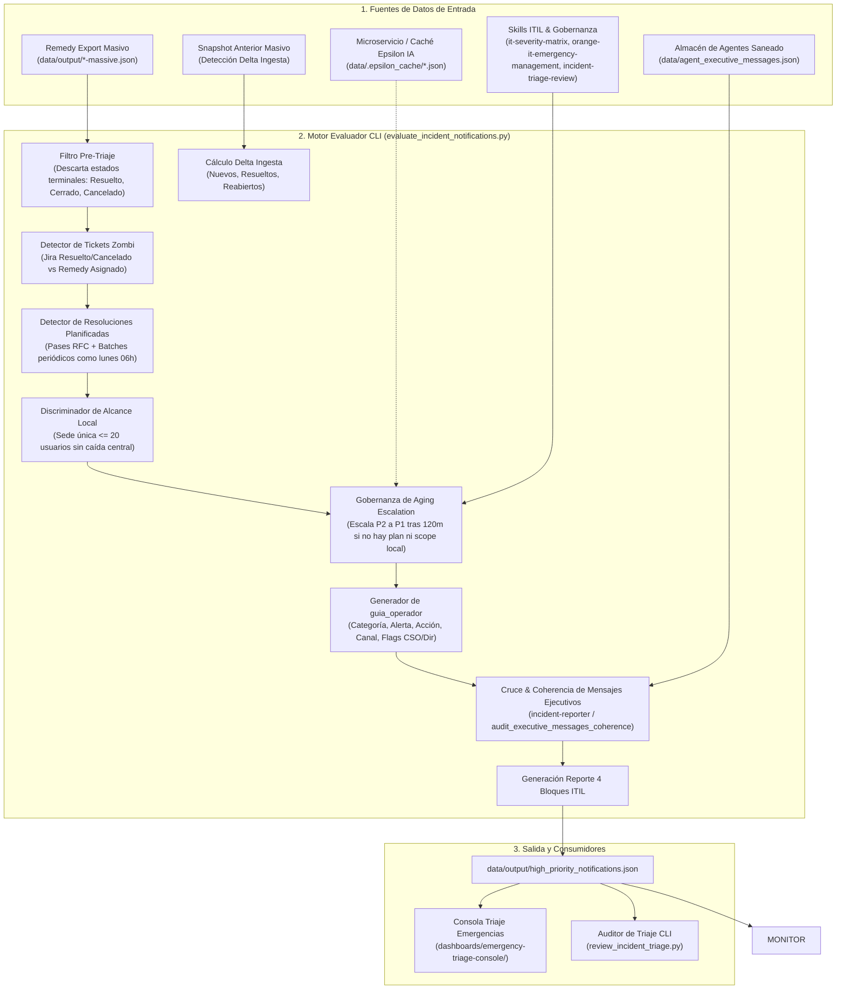

# Especificación Técnica: Catálogo de Incidencias de Alta Prioridad (`high_priority_notifications.json`)

Documentación técnica, funcional y de arquitectura del fichero [`data/output/high_priority_notifications.json`](file:///c:/Users/jose.delafuente/proyectos/release-dashboard-application/data/output/high_priority_notifications.json), el catálogo unificado y enriquecido de incidencias IT de alta prioridad (P1, P2 y discrepancias de subescalación N1) en el entorno Orange Tech Operations.

* **Versión del Esquema:** `2.6.0`
* **Skills de Referencia:** `it-severity-matrix` (v2.7.0), `orange-it-emergency-management` (v2.6.0), `incident-reporter` (v1.5.0), `incident-executive-notifications` (v1.5.0), `incident-triage-review` (v1.0.0).

---

## 📌 1. Propósito y Alcance

El catálogo `high_priority_notifications.json` constituye la **Fuente Única de Verdad (Single Source of Truth)** para el triaje automatizado, el gobierno de crisis IT y la toma de decisiones del Incident Manager y los operadores de consola:

1. **Triaje ITIL Automatizado & Calibrado**: Evalúa el impacto y la urgencia real sobre el negocio de todos los tickets masivos de Remedy aplicando la matriz corporativa de Orange ([`it-severity-matrix`](file:///c:/Users/jose.delafuente/proyectos/release-dashboard-application/.agents/skills/it-severity-matrix/SKILL.md)), evitando tanto la subescalación de N1 como el sobreescalado ciego por tiempo.
2. **Guía Determinista para el Operador (`guia_operador`)**: Proporciona instrucciones operativas unívocas, categorizadas y accionables para que el operador de consola sepa exactamente qué protocolo activar, qué canal utilizar y si procede o no convocar War Room o emitir comunicaciones ejecutivas.
3. **Discriminación de Tipologías Operativas**: Diferencia de forma automatizada entre:
   - **Emergencias Críticas Vivas (`EMERGENCIA_VIVA`)**: Caídas masivas o de servicios core sin mitigación.
   - **Resoluciones Planificadas y Batches (`RESOLUCION_PLANIFICADA`)**: Tickets con pases RFC o ventanas batch periódicas programadas (con techo P2 y exención estricta de aging).
   - **Estancamientos Locales (`ESTANCAMIENTO_LOCAL`)**: Incidencias departamentales ($\le 20$ usuarios o sede única sin caída central) que no deben inflarse a emergencias corporativas nacionales.
   - **Tickets Zombi de Remedy (`TICKET_ZOMBI_REMEDY`)**: Desincronizaciones donde el problema ya fue cerrado/cancelado en Jira pero sigue como `Asignado` en Remedy, desescalando a P3 administrativo.
4. **Control de SLAs de Crisis y Cronómetros de Escalado**: Monitoriza los cronómetros de Orange IT Emergency Management: 20 min (1ª Notificación a Dirección), 45 min (Escalado telefónico obligatorio a IM-CSO/N3) y 105 min / >2h (Alarma por estancamiento y escalado a estamentos superiores).
5. **Consolidación de Comunicaciones Ejecutivas**: Almacena los comunicados oficiales auditados para Dirección (**Apertura**, **Seguimiento** y **Cierre**) cumpliendo los límites normativos ($\le 90$ palabras monopárrafo y $\le 30$ palabras en versión breve).
6. **Alimentación de Interfaces**: Provee los datos en tiempo real a la **Consola de Triaje y Operaciones de Emergencias** ([`dashboards/emergency-triage-console/`](file:///c:/Users/jose.delafuente/proyectos/release-dashboard-application/dashboards/emergency-triage-console/)) y los endpoints REST de la aplicación.

---

## 🏛️ 2. Arquitectura y Flujo de Generación

El catálogo es generado de forma programática por el CLI [`evaluate_incident_notifications.py`](file:///c:/Users/jose.delafuente/proyectos/release-dashboard-application/converters/cli/evaluate_incident_notifications.py):



### Comando Oficial de Generación
```bash
python converters/cli/evaluate_incident_notifications.py --input "data/output/CS-Informe incidencias P1,  P2 y P3 - 2026S2 - 04 Nov 2026 (5)-massive.json"
```

* **Parámetros admitidos:**
  * `--input, -i`: Ruta al archivo JSON masivo de entrada (resuelve el más reciente automáticamente si se omite).
  * `--output, -o`: Ruta de destino (por defecto `data/output/high_priority_notifications.json`).
  * `--limit, -l`: Límite numérico de incidencias para depuración o pruebas.
  * `--base-url`: URL base del microservicio Epsilon IA (por defecto `http://127.0.0.1:8080/api/epsilon/resumenIA`).
  * `--force`: Invalida la caché de Epsilon y fuerza reconsultas.
  * `--dry-run`: Evalúa en memoria y muestra métricas por consola sin sobreescribir el JSON de salida.

---

## 📋 3. Especificación Detallada del Esquema JSON (v2.6.0)

El fichero se divide en dos bloques raíz: **`_metadata`** y **`data`**.

```json
{
  "_metadata": { ... },
  "data": [ { ... }, { ... } ]
}
```

---

### 3.1. Bloque `_metadata`

Proporciona trazabilidad completa del procesamiento, versiones de skills aplicadas, deltas de ingesta y los 18 contadores cuantitativos de control:

| Campo | Tipo | Descripción |
| :--- | :--- | :--- |
| `type` | `string` | `"high_priority_notifications"`. |
| `version` | `string` | Versión del esquema (`"2.6.0"`). |
| `skills_version` | `object` | Versiones exactas de las skills empleadas durante el triaje: `it-severity-matrix` (2.7.0), `orange-it-emergency-management` (2.6.0), `incident-reporter` (1.5.0), `incident-executive-notifications` (1.5.0). |
| `generated_at` | `string (ISO-8601 UTC)` | Fecha/hora UTC de generación (ej. `"2026-11-04T18:52:07.834784+00:00"`). |
| `source_file` | `string` | Nombre base del archivo masivo procesado. |
| `ingestion_delta` | `object` | Comparativa contra el lote masivo previo (fichero anterior, conteo nuevos, resueltos, reabiertos e IDs específicos). |
| `audit_completeness` | `object` | Desglose de completitud semántica: `completas`, `parciales`, `incompletas` y `terminales_omitidas`. |
| `kpis` | `object` | Contadores agregados para el Incident Manager (ver tabla inferior). |
| `total_source_tickets`| `integer` | Total de tickets presentes en el archivo fuente original. |
| `terminal_tickets_omitted` | `integer` | Tickets terminales excluidos del triaje activo conforme a ITIL. |

#### Contadores de `_metadata.kpis` (18 KPIs)
| KPI | Tipo | Significado Operativo |
| :--- | :---: | :--- |
| `total_scanned` | `int` | Total de tickets leídos del archivo fuente. |
| `terminal_skipped_count` | `int` | Tickets descartados por estar en estado final (`Cerrado`, `Resuelto`, `Cancelado`). |
| `active_evaluated_count` | `int` | Tickets vivos sometidos a evaluación activa (`total_scanned - terminal_skipped_count`). |
| `total_high_priority` | `int` | Suma de incidencias activas clasificadas como **P1** o **P2**. |
| `p1_critical_count` | `int` | Total de tickets evaluados como **P1 Crítico** (Emergencias Vivas). |
| `p2_high_count` | `int` | Total de tickets evaluados como **P2 Mayor**. |
| `reabiertas_count` | `int` | Tickets reabiertos que aplican factor agravante ITIL. |
| `borradores_provisionales_count` | `int` | Mensajes generados en modo borrador preliminar. |
| `discrepancies_count` | `int` | Total de tickets con subescalación N1 (Remedy < ITIL). |
| `discrepancias_delta1_moderada_count` | `int` | Subescalación de +1 nivel (ej. Nominal P3 $\rightarrow$ Evaluado P2). |
| `discrepancias_delta2_mayor_count` | `int` | Subescalación de +2 niveles (ej. Nominal P3 $\rightarrow$ Evaluado P1). |
| `discrepancias_delta3_critica_count` | `int` | Subescalación de +3 niveles (ej. Nominal P4 $\rightarrow$ Evaluado P1). |
| `aging_escaladas_p1_count` | `int` | Incidencias P2 escaladas operativamente a P1 por superar 120m sin workaround. |
| **`tickets_zombi_count`** | `int` | **Tickets cancelados/resueltos en Jira que siguen activos en Remedy.** |
| **`resoluciones_planificadas_count`** | `int` | **Tickets asociados a RFC programadas o batches periódicos (exentos de aging).** |
| **`estancamientos_locales_count`** | `int` | **Tickets departamentales ($\le 20$ usuarios o sede única) acotados a P2/P3 local.** |
| `sla_primera_notificacion_vencidos_count` | `int` | Tickets con $>20$ min desde apertura sin comunicado a Dirección. |
| `requiere_escalado_telefonico_count` | `int` | Tickets activos $\ge 45$ min que exigen llamada a IM-CSO. |
| `workaround_pendientes_cso_count` | `int` | Incidencias con mitigación transitoria pendientes de validación formal por CSO. |

---

### 3.2. Bloque `data[]`: Campos por Incidencia

El array `data` contiene los tickets activos evaluados de alta prioridad o discrepancias, ordenados operativamente (emergencias vivas primero, seguidas de incidencias mayores, y con los tickets zombi relegados al final de la cola).

#### A. Identificación y Severidades
* **`id`** (`string`): Identificador Remedy oficial (ej. `"INC000004175558"`).
* **`titulo`** (`string`): Título limpio y sintetizado de la incidencia.
* **`sistemas`** (`array[string]`): Lista de sistemas, microservicios o interfaces involucradas.
* **`prioridad_original`** (`string`): Severidad nominal N1 registrada en Remedy (`"Media"`, `"Alta"`, `"Crítica"`).
* **`prioridad_sugerida`** (`string`): Criticidad real dictaminada por el motor (`"P1"`, `"P2"`, `"P3"`).
* **`es_alta_prioridad`** (`boolean`): `true` si la prioridad sugerida es P1 o P2.
* **`estatus`** (`string`): Estado en Remedy (`"Asignado"`, `"En curso"`, `"Pendiente"`).
* **`fecha_envio`** / **`fecha_apertura`** (`string`): Fechas de registro en Remedy.

#### B. Metadatos de Discrepancia y Clasificación Especial (Nuevos en v2.6.0)
* **`es_discrepancia`** (`boolean`): `true` si la prioridad evaluada difiere de la nominal.
* **`discrepancia_delta`** (`integer`): Magnitud del desajuste ($0, 1, 2$ o $3$).
* **`discrepancia_gravedad`** (`string`): `"Mayor Severa"` ($\ge 2$), `"Moderada"` ($1$) o vacía ($0$).
* **`discrepancia_motivo`** (`string`): Justificación técnica detallada de la subescalación o ajuste.
* **`aging_escalated`** (`boolean`): `true` si el ticket escaló de P2 a P1 por transcurrir $\ge 120$ min sin mitigación.
* **`es_planificada`** (`boolean`): `true` si la solución está programada en un pase RFC o proceso batch periódico.
* **`detalle_planificacion`** (`string`): Fecha y descripción del pase comprometido (ej. `"Proceso batch planificado (Lunes 06h)"` o `"Pase comprometido 17/11/2026"`).
* **`es_zombi`** (`boolean`): `true` si el ticket ya fue cancelado o resuelto en Jira pero sigue en `Asignado` en Remedy.
* **`detalle_zombi`** (`string`): Evidencia de la desincronización (ej. `"Ticket cancelado en Jira como Resuelto/No Aplica"`).
* **`es_local_departamental`** (`boolean`): `true` si la afectación está acotada a $\le 20$ usuarios o una única sede sin indisponibilidad total de servicio.

---

### 3.3. El Objeto `guia_operador`: Especificación Exhaustiva

Ubicado tanto en la raíz de cada incidencia (`data[i].guia_operador`) como dentro de `data[i].evaluacion.guia_operador`, este objeto proporciona la **inteligencia de decisión para la consola**:

```json
"guia_operador": {
  "categoria_operativa": "RESOLUCION_PLANIFICADA",
  "alerta_consola": "📅 RESOLUCIÓN PLANIFICADA: Proceso batch planificado (Lunes 06h)",
  "accion_recomendada": "Monitorizar pase programado. No convocar War Room ni escalar telefónicamente a IM-CSO salvo que falle el pase.",
  "canal_escalado": "Mesa de Cambios (CAB) / Seguimiento de Releases",
  "prioridad_operativa_consola": "P2 Alta",
  "requiere_llamada_cso": false,
  "requiere_comunicado_direccion": false
}
```

#### Diccionario de Campos de `guia_operador`

| Campo | Tipo | Valores Posibles | Propósito y Comportamiento |
| :--- | :--- | :--- | :--- |
| **`categoria_operativa`** | `enum string` | <ul><li>`EMERGENCIA_VIVA`</li><li>`RESOLUCION_PLANIFICADA`</li><li>`ESTANCAMIENTO_LOCAL`</li><li>`TICKET_ZOMBI_REMEDY`</li><li>`SEGUIMIENTO_ESTANDAR`</li></ul> | Define la tipología de tratamiento operativo. Determina el orden de atención y los protocolos a seguir. |
| **`alerta_consola`** | `string` | Texto descriptivo con emoji badge (ej. `🚨 EMERGENCIA CRÍTICA P1 ACTIVA`, `📅 RESOLUCIÓN PLANIFICADA: ...`, `⚠️ TICKET ZOMBI: ...`, `⏳ ESTANCAMIENTO LOCAL (>2h): ...`). | Mensaje visual de impacto inmediato que se renderiza en la cabecera de la tarjeta o fila de la consola. |
| **`accion_recomendada`** | `string` | Instrucción procedimental en lenguaje claro y directo. | Le indica al operador qué acción ejecutar y qué acciones omitir de forma expresa para evitar errores operativos. |
| **`canal_escalado`** | `string` | <ul><li>`Vía Telefónica IM-CSO / Teams War Room`</li><li>`Mesa de Cambios (CAB) / Seguimiento de Releases`</li><li>`Grupo Resolutor Remedy / IM de Turno`</li><li>`Mesa de Incidencias (BMC Remedy)`</li></ul> | Señala el canal técnico u organizativo correcto donde debe interactuar el operador. |
| **`prioridad_operativa_consola`** | `string` | `"P1 Crítico"`, `"P2 Alta"`, `"P2 Local"`, `"P3 Cierre Administrativo"`, `"P3 Media"`. | Nivel de criticidad calibrado que debe reflejar la consola para el operador de turno. |
| **`requiere_llamada_cso`** | `boolean` | `true` o `false` | Bandera booleana: si es `true`, exige llamada telefónica obligatoria al Incident Manager de Customer & Service Ops (IM-CSO) tras superar 45 minutos. |
| **`requiere_comunicado_direccion`**| `boolean` | `true` o `false` | Bandera booleana: si es `true`, habilita y exige la emisión de comunicados ejecutivos oficiales de Apertura/Seguimiento. Si es `false`, previene saturar a Dirección. |

---

### 3.4. Matriz de Comportamiento Operativo por Categoría

La siguiente matriz gobierna el tratamiento que el motor y la consola aplican a cada categoría:

| Categoría Operativa | Prioridad Máxima | ¿Aplica Aging Escalation? | Escalado Telefónico CSO (>45m) | War Room Teams (>1h) | Comunicado Dirección | Acción Operativa Obligatoria |
| :--- | :---: | :---: | :---: | :---: | :---: | :--- |
| **`EMERGENCIA_VIVA`** | **P1** | **Sí** ($\ge 120m \rightarrow P1$) | **🟢 SÍ (Obligatorio)** | **🟢 SÍ** | **🟢 SÍ ($\le 90$ palabras)** | Intervención inmediata, audio obligatorio y apertura de War Room. |
| **`RESOLUCION_PLANIFICADA`** | **P2** | **❌ EXENTO** (Techo P2) | ⚪ NO (Salvo fallo del pase) | ⚪ NO | ⚪ NO | Monitorizar fecha/hora del pase RFC o batch semanal comprometido. |
| **`ESTANCAMIENTO_LOCAL`** | **P2 / P3** | **❌ EXENTO** (Techo P2) | ⚪ NO | ⚪ NO | ⚪ NO | Reclamar avance técnico al Grupo Resolutor asignado vía Remedy. |
| **`TICKET_ZOMBI_REMEDY`** | **P3** | **❌ EXENTO** (Techo P3) | ⚪ NO | ⚪ NO | ⚪ NO | Solicitar Cierre Administrativo formal a la Mesa en BMC Remedy. |
| **`SEGUIMIENTO_ESTANDAR`** | **P3 / P4** | ⚪ No | ⚪ NO | ⚪ NO | ⚪ NO | Tratamiento estándar conforme a cola resolutora de Remedy. |

---

### 3.5. Sub-objeto `evaluacion`

Contiene el desglose técnico y los cronómetros ITIL calculados por el motor:

* **`proceso`** / **`proceso_negocio`** (`string`): Uno de los 10 Procesos Críticos corporativos de Orange (ATC, Ventas, Facturación, Middleware, etc.).
* **`dominio_tecnico`** (`string`): Dominio tecnológico (`"Sistemas Core"`, `"Infraestructura Cloud"`, `"Redes"`, etc.).
* **`criterio`** (`string`): Regla específica de `it-severity-matrix` superada.
* **`impacto`** / **`urgencia`** (`string`): Nivel (`"Alto"`, `"Medio"`, `"Bajo"`).
* **`impacto_justificacion`** / **`urgencia_justificacion`** (`string`): Texto explicativo con evidencia extraída de Epsilon o Remedy.
* **`workaround`** (`string`): `"Sí"`, `"No"` o `"Desconocido"`.
* **`workaround_gobernanza`** (`string`): Dictamen de gobernanza (bloqueo de desescalada sin erradicación).
* **`sla_objetivo_minutos`** (`integer`): Objetivo de resolución (15m P1, 60m P2, 240m P3).
* **`minutos_desde_apertura`** (`integer`): Tiempo transcurrido real.
* **`sla_primera_notificacion_vencido`** (`boolean`): `true` si tiempo $> 20$ min.
* **`requiere_escalado_telefonico`** (`boolean`): `true` si tiempo $\ge 45$ min.
* **`escalado_estamentos_superiores`** (`boolean`): `true` si tiempo $\ge 105$ min o $> 2$ horas.
* **`metricas_cuantitativas`** (`object`): Valores numéricos de telemetría extraídos:
  * `sedes` (`integer` | `null`): Número de centros afectados.
  * `usuarios` (`integer` | `null`): Agentes u operadores impactados.
  * `desviacion_pct` (`float` | `null`): Caída porcentual de tráfico o transacciones.
  * `detalles` (`array[string]`): Hechos cuantificados aislados.

---

### 3.6. Sub-objeto `resumen_ia`

Datos semánticos provistos por el microservicio o la caché local de **Epsilon Resumen IA**:

* **`problema`** (`string`): Descripción sintética del síntoma técnico.
* **`impacto`** (`string`): Afectación operativa y de negocio reportada.
* **`solucion`** (`string`): Diagnóstico de causa raíz o medidas paliativas aplicadas.
* **`bloqueos`** (`string`): Impedimentos de avance entre grupos resolutores.
* **`siguiente_accion`** (`string`): Siguiente hito acordado.
* **`hitos_tecnicos`** (`array[string]`): Cronología verificada de actuaciones de soporte.

---

### 3.7. Sub-objeto `mensajes_ejecutivos`

Estructura de comunicaciones formales oficiales para Dirección generadas por [`incident-reporter`](file:///c:/Users/jose.delafuente/proyectos/release-dashboard-application/agents/it-incidents/incident-reporter.md) y auditadas por [`audit_executive_messages_coherence.py`](file:///c:/Users/jose.delafuente/proyectos/release-dashboard-application/converters/cli/audit_executive_messages_coherence.py):

* Fases disponibles: **`apertura`**, **`seguimiento`** y **`cierre`**.
* Campos de cada fase:
  * **`completo`** (`string`): Texto oficial para Dirección ($\le 90$ palabras, exactamente un único párrafo cohesionado).
  * **`breve`** (`string`): Alerta ultracorta para canales de mensajería rápida ($\le 30$ palabras, una sola línea).
  * **`conteo_palabras_completo`** (`integer`): Palabras reales de la versión completa.
  * **`conteo_palabras_breve`** (`integer`): Palabras reales de la versión breve.
  * **`generado_por_agente`** (`boolean`): `true` si proviene del almacén persistente oficial.
  * **`origen`** (`string`): `"incident-reporter"`.
  * **`prompt_agente`** (`string`): Contexto estructurado precalculado para invocar al LLM si el mensaje está pendiente.

---

### 3.8. Campo `reporte_emergencia`

Texto formateado en los **4 bloques normativos** de Orange IT Emergency Management:
1. `[1] CLASIFICACIÓN DEL TICKET`: Severidad ITIL real, proceso, umbral y sistemas.
2. `[2] ESTADO DE COMUNICACIONES Y SLAS`: Cronómetros de 20m, 60m y estado de War Room.
3. `[3] PLAN DE ACCIÓN Y GOBERNANZA DE WORKAROUNDS`: Causa técnica, hitos y control de workaround.
4. `[4] ESTADO DE ESCALADO TELEFÓNICO`: Canal de audio obligatorio, escalados a N3/CSO y roles RACI.

---

## 🔍 4. Ejemplos Reales Ilustrativos

### Ejemplo 1: Emergencia Viva P1 (`INC000004175558`)
```json
{
  "id": "INC000004175558",
  "titulo": "A-Red de Datos | Acceso | Jazzplat - Guadalajara",
  "prioridad_original": "Media",
  "prioridad_sugerida": "P1",
  "es_discrepancia": true,
  "discrepancia_delta": 2,
  "es_planificada": false,
  "es_zombi": false,
  "es_local_departamental": false,
  "guia_operador": {
    "categoria_operativa": "EMERGENCIA_VIVA",
    "alerta_consola": "🚨 EMERGENCIA CRÍTICA P1 ACTIVA",
    "accion_recomendada": "Aplicar protocolo IM-CSO: Escalar telefónicamente a IM-CSO si >45m y convocar War Room si >1h.",
    "canal_escalado": "Vía Telefónica IM-CSO / Teams War Room",
    "prioridad_operativa_consola": "P1 Crítico",
    "requiere_llamada_cso": true,
    "requiere_comunicado_direccion": true
  }
}
```

### Ejemplo 2: Resolución Planificada en Batch Periódico (`INC000004169386`)
```json
{
  "id": "INC000004169386",
  "titulo": "Ficha Cliente Orange | Error funcional | ISGF - Murcia",
  "prioridad_original": "Media",
  "prioridad_sugerida": "P2",
  "aging_escalated": false,
  "es_planificada": true,
  "detalle_planificacion": "Proceso batch planificado (Lunes 06h)",
  "es_zombi": false,
  "guia_operador": {
    "categoria_operativa": "RESOLUCION_PLANIFICADA",
    "alerta_consola": "📅 RESOLUCIÓN PLANIFICADA: Proceso batch planificado (Lunes 06h)",
    "accion_recomendada": "Monitorizar pase programado. No convocar War Room ni escalar telefónicamente a IM-CSO salvo que falle el pase.",
    "canal_escalado": "Mesa de Cambios (CAB) / Seguimiento de Releases",
    "prioridad_operativa_consola": "P2 Alta",
    "requiere_llamada_cso": false,
    "requiere_comunicado_direccion": false
  }
}
```

### Ejemplo 3: Estancamiento Local Acotado a P2 Local (`INC000004162280`)
```json
{
  "id": "INC000004162280",
  "titulo": "Siebel 8 | Error funcional | OEST - Oviedo",
  "prioridad_original": "Media",
  "prioridad_sugerida": "P2",
  "aging_escalated": false,
  "es_planificada": false,
  "es_zombi": false,
  "es_local_departamental": true,
  "guia_operador": {
    "categoria_operativa": "ESTANCAMIENTO_LOCAL",
    "alerta_consola": "⏳ ESTANCAMIENTO LOCAL (>2h): 15d 2h (21750m) en SOP_SMC_TEIDE",
    "accion_recomendada": "Reclamar avance técnico al Grupo Resolutor vía Remedy. No convocar War Room por alcance acotado (departamental <=20 usuarios o sede única sin caída total).",
    "canal_escalado": "Grupo Resolutor Remedy / IM de Turno",
    "prioridad_operativa_consola": "P2 Local",
    "requiere_llamada_cso": false,
    "requiere_comunicado_direccion": false
  }
}
```

### Ejemplo 4: Ticket Zombi para Cierre Administrativo (`INC000004164611`)
```json
{
  "id": "INC000004164611",
  "titulo": "Ficha Cliente Orange | Error funcional | Foundever - Sevilla",
  "prioridad_original": "Media",
  "prioridad_sugerida": "P3",
  "es_planificada": false,
  "es_zombi": true,
  "detalle_zombi": "Ticket cancelado en Jira como Resuelto/No Aplica",
  "guia_operador": {
    "categoria_operativa": "TICKET_ZOMBI_REMEDY",
    "alerta_consola": "⚠️ TICKET ZOMBI: Ticket cancelado en Jira como Resuelto/No Aplica",
    "accion_recomendada": "Solicitar Cierre Administrativo formal a la Mesa en BMC Remedy al estar resuelto/cancelado en Jira. No requiere investigación técnica.",
    "canal_escalado": "Mesa de Incidencias (BMC Remedy)",
    "prioridad_operativa_consola": "P3 Cierre Administrativo",
    "requiere_llamada_cso": false,
    "requiere_comunicado_direccion": false
  }
}
```

---

## 🛠️ 5. Gobernanza y Buenas Prácticas de Mantenimiento

1. **Regeneración tras Ingesta Masiva**: Al incorporar un nuevo archivo masivo a `data/output/`, ejecutar siempre `python converters/cli/evaluate_incident_notifications.py --input <fichero>` para regenerar el catálogo.
2. **Auditoría de Coherencia**: Antes de publicar o difundir comunicados a Dirección, verificar que no existan discrepancias mediante:
   ```bash
   python converters/cli/audit_executive_messages_coherence.py
   ```
3. **Revisión y Calibración de Triaje**: Para auditar la concordancia entre Remedy e ITIL, ejecutar la herramienta de la skill `incident-triage-review`:
   ```bash
   python .agents/skills/incident-triage-review/scripts/review_incident_triage.py
   ```
4. **Respeto a las Reglas de Oro**: Ninguna incidencia puede desescalarse automáticamente por la mera existencia de un workaround sin validación formal documentada de IM-CSO (Regla de Oro 3).
