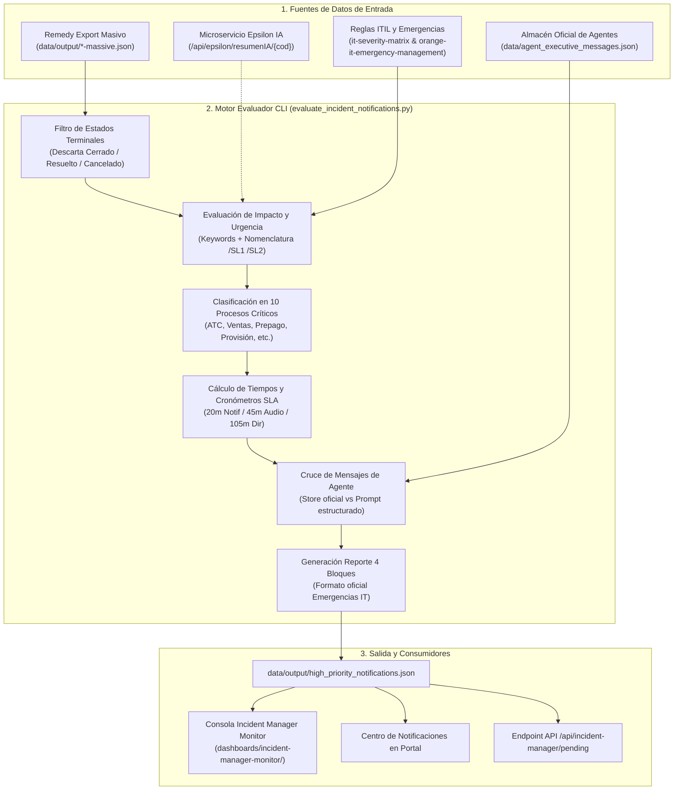

# Especificación Técnica: Catálogo de Incidencias de Alta Prioridad (`high_priority_notifications.json`)

Documentación técnica y funcional del fichero [`data/output/high_priority_notifications.json`](file:///c:/Users/jose.delafuente/proyectos/release-dashboard-application/data/output/high_priority_notifications.json), el catálogo unificado y enriquecido de incidencias IT de alta prioridad (P1, P2 y discrepancias de subescalación N1) en el entorno Orange.

---

## 📌 1. Propósito y Alcance

El catálogo `high_priority_notifications.json` constituye la **Fuente Única de Verdad (Single Source of Truth)** para el seguimiento, triaje operativo y comunicación ejecutiva de incidencias críticas en la plataforma:

1. **Triaje ITIL Automatizado**: Evalúa el impacto real sobre el negocio de todos los tickets masivos de Remedy, aplicando la matriz oficial de criticidad de Orange ([`it-severity-matrix`](file:///c:/Users/jose.delafuente/proyectos/release-dashboard-application/.agents/skills/it-severity-matrix/SKILL.md)).
2. **Detección de Discrepancias (Subescalación N1)**: Identifica tickets que fueron clasificados nominalmente como P3 (Media) o P4 (Baja) en Remedy pero cuyo impacto real supera los umbrales de P1 (SL1) o P2 (SL2).
3. **Control de SLAs de Crisis y Escalados**: Monitoriza los cronómetros oficiales de Orange IT Emergency Management: 20 minutos (1ª Notificación a Dirección), 45 minutos (Escalado telefónico obligatorio a N3/Proveedor) y 105 minutos (2º Escalado a Dirección y CSO).
4. **Almacén de Comunicaciones Oficiales para Dirección**: Consolida los textos ejecutivos oficiales en 3 fases (**Apertura**, **Seguimiento** y **Cierre**) con versiones de hasta 90 palabras (monopárrafo) y alertas breves de hasta 30 palabras generadas por el agente [`incident-reporter`](file:///c:/Users/jose.delafuente/proyectos/release-dashboard-application/agents/it-incidents/incident-reporter.md).
5. **Alimentación de Dashboards**: Proporciona los datos en tiempo real para la **Consola de Emergencias IT del Incident Manager** ([`dashboards/incident-manager-monitor/`](file:///c:/Users/jose.delafuente/proyectos/release-dashboard-application/dashboards/incident-manager-monitor/)), el **Centro de Notificaciones** y los endpoints de la API backend.

---

## 🏛️ 2. Arquitectura y Flujo de Generación

El catálogo es generado mediante el script CLI [`evaluate_incident_notifications.py`](file:///c:/Users/jose.delafuente/proyectos/release-dashboard-application/converters/cli/evaluate_incident_notifications.py):



### Comando de Generación
```bash
python converters/cli/evaluate_incident_notifications.py
```
* **Opciones admitidas**:
  * `--input, -i`: Ruta al archivo masivo JSON de entrada (por defecto resuelve el más reciente vía `data/output/index.json`).
  * `--output, -o`: Ruta de destino (por defecto `data/output/high_priority_notifications.json`).
  * `--limit, -l`: Límite de incidencias a procesar (útil para pruebas).
  * `--base-url`: URL del microservicio Epsilon IA (por defecto `http://127.0.0.1:8081/api/epsilon/resumenIA`).
  * `--dry-run`: Ejecuta la evaluación y muestra métricas por consola sin escribir en disco.

---

## 📋 3. Especificación Detallada del Esquema JSON

El documento JSON se compone de dos secciones raíz: **`_metadata`** y **`data`**.

```json
{
  "_metadata": { ... },
  "data": [ { ... }, { ... } ]
}
```

---

### 3.1. Bloque `_metadata`

Proporciona trazabilidad completa sobre la ejecución y resume los indicadores clave (KPIs) del conjunto de incidencias:

| Campo | Tipo | Descripción |
| :--- | :--- | :--- |
| `type` | `string` | Identificador de tipo de documento: `"high_priority_notifications"`. |
| `version` | `string` | Versión del esquema: `"1.0.0"`. |
| `generated_at` | `string (ISO-8601 UTC)` | Timestamp exacto de generación (ej. `"2026-10-30T09:54:43.655120+00:00"`). |
| `source_file` | `string` | Nombre del fichero masivo origen procesado (ej. `"CS-Informe incidencias P1, P2 y P3 - 2026 - 29 Oct 2026-massive.json"`). |
| `kpis` | `object` | Diccionario con los 10 contadores cuantitativos del lote. |

#### Sub-campos de `_metadata.kpis`
* **`total_scanned`** (`integer`): Cantidad total de tickets contenidos en el archivo de entrada.
* **`terminal_skipped_count`** (`integer`): Incidencias omitidas por encontrarse ya en estado terminal (`Cerrado`, `Resuelto`, `Cancelado`).
* **`active_evaluated_count`** (`integer`): Incidencias activas sobre las que se aplicó el triaje (`total_scanned - terminal_skipped_count`).
* **`total_high_priority`** (`integer`): Incidencias activas clasificadas en severidad alta (`p1_critical_count + p2_high_count`).
* **`p1_critical_count`** (`integer`): Tickets evaluados como severidad **P1 / SL1 (Emergencia Crítica)**.
* **`p2_high_count`** (`integer`): Tickets evaluados como severidad **P2 / SL2 (Incidencia Mayor)**.
* **`discrepancies_count`** (`integer`): Tickets donde el cálculo ITIL supera la severidad nominal de Remedy (subescalación detectada).
* **`sla_primera_notificacion_vencidos_count`** (`integer`): Incidencias con más de 20 minutos desde su apertura sin emitir la 1ª notificación a Dirección.
* **`requiere_escalado_telefonico_count`** (`integer`): Incidencias con 45 minutos o más de apertura que exigen convocatoria telefónica/audio a N3 o proveedores.
* **`workaround_pendientes_cso_count`** (`integer`): Incidencias con solución temporal (workaround) que requieren autorización formal de IM-CSO antes de desescalar.

---

### 3.2. Bloque `data[]`: Campos por Incidencia

El array `data` contiene la lista de incidencias filtradas (solo aquellas evaluadas como **P1**, **P2** o con **discrepancia de subescalación**). Cada elemento dispone de los siguientes campos:

#### A. Identificación y Metadatos de Cabecera
* **`id`** (`string`): Código Remedy oficial del ticket (ej. `"INC000004156790"`).
* **`titulo`** (`string`): Descripción o título de la incidencia.
* **`sistemas`** (`array[string]`): Lista de aplicativos o plataformas comprometidas (ej. `["DES_SOE_FICHA"]` o `["SPAIN ALMACENAMIENTO"]`). Proviene de Epsilon Resumen IA o del campo `"Grupo asignado"` del ticket.
* **`prioridad_original`** (`string`): Severidad nominal asignada en Remedy por N1 (ej. `"Media"`, `"Alta"`, `"Crítica"`).
* **`prioridad_sugerida`** (`string`): Severidad real calculada tras evaluar impacto y urgencia (`"P1"` o `"P2"`).
* **`es_alta_prioridad`** (`boolean`): `true` si la prioridad calculada es P1 o P2.
* **`es_discrepancia`** (`boolean`): `true` si la prioridad calculada es más crítica que la nominal de Remedy (ej. Remedy = Media P3, pero calculada = P1 o P2).
* **`estatus`** (`string`): Estado operativo en Remedy (ej. `"Asignado"`, `"En curso"`).
* **`fecha_envio`** / **`fecha_apertura`** (`string`): Timestamp de apertura registrado en Remedy (ej. `"14/10/2026 13:26 a"`).

---

#### B. Sub-objeto `evaluacion`
Contiene la justificación cuantitativa y cualitativa del triaje conforme a las skills [`it-severity-matrix`](file:///c:/Users/jose.delafuente/proyectos/release-dashboard-application/.agents/skills/it-severity-matrix/SKILL.md) y [`orange-it-emergency-management`](file:///c:/Users/jose.delafuente/proyectos/release-dashboard-application/.agents/skills/orange-it-emergency-management/SKILL.md):

| Campo | Tipo | Valores / Ejemplo | Descripción Técnica |
| :--- | :--- | :--- | :--- |
| `proceso` | `string` | `"Atención al Cliente (ATC)"`, `"Ventas"`, `"Prepago"`, `"Portabilidad"`, `"Provisión"`, `"Facturación y Cobros"`, `"Middleware e Integración Transversal"`, `"Conectividad de Sedes, Call Centers y Tiendas"`, `"Infraestructura Core IT, BBDD y Cloud"`, `"Identidad (GDU/EVIDIAN) y Automatización"` o `"Sistemas Core"`. | Clasificación en uno de los 10 Procesos Críticos de Negocio de Orange según el módulo afectado y el grupo resolutor. |
| `criterio` | `string` | Ej. `"ATC (3.1): Frontales/CRM (>20% desviación en 30m) o Regla de Oro N1"` | Umbral numérico o regla de triaje de la matriz ITIL superado. |
| `impacto` | `string` | `"Alto"`, `"Medio"`, `"Bajo"` | Nivel de impacto en servicio o usuarios. |
| `impacto_justificacion` | `string` | Ej. `"Afectación crítica o corte global sobre el servicio principal sin alternativa viable."` | Razón cualitativa del nivel de impacto. |
| `urgencia` | `string` | `"Alta"`, `"Media"`, `"Baja"` | Nivel de urgencia temporal. |
| `urgencia_justificacion` | `string` | Ej. `"Incidencia en tratamiento con contención operativa transitoria."` | Razón cualitativa de la urgencia. |
| `workaround` | `string` | `"Sí"`, `"No"`, `"Desconocido"` | Detección automática de medidas de mitigación transitorias. |
| `workaround_gobernanza` | `string` | Ej. `"Pendiente autorización IM-CSO (SL1 activa)"` o `"Sin workaround (Resolución directa requerida)"` | Estado institucional del workaround conforme a la **Regla de Oro 3** (prohibida la desescalada sin erradicación total). |
| `sla_objetivo_minutos` | `integer` | `15` (P1), `60` (P2), `240` (P3), `1440` (P4) | Tiempo diana de resolución ITIL. |
| `minutos_desde_apertura` | `integer` | Minutos (ej. `4240`) | Tiempo real transcurrido desde la apertura en Remedy. |
| `sla_primera_notificacion_vencido`| `boolean` | `true` si `minutos_desde_apertura > 20` | Alerta de vencimiento del SLA de 1ª comunicación a Dirección (<20m). |
| `requiere_escalado_telefonico` | `boolean` | `true` si `minutos_desde_apertura >= 45` | Alerta de 1er escalado obligatorio por canal telefónico/audio a N3. |
| `escalado_estamentos_superiores`| `boolean` | `true` si `minutos_desde_apertura >= 105` | Alerta de 2º escalado a Dirección y CSO (45m + 1h). |
| `proxima_ventana_update_minutos` | `integer` | Minutos restantes (1-60) | Minutos para la siguiente actualización horaria obligatoria. |

---

#### C. Sub-objeto `resumen_ia`
Información semántica enriquecida obtenida de **Epsilon Resumen IA** (`/api/epsilon/resumenIA/{id}`):

* **`problema`** (`string`): Resumen sintético del fallo técnico analizado por Epsilon.
* **`impacto`** (`string`): Afectación en clientes o procesos de negocio.
* **`solucion`** (`string`): Causa raíz identificada o plan técnico de solución.
* **`bloqueos`** (`string`): Impedimentos activos entre equipos de soporte.
* **`siguiente_accion`** (`string`): Siguiente hito planificado por el equipo de guardia.

> [!NOTE]
> **Tolerancia a Fallos / Modo Offline:** Si el microservicio Epsilon no se encuentra disponible (o falla por permisos de red), este bloque se asigna como `null` y la evaluación continúa normalmente utilizando los metadatos del ticket de Remedy.

---

#### D. Sub-objeto `mensajes_ejecutivos`
Estructura de comunicaciones oficiales para Dirección en las 3 fases del ciclo de vida ITIL: **`apertura`**, **`seguimiento`** y **`cierre`**:

```json
"mensajes_ejecutivos": {
  "apertura": {
    "completo": "Se declara incidencia crítica P1...",
    "breve": "Apertura P1 (...): ...",
    "conteo_palabras_completo": 73,
    "conteo_palabras_breve": 21,
    "generado_por_agente": true,
    "origen": "incident-reporter",
    "estado": "completado",
    "prompt_agente": "Actúa como el agente incident-reporter..."
  },
  "seguimiento": { ... },
  "cierre": { ... },
  "reporte_emergencia": "🚨 REPORTE DE EMERGENCIA IT..."
}
```

Cada fase incluye:
* **`completo`** (`string`): Redacción ejecutiva oficial para Dirección: **máximo 90 palabras** en un **único párrafo cohesionado**.
* **`breve`** (`string`): Alerta ultracorta para canal SMS o Teams: **máximo 30 palabras**.
* **`conteo_palabras_completo`** (`integer`): Conteo exacto de palabras de la versión completa ($\le 90$).
* **`conteo_palabras_breve`** (`integer`): Conteo exacto de palabras de la versión breve ($\le 30$).
* **`generado_por_agente`** (`boolean`):
  * `true`: Si el mensaje proviene del almacén oficial persistente [`data/agent_executive_messages.json`](file:///c:/Users/jose.delafuente/proyectos/release-dashboard-application/data/agent_executive_messages.json).
  * `false`: Si la redacción aún no ha sido generada o aprobada.
* **`origen`** (`string`): Identificador del agente (`"incident-reporter"`).
* **`estado`** (`string`): `"pendiente"` si aún no existe texto en el almacén; omitido o `"completado"` si ya existe.
* **`prompt_agente`** (`string`): Prompt estructurado preconstruido con todo el contexto necesario (ID, título, sistemas, criticidad, proceso, umbral y Epsilon) listo para ejecutarse en el LLM bajo demanda.

---

#### E. Campo `reporte_emergencia`
Cadena de texto multilinea formateada en los **4 bloques normativos** exigidos por [`orange-it-emergency-management`](file:///c:/Users/jose.delafuente/proyectos/release-dashboard-application/.agents/skills/orange-it-emergency-management/SKILL.md) para sincronización técnica y gobernanza:

1. **`[1] CLASIFICACIÓN DEL TICKET`**: ID, Severidad ITIL (SL1/SL2), Proceso Crítico, Umbral superado, Alcance y Sistemas, Impacto y Urgencia.
2. **`[2] ESTADO DE COMUNICACIONES Y SLAS`**: Minutos transcurridos, estado de 1ª Notificación (<20 min) y frecuencia de actualizaciones (30/60 min).
3. **`[3] PLAN DE ACCIÓN Y GOBERNANZA DE WORKAROUNDS`**: Diagnóstico técnico, acciones en curso, siguiente hito y estado de gobernanza del workaround (bloqueo de desescalada).
4. **`[4] ESTADO DE ESCALADO TELEFÓNICO`**: Fase de escalado según cronómetro (Normal / 45m / +105m), canal de audio obligatorio y roles RACI (Incident Manager como Responsable, IM-CSO como Aprobador).

---

## 🔍 4. Ejemplo JSON Completo y Anotado

A continuación se muestra un registro real extraído del catálogo:

```json
{
  "id": "INC000004167733",
  "titulo": "CORTE TOTAL // SEVILLA // LA FINCA",
  "sistemas": [
    "ROUTING_CORE"
  ],
  "prioridad_original": "Media",
  "prioridad_sugerida": "P1",
  "es_alta_prioridad": true,
  "es_discrepancia": true,
  "estatus": "En curso",
  "fecha_envio": "26/10/2026 23:46 a",
  "fecha_apertura": "26/10/2026 23:46 a",
  "evaluacion": {
    "proceso": "Operación y Monitorización (O&M)",
    "criterio": "ATC (3.1): Frontales/CRM (>20% desviación en 30m) o Regla de Oro N1",
    "impacto": "Alto",
    "impacto_justificacion": "Afectación crítica o corte global sobre el servicio principal sin alternativa viable.",
    "urgencia": "Alta",
    "urgencia_justificacion": "Impacto activo en vivo que requiere restablecimiento inmediato.",
    "workaround": "Desconocido",
    "workaround_gobernanza": "No identificado",
    "sla_objetivo_minutos": 15,
    "fecha_apertura": "26/10/2026 23:46 a",
    "minutos_desde_apertura": 4240,
    "sla_primera_notificacion_vencido": true,
    "requiere_escalado_telefonico": true,
    "escalado_estamentos_superiores": true,
    "proxima_ventana_update_minutos": 20
  },
  "resumen_ia": null,
  "mensajes_ejecutivos": {
    "apertura": {
      "completo": "Se declara incidencia crítica P1 (INC000004167733) por corte total de conectividad en el enlace entre Sevilla y La Finca. La anomalía interrumpe la sincronización de servicios y tráfico de red sobre el nodo principal sin canal alternativo activo, afectando a la operativa interna y a la monitorización de sistemas. Los equipos de infraestructura de red y comunicaciones investigan el origen de la caída y coordinan maniobras de conmutación para restablecer el servicio a la mayor brevedad. Próxima actualización en 30 minutos.",
      "breve": "Apertura P1 (INC000004167733): Corte total de enlace Sevilla - La Finca sin ruta alternativa. Equipos de red coordinando conmutación. Próxima actualización 30 min.",
      "conteo_palabras_completo": 78,
      "conteo_palabras_breve": 22,
      "generado_por_agente": true,
      "origen": "incident-reporter",
      "prompt_agente": "Actúa como el agente incident-reporter..."
    },
    "seguimiento": {
      "completo": "Seguimiento de la incidencia P1 (INC000004167733) sobre el corte total entre Sevilla y La Finca. Los especialistas de red han verificado la caída a nivel de capa física en el circuito principal. Se ha iniciado el levantamiento manual del enlace de respaldo y el reencaminamiento dinámico del tráfico para restaurar los servicios críticos de monitorización. Se mantiene supervisión continua de las interfaces para validar la estabilidad del enlace secundario antes de confirmar la recuperación del tráfico troncal.",
      "breve": "Seguimiento P1 (INC000004167733): Identificada caída en capa física del enlace Sevilla-La Finca; reencaminando tráfico por circuito secundario bajo supervisión técnica.",
      "conteo_palabras_completo": 72,
      "conteo_palabras_breve": 19,
      "generado_por_agente": true,
      "origen": "incident-reporter",
      "prompt_agente": "Actúa como el agente incident-reporter..."
    },
    "cierre": {
      "completo": "Queda resuelta y cerrada la incidencia crítica P1 (INC000004167733) en el enlace Sevilla - La Finca. Tras la intervención técnica y sustitución del módulo óptico defectuoso en la interfaz troncal, se ha normalizado la conectividad sobre el circuito principal. El tráfico opera con plena estabilidad y latencias nominales, habiéndose deshabilitado la ruta provisional de contingencia. Se confirma la total recuperación del servicio y se mantiene supervisión preventiva habitual de las líneas de comunicación.",
      "breve": "Cierre P1 (INC000004167733): Normalizado enlace Sevilla - La Finca tras sustituir módulo óptico; tráfico restablecido sobre circuito principal sin incidencias.",
      "conteo_palabras_completo": 70,
      "conteo_palabras_breve": 19,
      "generado_por_agente": true,
      "origen": "incident-reporter",
      "prompt_agente": "Actúa como el agente incident-reporter..."
    }
  },
  "reporte_emergencia": "🚨 REPORTE DE EMERGENCIA IT - ORANGE TECH OPERATIONS\n────────────────────────────────────────────────────────────\n[1] CLASIFICACIÓN DEL TICKET\n• Incidencia: INC000004167733 (SL1 (Emergencia Crítica))\n• Proceso Crítico: Operación y Monitorización (O&M)\n• Umbral de Emergencia: ATC (3.1): Frontales/CRM (>20% desviación en 30m) o Regla de Oro N1\n• Alcance y Sistemas: ROUTING_CORE\n• Impacto: Alto (Afectación crítica o corte global sobre el servicio principal sin alternativa viable.)\n• Urgencia: Alta (Impacto activo en vivo que requiere restablecimiento inmediato.)\n\n[2] ESTADO DE COMUNICACIONES Y SLAS\n• Tiempo desde Apertura: 4240 min\n• 1ª Notificación a Dirección: ⚠️ SLA 1ª Notificación VENCIDO (>20 min - 4240 min transcurridos)\n• Frecuencia de Actualizaciones: Cada 60 min (o <30m ante cambios críticos)\n• War Room / Teams: Liderado por Incident Manager (IM)\n\n[3] PLAN DE ACCIÓN Y GOBERNANZA DE WORKAROUNDS\n• Diagnóstico Técnico: CORTE TOTAL // SEVILLA // LA FINCA\n• Acciones en Curso: Diagnóstico y contención técnica en curso por equipos resolutores\n• Siguiente Hito: Auditoría preventiva PaP y restablecimiento de servicio\n• Workaround: Desconocido | Gobernanza: No identificado\n• Regla de Oro: Prohibida la desescalada automática sin erradicación total del impacto\n• Revisión Trabajos Programados (PaP): Auditoría preventiva de Rollback en curso\n\n[4] ESTADO DE ESCALADO TELEFÓNICO\n• Protocolo de Tiempos: 🚨 2º Escalado Requerido a Estamentos Superiores (+4240 min transcurridos)\n• Canal de Escalado: Vía Telefónica obligatoria (Regla de Oro)\n• Gobernanza RACI: Incident Manager (R) / Customer & Service Ops IM-CSO (A)\n────────────────────────────────────────────────────────────"
}
```

---

## ⚙️ 5. Integración con Frontends y Consumidores

| Consumidor | Archivo / Endpoint | Campos Clave Utilizados | Comportamiento |
| :--- | :--- | :--- | :--- |
| **Consola del Incident Manager** | [`dashboards/incident-manager-monitor/monitor.js`](file:///c:/Users/jose.delafuente/proyectos/release-dashboard-application/dashboards/incident-manager-monitor/monitor.js) | `prioridad_sugerida`, `es_discrepancia`, `minutos_desde_apertura`, `mensajes_ejecutivos`, `workaround` | <ul><li>Calcula los contadores de los chips de urgencia (`🚨 Requieren Acción Ya`, `📞 Escalados Vencidos`, `⚖️ Discrepancias`).</li><li>Renderiza banners de escalado dinámico (45m / 105m) y el candado de gobernanza de workaround.</li><li>Muestra las píldoras de estado de comunicaciones (`Ap`, `Seg`, `Cie`).</li></ul> |
| **Centro de Notificaciones** | [`dashboards/assets/incident-notifications.js`](file:///c:/Users/jose.delafuente/proyectos/release-dashboard-application/dashboards/assets/incident-notifications.js) | `mensajes_ejecutivos`, `prioridad_sugerida`, `es_discrepancia` | Alimenta el dropdown flotante de notificaciones en la barra superior unificada de todos los dashboards. |
| **API Backend Incident Manager** | `GET /api/incident-manager/pending` | `_metadata.kpis`, `data` | Endpoint HTTP que sirve los datos agregados para integración con sistemas externos o proxy Python. |
| **Generador de Informes PPTX** | `converters/cli/generate_executive_report.py` | `evaluacion`, `resumen_ia`, `reporte_emergencia` | Extrae el diagnóstico y la cronología verificada para maquetar la presentación ejecutiva corporativa. |

---

## 🛠️ 6. Mantenimiento y Buenas Prácticas

1. **Regeneración tras Ingesta**: Siempre que se incorpore un nuevo CSV masivo a `data/input/` o mediante subida web, debe re-ejecutarse `evaluate_incident_notifications.py` para refrescar este catálogo.
2. **Preservación del Almacén de Agentes**: No modificar manualmente [`data/agent_executive_messages.json`](file:///c:/Users/jose.delafuente/proyectos/release-dashboard-application/data/agent_executive_messages.json) sin respetar la estructura `completo` / `breve` y los límites de palabras ($\le 90$ y $\le 30$).
3. **Caché de Epsilon IA**: Las respuestas de Epsilon se almacenan localmente en `data/.epsilon_cache/` durante 15 minutos (TTL 900s) para evitar sobrecargar el microservicio corporativo. Si se requiere invalidar la caché, usar la opción `--force`.

