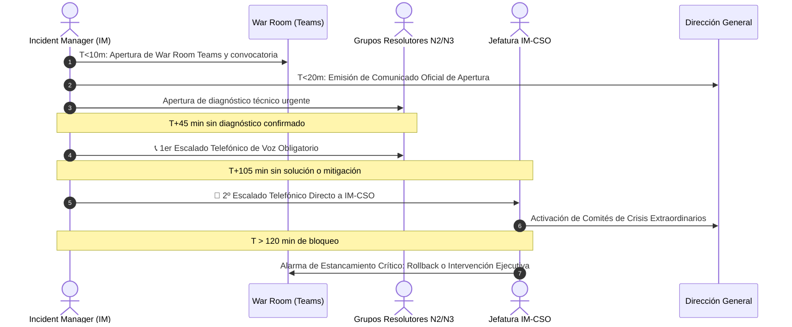

# Escenario 1: Emergencia Viva Crítica (SL1 / P1)

Guía procedimental de actuación inmediata para incidencias con corte total, degradación severa o alto riesgo inminente en los Procesos Críticos de Negocio o infraestructura Tier 0 (`CORE++`) en Orange Tech Operations.

* **Código Operativo:** `EMERGENCIA_VIVA`
* **Severidad ITIL Calibrada:** `SL1 / P1 (Emergencia Crítica)`
* **Llamada a IM-CSO:** **OBLIGATORIA** (Vía Telefónica Directa)
* **Canal Prescrito:** Vía Telefónica IM-CSO + War Room en Microsoft Teams
* **SLA de 1ª Acción:** Menos de 10 minutos
* **Protocolo General:** [Protocolo Operativo IM-CSO Post-Triaje](02-gestion-emergencias/protocolo-im-cso-escenarios-triaje.md)

---

## 🎯 1. Criterios de Activación y Detección

Este escenario se activa de forma automática cuando el triaje algorítmico detecta cualquiera de las siguientes condiciones:
1. **Vulneración de Umbrales Críticos:** Afectación en cualquiera de los 6 Procesos Críticos de Negocio:
   - **Atención al Cliente (ATC):** Caída CTI/IVR >20%, imposibilidad de atención en Call Centers.
   - **Ventas y Canales:** Bloqueo de contratación en tiendas físicas, web o app >15%.
   - **Portabilidad:** Parada de intercambio de ficheros con operadores donantes/receptores.
   - **Cobros y Pagos:** Imposibilidad de cobro en pasarelas bancarias o TPV.
   - **Provisión:** Encolamiento masivo de órdenes en BBDD o plataformas de red.
   - **Facturación:** Parada de ciclos de facturación o tarificación prepago en tiempo real.
2. **Caída de Sistemas Tier 0 (`CORE++`):** BSCS, CALL CENTER CTI, TIBCO Transversal, APIGEE, BOREAL, HPSPI, etc.
3. **Escalado Preventivo por Aging (>120 min):** Ticket clasificado originalmente como P2 que permanece activo más de 120 minutos sin workaround autorizado ni solución programada.

---

## ⏱️ 2. Flujo Cronológico de Actuación del Operador de Consola / IM



### Acciones Obligatorias por Minuto:
* **Minuto 0 - 10 ($T_0$):**
  - Convocar War Room de crisis en Microsoft Teams con el canal oficial de emergencias.
  - Verificar incorporación de las guardias N2/N3 del aplicativo y dependencias de infraestructura.
  - Registrar la traza oficial **`WL-01`** en las Notas de Trabajo (Work Info) de BMC Remedy.
* **Minuto 10 - 20:**
  - Redactar y enviar la **Notificación Ejecutiva de APERTURA** para Dirección ($\le 90$ palabras versión completa, $\le 30$ palabras versión breve).
* **Minuto 45 ($T+45\text{ min}$):**
  - Si no hay diagnóstico técnico verificado con causa del corte, realizar **llamada telefónica obligatoria** al coordinador de guardia del grupo resolutor o jefe de soporte.
  - Registrar la traza oficial **`WL-02`** en Remedy inmediatamente tras la llamada (<5 min).
* **Minuto 105 ($T+105\text{ min} = 45\text{m} + 1\text{h}$):**
  - Si persiste la indisponibilidad de servicio sin solución validada, realizar **llamada telefónica directa a la Jefatura de Customer & Service Operations (IM-CSO)**.
  - Registrar la traza oficial **`WL-02`** (Segundo Hito) en Remedy.
* **Minuto > 120 ($T > 120\text{ min}$):**
  - Disparo de la **Alarma de Estancamiento Crítico**: elevación a Directores de Área y comités de crisis de negocio.
  - Si la incidencia deriva de un Trabajo Programado (PaP) reciente, ordenar **Rollback inmediato**.

---

## 📝 3. Trazas Obligatorias para Worklogs (BMC Remedy ITSM)

### Traza WL-01: Apertura War Room SL1 y Declaración de Emergencia
```text
[IM-CSO / PROTOCOLO] [WL-01: APERTURA WAR ROOM SL1] - AAAA-MM-DD HH:MM:SS CET
Autor: [Nombre y Apellidos] - Incident Manager de Guardia
Severidad Evaluada: SL1 / P1 (Emergencia Crítica)
Proceso Crítico Comprometido: [ATC / Ventas / Portabilidad / Cobros / Provisión / Facturación / CORE++]
Aplicativo / Componente: [Ej. BSCS / CALL CENTER CTI / TIBCO / APIGEE / BOREAL]

SÍNTOMA OPERACIONAL Y ALCANCE:
[Descripción concisa del corte, porcentaje de error o indisponibilidad detectada].

ACCIONES INICIALES EJECUTADAS:
1. Convocada War Room de Emergencias en Teams: [Enlace o Sala Oficial].
2. Notificación ejecutiva de fase APERTURA emitida a Dirección (< 20 min).
3. Convocados de urgencia los grupos resolutores: [Listado de grupos N2/N3 convocados].
4. Cronómetro de escalado telefónico activado (Hito T+45m fijado para las HH:MM).
```

### Traza WL-02: Registro de Escalado Telefónico Oficial (45m / 105m / >2h)
```text
[IM-CSO / PROTOCOLO] [WL-02: ESCALADO TELEFÓNICO OFICIAL] - AAAA-MM-DD HH:MM:SS CET
Autor: [Nombre y Apellidos] - Incident Manager de Guardia
Hito de Escalado: [T+45 min sin diagnóstico / T+105 min (+1h) sin solución / Alarma Estancamiento >2h]
Canal Empleado: Llamada Telefónica Directa (Voz Obligatoria)

INTERLOCUTOR CONTACTADO:
• Nombre y Apellidos: [Nombre del responsable o guardia contactada]
• Rol / Cargo: [Coordinador de Guardia / Jefe de Proyecto / Jefatura IM-CSO / Responsable Proveedor]
• Grupo Resolutor: [Ej. SOP_SMC_TEIDE / DSI_INFRA_OCI / Soporte N3 Proveedor]

RESUMEN DE LA COMUNICACIÓN Y COMPROMISOS:
1. Se transmite la falta de avances técnicos tras [XX] minutos de investigación en War Room.
2. Interlocutor moviliza de inmediato a [recurso adicional o especialista de soporte N3 / vendor].
3. Compromiso acordado: Presentación de nuevo diagnóstico en War Room antes de las HH:MM.
4. Próximo hito de control fijado para las HH:MM.
```

---

## 🚫 4. Reglas de Prevención y Errores Prohibidos

1. ❌ **Prohibido limitarse a mensajes en Teams o emails:** Los hitos de 45 min y 105 min son llamadas telefónicas obligatorias de voz.
2. ❌ **Prohibido desescalar a P2 o P3 por la aplicación de un parche temporal sin validación de IM-CSO:** Rige el Candado de Severidad 🔒.
3. ❌ **Prohibido omitir la comunicación a Dirección:** El comunicado de Apertura debe enviarse en menos de 20 minutos desde la categorización de la emergencia.

---

## 🔗 5. Enlaces y Recursos Rápidos

* [Consola de Triaje y Emergencias IT ↗](/dashboards/emergency-triage-console/ ':ignore :target=_blank')
* [Cockpit del Incident Manager ↗](/dashboards/incident-manager-monitor/ ':ignore :target=_blank')
* [Protocolo Completo de Gobernanza IM-CSO](02-gestion-emergencias/protocolo-im-cso-escenarios-triaje.md)
* [Escenario 7: Gobernanza de Workaround y Candado Activo 🔒](02-gestion-emergencias/escenarios/escenario-7-workaround-autorizado.md)
* [Escenario 8: Reactivación Exprés por Reapertura Activa](02-gestion-emergencias/escenarios/escenario-8-reapertura-activa.md)

