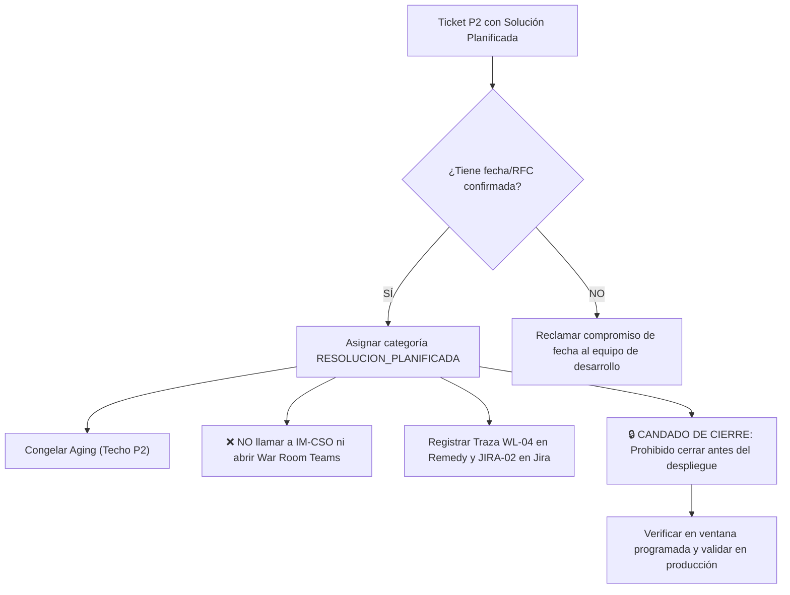

# Escenario 2: Incidencia Mayor con Solución o Despliegue Planificado (SL2 / P2)

Guía procedimental de actuación para incidencias que disponen de una solución técnica cerrada y calendarizada en una ventana de despliegue, pase a producción (RFC) o proceso batch periódico.

* **Código Operativo:** `RESOLUCION_PLANIFICADA`
* **Severidad ITIL Calibrada:** `SL2 / P2 (Seguimiento de Release)` (Tope de Severidad)
* **Llamada a IM-CSO:** **NO REQUERIDA** (Canales de voz reservados para emergencias vivas)
* **Canal Prescrito:** Mesa de Cambios (CAB) / Equipo de Despliegues / Release Manager
* **SLA de 1ª Acción:** Menos de 30 minutos
* **Exención de Aging:** **ACTIVA** (El paso del tiempo $> 120\text{ min}$ NO escala el ticket a P1)
* **Protocolo General:** [Protocolo Operativo IM-CSO Post-Triaje](02-gestion-emergencias/protocolo-im-cso-escenarios-triaje.md)

---

## 🎯 1. Criterios de Activación y Detección

Este escenario se activa cuando en el análisis del ticket o en la telemetría de Epsilon IA concurren los siguientes factores:
1. **Solución Técnica Desarrollada:** Existe una Pull Request (PR) validada en entorno de pruebas, un parche de software finalizado o un script de corrección cerrado por el equipo de ingeniería.
2. **Ventana de Ejecución Calendarizada:**
   - Pase a Producción con RFC formal (`CRQ00000XXXXXXX`) programado en ventana nocturna o de bajo impacto.
   - Fecha y hora acordadas con el negocio (ej. `Pase comprometido 17/11/2026 23:00 CET`).
   - Proceso batch periódico planificado (ej. `Conciliación BSCS lunes a las 06:00 AM`).
3. **Ausencia de Caída Activa Bloqueante:** El servicio continúa operando con medidas de contorno o afectación funcional diferida, sin corte total de negocio en curso.

---

## 🛑 2. Regla de Oro: Exención Estricta de Aging

> [!IMPORTANT]
> En condiciones ordinarias, una incidencia P2 que supera los 120 minutos sin mitigación escala automáticamente a P1.
> **En el Escenario 2, esta regla queda formalmente suspendida.**
> Dado que la solución está acordada y la espera responde a criterios de seguridad técnica para no impactar el horario comercial, el ticket **NO debe escalar a P1** ni computar como deriva operativa.

---

## ⏱️ 3. Flujo de Actuación para el Operador de Consola



### Instrucciones Operativas:
1. **Calificación en Consola:** Marcar la incidencia como `RESOLUCION_PLANIFICADA`. Comprobar que en la consola se visualiza la pastilla `🗓️ Resolución Planificada`.
2. **Prohibición de Escalados Telefónicos:** No realizar llamadas telefónicas de emergencia a IM-CSO ni convocar War Room nocturnas fuera de la ventana planificada.
3. **Registro Formal en Ticketing:**
   - Registrar la traza oficial **`WL-04`** en las Notas de Trabajo (Work Info) de Remedy.
   - Sincronizar en la issue de Jira vinculada la traza **`JIRA-02`** con el RFC y la fecha acordada.
4. **Cierre Administrativo Condicionado:** Prohibido resolver o cerrar el ticket en Remedy hasta que el pase haya finalizado con éxito y se haya verificado la estabilidad en producción.

---

## 📝 4. Trazas Obligatorias para Worklogs

### Traza WL-04 (BMC Remedy ITSM): Concesión de Exención de Aging
```text
[IM-CSO / PROTOCOLO] [WL-04: RESOLUCIÓN PLANIFICADA - EXENCIÓN AGING] - AAAA-MM-DD HH:MM:SS CET
Autor: [Nombre y Apellidos] - [Operador Consola / Incident Manager]
Categoría Operativa: RESOLUCION_PLANIFICADA (Techo SL2 / P2)
Tipo de Planificación: [Pull Request validada / Pase a Producción RFC / Ventana Batch Periódica]
Referencia de Entrega: [Jira ID: PROJ-XXXX / RFC: CRQ00000XXXXXXX / PR: #XXXX]

VENTANA DE EJECUCIÓN PROGRAMADA:
• Fecha y Hora Comprometida: AAAA-MM-DD HH:MM:SS CET
• Grupo Responsable del Despliegue: [Ej. EQUIPO_DESPLIEGUES_CRM / GESTION_CAMBIOS]

DICTAMEN OPERATIVO Y DIRECTRICES:
1. Se suspende formalmente el escalado a P1 por envejecimiento acumulado (>120m).
2. Se mantiene la severidad acotada a P2 en fase obligatoria de SEGUIMIENTO.
3. No procede llamada de emergencia a IM-CSO ni activación de guardias fuera de ventana.
4. CANDADO DE CIERRE ACTIVO: Prohibido cerrar administrativamente el ticket en Remedy antes de la ejecución del pase y la verificación en producción.
```

### Traza JIRA-02 (Atlassian Jira): Notificación de Despliegue Comprometido
```text
[IM-CSO / COMPROMISO DE DESPLIEGUE]
Incidencia Remedy Asociada: INC00000XXXXXXX
Pull Request / Parche: [PR #XXXX / Rama: hotfix/XXXX]
Pase a Producción Asociado: [RFC CRQ00000XXXXXXX]
Ventana Programada: AAAA-MM-DD HH:MM:SS CET

La solución técnica ha superado las pruebas en entorno de preproducción. 
Se notifica al Incident Manager para aplicar la exención de aging (RESOLUCION_PLANIFICADA) en Remedy.
```

---

## 🚫 5. Qué NO Debe Hacerse en Este Escenario

* ❌ **NO escalar a P1 al alcanzar los 120 minutos:** Constituye una sobreescalación ficticia que falsea los indicadores de crisis.
* ❌ **NO despertar o llamar por teléfono a guardias directivas** cuando la intervención está planificada para el fin de semana o la madrugada acordada.
* ❌ **NO dar por cerrada la incidencia antes de tiempo:** Debe permanecer en seguimiento hasta la prueba post-despliegue en producción.

---

## 🔗 6. Enlaces y Recursos Rápidos

* [Consola de Triaje y Emergencias IT ↗](/dashboards/emergency-triage-console/ ':ignore :target=_blank')
* [Cockpit del Incident Manager ↗](/dashboards/incident-manager-monitor/ ':ignore :target=_blank')
* [Protocolo Completo de Gobernanza IM-CSO](02-gestion-emergencias/protocolo-im-cso-escenarios-triaje.md)
* [Escenario 3: Ticket Zombi Remedy](02-gestion-emergencias/escenarios/escenario-3-ticket-zombi-remedy.md)
* [Escenario 7: Soluciones de Contorno y Workaround 🔒](02-gestion-emergencias/escenarios/escenario-7-workaround-autorizado.md)

