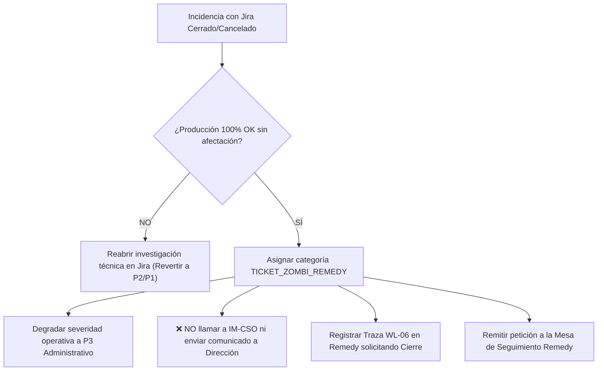

# Escenario 3: Ticket Zombi en Remedy (P3 Administrativo)

Guía procedimental para la detección y tramitación de tickets zombi: incidencias que han sido cerradas, resueltas o canceladas en las herramientas de desarrollo o soporte técnico (Atlassian Jira, Mantis o repositorios de proveedores), pero que permanecen indebidamente abiertas en BMC Remedy ITSM generando falsas alarmas de envejecimiento.

* **Código Operativo:** `TICKET_ZOMBI_REMEDY`
* **Severidad ITIL Calibrada:** `P3 Administrativo` (Desescalado de colas operativas)
* **Llamada a IM-CSO:** **NO REQUERIDA** (Prohibido sobrecargar canales telefónicos de crisis)
* **Canal Prescrito:** Mesa de Seguimiento de Incidencias / Administrador de Remedy ITSM
* **SLA de 1ª Acción:** Menos de 60 minutos
* **Protocolo General:** [Protocolo Operativo IM-CSO Post-Triaje](02-gestion-emergencias/protocolo-im-cso-escenarios-triaje.md)

---

## 🎯 1. Criterios de Activación y Detección

Este escenario se activa cuando el motor de triaje identifica la siguiente discrepancia de ciclo de vida entre herramientas:
1. **Estado en Jira / Herramienta de Entrega:** El ticket o issue vinculado figura como `Cerrado`, `Resuelto`, `Cancelado` o con resolución `No Aplica` / `Won't Fix`.
2. **Estado en BMC Remedy ITSM:** El ticket de incidencia (`INC00000XXXXXXX`) continúa en estado `Asignado` o `Pendiente` sin actividad real.
3. **Validación en Producción:** Se constata que el servicio opera al 100% sin degradación ni impacto en los usuarios y sin incidencias vinculadas vivas.

---

## 🩺 2. Impacto Negativo de los Tickets Zombi

Los tickets zombi distorsionan severamente la gobernanza operativa de Orange Tech Operations:
* **Penalización de Aging Ficticio:** Computan falsamente miles de minutos de apertura, distorsionando el cálculo del MTTR (Mean Time to Resolution).
* **Falsas Alarmas de Escalado:** Disparan indebidamente alertas de subescalación a P1 si superan los 120 minutos.
* **Ruido en Comités de Dirección:** Aparecen en informes de incidencias pendientes de releases consumiendo tiempo de gestión ejecutiva innecesario.

---

## ⏱️ 3. Flujo de Actuación del Operador de Consola



### Instrucciones Operativas:
1. **Reclasificación Inmediata en Consola:** Marcar la incidencia con la categoría `TICKET_ZOMBI_REMEDY` y severidad `P3 Administrativo`.
2. **Copiar Solicitud Formal:** Utilizar el botón **📋 Copiar Plantilla de Cierre Administrativo** disponible en la tarjeta de la consola.
3. **Pegar en Remedy:** Insertar la traza oficial **`WL-06`** en las Notas de Trabajo (Work Info) de BMC Remedy con visibilidad `Internal`.
4. **Notificar a la Mesa de Seguimiento:** Enviar notificación o correo a la Mesa de Control de Remedy para el cambio formal de estado a `Cerrado / Resuelto`.

---

## 📝 4. Trazas Obligatorias para Worklogs

### Traza WL-06 (BMC Remedy ITSM): Solicitud Formal de Cierre Administrativo
```text
[IM-CSO / PROTOCOLO] [WL-06: SOLICITUD CIERRE ADMINISTRATIVO ZOMBI] - AAAA-MM-DD HH:MM:SS CET
Autor: [Nombre y Apellidos] - [Operador Consola / Incident Manager]
Categoría Operativa: TICKET_ZOMBI_REMEDY (Prioridad Operativa Reducida: P3 Administrativo)
Referencia Jira / Desarrollo: [JIRA-XXXXX] (Estado en Jira: CERRADO / RESUELTO)

JUSTIFICACIÓN DE CIERRE ADMINISTRATIVO:
1. Se ha comprobado que el desarrollo y pase técnico han concluido satisfactoriamente.
2. Se confirma la total ausencia de afectación en producción (telemetría y monitorización OK).
3. No procede mantener el ticket en estado Asignado/Pendiente penalizando los KPIs de aging.

PETICIÓN A LA MESA DE SEGUIMIENTO REMEDY:
Se solicita formalmente al Administrador de Remedy / Mesa de Seguimiento tramitar el 
CIERRE ADMINISTRATIVO de esta incidencia por conclusión técnica en Jira.
Dictamen emitido por la Consola de Triaje y Gestión de Emergencias IT de Orange.
```

### Traza JIRA-03 (Atlassian Jira): Aviso de Cierre Técnico y Traspaso
```text
[IM-CSO / CIERRE TÉCNICO EN JIRA]
Incidencia Remedy Asociada: INC00000XXXXXXX
Estado en Jira: RESUELTO / CERRADO

La entrega ha sido desplegada y validada en producción. 
Se solicita al Incident Manager tramitar el cierre formal o administrativo en Remedy 
para evitar la persistencia de tickets zombi en la mesa de seguimiento.
```

---

## 🚫 5. Errores Comunes a Evitar

* ❌ **Prohibido mantener tickets zombi en la cola de emergencias vivas:** Debe retirarse de la vista ejecutiva de Dirección de inmediato.
* ❌ **Prohibido realizar llamadas a IM-CSO:** Ningún ticket zombi justifica llamadas telefónicas de guardia.
* ❌ **Prohibido cerrar el ticket en Remedy si aún persisten pruebas pendientes:** Debe confirmarse previamente la normalización del servicio.

---

## 🔗 6. Enlaces y Recursos Rápidos

* [Consola de Triaje y Emergencias IT ↗](/dashboards/emergency-triage-console/ ':ignore :target=_blank')
* [Cockpit del Incident Manager ↗](/dashboards/incident-manager-monitor/ ':ignore :target=_blank')
* [Protocolo Completo de Gobernanza IM-CSO](02-gestion-emergencias/protocolo-im-cso-escenarios-triaje.md)
* [Escenario 2: Solución Planificada y Exención de Aging](02-gestion-emergencias/escenarios/escenario-2-resolucion-planificada.md)
* Skill `incident-triage-review` (`.agents/skills/incident-triage-review/SKILL.md`)

