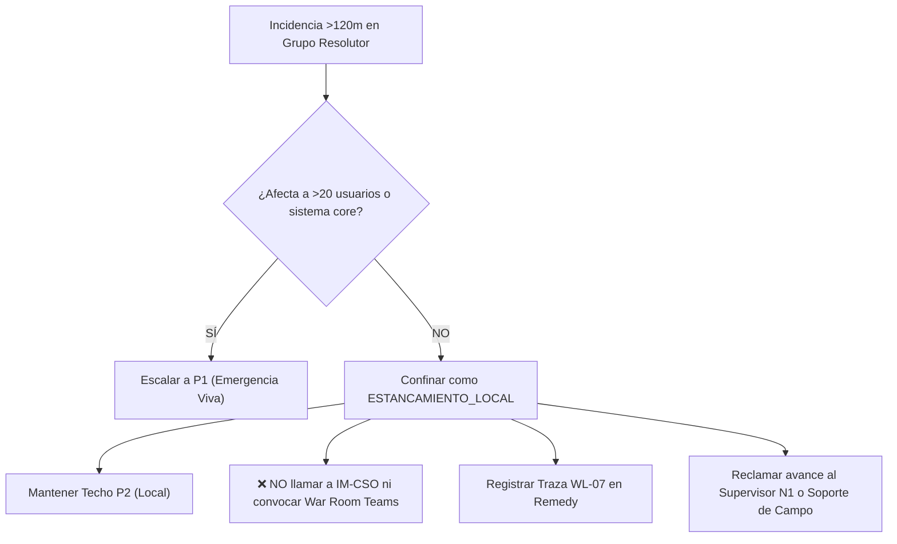

# Escenario 4: Estancamiento Local en Incidencias Departamentales (SL2 / P2)

Guía procedimental para incidencias acotadas a un puesto individual, departamento reducido o sede menor que han superado los 120 minutos de apertura sin resolución por parte del grupo resolutor, evitando su sobreescalación indebida a Emergencia Nacional P1.

* **Código Operativo:** `ESTANCAMIENTO_LOCAL`
* **Severidad ITIL Calibrada:** `SL2 / P2 Local / Departamental` (Techo de Severidad)
* **Llamada a IM-CSO:** **NO REQUERIDA** (Prohibido involucrar comités de crisis directivos)
* **Canal Prescrito:** Supervisor N1 / Grupo Resolutor Local / Soporte de Campo (Field Services)
* **SLA de 1ª Acción:** Menos de 15 minutos
* **Protocolo General:** [Protocolo Operativo IM-CSO Post-Triaje](02-gestion-emergencias/protocolo-im-cso-escenarios-triaje.md)

---

## 🎯 1. Criterios de Activación y Detección

Este escenario se activa cuando concurren simultáneamente las siguientes condiciones operativas:
1. **Alcance Físico Acotado:**
   - Afectación limitada a un puesto de trabajo individual o a un grupo menor ($\le 20$ usuarios).
   - Afectación en una única sede no principal o tienda individual.
2. **Sistemas Centrales 100% Operativos:** No existe degradación en sistemas centrales, plataformas core (`BSCS`, `TIBCO`, `APIGEE`, etc.) ni en enlaces troncales de red.
3. **Superación del Umbral de Aging ($T \ge 120\text{ min}$):** El ticket ha permanecido estancado en el grupo resolutor asignado durante más de 2 horas sin diagnóstico ni resolución.

---

## 🛑 2. Regla de Confinamiento de Crisis

> [!WARNING]
> La regla general de envejecimiento ITIL escala cualquier incidencia P2 abierta $>120\text{ min}$ a P1.
> **En incidencias de alcance local o departamental, esta subescalación está expresamente prohibida.**
> Elevar un problema de un PC, una impresora o una sede de 10 usuarios a Emergencia P1 satura los comités ejecutivos y distrae a las guardias centrales de las verdaderas emergencias que impactan en los clientes y en los ingresos de la compañía.

---

## ⏱️ 3. Flujo de Actuación del Operador de Consola



### Instrucciones Operativas:
1. **Verificación de Afectación Troncal:** Confirmar que no hay alertas de red global ni caída de servicios troncales asociadas a la incidencia.
2. **Fijar Techo de Severidad:** Asignar la categoría `ESTANCAMIENTO_LOCAL` y asegurar que la prioridad queda acotada en `P2 Local`.
3. **Reclamación Departamental:** Reclamar la atención del ticket al **Supervisor N1**, al jefe de equipo del grupo resolutor o a soporte de campo (Field Services).
4. **Registro Formal:** Insertar en BMC Remedy la traza oficial **`WL-07`**.

---

## 📝 4. Trazas Obligatorias para Worklogs (BMC Remedy ITSM)

### Traza WL-07: Confinamiento por Estancamiento Local
```text
[IM-CSO / PROTOCOLO] [WL-07: CONFINAMIENTO ESTANCAMIENTO LOCAL] - AAAA-MM-DD HH:MM:SS CET
Autor: [Nombre y Apellidos] - [Operador Consola / Incident Manager]
Categoría Operativa: ESTANCAMIENTO_LOCAL (Techo SL2 / P2)
Tiempo Acumulado de Apertura: [XXX] minutos (> 120 min)

ANÁLISIS DE ALCANCE Y CONFINAMIENTO:
• Puestos / Usuarios afectados: [XX puestos (<= 20 usuarios)]
• Ubicación: [Sede individual no central / Centro de atención específico]
• Estado de Sistemas Centrales: 100% Operativos sin degradación troncal.

ACUERDO DE TRATAMIENTO OPERATIVO:
1. Queda excluida la elevación a Emergencia P1 corporativa para evitar saturación de comités.
2. No se requiere llamada a IM-CSO ni activación de retenes de sistemas centrales.
3. Se deriva el seguimiento al Supervisor N1 / Soporte de Campo (Field Services) para resolución física local.
```

---

## 🚫 5. Errores Comunes a Evitar

* ❌ **NO convocar War Room nacional:** Los estancamientos locales se gestionan mediante reclamación al grupo o soporte de campo.
* ❌ **NO escalar telefónicamente a la Jefatura de IM-CSO:** Los canales de voz de CSO están reservados para incidencias con impacto transversal.
* ❌ **NO abandonar el ticket:** El operador debe exigir una respuesta al grupo asignado cada 60 minutos hasta su resolución.

---

## 🔗 6. Enlaces y Recursos Rápidos

* [Consola de Triaje y Emergencias IT ↗](/dashboards/emergency-triage-console/ ':ignore :target=_blank')
* [Cockpit del Incident Manager ↗](/dashboards/incident-manager-monitor/ ':ignore :target=_blank')
* [Protocolo Completo de Gobernanza IM-CSO](02-gestion-emergencias/protocolo-im-cso-escenarios-triaje.md)
* [Escenario 1: Emergencia Viva Crítica](02-gestion-emergencias/escenarios/escenario-1-emergencia-viva.md)
* Skill `orange-it-emergency-management` (`.agents/skills/orange-it-emergency-management/SKILL.md`)

