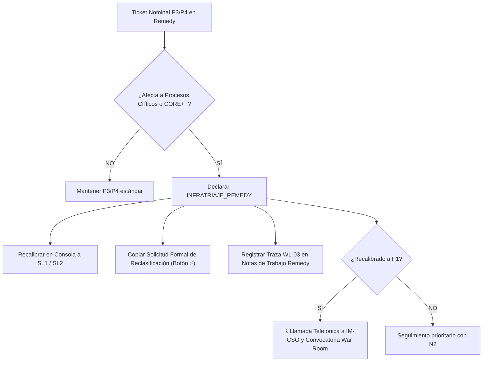

# Escenario 5: Discrepancia por Infratriaje en Remedy (Subescalación a P1/P2)

Guía procedimental para incidencias registradas administrativamente con baja o media prioridad (P3 / P4) por el Centro de Atención a Usuarios (N1 / CAU), pero cuya afectación técnica real vulnera los umbrales críticos de negocio, exigiendo su corrección y rectificación inmediata en la consola y en BMC Remedy.

* **Código Operativo:** `INFRATRIAJE_REMEDY`
* **Severidad ITIL Calibrada:** `SL1 / P1 (Crítica)` o `SL2 / P2 (Mayor)`
* **Severidad Nominal en Remedy:** Media (P3) o Baja (P4)
* **Llamada a IM-CSO:** **OBLIGATORIA** (Si se recalibra a P1)
* **Canal Prescrito:** Canal Telefónico IM-CSO + Notas de Trabajo Remedy
* **SLA de 1ª Acción:** Menos de 15 minutos
* **Protocolo General:** [Protocolo Operativo IM-CSO Post-Triaje](../protocolo-im-cso-escenarios-triaje.md)

---

## 🎯 1. Criterios de Activación y Detección

Este escenario se activa cuando el motor de triaje determinista detecta una **discrepancia positiva** ($\Delta \ge 1$, $\Delta \ge 2$ o $\Delta = 3$) entre la clasificación administrativa original y el impacto objetivo real:
1. **Infratriaje de Nivel 1:** El operador de CAU o la mesa de entrada catalogó el ticket como P3 o P4 por falta de visibilidad del impacto global o desconocimiento del catálogo de aplicaciones críticas.
2. **Impacto en Procesos Críticos o Componentes CORE++:** La incidencia afecta a pasarelas de pago, tarificación prepago, sistemas de Call Center CTI, provisión de red o bases de datos centrales Exadata/ESX.
3. **Regla de Oro N1 (it-severity-matrix):** Prevalece de forma absoluta el impacto operacional demostrado sobre el negocio frente a la etiqueta administrativa del ticket.

---

## ⏱️ 2. Flujo de Actuación del Operador de Consola



### Instrucciones Operativas:
1. **Identificación de la Discrepancia:** En la Consola de Triaje, localizar la tarjeta marcada con la etiqueta `⚡ Reclasificación Inmediata` y la severidad sugerida en color rojo o ámbar.
2. **Copiar Dictamen Formal:** Pulsar el botón **⚡ Reclasificar** para copiar al portapapeles la justificación normativa generada por el motor de triaje.
3. **Registro en BMC Remedy:** Insertar en las Notas de Trabajo (Work Info) la traza oficial **`WL-03`** justificando el criterio vulnerado (ej. Criterio 3.6 de Facturación o 3.1 de ATC).
4. **Modificación de Campos en Remedy:** Si el operador tiene permisos de modificación, actualizar los campos `Impacto` y `Urgencia` en Remedy para reflejar la prioridad calculada.
5. **Activación de Emergencia:** Si la nueva prioridad es P1, proceder inmediatamente a la convocatoria de la War Room y a la llamada telefónica a IM-CSO si se superan los 45 minutos.

---

## 📝 3. Trazas Obligatorias para Worklogs (BMC Remedy ITSM)

### Traza WL-03: Rectificación de Triaje por Discrepancia / Infratriaje
```text
[IM-CSO / PROTOCOLO] [WL-03: RECTIFICACIÓN DISCREPANCIA TRIAJE] - AAAA-MM-DD HH:MM:SS CET
Autor: [Nombre y Apellidos] - [Operador Consola / Incident Manager]
Severidad Nominal Remedy: [Media - P3 / Baja - P4 / Urgencia: Media/Baja]
Severidad Objetiva Calibrada: [SL1 / P1 Crítica  ó  SL2 / P2 Mayor]

JUSTIFICACIÓN TÉCNICA Y NORMATIVA (it-severity-matrix & incident-triage-review):
• Proceso de Negocio / Componente: [ATC / Ventas / Facturación / Componente CORE++]
• Criterio / Umbral Vulnerado: [Criterio 3.X, ej. Caída de IVR/CTI >20% / Corte en BBDD Exadata]
• Regla de Oro Aplicada: Prevalece el impacto objetivo sobre el negocio frente a la clasificación administrativa de N1.

ACCIONES DISPARADAS:
1. Rectificada la severidad operativa en la Consola de Triaje y Emergencias IT.
2. Notificación prioritaria cursada a Customer & Service Operations (IM-CSO).
3. Cronómetros de escalado y SLAs de crisis computados retroactivamente desde la apertura del ticket (T0: AAAA-MM-DD HH:MM:SS).
4. Advertencia: Prohibido desescalar este ticket sin validación expresa de IM-CSO.
```

---

## 🚫 4. Errores Comunes a Evitar

* ❌ **NO respetar pasivamente la prioridad P3/P4 nominal:** Si el negocio está degradado, el operador tiene la obligación de reclasificar el incidente.
* ❌ **NO demorar la notificación:** La corrección debe realizarse en los primeros 15 minutos de recepción del ticket.
* ❌ **NO olvidar computar el SLA retroactivamente:** El cronómetro de escalado telefónico debe contar desde la apertura original del ticket en Remedy, no desde el momento de la rectificación.

---

## 🔗 5. Enlaces y Recursos Rápidos

* [Consola de Triaje y Emergencias IT ↗](/dashboards/emergency-triage-console/ ':ignore :target=_blank')
* [Protocolo Completo de Gobernanza IM-CSO](../protocolo-im-cso-escenarios-triaje.md)
* [Escenario 1: Emergencia Viva Crítica](./escenario-1-emergencia-viva.md)
* Skill `it-severity-matrix` (`.agents/skills/it-severity-matrix/SKILL.md`)

