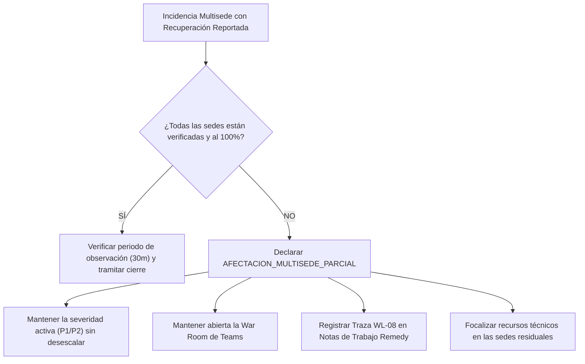

# Escenario 6: Afectación Multisede Parcial y Prevención de Falso Cierre (SL1 / SL2)

Guía procedimental para incidencias con afectación distribuida en múltiples sedes, tiendas o centros de atención al cliente (Call Centers) donde uno o varios centros reportan restablecimiento pero persisten otros centros con fallos activos.

* **Código Operativo:** `AFECTACION_MULTISEDE_PARCIAL`
* **Severidad ITIL Calibrada:** `SL1 / P1` o `SL2 / P2` (Severidad Mantenida sin desescalar)
* **Llamada a IM-CSO:** **INFORMATIVA** (Actualización de avance de sedes)
* **Canal Prescrito:** War Room en Teams / Coordinación de Sedes y Redes
* **SLA de 1ª Acción:** Menos de 20 minutos
* **Protocolo General:** [Protocolo Operativo IM-CSO Post-Triaje](02-gestion-emergencias/protocolo-im-cso-escenarios-triaje.md)

---

## 🎯 1. Criterios de Activación y Detección

Este escenario se activa cuando en una incidencia con afectación geográfica concurren los siguientes factores:
1. **Alcance Multisede Inicial:** El problema afecta a 2 o más sedes (ej. Call Centers en Málaga, Sevilla, Zaragoza y Barcelona).
2. **Restablecimiento Parcial:** La guardia técnica de red o el operador local confirma que los enlaces de una de las sedes (ej. Málaga) han recuperado la conectividad y atienden tráfico.
3. **Persistencia Residual:** Continúan activos errores o pérdida de enlace en las sedes restantes (ej. Barcelona continúa con 35 puestos sin servicio telefónico).

---

## 🛑 2. Regla de Oro: Prohibición Estricta de Cierre Prematuro

> [!CAUTION]
> Queda terminantemente prohibido cerrar administrativamente el ticket en Remedy o dar por finalizada la incidencia cuando la recuperación es únicamente **parcial**.
> El cierre prematuro ante una recuperación asimétrica genera una percepción errónea de normalización en Dirección mientras los usuarios de las sedes restantes permanecen desatendidos.

---

## ⏱️ 3. Flujo de Actuación del Incident Manager / Operador



### Instrucciones Operativas:
1. **Balance de Centros Afectados:** Elaborar un inventario detallado clasificando sedes restablecidas vs. sedes con problemas persistentes.
2. **Mantenimiento de Severidad y War Room:** No reducir la severidad a P3. Si la incidencia era P1, continúa en P1 con la War Room de Teams abierta.
3. **Registro Formal en Remedy:** Insertar en las Notas de Trabajo la traza oficial **`WL-08`** detallando el balance de sedes.
4. **Comunicación a Dirección:** En las notas de seguimiento a Dirección, especificar explícitamente: *"Recuperadas sedes X e Y; persiste afectación en sede Z"*.

---

## 📝 4. Trazas Obligatorias para Worklogs (BMC Remedy ITSM)

### Traza WL-08: Gestión de Afectación Multisede Parcial
```text
[IM-CSO / PROTOCOLO] [WL-08: EVOLUCIÓN MULTISEDE PARCIAL] - AAAA-MM-DD HH:MM:SS CET
Autor: [Nombre y Apellidos] - Incident Manager de Guardia
Severidad Activa: [SL1 / SL2] (Mantenida)

BALANCE DE SEDES Y CENTROS AFECTADOS:
• Sedes Restablecidas y Verificadas: [Ej. 3 sedes: Málaga, Zaragoza, Sevilla]
• Sedes Residuales con Impacto Activo: [Ej. 1 sede: Barcelona (35 puestos degradados)]

INSTRUCCIÓN DE GOBERNANZA:
Se prohíbe de forma estricta el cierre del ticket o su desescalada mientras persista 
afectación en Barcelona. Los recursos técnicos de red y soporte continúan focalizados 
en la normalización de los circuitos residuales. Próxima actualización en 30 minutos.
```

---

## 🚫 5. Errores Comunes a Evitar

* ❌ **NO cerrar el ticket original y abrir uno nuevo para la sede residual:** Rompe la trazabilidad del incidente y oculta el tiempo total acumulado de caída (MTTR).
* ❌ **NO desconvocar a los resolutores:** Los equipos de infraestructura y comunicaciones deben permanecer en la War Room hasta el restablecimiento del último centro.
* ❌ **NO declarar resuelta la incidencia ante Dirección sin la validación del responsable local de cada sede.**

---

## 🔗 6. Enlaces y Recursos Rápidos

* [Consola de Triaje y Emergencias IT ↗](/dashboards/emergency-triage-console/ ':ignore :target=_blank')
* [Protocolo Completo de Gobernanza IM-CSO](02-gestion-emergencias/protocolo-im-cso-escenarios-triaje.md)
* [Escenario 1: Emergencia Viva Crítica](02-gestion-emergencias/escenarios/escenario-1-emergencia-viva.md)
* Skill `incident-triage-review` (`.agents/skills/incident-triage-review/SKILL.md`)

