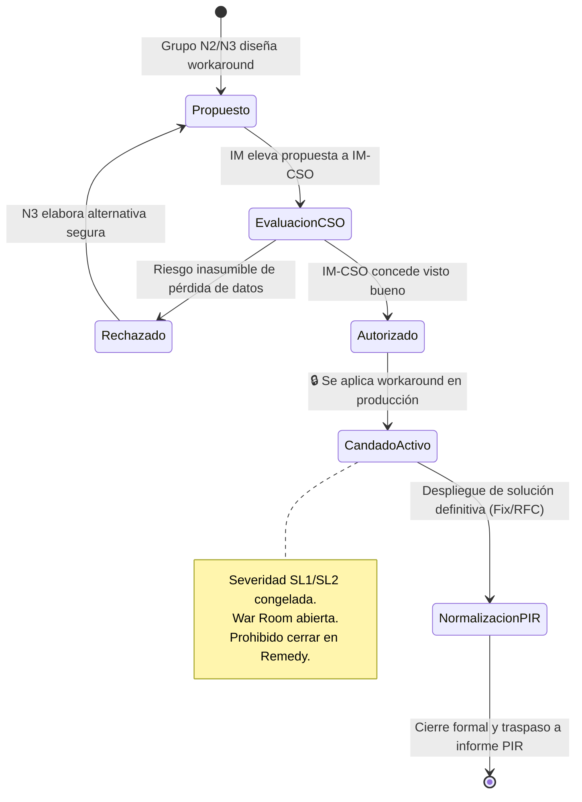

# Escenario 7: Soluciones de Contorno y Candado de Severidad 🔒 (Workarounds)

Marco normativo y procedimental para la autorización, aplicación y gobernanza de soluciones de contorno temporales (workarounds) en incidencias mayores o críticas, garantizando la activación del **Candado de Severidad** para impedir el cierre prematuro o desescalado encubierto.

* **Código Operativo:** `WORKAROUND_AUTORIZADO`
* **Severidad ITIL Calibrada:** `SL1 / P1` o `SL2 / P2` (Severidad Protegida por Candado 🔒)
* **Llamada a IM-CSO:** **OBLIGATORIA** (Autorización previa indispensable de la Jefatura CSO)
* **Canal Prescrito:** Canal Telefónico Directo IM-CSO / Sala de Crisis Teams
* **SLA de 1ª Acción:** Inmediato (Previo a la ejecución en producción)
* **Protocolo General:** [Protocolo Operativo IM-CSO Post-Triaje](02-gestion-emergencias/protocolo-im-cso-escenarios-triaje.md)

---

## 🎯 1. Concepto y Tipología de Workarounds

Un **Workaround** (Solución de Contorno) es una medida técnica provisional destinada a restablecer el flujo del servicio o mitigar el impacto en negocio sin corregir la causa raíz del defecto subyacente.

### Tipos Comunes en Orange Tech Operations:
1. **Reinicio de Servicios / Pods / Instancias:** Reciclado de servidores de aplicaciones, pods de Kubernetes en OCI/GCP o nodos Middleware (`TIBCO`, `APIGEE`).
2. **Conmutación de Nodos / Failover:** Aislamiento manual de un nodo anómalo y balanceo forzado hacia el nodo pasivo o secundario.
3. **Purga o Drenaje de Colas de Mensajería:** Reencolado de mensajes atascados en brokers de mensajería (Kafka, JMS).
4. **Bypass de Validaciones Temporales:** Desactivación temporal de una regla de comprobación no crítica para permitir la facturación o la tramitación de pedidos.

---

## 🔒 2. La Regla de Oro del Candado de Severidad

> [!IMPORTANT]
> **REGLA DE ORO DE GOBERNANZA (orange-it-emergency-management):**
> 1. Queda terminantemente prohibido a los grupos resolutores aplicar un workaround en producción sin la **autorización expresa y fehaciente de Customer & Service Operations (IM-CSO)**.
> 2. La aplicación exitosa de un workaround **NO reduce automáticamente la severidad del ticket** de P1 a P3 ni autoriza su cierre en Remedy.
> 3. El ticket permanece en severidad mayor bajo **monitorización activa en War Room** con el **Candado 🔒 activado** hasta que la causa raíz haya sido subsanada mediante una solución definitiva validada.

---

## ⏱️ 3. Ciclo de Vida del Candado de Workaround



---

## ⏱️ 4. Flujo de Actuación del Incident Manager

1. **Recepción de la Propuesta:** El grupo resolutor formula la medida provisional evaluando si genera riesgo de pérdida de datos o efectos secundarios.
2. **Elevación Inmediata a IM-CSO:** El Incident Manager contacta telefónicamente a la Jefatura de IM-CSO para exponer la medida y solicitar su visto bueno formal.
3. **Registro de Autorización:** Se inserta en Remedy la traza oficial **`WL-05`** con el nombre del responsable de CSO que autorizó la ejecución.
4. **Ejecución y Comprobación:** El grupo resolutor aplica la acción y se monitorizan los KPIs de negocio durante un mínimo de 30 minutos.
5. **Mantenimiento del Candado:** El ticket no se desescala a P3 ni se cierra; se coordina la fecha de entrega de la solución definitiva con el equipo de release.

---

## 📝 5. Trazas Obligatorias para Worklogs (BMC Remedy ITSM)

### Traza WL-05: Autorización Formal de Workaround y Candado Activo 🔒
```text
[IM-CSO / PROTOCOLO] [WL-05: AUTORIZACIÓN WORKAROUND - CANDADO ACTIVO 🔒] - AAAA-MM-DD HH:MM:SS CET
Autor: [Nombre y Apellidos] - Incident Manager de Guardia
Responsable IM-CSO Autorizante: [Nombre y Apellidos / Cargo CSO]
Grupo Técnico Ejecutor: [Ej. DSI_MIDDLEWARE_TIBCO / SOP_BBDD]

DESCRIPCIÓN TÉCNICA DEL WORKAROUND:
[Detalle de la acción: reinicio de pods, conmutación de nodo, purga de colas, bypass de validación, etc.]

EVALUACIÓN DE IMPACTO RESIDUAL Y SALVAGUARDAS:
• Integridad de datos comprometida: [NO / SÍ (Detallar medidas de conciliación)]
• Afectación a clientes durante ejecución: [NO / SÍ (Ventana estimada de XX min)]
• Plan de marcha atrás (Rollback del workaround): [Procedimiento inmediato en caso de anomalía]

CONDICIÓN DE GOBERNANZA VINCULANTE:
🔒 CANDADO DE SEVERIDAD ACTIVO: La aplicación de esta solución temporal NO reduce la 
severidad del ticket ni autoriza su desescalado a P3 ni su cierre. El ticket permanece en 
[SL1 / SL2] bajo monitorización en War Room hasta la implantación de la solución definitiva.
```

---

## 🚫 6. Errores Comunes a Evitar

* ❌ **NO aplicar el workaround de espaldas a IM-CSO:** Las medidas no autorizadas que causen corrupción de base de datos conllevan responsabilidad disciplinaria.
* ❌ **NO desescalar el ticket a P3 tras mitigar el síntoma:** Provoca que el problema de fondo caiga en el olvido hasta una recurrencia mayor.
* ❌ **NO cerrar el ticket en Remedy alegando que el cliente "ya no se queja":** Solo la solución estructural definitiva autoriza el traspaso a cierre.

---

## 🔗 7. Enlaces y Recursos Rápidos

* [Consola de Triaje y Emergencias IT ↗](/dashboards/emergency-triage-console/ ':ignore :target=_blank')
* [Protocolo Completo de Gobernanza IM-CSO](02-gestion-emergencias/protocolo-im-cso-escenarios-triaje.md)
* [Escenario 1: Emergencia Viva Crítica](02-gestion-emergencias/escenarios/escenario-1-emergencia-viva.md)
* [Escenario 8: Reactivación Exprés por Reapertura Activa](02-gestion-emergencias/escenarios/escenario-8-reapertura-activa.md)
* Skill `orange-it-emergency-management` (`.agents/skills/orange-it-emergency-management/SKILL.md`)

