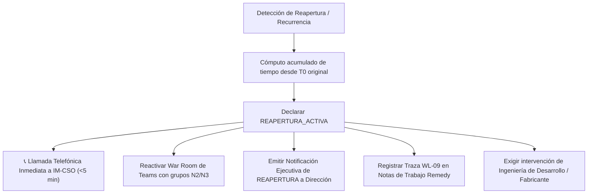

# Escenario 8: Reactivación Exprés por Reapertura / Recurrencia Activa (SL1 / SL2)

Guía procedimental de máxima urgencia para incidencias que se reabren en BMC Remedy o experimentan un repunte del corte de servicio tras la aplicación de un workaround inestable o un cierre precipitado, disparando protocolos de reactivación sin periodos de cortesía.

* **Código Operativo:** `REAPERTURA_ACTIVA`
* **Severidad ITIL Calibrada:** `SL1 / P1` o `SL2 / P2` (Reactivación de Emergencia)
* **Llamada a IM-CSO:** **OBLIGATORIA E INMEDIATA** (Sin periodo de cortesía de 45 min)
* **Canal Prescrito:** Canal Telefónico Directo IM-CSO + War Room Teams Inmediata
* **SLA de 1ª Acción:** Menos de 5 minutos
* **Protocolo General:** [Protocolo Operativo IM-CSO Post-Triaje](../protocolo-im-cso-escenarios-triaje.md)

---

## 🎯 1. Criterios de Activación y Detección

Este escenario se activa cuando concurren las siguientes circunstancias operativas:
1. **Ticket Reabierto en BMC Remedy:** Incidencia que se encontraba en estado `Resuelto` o `Pendiente de Validación` y vuelve a estado `Asignado` o `En Curso` tras quejas de usuarios o repunte de monitorización.
2. **Fallo o Inestabilidad de Workaround Previo:** La medida temporal aplicada en el Escenario 7 colapsa, reproduciendo la indisponibilidad total o la degradación de transacciones.
3. **Recurrencia en Menos de 48 Horas:** Reproducción del mismo síntoma técnico en el mismo componente o aplicativo dentro de la misma ventana de servicio.

---

## 🛑 2. Regla de Oro: Eliminación del Periodo de Cortesía

> [!CAUTION]
> En una reapertura o recurrencia activa:
> 1. **Los cronómetros NO se reinician:** El tiempo de indisponibilidad y deriva se computa acumulando la duración desde la fecha y hora de apertura original ($T_0$).
> 2. **Sin cortesía de 45 minutos:** Al superar ampliamente los umbrales de crisis desde $T_0$, **se ejecuta la llamada telefónica inmediata a IM-CSO y a los responsables de soporte N3 en los primeros 5 minutos**.
> 3. **Prohibido reaplicar el mismo workaround:** Si un workaround falló, queda terminantemente prohibido repetir la misma acción de contorno.

---

## ⏱️ 3. Flujo de Actuación del Incident Manager



### Instrucciones Operativas Paso a Paso:
1. **Reapertura de la War Room:** Reactivar de inmediato la sala de crisis en Teams convocando con máxima prioridad a los especialistas de sistemas y desarrollo.
2. **Llamada de Voz Directa a IM-CSO:** Comunicar telefónicamente la reapertura a la Jefatura de Customer & Service Operations explicando el fallo de la mitigación previa.
3. **Comunicado Oficial a Dirección:** Emitir la comunicación ejecutiva oficial en fase de `REAPERTURA` ($\le 90$ palabras completo, $\le 30$ palabras breve) para mantener alineada a la Dirección.
4. **Registro en Ticketing:** Insertar de inmediato en Remedy la traza oficial **`WL-09`**.
5. **Apertura de Expediente Post-Mortem Agravado:** La reincidencia obligará a un análisis PIR exhaustivo con revisión del porqué falló la mitigación inicial.

---

## 📝 4. Trazas Obligatorias para Worklogs (BMC Remedy ITSM)

### Traza WL-09: Reactivación Exprés por Reapertura / Recurrencia
```text
[IM-CSO / PROTOCOLO] [WL-09: REAPERTURA ACTIVA POR RECURRENCIA] - AAAA-MM-DD HH:MM:SS CET
Autor: [Nombre y Apellidos] - Incident Manager de Guardia
Estado: Ticket Reabierto / Recurrencia Activa
Apertura Original (T0): AAAA-MM-DD HH:MM:SS | Tiempo Acumulado Total: [XXX] min

MOTIVO DE LA REAPERTURA Y SÍNTOMA:
[Descripción del repunte de errores, caída de servicio o fallo en la mitigación previa].

ACCIONES INMEDIATAS (PROTOCOLOS SIN CORTESÍA):
1. Reactivada inmediatamente la War Room en Teams.
2. Cómputo de cronómetros acumulado desde T0 original: al superar los umbrales de escalado, se ejecuta llamada directa inmediata a IM-CSO y N3 sin periodo de cortesía.
3. Emitida notificación ejecutiva oficial en fase de REAPERTURA a Dirección.
4. Queda terminantemente prohibido reaplicar el mismo workaround que resultó inestable.
```

---

## 🚫 5. Errores Comunes a Evitar

* ❌ **NO esperar 45 minutos para llamar por teléfono:** El incidente ya ha consumido su ventana de tolerancia operativa.
* ❌ **NO intentar "probar a ver si reiniciando otra vez funciona":** Provoca mayores pérdidas transaccionales y distorsión en BBDD.
* ❌ **NO ocultar la reapertura a Dirección:** La transparencia es innegociable bajo la doctrina de comunicación corporativa de Orange.

---

## 🔗 6. Enlaces y Recursos Rápidos

* [Consola de Triaje y Emergencias IT ↗](/dashboards/emergency-triage-console/ ':ignore :target=_blank')
* [Protocolo Completo de Gobernanza IM-CSO](../protocolo-im-cso-escenarios-triaje.md)
* [Escenario 1: Emergencia Viva Crítica](./escenario-1-emergencia-viva.md)
* [Escenario 7: Soluciones de Contorno y Candado 🔒](./escenario-7-workaround-autorizado.md)
* [Notificaciones Ejecutivas Oficiales](../notificaciones-ejecutivas.md)

