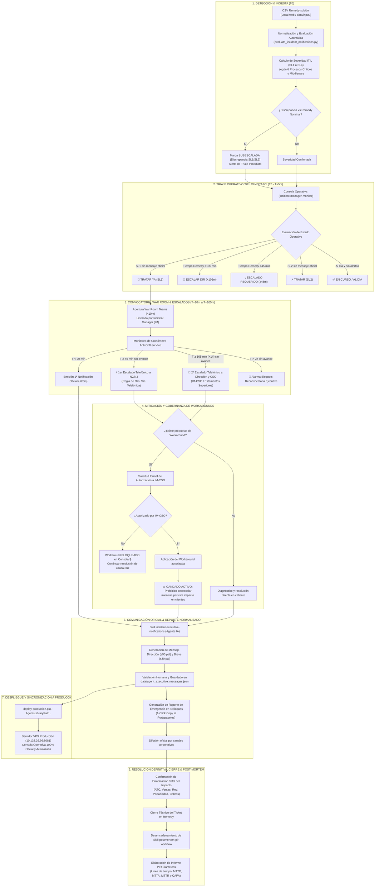

# Guía Operativa: Flujo Integral de Gestión de Incidencias y Emergencias IT (Orange Tech Operations)

Esta guía define el procedimiento estándar, estructurado y de extremo a extremo (**End-to-End Incident Lifecycle**) que el **Incident Manager (IM)**, el equipo de guardia operativa y los centros de control de soporte deben ejecutar desde la detección inicial de una anomalía o subida de un nuevo CSV de Remedy hasta la resolución definitiva, la erradicación del impacto y el traspaso a Post-Mortem (PIR).

---

## 🎯 Principios Fundamentales y Reglas de Oro

1. **La "Regla de Oro" (Principio de Precaución en Triaje N1):**
   * Ante cualquier duda, anomalía técnica no catalogada o información incompleta sobre el alcance real de una afectación, **la incidencia se clasifica inmediatamente como Emergencia (SL1 / P1 / Crítica)**.
   * Se gestiona, convoca y comunica como SL1 desde el primer minuto. Únicamente se podrá desescalar si se confirma formal y documentalmente que el impacto es menor.
2. **Prioridad Objetiva sobre la Severidad Nominal de Remedy (Detección de Discrepancias):**
   * El operador y la matriz de los **6 Procesos Críticos de Negocio** mandan sobre el campo de prioridad nominal del ticket de Remedy. Si Remedy cataloga una avería como *"Media"* o *"Baja"* pero supera los umbrales de negocio (ej. caída de IVR, colapso de ventas o corte de facturación), la Consola la reclasifica como **Subescalada (Discrepancia SL1/SL2)** y exige tratamiento urgente inmediato.
3. **Control de Cronómetros y Escalados Telefónicos Obligatorios:**
   * En emergencias SL1 y situaciones de estancamiento, los escalados son **vía telefónica / voz obligatoria** (Regla de Oro de Convocatoria). Queda expresamente prohibido sustituir los escalados temporales por correos pasivos, WhatsApp o notas internas.
   * **T < 20 min:** 1ª Notificación oficial emitida a Dirección y comités.
   * **T ≥ 45 min:** 1er Escalado Telefónico obligatorio a resolutores N2/N3 y jefaturas de grupo.
   * **T ≥ 105 min (+1h adicional):** 2º Escalado Telefónico a Estamentos Superiores (Dirección de Operaciones y Customer & Service Ops / IM-CSO).
   * **T > 2h sin avance:** Alarma por bloqueo; activación de escalado de crisis a IM-CSO y reconvocatoria ejecutiva de War Room.
4. **Gobernanza Institucional de Workarounds (Candado 🔒):**
   * Cualquier solución provisional, conmutación de tráfico, reinicio de balanceadores o mitigación temporal (**workaround**) requiere **autorización previa y explícita de Customer & Service Ops (IM-CSO)**.
   * **Bloqueo estricto de desescaladas:** La aplicación de un workaround nunca reduce la severidad SL1 ni cierra el ticket mientras persista el impacto en clientes o no se haya erradicado totalmente la causa raíz.
5. **Estándar de Comunicación Ejecutiva Oficial:**
   * **Versión Completa para Dirección:** Exactamente **1 único párrafo**, máximo **90 palabras**.
   * **Versión Breve (SMS / Guardia):** Máximo **30 palabras**.
   * **Regla Anti-Alucinación:** No inventar horarios, métricas de afectados, causas raíz no confirmadas ni sistemas no especificados en las evidencias técnicas.
6. **Desacoplamiento entre Entornos (Local vs Producción):**
   * En el servidor de producción VPS (`10.132.26.96:8081`) **no existen modelos de lenguaje (LLM) ni skills de IA**. El triaje asistido, la redacción oficial con el rol `incident-reporter` y la revisión humana (*Human-in-the-Loop*) se realizan en el entorno local (`:8080`) y se despliegan de forma inmutable mediante `deploy-production.ps1`.

---

## 🗺️ Mapa Visual del Ciclo de Vida de la Incidencia



---

## 🛠️ Procedimiento Operativo Paso a Paso

### FASE 1: Detección, Ingesta y Triaje Inicial (T0 a T+5 min)

#### Paso 1.1: Recepción e Ingesta del CSV Remedy
* **Opción A (Recomendada - Vía Web Local):**
  1. Con el servidor local iniciado (`python serve_app.py` en `:8080`), accede a:  
     **[http://localhost:8080/dashboards/incident-manager-monitor/](http://localhost:8080/dashboards/incident-manager-monitor/)**
  2. En el panel superior, haz clic en **"Seleccionar archivo"** y sube el archivo de incidencias descargado de Remedy (`CS-Informe incidencias P1, P2 y P3 - *.csv`).
  3. El sistema procesa el archivo, calcula los minutos transcurridos desde la apertura Remedy de cada ticket y actualiza el catálogo en tiempo real.
* **Opción B (Línea de Comandos):**
  ```powershell
  python converters/evaluate_incident_notifications.py
  ```

#### Paso 1.2: Triaje Rápido "De un Vistazo" en la Consola Operativa
Al abrir la Consola Operativa, la vista inicial presenta la **Bandeja de Triaje Operativo "De un Vistazo"**:
1. Revisa de inmediato los 7 KPIs superiores (todos interactivos):
   * **PENDIENTES:** Número de tickets que requieren acción operativa inmediata (rojo pulsante si > 0).
   * **AL DÍA:** Incidencias en curso con mensaje oficial emitido, escalado al día y sin discrepancias.
   * **TOTAL ACTIVAS:** Total de tickets en seguimiento.
   * **P1 / P2:** Desglose de criticidad ITIL con filtros independientes por severidad.
   * **SUBESCALADAS:** Incidencias donde la severidad nominal de Remedy es inferior al impacto real, con desglose `(SL1 / SL2)`.
   * **ESCALADOS (≥ 45M):** Incidencias con más de 45 minutos transcurridos sin resolución (deduplicado por ticket).
   * **WORKAROUNDS CSO:** Mitigaciones provisionales pendientes de autorización por IM-CSO.
2. Utiliza los controles de visualización:
   * **Conmutador de Estados:** Alterna entre **"Solo Pendientes (N)"** (para aislar tickets que requieren acción) y **"Todas las Activas (N)"** (para ver el catálogo activo completo). Los contadores se actualizan en tiempo real.
   * **Selector de Presentación:** Alterna entre **"📋 Vista Triaje Rápido"** (tabla consolidada de alta densidad) y **"🗂️ Vista Tarjetas Detalle"** (despliegue profundo por incidencia).
3. Transiciones del **Ciclo de Vida (4 Estados Operativos)**:
   * Cada ticket puede transicionar entre `Pendiente`, `Comunicada`, `En Seguimiento` y `Descartada` usando el selector directo `.im-status-select` en la tabla o en la cabecera de la tarjeta. Las decisiones persisten automáticamente en `localStorage`.
4. Acciones inmediatas desde la tabla de triaje (1-Clic):
   * `📋 Reclasif.`: Aparece en filas con discrepancia; copia al portapapeles la solicitud formal para el worklog de Remedy.
   * `📞 War Room`: Aparece cuando el tiempo $\ge 45\text{ min}$; copia al portapapeles la convocatoria estructurada de Teams para voz obligatoria.
   * Pastillas de urgencia en la columna **ESTADO / ACCIÓN**:
     * `🚨 TRATAR YA (SL1)`: Incidencia crítica P1/SL1 pendiente de redacción oficial.
     * `🚨 ESCALAR DIR (+105m)`: Ticket con más de 105 minutos transcurridos; requiere llamada a Dirección y CSO.
     * `📞 ESCALADO REQUERIDO (≥45m)`: Ticket con más de 45 minutos transcurridos; requiere convocatoria telefónica a N2/N3.
     * `⚡ TRATAR (SL2)`: Incidencia mayor P2/SL2 pendiente de redacción oficial.

---

### FASE 2: Convocatoria, War Room y Control de Escalados Telefónicos (T+10 min a T+105 min)

#### Paso 2.1: Apertura de War Room Teams (< 10 min para SL1)
* Para toda incidencia clasificada como **SL1 / P1**, el Incident Manager abre de forma inmediata una reunión de audio/vídeo en Microsoft Teams (*War Room*).
* **Convocatoria en 1-Clic:** Utiliza el botón `📞 Convocatoria War Room Teams` (en la tarjeta) o `📞 War Room` (en la tabla de triaje) para generar y copiar el mensaje estructurado de convocatoria que incluye la gobernanza RACI, tiempo transcurrido y canal de audio obligatorio.
* Convoca a los responsables de guardia N2 y N3 de los sistemas implicados consultando los directorios corporativos:
  * **Directorio de Guardias GRIAL:** [https://grial.orange.es](https://grial.orange.es)
  * **Confluence Operaciones MasMóvil:** [https://confluence.masmovil.com](https://confluence.masmovil.com)

#### Paso 2.2: Primera Notificación Oficial (< 20 min)
* Antes de cumplirse los primeros 20 minutos desde la identificación del ticket, debe difundirse la **1ª Notificación Oficial de Apertura** a los comités de seguimiento y Dirección.

#### Paso 2.3: Control de Tiempos de Escalado y Protocolo Telefónico Estricto
Los distintivos de cronómetro (`⏱️ HHh MMm`) calculan en vivo los minutos transcurridos:
1. **Primer Escalado Telefónico (≥ 45 Minutos):**
   * Cuando el cronómetro alcanza los **45 minutos** y el distintivo entra en alerta ámbar pulsante (`im-timer-pulse-warning`), si el grupo resolutor no presenta un diagnóstico firme con avance técnico significativo:
   * El IM realiza una **llamada telefónica directa** (no chat, no correo) al responsable técnico de guardia del grupo resolutor o jefatura de soporte.
   * Exige la incorporación inmediata de recursos adicionales y fija un punto de control a 30 minutos.
2. **Segundo Escalado Telefónico a Estamentos Superiores (≥ 105 Minutos / +1h adicional):**
   * Si transcurre **1 hora adicional** (alcanzando los **105 minutos** desde la apertura) y la incidencia continúa sin mitigarse, el distintivo entra en alerta roja crítica pulsante (`im-timer-pulse-critical`):
   * El IM ejecuta una **llamada telefónica inmediata a Dirección de Operaciones y Customer & Service Ops (IM-CSO)**.
   * Se evalúa la activación del Comité de Crisis y la afectación directa a clientes.
3. **Alarma por Bloqueo (> 2 Horas sin Avance):**
   * Todo ticket SL1 que acumule más de 2 horas sin avance o plan validado activa la alarma de estancamiento, exigiendo la reconvocatoria ejecutiva de urgencia de la mesa de crisis.

---

### FASE 3: Gobernanza de Workarounds y Bloqueo de Desescaladas

```text
    ┌────────────────────────────────────────────────────────┐
    │ 🔒 GOBERNANZA DE WORKAROUNDS (REGLA INSTITUCIONAL CSO) │
    └────────────────────────────────────────────────────────┘
    1. Propuesta Técnica de Mitigación (N2 / Proveedor)
                   │
                   ▼
    2. Validación Técnica de Viabilidad (Incident Manager)
                   │
                   ▼
    3. Solicitud Formal de Autorización a IM-CSO
                   │
         ┌─────────┴─────────┐
         ▼                   ▼
    [DENEGADO]          [AUTORIZADO]
         │                   │
    Bloqueo en Consola  Aplicación de Mitigación
    Continuar causa     en Producción
    raíz en caliente         │
                             ▼
                    ¿Impacto en cliente
                    totalmente erradicado?
                             │
                   ┌─────────┴─────────┐
                   ▼                   ▼
                 [NO]                [SÍ]
             CANDADO ACTIVO      Autorización CSO
             Prohibido rebajar   de Desescalada o
             severidad (SL1)     Cierre en Remedy
```

1. **Requerimiento de Autorización IM-CSO:** Ningún grupo técnico puede dar por mitigada una incidencia mediante un parche temporal, reinicio de balanceadores o bypass de servicios sin el visto bueno de **Customer & Service Ops (IM-CSO)**.
2. **Candado Institucional de Desescalada:** En la Consola Operativa, si una incidencia cuenta con workaround activo pero el impacto persiste o falta la autorización de CSO, el banner de bloqueo (`.im-gov-lock-banner`) impide rebajar la severidad en el informe.

---

### FASE 4: Comunicación Ejecutiva Oficial y Reporte en 4 Bloques

#### Paso 4.1: Redacción Asistida con la Skill de IA (Entorno Local)
1. Para los tickets que figuren en estado pendiente de redacción, solicita al asistente en el chat local de Antigravity:
   > *"He cargado el CSV de incidencias. Activa la skill incident-executive-notifications para redactar las comunicaciones oficiales pendientes."*
2. El asistente adoptará el rol `incident-reporter` y redactará los dos niveles requeridos:
   * **Mensaje para Dirección:** 1 único párrafo, máximo 90 palabras, tono formal y neutral.
   * **Versión Breve (SMS/Guardia):** Máximo 30 palabras.
3. Los textos validados se guardan automáticamente en `data/agent_executive_messages.json` mediante `update_agent_message.py`.

#### Paso 4.2: Edición Manual o Ajuste Directo en la Consola
Si necesitas redactar o ajustar el texto directamente en el navegador:
* Utiliza el botón **"✨ Sugerir Borrador IA"** (en la cabecera del editor) o **"✨ Sugerir"** (en la barra de ingesta rápida): la Consola autocompleta inmediatamente un borrador adaptado al ticket y a la fase (Apertura, Seguimiento o Cierre), garantizando el cumplimiento de los límites ($\le 90$ palabras monopárrafo para la versión completa y $\le 30$ palabras para la versión breve).
* El editor cuenta con contadores reactivos en tiempo real que alertan si se supera el límite de palabras o si se introducen múltiples párrafos no permitidos.
* Haz clic en **"Guardar en Almacén Oficial"** para persistir el mensaje directamente en `data/agent_executive_messages.json`.

#### Paso 4.3: Generación del Reporte Normalizado de Emergencia (1-Click Copy)
1. En la tarjeta de la incidencia en la Consola Operativa, haz clic en el botón **"📋 Copiar Reporte"**.
2. El sistema genera de forma instantánea el reporte estructurado en 4 bloques normalizados listo para ser pegado en Teams, correo o acta de guardia:

```text
================================================================================
REPORTE DE OPERACIONES DE EMERGENCIA IT - ORANGE ESPAÑA
================================================================================
[1] CLASIFICACIÓN DEL TICKET
• ID Incidencia: INC000004168775
• Severidad Calculada: SL1 / P1 (Emergencia Crítica)
• Proceso Crítico de Negocio: Provisión y Activación
• Umbral Superado: Órdenes de Móvil: >20% de errores o 100% en error por >10 minutos
• Sistemas Afectados: PROVISION_MOVIL, OSB, CRM_FRONTAL
• Impacto Operativo: Bloqueo en la provisión de altas de telefonía móvil

[2] ESTADO DE COMUNICACIONES Y SLAS
• Apertura Remedy: 28/10/2026 07:15:00
• Tiempo Transcurrido: ⏱️ 01h 45m (105 min)
• Primera Notificación (<20 min): Emitida
• Frecuencia de Actualización: Cada 30 minutos (Emergencia SL1)

[3] PLAN DE ACCIÓN Y GOBERNANZA DE WORKAROUNDS
• Diagnóstico Técnico: Saturación de hilos en pasarela OSB provisión móvil
• Workaround Detectado: Conmutación de tráfico a nodo secundario
• Gobernanza CSO: AUTORIZADO POR IM-CSO
• Estado de Candado: IMPACTO NO ERRADICADO (Mantiene Severidad SL1)

[4] ESTADO DE ESCALADO TELEFÓNICO
• Fase de Escalado: ESCALADO SUPERIOR REQUERIDO (≥105 min)
• Canal de Escalado: Vía Telefónica obligatoria a Dirección y CSO (Regla de Oro)
• Matriz RACI: Incident Manager (R) / IM-CSO (A) / N2-N3 (C)
================================================================================
```

---

### FASE 5: Resolución, Cierre Técnico y Traspaso a Post-Mortem (PIR)

1. **Verificación de Erradicación Total:**
   * La incidencia solo se da por resuelta cuando las métricas operativas de los aplicativos vuelven a sus valores nominales durante al menos **30 minutos continuados** sin reaparición de alarmas.
   * Se obtiene confirmación expresa de las áreas operativas afectadas (ATC, Canal Comercial, Operaciones de Red o Facturación).
2. **Cierre Técnico en Remedy:**
   * El Incident Manager actualiza el ticket en Remedy a estado *"Resuelto"* con la codificación de causa raíz técnica adecuada.
3. **Traspaso al Flujo Post-Mortem (PIR):**
   * Toda incidencia SL1 / P1 exige la elaboración obligatoria de un **Post-Incident Review (PIR)** o informe *Post-Mortem Blameless*.
   * Ejecuta o solicita la activación de la skill de post-mortem:
     > *"La incidencia INC000004168775 ha quedado resuelta. Activa la skill postmortem-pir-workflow para iniciar la elaboración del informe PIR."*
   * El flujo recopilará la línea de tiempo verificada, calculará las métricas operativas oficiales (**MTTD**, **MTTA**, **MTTR**) y estructurará el plan de acciones preventivas y correctivas (**CAPA**).

---

### FASE 6: Sincronización y Publicación en Producción

Una vez que las comunicaciones y estados han sido validados en local, traslada los datos al servidor VPS de producción:

```powershell
powershell -ExecutionPolicy Bypass -File scripts/deploy-production.ps1 -AgentsLibraryPath .
```

* El script compilará el runtime inmutable, subirá los ficheros de datos (`agent_executive_messages.json` y `high_priority_notifications.json`) a la ruta persistente `/infocodes/var/storage/release-dashboard/` y verificará el estado HTTP del servidor (`200 OK`).
* Accede a la Consola de Producción para verificar la coherencia de los indicadores:  
  **[http://infocodes.si.orange.es:8081/dashboards/incident-manager-monitor/](http://infocodes.si.orange.es:8081/dashboards/incident-manager-monitor/)**

---

## 📊 Matriz Oficial de Severidad y Umbrales Cuantitativos de Emergencia (Orange)

| Proceso Crítico | Umbrales Cuantitativos de Emergencia (SL1 / P1) | SLA de 1ª Notificación | Escalado Telefónico Obligatorio |
| :--- | :--- | :--- | :--- |
| **Atención al Cliente (ATC)** | • Caída total o indisponibilidad de IVR en cualquier marca.<br>• Descarte de **>20% de llamadas durante 1 hora**.<br>• Desviación de **>20% en 30 minutos** en Frontales/CRM o bloqueo de consulta de datos del cliente. | < 20 min | • 45m: Jefatura ATC / Resolutores N2<br>• 105m: Dirección de Clientes / CSO |
| **Ventas y Canales** | • Impacto en **>30% del volumen comercial** de cualquier canal o marca.<br>• Registrar **<15% de ventas diarias** respecto a la media de los 4 días equivalentes anteriores. | < 20 min | • 45m: Responsable Canal Comercial<br>• 105m: Dirección de Ventas / CSO |
| **Portabilidad** | • Fallo en el inicio del flujo nocturno a las **02:00 AM**.<br>• Fallo de comunicación con entidad de referencia entre 08:00 y 20:00 (caída total o **retraso >2 horas**). | < 20 min | • 45m: Operaciones Portabilidad<br>• 105m: Dirección Regulatoria / CSO |
| **Prepago** | • **Recargas:** >10% de errores o >30 min sin transacciones.<br>• **Altas:** >10% de errores o >30 min sin altas operativas. | < 20 min | • 45m: Plataformas Prepago N2/N3<br>• 105m: Dirección Financiera / CSO |
| **Provisión y Activación** | • Indisponibilidad del **100% de renovaciones de beneficios**.<br>• **Órdenes Móvil:** >20% de error o 100% en error por >10 min.<br>• **Órdenes Fijo:** >30% de error o 100% en error por >30 min. | < 20 min | • 45m: Jefatura Provisión OSB/Core<br>• 105m: Dirección Técnica / CSO |
| **Facturación y Cobros** | • Desviación de **>1 día en cobro o facturación batch**.<br>• Más de **3 horas sin tarificación online**.<br>• Afectación en la ventana de **±3 días de ciclo de facturación**. | < 20 min | • 45m: Facturación y Cobros N2<br>• 105m: Dirección de Finanzas / CSO |
| **Middleware Transversal** | • Caída de Pasarelas API, Buses de Integración (OSB, TIBCO) que intercomunican dos o más procesos críticos o frontales. | < 20 min | • 45m: Escalado en paralelo N2/N3<br>• 105m: Dirección de Arquitectura / CSO |

---

## 👥 Matriz RACI y Canales de Comunicación

| Rol Operativo | Función en el Flujo | Triaje y Clasificación | Convocatoria y War Room | Aprobación de Workaround | Escalados Telefónicos |
| :--- | :--- | :---: | :---: | :---: | :---: |
| **Incident Manager (IM)** | Líder táctico de la crisis IT | **R** (Responsible) | **R** (Responsible) | **C** (Consulted) | **R** (Responsible) |
| **IM-CSO (Customer & Service Ops)** | Autoridad de Gobierno y Clientes | **A** (Accountable) | **I** (Informed) | **A** (Approver Único) | **A** (Approver a Dirección) |
| **Grupos Resolutores N2 / N3** | Diagnóstico y ejecución técnica | **C** (Consulted) | **R** (Participante Activo) | **R** (Proponente Técnico) | **C** (Receptor de Escalado) |
| **N1 / Centro de Control** | Monitorización e ingesta de tickets | **R** (Triaje Inicial) | **I** (Informed) | **I** (Informed) | **I** (Informed) |
| **Dirección de Operaciones** | Estamento Directivo Ejecutivo | **I** (Informed) | **I** (Informed) | **I** (Informed) | **I** (Receptor a +105 min) |

---

## 🧰 Cheat Sheet de Comandos Operativos

| Operación | Comando en Terminal |
| :--- | :--- |
| **Evaluar y recalcular notificaciones locales** | `python converters/evaluate_incident_notifications.py` |
| **Escanear tickets pendientes de redacción** | `python .agents/skills/incident-executive-notifications/scripts/scan_pending_incidents.py` |
| **Escanear tickets en formato JSON** | `python .agents/skills/incident-executive-notifications/scripts/scan_pending_incidents.py --json` |
| **Consultar contexto y prompt de un ticket** | `python .agents/skills/incident-executive-notifications/scripts/scan_pending_incidents.py --id INC000004XXXXXX` |
| **Guardar redacción manual en almacén** | `python converters/cli/update_agent_message.py --id INC000004XXXXXX --phase apertura --raw "<texto>"` |
| **Ejecutar tests unitarios de la Consola** | `pytest converters/tests/unit/test_incident_manager_monitor.py -v` |
| **Desplegar al servidor de producción VPS** | `powershell -ExecutionPolicy Bypass -File scripts/deploy-production.ps1 -AgentsLibraryPath .` |

---

## ❓ Preguntas Frecuentes y Diagnóstico Operativo (FAQ)

### 1. ¿Qué hago si una incidencia está en estado SL2 pero supera los 45 minutos de apertura?
* Si una incidencia SL2 supera los 45 minutos, la Consola Operativa la clasifica automáticamente dentro del chip de **Escalados Vencidos (≥45m)** y activa el estado `📞 ESCALADO REQUERIDO (≥45m)`.
* Debes contactar telefónicamente con el resolutor asignado para verificar el diagnóstico y confirmar si existe riesgo de elevación a SL1.

### 2. ¿Por qué una incidencia con mensaje oficial ya emitido sigue apareciendo en "Pendientes de Tratar"?
* La definición operativa de **"Pendiente de Tratar"** no abarca únicamente la redacción de mensajes. Un ticket se considera pendiente de tratamiento si cumple **cualquiera** de estas tres condiciones:
  1. Requiere redacción oficial inmediata (SL1/P2 sin mensaje en almacén).
  2. Su tiempo de apertura ha alcanzado o superado los 45 minutos sin resolución, exigiendo seguimiento telefónico.
  3. Presenta una discrepancia de severidad (subescalación en Remedy frente a la matriz Orange).

### 3. ¿Puede un proveedor o resolutor aplicar un workaround sin permiso de CSO?
* **No.** Bajo la normativa de gestión de emergencias IT de Orange, cualquier medida paliativa que altere la topología, funcionalidad o capacidad de un servicio debe ser autorizada expresamente por **IM-CSO**. En caso de aplicarse de forma unilateral en caliente, la Consola mantendrá el candado institucional activo 🔒 y la incidencia seguirá computando como SL1.

---

## 📁 Archivos y Rutas Relacionadas

* **Guía Operativa de Notificaciones Ejecutivas:** [`docs/INCIDENT-EXECUTIVE-NOTIFICATIONS-WORKFLOW.md`](file:///c:/Users/jose.delafuente/proyectos/release-dashboard-application/docs/INCIDENT-EXECUTIVE-NOTIFICATIONS-WORKFLOW.md)
* **Manual del Operador de la Consola:** [`docs/MANUAL-OPERADOR-CONSOLA-OPERATIVA.md`](file:///c:/Users/jose.delafuente/proyectos/release-dashboard-application/docs/MANUAL-OPERADOR-CONSOLA-OPERATIVA.md)
* **Consola Operativa (HTML/JS/CSS):** [`dashboards/incident-manager-monitor/`](file:///c:/Users/jose.delafuente/proyectos/release-dashboard-application/dashboards/incident-manager-monitor/)
* **Servicio Backend de Gestión de Incidencias:** [`converters/cli/incident_manager_service.py`](file:///c:/Users/jose.delafuente/proyectos/release-dashboard-application/converters/cli/incident_manager_service.py)
* **Skill Especialista en Emergencias IT Orange:** [`.agents/skills/orange-it-emergency-management/SKILL.md`](file:///c:/Users/jose.delafuente/proyectos/release-dashboard-application/.agents/skills/orange-it-emergency-management/SKILL.md)
* **Skill Matriz de Severidad y Escalados:** [`.agents/skills/it-severity-matrix/SKILL.md`](file:///c:/Users/jose.delafuente/proyectos/release-dashboard-application/.agents/skills/it-severity-matrix/SKILL.md)
* **Skill Redacción Ejecutiva:** [`.agents/skills/incident-executive-notifications/SKILL.md`](file:///c:/Users/jose.delafuente/proyectos/release-dashboard-application/.agents/skills/incident-executive-notifications/SKILL.md)
* **Skill Flujo Post-Mortem (PIR):** [`.agents/skills/postmortem-pir-workflow/SKILL.md`](file:///c:/Users/jose.delafuente/proyectos/release-dashboard-application/.agents/skills/postmortem-pir-workflow/SKILL.md)

