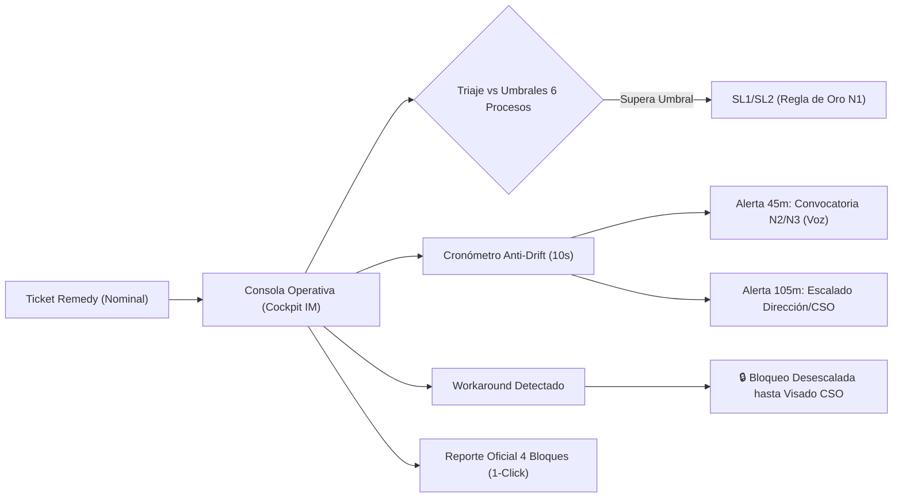
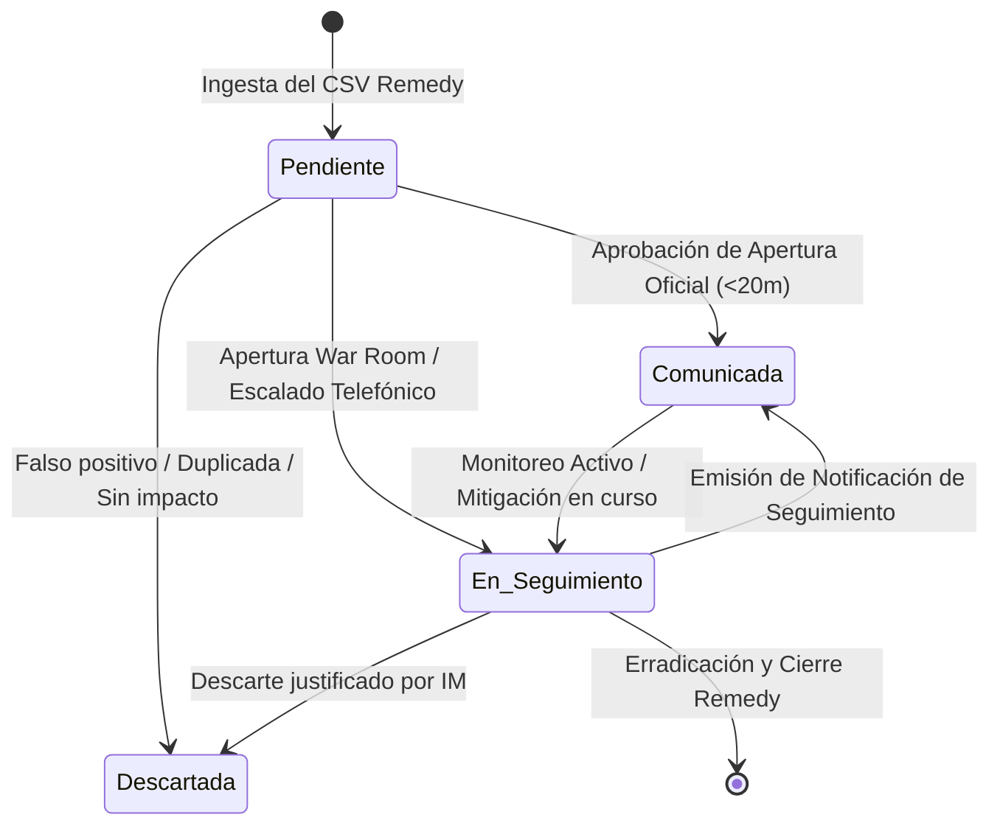
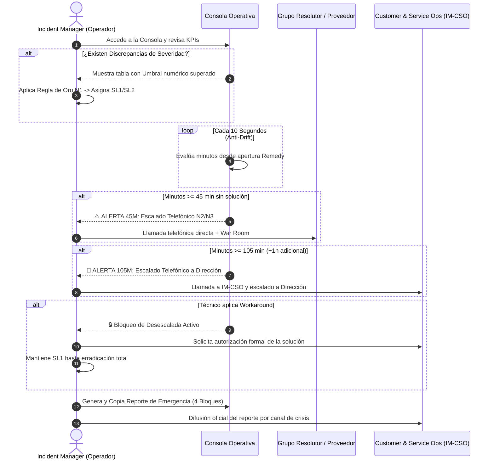
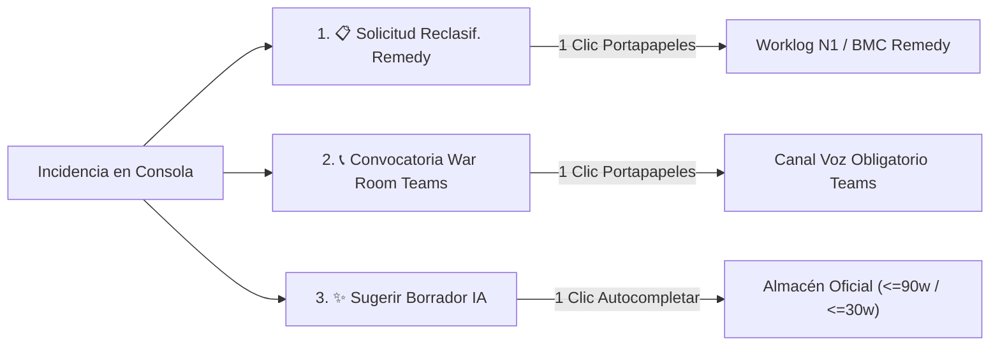

# Manual del Operador: Consola de Emergencias IT Orange
## *Cockpit Operativo del Incident Manager (IM)*

**Versión:** 1.0.0  
**Fecha de Aprobación:** Octubre 2026  
**Ámbito:** Orange Tech Operations · Customer & Service Ops (IM-CSO) · Incident Management  
**Clasificación:** Uso Interno Operativo (Confidencial)  

---

## 📑 Índice de Contenidos

1. [Introducción y Propósito Operativo](#1-introducción-y-propósito-operativo)
2. [Principios y Reglas de Oro Orange](#2-principios-y-reglas-de-oro-orange)
3. [Acceso a la Consola y Política de Aislamiento](#3-acceso-a-la-consola-y-política-de-aislamiento)
4. [Estructura Visual y Modos de la Consola](#4-estructura-visual-y-modos-de-la-consola)
5. [Ciclo de Vida: Flujo de 4 Estados Operativos](#5-ciclo-de-vida-flujo-de-4-estados-operativos)
6. [Guía Paso a Paso durante el Turno de Guardia](#6-guía-paso-a-paso-durante-el-turno-de-guardia)
7. [Herramientas de Acción Inmediata del Cockpit](#7-herramientas-de-acción-inmediata-del-cockpit)
8. [Gestión Cuantitativa de Discrepancias (Subescalaciones)](#8-gestión-cuantitativa-de-discrepancias-subescalaciones)
9. [Cronometraje Anti-Drift y Protocolo de Escalado Telefónico](#9-cronometraje-anti-drift-y-protocolo-de-escalado-telefónico)
10. [Gobernanza de Workarounds y Bloqueo de Desescaladas](#10-gobernanza-de-workarounds-y-bloqueo-de-desescaladas)
11. [Reporte Normalizado de Emergencia en 4 Bloques](#11-reporte-normalizado-de-emergencia-en-4-bloques)
12. [Redacción y Publicación de Comunicados Oficiales](#12-redacción-y-publicación-de-comunicados-oficiales)
13. [Playbooks de Actuación ante Escenarios Críticos](#13-playbooks-de-actuación-ante-escenarios-críticos)
14. [Matriz RACI y Directorios de Contacto de Guardia](#14-matriz-raci-y-directorios-de-contacto-de-guardia)
15. [Resolución de Incidencias Técnicas de la Consola (Troubleshooting)](#15-resolución-de-incidencias-técnicas-de-la-consola-troubleshooting)
16. [Documentación y Flujos Relacionados](#16-documentación-y-flujos-relacionados)

---

## 1. Introducción y Propósito Operativo

La **Consola de Emergencias IT Orange** (*Cockpit del Incident Manager*) es la herramienta táctica de supervisión en tiempo real diseñada para los operadores de **Incident Management** y **Customer & Service Ops (IM-CSO)**.

Su misión principal es:
* **Garantizar el triaje objetivo y sin sesgos:** Contrastar la severidad nominal que viene registrada en Remedy con los umbrales numéricos de impacto de los **6 Procesos Críticos de Negocio de Orange**.
* **Supervisar los tiempos de escalado telefónico obligatorio:** Monitorear de forma anti-deriva (*anti-drift*) las ventanas críticas de **45 minutos** (1er escalado a resolutores) y **105 minutos / +1 hora adicional** (2º escalado a Dirección y CSO).
* **Impedir desescaladas indebidas:** Bloquear el cierre o rebaja prematura de tickets mitigados mediante soluciones provisionales (*workarounds*) sin la erradicación efectiva del impacto y sin el visado explícito de IM-CSO.
* **Garantizar comunicaciones ejecutivas de alta calidad:** Centralizar la redacción, conteo estricto de palabras ($\le 90$ palabras completas y $\le 30$ palabras breves) y publicación de los comunicados de crisis para la Dirección de Orange.



---

## 2. Principios y Reglas de Oro Orange

Todo operador al frente de la Consola debe regirse por los cuatro principios inquebrantables de la operación de emergencias de Orange:

> [!IMPORTANT]
> ### Las 4 Reglas de Oro del Incident Manager:
> 1. **Principio de Precaución (Regla de Oro N1):** Ante cualquier duda sobre el alcance, métrica o impacto real de una degradación técnica en clientes o procesos de negocio, **clasifícala de inmediato como Emergencia (SL1 / P1)**. Solo se podrá reducir la severidad si se demuestra con datos concluyentes que el impacto está por debajo del umbral.
> 2. **Canal Telefónico Obligatorio en SL1:** Todos los escalados operativos durante una emergencia SL1 deben ejecutarse **vía llamada telefónica directa o canal de audio inmediato**. Los correos, tickets o mensajes de Teams no sustituyen la llamada telefónica en situaciones críticas.
> 3. **Gobernanza Institucional de Workarounds:** La adopción de cualquier parche, reinicio de servicios, redirección de tráfico o bypass temporal **requiere siempre la autorización explícita de Customer & Service Ops (IM-CSO)**.
> 4. **Prohibición de Desescalada Automática:** La aplicación de un *workaround* **NUNCA reduce por sí sola la severidad de un ticket**. Una emergencia solo deja de ser SL1 cuando el impacto en el cliente final y en los procesos de negocio ha desaparecido de raíz.

> [!CAUTION]
> ### Regla Anti-Alucinación en Comunicaciones Oficiales:
> Está terminantemente prohibido incorporar en los informes ejecutivos horas de resolución estimadas, cifras de clientes afectados, orígenes de fallo o grupos culpables que no cuenten con confirmación técnica fehaciente en la evidencia del ticket. Si un dato no está confirmado, debe declararse explícitamente como *"en curso de diagnóstico técnico"*.

---

## 3. Acceso a la Consola y Política de Aislamiento

### Direcciones de Acceso:
* **Entorno de Producción (VPS Corporativo):**  
  [http://infocodes.si.orange.es:8081/dashboards/incident-manager-monitor/](http://infocodes.si.orange.es:8081/dashboards/incident-manager-monitor/)
* **Entorno de Desarrollo y Redacción Local:**  
  [http://localhost:8080/dashboards/incident-manager-monitor/](http://localhost:8080/dashboards/incident-manager-monitor/)

### Política de Aislamiento Estricto:
Por directriz de seguridad y confidencialidad operativa, la Consola de Emergencias **no está enlazada en el Portal General de Métricas de Release** (`/dashboards/portal/` o `/dashboards/index.html`).

* El acceso está restringido al **Incident Manager**, operadores de **Command Center (N1)**, especialistas de **IM-CSO** y responsables de turno de guardia.
* Los operadores deben acceder mediante marcador directo en sus navegadores seguros o enlaces facilitados por el equipo de guardia.

---

## 4. Estructura Visual y Modos de la Consola

La interfaz está organizada en cuatro zonas tácticas optimizadas para el control operativo en tiempo real:

```
+---------------------------------------------------------------------------------------------------+
| [ORANGE LOGO] Consola Operativa de Emergencias IT · Incident Manager    [Modo Emergencias] [RACI] |
+---------------------------------------------------------------------------------------------------+
| [VISTAS: 📋 Triaje Rápido | 🗂️ Tarjetas Detalle]   [FILTRO ESTADO: Solo Pendientes (N) | Todas (N)] |
+---------------------------------------------------------------------------------------------------+
| [KPI] Pendientes | [KPI] Al Día | [KPI] Total Activas | [KPI] P1/P2 | [KPI] Subescaladas | [KPI] Escalados | [KPI] Workarounds |
+---------------------------------------------------------------------------------------------------+
| [Buscador: ID / Sistema...]  [Filtro Severidad]  [Filtro Proceso Crítico]  [Filtro Disc]  [✕ Limpiar]  |
+---------------------------------------------------------------------------------------------------+
| [BANDEJA DE TRIAJE RÁPIDO "DE UN VISTAZO" (TABLA)] o [TARJETAS DE INCIDENCIA EN VIVO]             |
|  * Cabecera: ID, Sistema, Estado Operativo (Selector), Timer Anti-Drift (ej. ⏱️ 52m)               |
|  * Acciones Rápidas: 📋 Reclasif. (Remedy) | 📞 War Room (Teams) | Selector 4 Estados             |
|  * Banner de Escalado Telefónico (Ámbar 45m / Rojo 105m con botón War Room)                       |
|  * Tabla de Discrepancia Cuantitativa con botón "Copiar Solicitud Reclasificación Remedy"          |
|  * Banner Institucional de Bloqueo de Workaround (🔒 Candado activo)                              |
|  * Panel de Redacción Oficial con Asistente "✨ Sugerir Borrador IA" (<=90w / <=30w)               |
|  * Reporte Normalizado de Emergencia en 4 Bloques (Monospace con botón 1-Click Copy)              |
+---------------------------------------------------------------------------------------------------+
```

### 1. Barra Superior de Acciones y Modos de Presentación:
* **Selector de Modo de Consola ("Modo Emergencias" / "Modo Compacto"):** Permite alternar entre la vista analítica profunda con todos los paneles desplegados (ideal durante incidentes activos) y la vista compacta para revisiones de rutina.
* **Selector de Modo de Presentación:**
  * **📋 Vista Triaje Rápido (Predeterminada):** Tabla interactiva consolidada con vista tabular de todas las incidencias, badges de urgencia, cronómetro en vivo y **botones de acción inmediata en cada fila** (`📋 Reclasif.`, `📞 War Room` y selector directo de estado).
  * **🗂️ Vista Tarjetas Detalle:** Visualización de tarjetas expandidas individuales con todo el desglose analítico, cronómetro sincronizado, tabla cuantitativa de discrepancia, candado de gobernanza, editor oficial y reporte en 4 bloques.
* **Selector de Visualización por Estado Operativo:**
  * **Botón "Solo Pendientes (N)":** Aísla exclusivamente las incidencias que requieren atención (tickets en estado pendiente, con escalados $\ge 45\text{m}$, discrepancias activas o sin redacción aprobada). El contador numérico se actualiza en vivo.
  * **Botón "Todas las Activas (N)":** Despliega el universo completo de tickets en seguimiento (pendientes, comunicadas, en seguimiento y descartadas).
* **Botón "Protocolo & Contactos":** Despliega el modal emergente accesible con la matriz RACI corporativa y los enlaces directos a las agendas de guardia de GRIAL y Confluence.

### 2. Cuadro de Mando de KPIs (Tarjetas Superiores Interactivas):
Todas las tarjetas de KPIs son **interactivas y clicables**: hacer clic en cualquiera de ellas aplica el filtro correspondiente directamente en la bandeja de triaje y en las tarjetas.

| Tarjeta | Color / Estado | Significado Operativo / Comportamiento al Hacer Clic |
| :--- | :--- | :--- |
| **Pendientes** | **Rojo pulsante** ($>0$) / **Verde** ($=0$) | Incidencias que requieren tratamiento inmediato (redacción SL1/P2, escalado telefónico >45 min o discrepancias). *Al pulsar: activa el filtro de pendientes.* |
| **Al Día** | Verde neutro | Incidencias sin acciones pendientes: comunicación oficial aprobada y tiempos controlados. *Al pulsar: muestra incidencias al día.* |
| **Total Activas** | Gris neutro | Total de incidencias de alta prioridad en catálogo. *Al pulsar: activa la vista de "📋 Ver Todas".* |
| **P1 / P2** | **Rojo / Ámbar** | Desglose SL1 Críticas / SL2 Altas. *Al pulsar sobre el número `P1` filtra solo críticas; al pulsar sobre `P2` filtra solo altas; al pulsar en el cuerpo de la tarjeta alterna la severidad.* |
| **Subescaladas** | **Ámbar / Alerta** | Incidencias con severidad Remedy inferior al criterio ITIL Orange, mostrando el desglose `(SL1 / SL2)` de la prioridad real requerida (ej. `11 (6/5)`). *Al pulsar: filtra directamente las discrepancias.* |
| **Escalados (≥45m)** | **Naranja / Rojo** | Casos que han superado los 45 min o los 105 min desde la apertura Remedy. **Deduplicado por incidencia** (cada ticket computa una sola vez con independencia de sus alertas). *Al pulsar: filtra escalados vencidos.* |
| **Workarounds CSO** | **Ámbar con candado** | Soluciones temporales aplicadas pendientes del visado de Customer & Service Ops (IM-CSO) o de erradicación total. |

### 3. Filtros Rápidos y Botón de Limpieza:
* **Caja de Búsqueda:** Búsqueda reactiva instantánea por ID de Remedy (`INC...`), nombre del sistema (`CRM`, `IVR`, `OSB`, `Facturación`, etc.) o resumen del problema.
* **Desplegable de Severidad:** Filtrado directo por SL1 (Crítica), SL2 (Mayor) o todas.
* **Desplegable de Procesos de Negocio:** Filtra por los procesos corporativos de Orange con resolución tolerante a variantes: *Atención al Cliente (ATC), Facturación y Cobros, Provisión, Ventas, Prepago, Portabilidad, Operación y Monitorización (O&M) y Sistemas Core*.
* **Desplegable de Comunicación Oficial (Apertura / Seguimiento / Cierre):** Permite al operador aislar de inmediato incidencias según el avance de sus notas ejecutivas para Dirección:
  * `Todas las Comunicaciones` (por defecto).
  * `⚠️ Sin Comunicación (Alguna fase)`: Incidencias que tienen pendiente redactar o aprobar Apertura, Seguimiento o Cierre.
  * `❌ Sin Apertura Oficial`: Incidencias recién creadas sin comunicado inicial de apertura aprobado.
  * `⏳ Sin Seguimiento Oficial`: Incidencias en curso que aún no disponen de boletín de seguimiento formal.
  * `🏁 Sin Cierre Oficial`: Incidencias sin comunicación oficial de cierre y normalización del servicio.
  * `🚫 Sin Ninguna Comunicación`: Incidencias que carecen de las tres fases comunicativas.
  * `📣 Con Apertura Oficial`: Incidencias con comunicación inicial debidamente consolidada.
  * `🔄 Con Seguimiento Oficial`: Incidencias con informe de seguimiento aprobado.
  * `✅ Con Cierre Oficial`: Incidencias con informe final de resolución aprobado.
  * `✨ Con Todas Generadas`: Incidencias con el ciclo completo de comunicación ejecutiva cubierto.
* **Chip Táctico de Triaje "⚠️ Sin Comunicación (N)":** Chip de acceso rápido en la bandeja superior de triaje con contador numérico sincronizado en tiempo real.
* **Píldoras visuales en tabla de triaje (`Ap: ✓/✗`, `Seg: ✓/⏳`, `Cie: ✓/🏁`):** Debajo del identificador `INC...` de cada fila, se indica de un vistazo qué comunicaciones están aprobadas (`✓` verde) y cuáles faltan por emitir (`✗/⏳/🏁` ámbar).
* **Badges y Pestañas en Tarjetas Detalladas:** La tarjeta individual destaca con distintivos visuales `✅ Apertura Oficial` / `⚠️ Sin Apertura`, `✅ Seguimiento Oficial` / `⏳ Sin Seguimiento` y `✅ Cierre Oficial` / `🏁 Sin Cierre`, mientras que las pestañas del panel de redacción reflejan el icono de estado de cada fase (`Apertura ✅/⚠️`, `Seguimiento ✅/⏳`, `Cierre ✅/🏁`).
* **Toggle de Discrepancias:** Aísla de inmediato los tickets con subescalación detectada por la regla ITIL Orange.
* **Botón "✕ Limpiar Filtros":** Se muestra dinámicamente cuando hay cualquier filtro, búsqueda o chip no predeterminado activo, permitiendo con un solo clic restablecer la vista inicial por defecto.
* **Desacoplamiento Triaje / Tarjetas:** La bandeja de entrada opera de forma independiente sobre el catálogo completo, de modo que el botón `Todas las Activas` permite visualizar todos los tickets sin restricciones cruzadas.

---

## 5. Ciclo de Vida: Flujo de 4 Estados Operativos

Para garantizar un control preciso del ciclo de vida de cada emergencia y saber exactamente en qué fase se encuentra cada incidente, la Consola implementa una máquina de **4 estados operativos**:



### Definición Normativa de los 4 Estados:

1. **`Pendiente` (Estado Inicial):**
   * **Criterio:** Ticket recién detectado en el catálogo que aún no dispone de comunicado oficial aprobado en almacén, o que habiendo sido comunicado ha superado los 45 minutos sin resolución, o que cuenta con una discrepancia cuantitativa detectada.
   * **Acción Requerida:** Triaje inicial, evaluación de discrepancia, redacción de Apertura oficial o escalado telefónico obligatorio.
2. **`Comunicada`:**
   * **Criterio:** Incidencia cuya comunicación oficial para Dirección ya ha sido redactada, validada y almacenada en `data/agent_executive_messages.json`, encontrándose dentro de la ventana de control de SLA comprometida.
   * **Acción Requerida:** Esperar al siguiente hito de reporte periódico (cada 30 min en SL1, cada 60 min en SL2) o actualizar ante cambios significativos.
3. **`En Seguimiento`:**
   * **Criterio:** Incidencia con War Room abierta, escalado telefónico a resolutores o proveedores ya ejecutado, y plan de mitigación o diagnóstico técnico activo.
   * **Acción Requerida:** Coordinación técnica continua, supervisión del cronómetro anti-drift, control de posibles workarounds y preparación del comunicado de Seguimiento.
4. **`Descartada`:**
   * **Criterio:** Incidencia analizada por el Incident Manager que se descarta como falsa alarma, ticket duplicado en Remedy, prueba de sistemas o avería sin afectación demostrable a clientes ni a procesos críticos.
   * **Acción Requerida:** Documentar en el worklog de Remedy el motivo de descarte y no emitir comunicados a Dirección.

### Gestión y Persistencia del Estado:
* **Selector Rápido:** Tanto en la columna `ESTADO / ACCIÓN` de la tabla de triaje rápido como en la cabecera de la tarjeta de detalle, el Incident Manager puede cambiar el estado con un solo clic mediante el menú desplegable `.im-status-select`.
* **Persistencia Ininterrumpida (`localStorage`):** Cada cambio de estado se guarda inmediatamente en el almacenamiento local del navegador (`hp_incident_notifications_state_v1`). Al recargar la página, aplicar filtros o conmutar entre vistas, los estados asignados se mantienen 100% intactos.

---

## 6. Guía Paso a Paso durante el Turno de Guardia

Sigue este procedimiento operativo estándar (SOP) al tomar el turno o al recibir un aviso de crisis:



---

## 7. Herramientas de Acción Inmediata del Cockpit

Para eliminar la fricción entre la detección de anomalías y la ejecución operativa en caliente, la Consola incorpora **tres herramientas de acción inmediata** que permiten al Incident Manager actuar en cuestión de segundos:



### 1. Botón "Copiar Solicitud de Reclasificación Remedy"
* **Ubicación:** 
  - En la **tabla de Triaje Rápido**: botón directo `📋 Reclasif.` en la columna de acciones para cualquier fila con discrepancia activa.
  - En la **tarjeta de detalle**: botón `📋 Copiar Solicitud Reclasificación Remedy` dentro del panel ámbar de la tabla de discrepancias.
* **Función:** Genera y copia al portapapeles el texto formal estructurado con toda la justificación normativa para pegar en el worklog de Remedy o remitir a N1/Service Desk:
```text
[SOLICITUD RECLASIFICACIÓN DE PRIORIDAD - INCIDENT MANAGEMENT]
Incidencia: INC000004152079
Prioridad Actual Remedy: P3
Prioridad Requerida ITIL: P1 (SL1)
Proceso Crítico Impactado: Facturación y Cobros
Criterio/Umbral Superado: Facturación: >3h sin tarificación
Sistemas Afectados: SOP_TMC_EXCALIBUR
Justificación ITIL: El impacto cuantitativo supera el umbral crítico establecido en el catálogo de servicios de Orange. Se solicita al grupo resolutor N1/N2 la actualización inmediata de la prioridad en Remedy y el seguimiento en war room.
```

### 2. Botón "Convocatoria War Room Teams"
* **Ubicación:**
  - En la **tabla de Triaje Rápido**: botón directo `📞 War Room` cuando el ticket alcanza o supera los 45 minutos.
  - En la **tarjeta de detalle**: botón `📞 Convocatoria War Room Teams` dentro del banner dinámico de escalado telefónico obligatorio.
* **Función:** Redacta y copia al portapapeles el mensaje normativo para Teams, convocando a los grupos resolutores técnicos a canal de audio obligatorio, adaptándose dinámicamente según la ventana temporal (45m o 105m) e integrando la matriz RACI corporativa:
```text
🚨 [CONVOCATORIA WAR ROOM IT - ESCALADO OBLIGATORIO]
Incidencia: INC000004152079 (P1)
Tiempo transcurrido: 65 min (Umbral 45 min superado)
Canal: Voz/Audio Obligatorio Teams
Grupos convocados: N2 / N3 Resolutores, Especialistas de Sistemas SOP_TMC_EXCALIBUR
Gobernanza RACI: Incident Manager (Responsable) | IM-CSO (Aprobador)
Acción Requerida: Conectarse inmediatamente al canal de audio para triaje técnico coordinado y definir plan de contención.
```

### 3. Asistente "✨ Sugerir Borrador IA"
* **Ubicación:**
  - En la cabecera del panel del agente: botón `✨ Sugerir Borrador IA`.
  - En la barra de ingesta rápida de la tarjeta: botón `✨ Sugerir`.
* **Función:** Autocompleta al instante los campos de texto del formulario con borradores ejecutivos adaptados a la fase activa (Apertura, Seguimiento o Cierre).
* **Cumplimiento Matemático de Restricciones:**
  - **Versión Completa para Dirección:** Garantiza exactamente **1 único párrafo** y un conteo $\le 90$ palabras (típicamente entre 55 y 75 palabras reales).
  - **Versión Breve (SMS / Guardia):** Garantiza $\le 30$ palabras (típicamente entre 17 y 23 palabras reales).
  - **Regla Anti-Alucinación:** El asistente utiliza exclusivamente datos confirmados del ticket (ID, proceso de negocio, criterio cuantitativo de afectación y sistemas involucrados), marcando como "en diagnóstico" cualquier causa aún no establecida.

---

## 8. Gestión Cuantitativa de Discrepancias (Subescalaciones)

### ¿Qué es una Discrepancia de Severidad?
Ocurre con frecuencia que los grupos de N1 o usuarios registran tickets en Remedy con severidad **P3 (Media)** o **P4 (Baja)** a pesar de que el impacto técnico real vulnera los umbrales corporativos de Orange.

### Detección Visual en la Consola:
Cuando la Consola detecta esta situación, despliega sobre la tarjeta del incidente un panel ámbar con la **Tabla de Discrepancias Cuantitativas**:

* **Severidad Remedy (Nominal):** Muestra la prioridad original con la que entró el ticket (ej. `P3 (Nominal)`).
* **Severidad ITIL / Orange:** Indica la clasificación real obligatoria (ej. `SL1 (SL1 · Emergencia Crítica)`).
* **Proceso Crítico Afectado:** Señala el proceso vulnerado (ej. *Atención al Cliente (ATC)*).
* **Umbral Numérico Superado:** Destaca en negrita y tipografía monoespaciada el criterio cuantitativo exacto que justifica la emergencia (ej. `>20% llamadas perdidas o caída total IVR`).

### Umbrales Numéricos Oficiales de Orange (Los 6 Procesos Críticos):

```
+---------------------------------------------------------------------------------------------------+
| PROCESO CRÍTICO           | UMBRAL PARA CLASIFICAR INMEDIATAMENTE COMO SL1 / EMERGENCIA CRÍTICA    |
+---------------------------------------------------------------------------------------------------+
| 1. Atención al Cliente    | * Caída total o indisponibilidad del IVR en cualquier marca.          |
|    (ATC)                  | * Colapso con >20% de llamadas descartadas o no atendidas en 1 hora.  |
|                           | * Desviación >20% en 30 min en frontales/CRM o corte de consulta datos|
+---------------------------+-----------------------------------------------------------------------+
| 2. Ventas                 | * Impacto >30% en volumen de operaciones en cualquier canal o marca.  |
|                           | * Caída <15% de ventas diarias respecto a la media de días equivalentes|
+---------------------------+-----------------------------------------------------------------------+
| 3. Portabilidad           | * Imposibilidad de iniciar el flujo a las 02:00 AM.                   |
|                           | * Fallo de conexión con la entidad de referencia (retraso >2 horas).  |
|                           | * Indisponibilidad de componentes centrales de intercambio.           |
+---------------------------+-----------------------------------------------------------------------+
| 4. Provisión              | * Caída del 100% en renovaciones de beneficios.                       |
|                           | * Órdenes Móvil: >20% de error o 100% de error durante >10 minutos.   |
|                           | * Órdenes Fijo: >30% de error o 100% de error durante >30 minutos.    |
+---------------------------+-----------------------------------------------------------------------+
| 5. Prepago                | * Recargas: >10% de fallos o >30 minutos continuos sin recargas.      |
|                           | * Altas: >10% de fallos o >30 minutos continuos sin altas.            |
+---------------------------+-----------------------------------------------------------------------+
| 6. Facturación y Cobros   | * Desviación >1 día en fecha de cobro o tarificación batch.           |
|                           | * Más de 3 horas continuas sin tarificación online.                   |
|                           | * Degradación en la ventana crítica de ±3 días de ciclo de cobro.     |
+---------------------------+-----------------------------------------------------------------------+
```

---

## 9. Cronometraje Anti-Drift y Protocolo de Escalado Telefónico

La Consola incorpora un motor de cronometraje en tiempo real que recalcula cada 10 segundos la antigüedad del ticket contra la hora de apertura original de Remedy (en época Unix/UTC). Este motor es **inmune a retrasos de renderizado (*anti-drift*)** y consume menos de 0.1% de CPU.

### Estados del Cronómetro (`Timer Badge`):
1. **Fase Normal ($0$ a $44$ minutos):**  
   Badge gris con tiempo transcurrido (ej. `⏱️ 28m transcurridos`). Trabajo de diagnóstico estándar con el grupo asignado.
2. **Fase Alerta 45m ($45$ a $104$ minutos):**  
   Badge ámbar con pulso visual (`pulseAmber`) y banner de alerta:
   > **⚠️ ALERTA 45 MIN (1er Escalado Obligatorio):**  
   > Han transcurrido $\ge 45$ min sin resolución técnica. Conforme al protocolo Orange, el Incident Manager debe realizar **escalado telefónico** inmediato al siguiente nivel de soporte/proveedor y convocar reunión de alineación.
3. **Fase Crítica +1h / 105m ($\ge 105$ minutos):**  
   Badge rojo con pulso crítico (`pulseRed`) y banner de máxima urgencia:
   > **🚨 ALERTA +1H / 105 MIN (2º Escalado Crítico):**  
   > Superada 1 hora adicional de crisis sin avances resolutivos. Conforme al protocolo oficial de Emergencias Orange, es mandatario el **escalado telefónico a Dirección y Customer & Service Ops (IM-CSO)**.

### Reglas de Ejecución Telefónica:
* El operador no debe enviar un ticket o correo electrónico esperando respuesta pasiva.
* Debe marcar el número de guardia del responsable de nivel 2 o 3 según figure en **GRIAL** o **Confluence**.
* En convocatorias de crisis, debe abrir una sala de Teams (*War Room*) en menos de **10 minutos** e incorporar a los resolutores clave.

---

## 10. Gobernanza de Workarounds y Bloqueo de Desescaladas

Uno de los errores operativos más graves en la gestión de crisis es rebajar una incidencia de P1/SL1 a P3 o cerrarla porque un técnico aplicó una mitigación provisional (por ejemplo, reiniciar un pod o desviar tráfico).

### El Candado Institucional de la Consola:
Siempre que un ticket tenga registrada una solución de contingencia o la IA identifique un *workaround*, la tarjeta del incidente muestra el **Banner de Bloqueo con Candado** (`🔒`):

```
+-----------------------------------------------------------------------------------------------+
| 🔒 GOBERNANZA DE WORKAROUNDS: DESESCALADA BLOQUEADA                                            |
| La solución temporal aplicada NO erradica el impacto en negocio ni cuenta con la autorización  |
| formal de Customer & Service Ops (IM-CSO). Queda terminantemente prohibido desescalar el       |
| ticket a P3/SL3 o cerrarlo mientras persista riesgo o degradación.                           |
+-----------------------------------------------------------------------------------------------+
```

### Protocolo para Levantar el Bloqueo:
Para que un ticket pueda cambiar de severidad tras un workaround, deben cumplirse **simultáneamente** estas dos condiciones:
1. **Autorización explícita de IM-CSO:** El responsable de Customer & Service Ops debe dar su conformidad por canal formal.
2. **Erradicación total demostrable:** Las métricas de negocio (llamadas IVR, ventas, provisión) deben haber retornado a valores nominales en los dashboards de monitorización durante al menos **30 minutos consecutivos**.

---

## 11. Reporte Normalizado de Emergencia en 4 Bloques

Cada tarjeta de incidencia de alta prioridad dispone de un generador dinámico del **Informe Oficial de Emergencia Orange**. El informe se presenta en una caja de código monoespaciada de alto contraste, garantizando una lectura nítida y una copia sin pérdidas.

### Estructura Normalizada de los 4 Bloques:
```text
======================================================================
REPORTE DE EMERGENCIA IT ORANGE - INCIDENT MANAGEMENT
======================================================================

[1] CLASIFICACIÓN DEL TICKET
----------------------------------------------------------------------
* Identificador: INC000004128954
* Severidad Nominal Remedy: P3
* Severidad ITIL Orange: SL1 (Emergencia Crítica)
* Proceso Crítico Afectado: Atención al Cliente (ATC)
* Criterio de Activación: >20% llamadas perdidas o caída total IVR
* Sistemas Involucrados: IVR Central, Frontal CRM Clientes
* Impacto en Negocio: Caída de balanceador frontal que impide enrutar llamadas entrantes

[2] ESTADO DE COMUNICACIONES Y SLAS
----------------------------------------------------------------------
* Antigüedad de la Crisis: 52 minutos desde apertura
* 1ª Notificación a Dirección (<20 min): Emitida (14 min)
* Frecuencia de Actualizaciones: Cada 1 hora (o <30 min si hay cambios de impacto)
* Próxima Actualización Comprometida: En 8 minutos

[3] PLAN DE ACCIÓN Y GOBERNANZA DE WORKAROUNDS
----------------------------------------------------------------------
* Diagnóstico Técnico: Saturación de memoria por fuga en proceso de señalización SIP
* Solución Temporal (Workaround): Tráfico desviado al nodo secundario de Valencia
* Estado de Validación CSO: Pendiente de visado formal por IM-CSO
* Bloqueo de Desescalada: ACTIVO (Mantenida SL1 hasta erradicación total)
* Revisión de Cambios: No se detectan trabajos programados (PaP) asociados en ventana

[4] ESTADO DE ESCALADO TELEFÓNICO
----------------------------------------------------------------------
* Fase Actual: Alerta 45m Rebasada (52 min transcurridos)
* Canal Requerido: Llamada Telefónica Obligatoria (Regla de Oro)
* Acciones Ejecutadas: Convocatoria de War Room Teams con Proveedor N2 Telefonía
* Matriz RACI: Incident Manager (R - En curso) | IM-CSO (A - Informado)
======================================================================
```

### Cómo Copiar el Reporte en 1 Clic:
1. En la parte superior derecha de la caja del reporte, pulsa el botón **"📋 Copiar Reporte"**.
2. El botón cambiará visualmente a fondo verde con el texto **"✓ Copiado al portapapeles"**.
3. Pega el informe directamente en el canal de crisis de Microsoft Teams, en el correo para Dirección o en la herramienta de escalados.

---

## 12. Redacción y Publicación de Comunicados Oficiales

La Consola permite gestionar el contenido de las comunicaciones ejecutivas tanto en modo local (asistido por IA) como en modo manual directo:

### Parámetros Estrictos del Comunicado:
* **Versión Completa para Dirección:**  
  * Longitud máxima: **90 palabras**.  
  * Formato: **Exactamente 1 único párrafo** (sin saltos de línea intermedios ni viñetas).  
  * Contenido obligatorio: Qué ocurre, sistemas y marcas afectadas, impacto en clientes o procesos y plan de mitigación en curso.
* **Versión Breve (SMS / Mensajería de Guardia):**  
  * Longitud máxima: **30 palabras**.  
  * Formato: Alerta de texto directo encabezada por la severidad (ej. `SL1: Caída de IVR en marca Orange afectando al 35% de llamadas entrantes. Equipos de red en diagnóstico con War Room abierta.`).

### Validadores Reactivos de Longitud:
* Mientras escribes o editas en los campos de texto, el contador de palabras se actualiza dinámicamente.
* Si el texto supera las 90 palabras en la versión completa o las 30 en la breve, el contador se tornará en **color rojo** advirtiéndote del exceso.
* El botón **"Guardar en Almacén Oficial"** validará la longitud antes de persistir los cambios en el archivo acumulativo `data/agent_executive_messages.json`.

### Botón de Contingencia "Copiar Comando CLI":
Si por cortes de red o políticas de cortafuegos no puedes invocar el guardado directo por API HTTP, pulsa el botón **"Copiar Comando CLI"**. Obtendrás en el portapapeles el comando exacto para ejecutar en PowerShell:
```powershell
python converters/cli/update_agent_message.py --id INC000004128954 --phase apertura --raw "**Mensaje para Dirección (versión completa):**
Texto del mensaje aquí...

**Versión aún más breve:**
SL1: Alerta breve aquí."
```

---

## 13. Playbooks de Actuación ante Escenarios Críticos

### Playbook A: Detección de Subescalación en Remedy (Ticket entra como P3)
1. **Verificar Alerta:** Observa la tarjeta de la incidencia con el badge naranja `⚠️ SUBESCALACIÓN`.
2. **Consultar Umbral:** Comprueba en la tabla de discrepancia qué métrica se ha violado (ej. *Ventas: >30% de operaciones impactadas*).
3. **Reclasificar en la Consola:** Trata el ticket operativamente como **SL1 / Emergencia Crítica**.
4. **Notificar a N1 / Service Desk:** Llama al responsable del registro para que eleve la prioridad en Remedy a P1.
5. **Abrir War Room:** Inicia la sala de Teams en menos de 10 minutos.

### Playbook B: La Incidencia alcanza el minuto 45 sin Diagnóstico Técnico Claro
1. **Identificar Alerta:** El cronómetro parpadea en naranja y aparece el banner `⚠️ ALERTA 45 MIN`.
2. **Llamada Telefónica:** Consulta en **GRIAL / Confluence** el teléfono del responsable de soporte de segundo nivel (N2) o del Service Delivery Manager (SDM) del proveedor.
3. **Exigir Presencia:** Reclama la incorporación inmediata de especialistas técnicos sénior a la War Room.
4. **Emitir Update de Comunicaciones:** Prepara y envía la actualización para Dirección indicando que se ha ejecutado el 1er escalado.

### Playbook C: La Incidencia supera los 105 minutos (+1 hora de crisis)
1. **Identificar Alerta:** El cronómetro parpadea en rojo crítico y se activa el banner `🚨 ALERTA 105 MIN`.
2. **Llamada a IM-CSO:** Marca telefónicamente al Incident Manager de Customer & Service Ops.
3. **Escalado a Dirección:** Coordina con IM-CSO la emisión de la llamada de crisis a los directores de área y BCM.
4. **Revisión de Cambios (Rollback):** Exige al proveedor la revisión exhaustiva de todos los despliegues o trabajos programados (PaP) realizados en las últimas 24 horas y valora la orden de marcha atrás (*rollback*).

### Playbook D: El Proveedor solicita desescalar tras aplicar un Parche
1. **Comprobar Candado:** Verifica que el banner de `🔒 GOBERNANZA DE WORKAROUNDS` sigue activo.
2. **Exigir Autorización CSO:** Informa al proveedor: *"Según la gobernanza de Orange, ninguna solución temporal permite desescalar sin la autorización explícita de IM-CSO"*.
3. **Auditar Métricas de Negocio:** Monitoriza durante 30 minutos los dashboards de negocio para certificar que el impacto está completamente erradicado antes de aceptar cualquier rebaja de prioridad.

---

## 14. Matriz RACI y Directorios de Contacto de Guardia

### Matriz de Responsabilidades (RACI):
| Rol en la Emergencia | Incident Manager (IM) | Customer & Service Ops (IM-CSO) | Grupos Resolutores (N2/N3) | Proveedores Externos |
| :--- | :---: | :---: | :---: | :---: |
| **Triaje Inicial y Clasificación SL** | **R** *(Responsable)* | **A** *(Aprobador)* | **C** *(Consultado)* | **I** *(Informado)* |
| **Cronometraje y Alertas 45m/105m** | **R** *(Responsable)* | **I** *(Informado)* | **C** *(Consultado)* | **I** *(Informado)* |
| **Convocatoria Telefónica y War Room** | **R** *(Responsable)* | **I** *(Informado)* | **A** *(Actuante)* | **A** *(Actuante)* |
| **Autorización de Workarounds** | **C** *(Consultado)* | **A** *(Aprobador Único)* | **R** *(Propone)* | **R** *(Propone)* |
| **Emisión de Comunicados Ejecutivos** | **R** *(Redacta)* | **A** *(Valida y Escala)* | **C** *(Aporta datos)* | **I** *(Informado)* |
| **Revisión de PaP y Orden de Rollback**| **R** *(Exige)* | **A** *(Valida)* | **R** *(Ejecuta)* | **R** *(Ejecuta)* |

### Directorios Corporativos de Guardias y Teléfonos:
Accede a los directorios de guardia actualizados a través de los enlaces disponibles en el modal **"Protocolo & Contactos"** de la cabecera:

1. **GRIAL (Entornos Orange y Jazztel):**  
   * URL: `https://grial.orange.es`  
   * Contenido: Matrices de escalado técnico, turnos de guardia 24x7 de infraestructuras, bases de datos, redes y aplicativos core.
2. **Confluence Operaciones (Entornos MasMóvil y KRT):**  
   * URL: `https://confluence.masmovil.com`  
   * Contenido: Contactos de soporte de sistemas BSS/OSS, plataformas digitales y SDMs de marcas del grupo.

---

## 15. Resolución de Incidencias Técnicas de la Consola (Troubleshooting)

### Problema 1: "La consola no muestra incidencias o sale mensaje de error de conexión API"
* **Causa:** El servicio web local o de producción no está corriendo o el puerto está bloqueado.
* **Solución:**
  1. Verifica que el servidor está en ejecución (`python serve_app.py` en local o servicio systemd en el VPS).
  2. Comprueba en el navegador la llamada directa: `GET /api/incident-manager/pending`.
  3. Si la respuesta es `502 Bad Gateway` en producción, reinicia el backend mediante `sudo systemctl restart release-dashboard`.

### Problema 2: "Los textos de la cabecera de la tabla de discrepancias no se leen bien"
* **Causa:** Caché antigua del navegador manteniendo los estilos antiguos de la cabecera.
* **Solución:** Realiza una recarga forzada del navegador pulsando `Ctrl + F5` (o `Cmd + Shift + R` en macOS) para descargar la versión corregida de `monitor.css` con fondo ámbar `#FEF3C7` y texto marrón `#78350F`.

### Problema 3: "Al pulsar Guardar Oficial no se reflejan los cambios en Producción"
* **Causa:** Guardaste el mensaje en el entorno local pero no has ejecutado el despliegue al servidor VPS.
* **Solución:** Ejecuta el script de sincronización desde tu terminal PowerShell:
  ```powershell
  powershell -ExecutionPolicy Bypass -File scripts/deploy-production.ps1 -AgentsLibraryPath . -SkipPush
  ```
  Esto transferirá inmediatamente el archivo `data/agent_executive_messages.json` al almacenamiento persistente del VPS.

---

## 16. Documentación y Flujos Relacionados

* **[Flujo Integral de Gestión de Incidencias](flujo-gestion-incidencias.md):** Procedimiento de ciclo de vida completo de extremo a extremo (detección, triaje N1, escalado telefónico 45m/105m, gobernanza de workarounds y traspaso a PIR).
* **[Flujo de Notificaciones Ejecutivas](notificaciones-ejecutivas.md):** Manual de redacción de comunicados oficiales para Dirección y sincronización entre entornos.
* **[Índice General de Documentación](README.md):** Catálogo maestro de manuales y especificaciones del proyecto.

---

*Manual de Operaciones IT Orange · Aprobado para uso en turnos de guardia y centros de control de operaciones (CCO).*

