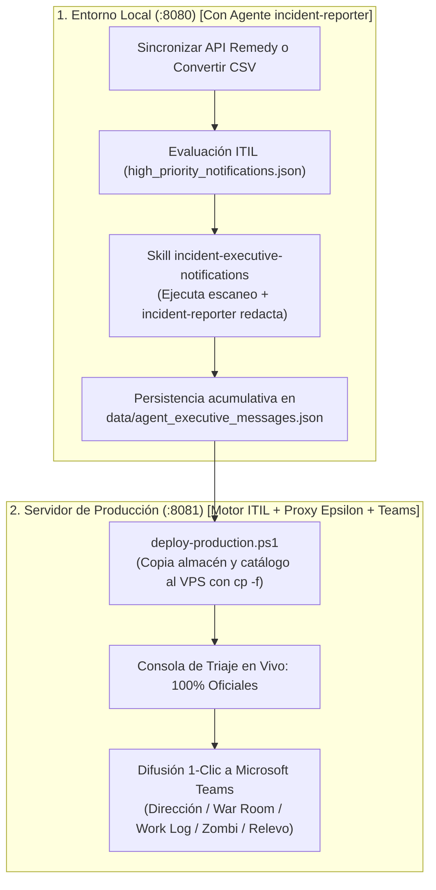
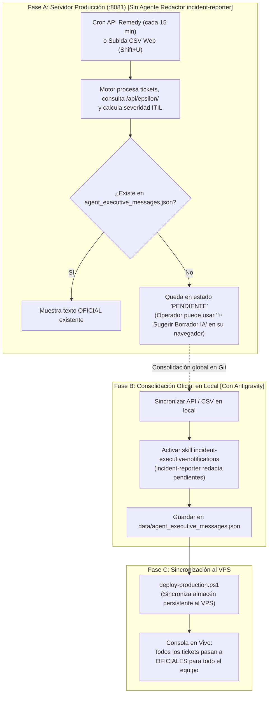

# Guía Operativa: Redacción y Despliegue de Notificaciones Ejecutivas de Incidencias

Esta guía describe el procedimiento paso a paso para gestionar la ingesta de incidencias Remedy (tanto por sincronización API automática como por carga de ficheros CSV), redactar las comunicaciones oficiales de alta prioridad para Dirección (`P1`, `P2` y discrepancias) mediante el agente **`incident-reporter`** y publicarlas de forma 100% segura y coherente en producción.

---

## 🎯 Principios y Reglas Clave

1. **Separación clara entre Motor de Triaje (Producción) y Agente Redactor (Local):**
   * En el **VPS de producción (`:8081`)** corre el motor determinista ITIL, la sincronización periódica con Remedy/MonTMC y el proxy técnico `/api/epsilon/` (Resumen IA técnico de Epsilon), pero **no** reside el asistente Antigravity ni el agente redactor `incident-reporter`.
   * Las comunicaciones ejecutivas definitivas para Dirección se redactan y validan en **local** (con supervisión humana) y se sincronizan al almacén persistente del servidor.
2. **Estándar Ejecutivo Estricto (`incident-reporter` v1.5.0):**
   * **Fases soportadas (4):** `apertura`, `seguimiento`, `reapertura` y `cierre` *(nota: las pestañas del editor visual de la consola cubren `apertura`, `seguimiento` y `cierre`; la fase `reapertura` se persiste desde la skill o mediante `update_agent_message.py --phase reapertura`)*.
   * **Bloqueo de Falso Cierre (`LIFECYCLE_STATUS_MISMATCH`):** Está terminantemente prohibido redactar o publicar una fase `cierre` mientras el ticket siga activo en Remedy (`Asignado`, `En curso`, `Pendiente`) o mantenga afectación parcial en alguna sede.
   * **Mensaje para Dirección (versión completa):** Exactamente **1 único párrafo** (sin saltos de línea ni viñetas), máximo **90 palabras**.
   * **Versión aún más breve (SMS / Guardia):** Exactamente **1 sola línea**, máximo **30 palabras**.
   * **Regla Anti-Alucinación y Anti-PII:** Prohibido inventar horas estimadas de resolución, causas raíz o métricas no respaldadas por el ticket, y prohibido incluir datos personales (nombres propios, MSISDN, DNI).
3. **Fuente de Verdad del Almacén (`Git` ➔ `VPS`):**
   * Todos los mensajes oficiales validados se acumulan de forma incremental en `data/agent_executive_messages.json` ante nuevas ingestas locales.
   * Al ejecutar `scripts/deploy-production.ps1`, la versión versionada en Git de `agent_executive_messages.json`, `high_priority_notifications.json` y `teams_channels_config.json` **sobrescribe (`cp -f`)** las copias de `/infocodes/var/storage/release-dashboard/` en el VPS. Por ello, `data/agent_executive_messages.json` en Git es siempre la fuente de verdad canónica.

---

## 🗺️ Mapa Visual de Procesos

### ESCENARIO 1: Flujo Habitual (Preparación en Local ➔ Publicación en Producción)



---

### ESCENARIO 2: Entrada Directa en Producción (Cron API MonTMC cada 15 min o Subida CSV Web)



---

## 🛠️ Procedimiento Paso a Paso

### ESCENARIO 1: Flujo Habitual (Preparación en Local ➔ Publicación en Producción)

#### FASE 1: Entorno Local (Preparación y Redacción)

#### Paso 1: Ingesta de incidencias en Local (Elige una opción)

* **Opción A (Sincronización incremental desde API Remedy / MonTMC):**
  ```powershell
  python converters/cli/sync_montmc_incidents.py --dias 3
  ```
  Descarga las incidencias recientes desde MonTMC, actualiza de forma no destructiva el dataset masivo local (`data/output/index.json`) y lanza automáticamente `evaluate_incident_notifications.py`.

* **Opción B (A través del Formulario Web Local o Consola de Triaje):**
  1. Arranca el servidor local si no está activo: `python serve_app.py` (puerto `8080`).
  2. Abre la Consola de Triaje (`http://localhost:8080/dashboards/emergency-triage-console/` y pulsa `Shift + U`) o el dashboard de Incidencias Masivas (`http://localhost:8080/dashboards/massive-incidents/`).
  3. Selecciona o arrastra el archivo CSV exportado de Remedy. La aplicación guarda el CSV en `data/input/`, convierte el CSV a JSON actualizando `data/output/index.json` y dispara `evaluate_incident_notifications.py`.

* **Opción C (Manual por terminal con fichero CSV):**
  1. Copia el CSV a `data/input/CS-Informe incidencias P1,  P2 y P3 - 2026 - <FECHA>.csv`.
  2. Convierte el CSV a JSON, actualiza `data/output/index.json` y ejecuta la evaluación de notificaciones:
     ```powershell
     python converters/cli/upload_csv.py "data/input/CS-Informe incidencias P1,  P2 y P3 - 2026 - <FECHA>.csv" massive . --wait-eval
     ```
     > **Nota importante:** No ejecutes `evaluate_incident_notifications.py` en solitario tras copiar un CSV sin pasar antes por `upload_csv.py` (o `convert_incidents.py`), ya que `evaluate_incident_notifications.py` **no lee ficheros CSV**, sino únicamente el último JSON registrado en `data/output/index.json`. *(Si tras convertir deseas generar además borradores provisionales `[BORRADOR PROVISIONAL]`, ejecuta después `python converters/cli/evaluate_incident_notifications.py --auto-draft`).*

#### Paso 2: Escanear incidencias pendientes de redacción *(Opcional — Solo inspección previa por terminal)*
> [!NOTE]
> **Este paso es opcional si vas a ejecutar a continuación el Paso 3.**  
> La skill `incident-executive-notifications` (Paso 3) ya ejecuta internamente `scan_pending_incidents.py` de forma automática tanto al arrancar como al verificar el cierre (`0 pendientes`). Ejecútalo manualmente solo si deseas consultar por terminal qué hay pendiente antes de invocar al agente:

```powershell
python .agents/skills/incident-executive-notifications/scripts/scan_pending_incidents.py
```

* **Alcance real del escáner:** `scan_pending_incidents.py` comprueba únicamente qué tickets activos carecen de comunicado oficial de **`apertura`** en `data/agent_executive_messages.json` (los borradores `--auto-draft` siguen figurando como pendientes hasta validarse). Si un ticket **ya tenía `apertura`** y requiere ahora un **`seguimiento`**, **`reapertura`** o **`cierre`**, el escáner mostrará `0 pendientes`; indícale al agente en el Paso 3 el ID del ticket y la fase que necesitas actualizar (o apóyate en `review_incident_triage.py --all`).

#### Paso 3: Invocar la Skill del Agente (`incident-reporter`)
Pide a Antigravity en el chat:
> *"He actualizado las incidencias. Activa la skill `incident-executive-notifications` para redactar las comunicaciones oficiales pendientes."*
> *(Para actualizaciones posteriores de un ticket concreto añade, por ejemplo: "...y redacta un `seguimiento` / `reapertura` / `cierre` para `INC000004XXXXXX`").*

El asistente:
1. Ejecutará `scan_pending_incidents.py` e inspeccionará los datos objetivos de Remedy y el Resumen IA de Epsilon de cada ticket, aplicando las reglas de triaje y calibración (`it-severity-matrix` v2.7.0, `orange-it-emergency-management` v2.6.0 e `incident-triage-review` v1.1.0).
2. Adoptará el rol **`incident-reporter`** y redactará la fase correspondiente (`apertura`, `seguimiento`, `reapertura` o `cierre`) en los dos niveles estrictos ($\le 90$ palabras monopárrafo y $\le 30$ palabras en una línea).
3. Persistirá automáticamente cada mensaje validado en `data/agent_executive_messages.json` mediante `converters/cli/update_agent_message.py`, regenerará `data/output/high_priority_notifications.json` y verificará que el escáner quede en `0 pendientes`.

#### Paso 4: Revisión Humana (*Human-in-the-Loop*) y Auditoría de Triaje
1. Revisa en el chat el resumen de los mensajes generados. Si deseas ajustar manualmente alguno:
   ```powershell
   python converters/cli/update_agent_message.py --id INC000004XXXXXX --phase seguimiento --raw "**Mensaje para Dirección (versión completa):**
   Tu nuevo texto formal en un único párrafo aquí...

   **Versión aún más breve:**
   P1 INC000004XXXXXX: Alerta breve ajustada en una sola línea."
   ```
2. Audita que no existan incoherencias de ciclo de vida (como falsos cierres o discrepancias sin calibrar):
   ```powershell
   python .agents/skills/incident-triage-review/scripts/review_incident_triage.py --all
   ```

---

#### FASE 2: Servidor de Producción (Publicación y Sincronización)

#### Paso 5: Verificar la alineación del dataset local antes de desplegar
> [!IMPORTANT]
> **Cómo sincroniza `deploy-production.ps1` los datos al VPS (`cp -f`):**  
> El script de despliegue copia forzosamente (`cp -f`) tu `data/agent_executive_messages.json` y tu `data/output/high_priority_notifications.json` locales hacia `/infocodes/var/storage/release-dashboard/` en el VPS.  
> * **Nunca despliegues con un `high_priority_notifications.json` local vacío o antiguo** (por ejemplo, si `data/output/index.json` apunta a `test-massive.json`), o sobrescribirás temporalmente las alertas activas del servidor hasta el próximo ciclo del cron. Asegúrate de haber ejecutado antes el Paso 1 en local.
> * **Si trabajas con un CSV puntual exportado** (en lugar de la sincronización API de Remedy), recuerda subir ese mismo CSV en la web de producción **después** (o además) del despliegue si también necesitas actualizar los paneles generales de Incidencias Masivas en el VPS.

#### Paso 6: Desplegar y sincronizar el almacén al VPS
Haz commit de los datos actualizados en la rama `production` y ejecuta el script oficial de despliegue desde PowerShell:
```powershell
powershell -ExecutionPolicy Bypass -File scripts/deploy-production.ps1
```
*(Si únicamente has actualizado mensajes ejecutivos y no necesitas regenerar el catálogo de agentes desde `biblioteca-agentes`, puedes abreviar con `-SkipCatalogBuild`).*

> [!WARNING]
> **No utilices `-AgentsLibraryPath .` en el despliegue habitual.**  
> El script lee por defecto la biblioteca canónica `C:\Users\jose.delafuente\Claude\Projects\biblioteca-agentes`. Apuntar a `.` excluiría agentes de otros dominios (como `orange-brand-generator`) e incluiría skills externas de terceros instaladas en el proyecto.

**¿Qué sincroniza este script en `/infocodes/var/storage/release-dashboard/`?**
* `agent_executive_messages.json` (almacén acumulativo de mensajes oficiales).
* `output/high_priority_notifications.json` (catálogo evaluado para la consola).
* `teams_channels_config.json` (canales y enrutamiento de acciones hacia Microsoft Teams).
* `output/agents_catalog.json`, `scheduled_changes_pap.json` y `resumen_incidencia_epsilon.md`.

*(Tras completar el despliegue, si en el VPS entraron novedades de Remedy durante los últimos minutos, basta con pulsar **"Sincronizar Remedy"** en la consola o esperar al cron de 15 min: el servidor reevaluará respetando el nuevo `agent_executive_messages.json` recién subido).*

#### Paso 7: Verificación en Vivo y Difusión por Teams
Comprueba las vistas en producción:
* **Consola de Emergencias IT:** `http://infocodes.si.orange.es:8081/dashboards/emergency-triage-console/`
* **Incidencias Masivas:** `http://infocodes.si.orange.es:8081/dashboards/massive-incidents/`
* **Portal Principal:** `http://infocodes.si.orange.es:8081/dashboards/portal/`

Desde la Consola de Emergencias, el Incident Manager dispone del botón **📣 Notificación Dirección** para publicar la tarjeta Adaptive Card validada directamente en el canal de Microsoft Teams asignado a Dirección.

---

### ESCENARIO 2: Entrada Directa de Tickets Nuevos en Producción

Ocurre cuando el cron automático cada 15 min (`sync-remedy-cron.sh`) detecta una avería nueva en Remedy o cuando un operador sube un CSV directamente en `http://infocodes.si.orange.es:8081` antes de pasar por el entorno local.

> [!IMPORTANT]
> **¿Qué IA y qué endpoints existen en Producción (`:8081`) frente a Local (`:8080`)?**
> * **SÍ existe `/api/epsilon/` (`converters/src/fastapi_epsilon_router.py`):** El servidor consulta o solicita el **Resumen IA técnico de Epsilon** (síntoma, sistemas, hitos y bloqueos del ticket).
> * **NO existe `incident-reporter` ni Antigravity:** El VPS no redacta por su cuenta comunicados ejecutivos para Dirección en `agent_executive_messages.json`. Toda incidencia nueva sin registro previo aparece inicialmente en `"estado": "pendiente"`.
> * **Persistencia en cliente vs global (`serve_app.py` vs VPS):** Los endpoints `/api/incident-manager/save-message`, `/api/teams/channels` y `/api/teams/send` pertenecen al servidor local (`serve_app.py` en `:8080`). En producción (`:8081`), la consola opera automáticamente con *fallback* en el navegador del operador:
>   * Al pulsar **"Guardar Mensaje Oficial"** o editar canales en el modal de Teams en `:8081`, los cambios quedan guardados en el `localStorage` del navegador de ese operador (no en el disco del VPS para el resto del turno).
>   * Al pulsar cualquiera de los **5 botones de Teams**, el navegador envía la tarjeta directamente al webhook de Power Automate (funcionando incluso sin salida directa a Internet desde el VPS).

#### ¿Cómo actúa el operador de guardia y cómo se consolida después para todo el equipo?
1. **Respuesta inmediata en caliente (<20 min en SL1/P1):** En la Consola de Producción (`:8081`), el operador abre la incidencia, pulsa **"✨ Sugerir Borrador IA"** (que construye en su navegador una propuesta acotada con los datos de Remedy/Epsilon y validadores de 90/30 palabras en vivo), la revisa, la guarda en su sesión (`localStorage`) y la difunde al instante a Teams con **📣 Notificación Dirección**.
2. **Consolidación oficial y global en Local (Git ➔ VPS):** Para que el mensaje ejecutivo (o cualquier cambio en canales de Teams) quede persistido oficialmente para todos los operadores y no se pierda en futuros despliegues:
   * Sincroniza en local (`python converters/cli/sync_montmc_incidents.py --dias 3` o descarga el CSV del VPS con `scp infocodes@10.132.26.96:"/infocodes/var/storage/release-dashboard/input/CS-Informe*.csv" data/input/` y conviértelo con `upload_csv.py`).
   * Redacta y guarda en `data/agent_executive_messages.json` con la skill `incident-executive-notifications` en Antigravity (y si modificaste canales de Teams, actualízalos en `data/teams_channels_config.json` con `scripts/manage_teams_channels.py` o en `localhost:8080`).
   * Haz commit y ejecuta `powershell -ExecutionPolicy Bypass -File scripts/deploy-production.ps1 -SkipCatalogBuild` para sincronizar el almacén al VPS.

---

## 🖥️ Capacidades Clave de la Consola Operativa de Emergencias (Cockpit IM)

> 📖 Para el detalle completo del turno de guardia, atajos de teclado y protocolos de escalado, consulta el **[Manual del Operador de la Consola Operativa](./manual-consola-operativa.md)**, el **[Triaje ITIL Automatizado](./triaje-itil-automatizado.md)** y el **[Protocolo IM-CSO y Escenarios](./protocolo-im-cso-escenarios-triaje.md)**.

1. **Barra de KPIs de Emergencia en Tiempo Real:**
   * Contadores en vivo de *Pendientes*, *Al Día*, *Total Activas*, *P1/SL1 y P2/SL2*, *Subescalaciones (Discrepancias)*, *Alertas de Escalado Telefónico (≥45m / ≥105m)* y *Workarounds Pendientes de visado IM-CSO*.
2. **Calibración Inteligente de Triaje ITIL (`incident-triage-review`):**
   * **Discrepancias Cuantitativas (Regla de Oro N1):** Contrasta la prioridad nominal de Remedy frente a los umbrales reales de procesos críticos, sedes/tiendas e infraestructura Core++/Core.
   * **Resoluciones Planificadas 📅:** Detecta tickets con fix validado pendiente de ventana de release, aplicando **tope máximo `P2`** y **exención de *Aging Escalation*** para evitar falsas alarmas P1.
   * **Tickets Zombi 🧟:** Identifica desincronizaciones administrativas (resueltos/cancelados en Jira pero aún abiertos en Remedy).
   * **Estancamiento de Work Log:** Señaliza tickets activos con más de `6h`, `12h` o `24h` sin apuntes técnicos en BMC Remedy.
3. **Cronometraje Anti-Drift y Gobernanza de Workarounds 🔒:**
   * Reloj sobre epoch UTC cada 10s con alertas en **45 min** (1er escalado telefónico a N2/N3 + War Room) y **105 min / +1h adicional** (2º escalado telefónico a IM-CSO y Dirección).
   * Candado institucional (`.im-gov-lock-banner`) que **prohíbe rebajar la severidad** por la mera existencia de un *workaround* sin erradicación real del impacto y sin visado de **IM-CSO**.
4. **Los 5 Botones Operativos de Microsoft Teams y Enrutamiento Multicanal:**
   * Integración mediante tarjetas Adaptive Cards y webhooks de Power Automate leídos desde `data/teams_channels_config.json` y configurables en el modal **"💬 Canales y Enrutamiento Microsoft Teams"** (pestañas *Canales y Webhooks*, *🔀 Enrutamiento de Acciones* y *Sobrescrituras por Grupo Resolutor*, con persistencia en disco en `:8080` / Git y en `localStorage` en `:8081`):
     1. **📢 Reclamación Work Log (`RECLAMACION_WORKLOG`):** Reclama actualización técnica en Remedy al grupo resolutor.
     2. **📣 Notificación Dirección (`NOTIFICACION_DIRECCION`):** Publica el comunicado ejecutivo validado (`apertura`, `seguimiento`, `reapertura` o `cierre`).
     3. **🚨 Convocatoria War Room (`CONVOCATORIA_WARROOM`):** Abre y difunde sala de crisis de voz para emergencias SL1/P1.
     4. **🧟 Solicitud Cierre Zombi (`CIERRE_ZOMBI`):** Solicita el cierre administrativo formal de tickets zombi.
     5. **📋 Traspaso Guardia (`TRASPASO_GUARDIA`):** Genera y publica el informe estructurado de relevo de turno ITIL.
5. **Editor Ejecutivo Integrado y Ciclo de Vida de 4 Estados:**
   * Botón **"✨ Sugerir Borrador IA"**, contadores de palabras reactivos ($\le 90$ monopárrafo / $\le 30$ breve), pestañas para `apertura`, `seguimiento` y `cierre` (`reapertura` vía CLI/skill), guardado directo en `:8080` (o `localStorage` en `:8081`) y copia de comando CLI de contingencia.
   * Selector de estado operativo (`Pendiente`, `Comunicada`, `En Seguimiento`, `Descartada`) y **Reporte Normalizado de Emergencia en 4 Bloques** con copia en 1 clic.

---

## ❓ Preguntas Frecuentes y Diagnóstico (FAQ)

### 1. ¿Por qué al entrar un ticket nuevo en producción no aparece redactado el texto oficial del agente automáticamente?
* **Prevención de alucinaciones en comunicaciones a Dirección:** En el VPS no se ejecuta ningún agente LLM autónomo escribiendo directamente boletines para Dirección sin revisión. El servidor calcula la severidad ITIL, obtiene el Resumen IA técnico (`/api/epsilon/`) y busca si existe redacción en `/infocodes/var/storage/release-dashboard/agent_executive_messages.json`; si es nuevo, lo deja en `"estado": "pendiente"` (pudiendo el operador usar **"✨ Sugerir Borrador IA"** en su navegador y consolidarlo después en Git con `incident-reporter`).

### 2. ¿Por qué `deploy-production.ps1` se detiene si tengo archivos sin commitear?
* **Salvaguarda de integridad Git:** El script comprueba `git status --porcelain` en la rama `production` para garantizar trazabilidad exacta entre lo versionado en Git y lo desplegado con `cp -f` en `/infocodes/var/storage/release-dashboard/` (`high_priority_notifications.json`, `agent_executive_messages.json` y `teams_channels_config.json`).

### 3. ¿Por qué Power Automate devuelve `ChatAppCUDOperationNotAllowedForFederatedUsers` al enviar a un chat nuevo de Teams?
* En entornos corporativos federados, el `Flow bot` de Power Automate no tiene permiso para auto-instalarse en un chat grupal donde no exista previamente. Solución: añade manualmente la app **Power Automate / Workflows** al chat desde Microsoft Teams, o configura la acción `Post_card` del flujo con **Post as: `User`** en lugar de `Flow bot`.

---

## 🧰 Comandos Útiles y Rescate (CheatSheet)

| Acción | Comando |
| :--- | :--- |
| **Sincronizar incidencias Remedy (API MonTMC)** | `python converters/cli/sync_montmc_incidents.py --dias 3` |
| **Convertir CSV manual y evaluar notificaciones** | `python converters/cli/upload_csv.py "data/input/<FICHERO>.csv" massive . --wait-eval` |
| **Reevaluar notificaciones ITIL (sobre JSON actual)** | `python converters/cli/evaluate_incident_notifications.py` |
| **Reevaluar con borradores provisionales** | `python converters/cli/evaluate_incident_notifications.py --auto-draft` |
| **Escanear pendientes de `apertura` (opcional)** | `python .agents/skills/incident-executive-notifications/scripts/scan_pending_incidents.py` |
| **Ver contexto y prompt de un ticket** | `python .agents/skills/incident-executive-notifications/scripts/scan_pending_incidents.py --id <INC>` |
| **Auditar coherencia de triaje y falsos cierres** | `python .agents/skills/incident-triage-review/scripts/review_incident_triage.py --all` |
| **Guardar redacción (`apertura`/`seguimiento`/`reapertura`/`cierre`)** | `python converters/cli/update_agent_message.py --id <INC> --phase seguimiento --raw "<texto>"` |
| **Gestionar canales de Teams por CLI** | `python scripts/manage_teams_channels.py list` |
| **Ejecutar tests unitarios de notificaciones** | `python -m pytest converters/tests/unit/test_update_agent_message.py converters/tests/unit/test_incident_triage_review.py -v` |
| **Desplegar a producción (estándar)** | `powershell -ExecutionPolicy Bypass -File scripts/deploy-production.ps1` |
| **Desplegar rápido (sin regenerar catálogo IA)** | `powershell -ExecutionPolicy Bypass -File scripts/deploy-production.ps1 -SkipCatalogBuild` |

---

## 📁 Archivos Involucrados

* **Agente redactor ejecutivo:** `agents/it-incidents/incident-reporter.md`
* **Skill de síntesis ejecutiva:** `.agents/skills/incident-executive-notifications/SKILL.md`
* **Skill y auditor de calibración de triaje:** `.agents/skills/incident-triage-review/SKILL.md` (`scripts/review_incident_triage.py`)
* **Escáner de tickets pendientes:** `.agents/skills/incident-executive-notifications/scripts/scan_pending_incidents.py`
* **Almacén acumulativo de mensajes oficiales:** `data/agent_executive_messages.json`
* **Catálogo evaluado para la consola:** `data/output/high_priority_notifications.json`
* **Configuración de canales y rutas Teams:** `data/teams_channels_config.json`
* **CLI de actualización de mensajes:** `converters/cli/update_agent_message.py`
* **Orquestador CLI de carga CSV:** `converters/cli/upload_csv.py`
* **Router FastAPI de Epsilon IA:** `converters/src/fastapi_epsilon_router.py`
* **Sincronizador API Remedy / MonTMC:** `converters/cli/sync_montmc_incidents.py` (`scripts/sync-remedy-cron.sh`)
* **Script de despliegue a producción:** `scripts/deploy-production.ps1`
