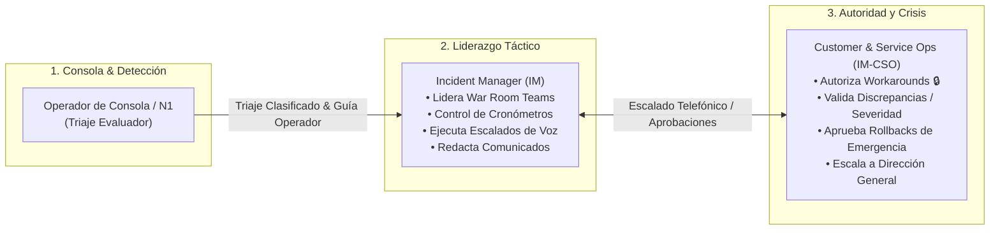
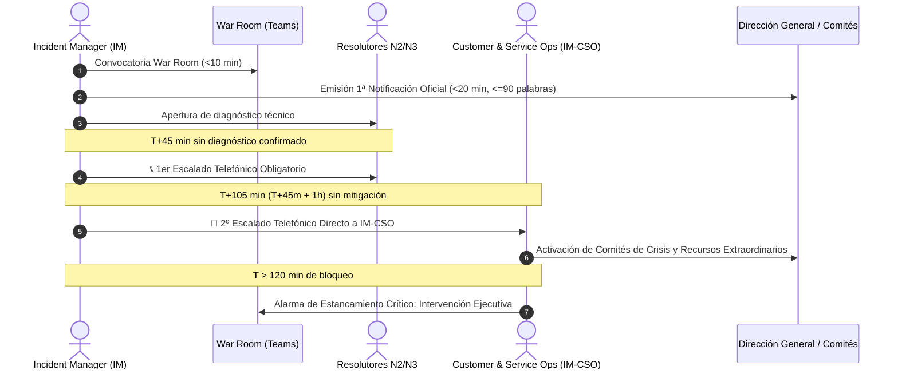
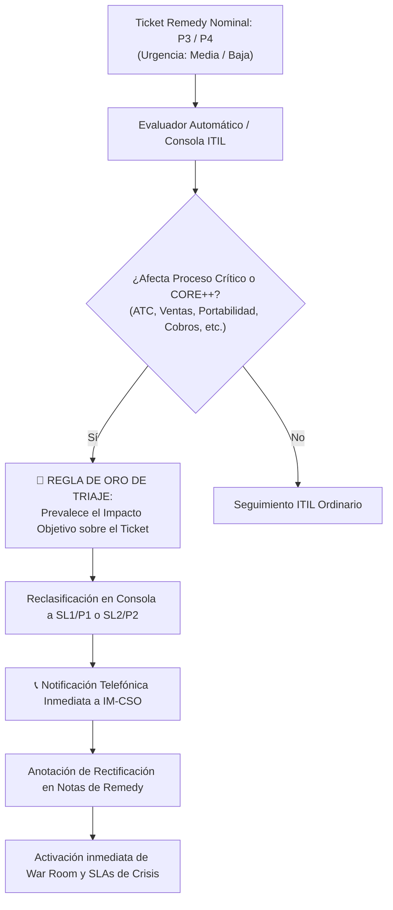
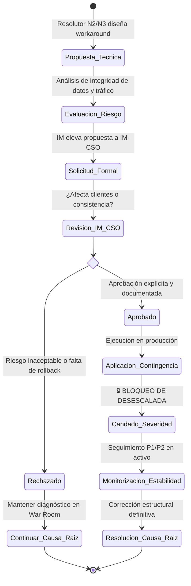

# Protocolo Operativo IM-CSO por Escenarios Post-Triaje

Guía procedimental y marco de gobernanza operativa para la actuación coordinada entre el **Incident Manager (IM)**, el **Operador de Consola NOC/CCO** y la jefatura de **Customer & Service Operations (IM-CSO)** tras la finalización del triaje algorítmico o manual de una incidencia de sistemas en Orange Tech Operations.

* **Versión:** `1.0.0`
* **Ámbito:** Operaciones IT, Centros de Control (CCO/NOC), Gestión de Crisis y Mesas de Seguimiento.
* **Skills Relacionadas:** [`orange-it-emergency-management`](file:///c:/Users/jose.delafuente/proyectos/release-dashboard-application/.agents/skills/orange-it-emergency-management/SKILL.md), [`it-severity-matrix`](file:///c:/Users/jose.delafuente/proyectos/release-dashboard-application/.agents/skills/it-severity-matrix/SKILL.md), [`incident-triage-review`](file:///c:/Users/jose.delafuente/proyectos/release-dashboard-application/.agents/skills/incident-triage-review/SKILL.md), [`incident-executive-notifications`](file:///c:/Users/jose.delafuente/proyectos/release-dashboard-application/.agents/skills/incident-executive-notifications/SKILL.md).

---

## 📌 1. Marco de Gobernanza y Modelo RACI (IM vs. IM-CSO)

La gestión de incidencias de alta prioridad y emergencias operativas en Orange exige una separación nítida de roles entre la **conducción táctica** y la **gobernanza institucional de crisis**:



### Matriz de Responsabilidad RACI

| Función / Decisión Operativa | Operador Consola | Incident Manager (IM) | Customer & Service Ops (IM-CSO) | Grupos Resolutores (N2/N3) |
| :--- | :---: | :---: | :---: | :---: |
| **Triaje inicial y clasificación ITIL** | **R** | **A** | **C** | **I** |
| **Convocatoria War Room (<10 min)** | **I** | **R / A** | **I** | **C** |
| **Ejecución de llamadas de escalado (45m / +1h)** | **I** | **R** | **A** | **C** |
| **Autorización de Workarounds / Soluciones de Contorno** | **I** | **C** | **A / R** | **C** |
| **Orden de Rollback preventivo (Post-PaP)** | **I** | **R** | **A** | **C** |
| **Reclasificación por Discrepancia (Infratriaje N1)** | **R** | **R** | **A** | **I** |
| **Aprobación de Comunicados Oficiales a Dirección** | **I** | **R** | **A** | **I** |
| **Tramitación de Cierre Administrativo (Tickets Zombi)** | **R** | **A** | **I** | **C** |

> [!NOTE]
> * **R (Responsible):** Quien ejecuta operativamente la tarea.
> * **A (Accountable):** Quien ostenta la autoridad última y aprueba el resultado.
> * **C (Consulted):** Quien aporta información técnica o criterio bidireccional.
> * **I (Informed):** Quien recibe la notificación del avance o dictamen.

---

## 🚦 2. Matriz Sintética de Actuación por Escenario Post-Triaje

Una vez emitido el dictamen del triaje (visible en el campo `guia_operador` de [`data/output/high_priority_notifications.json`](file:///c:/Users/jose.delafuente/proyectos/release-dashboard-application/data/output/high_priority_notifications.json) y en la Consola Operativa), el operador y el Incident Manager deben seguir de forma estricta las siguientes pautas:

| Escenario Post-Triaje | Prioridad Operativa | Llamada IM-CSO | Canal Prescrito | SLA 1ª Acción | Regla de Oro / Condicionante Clave | Guía Detallada |
| :--- | :---: | :---: | :--- | :---: | :--- | :---: |
| **1. Emergencia Viva Crítica** | `P1_CRITICA` | **OBLIGATORIA** | Telefónico Directo + War Room | < 10 min | Llamada <45m obligatoria; 1ª notif. <20m; War Room inmediata. | [📖 Escenario 1](./escenarios/escenario-1-emergencia-viva.md) |
| **2. Resolución Planificada** | `P2_SEGUIMIENTO` | **NO REQUERIDA** | Equipo Despliegues / Pases | < 30 min | Congelación estricta de aging (>120m no escala a P1); fase `seguimiento`. | [📖 Escenario 2](./escenarios/escenario-2-resolucion-planificada.md) |
| **3. Ticket Zombi Remedy** | `P3_ADMIN` | **NO REQUERIDA** | Mesa de Seguimiento / Remedy Admin | < 60 min | Jira cerrado/cancelado; emisión de plantilla formal de cierre administrativo. | [📖 Escenario 3](./escenarios/escenario-3-ticket-zombi-remedy.md) |
| **4. Estancamiento Local** | `P2_SEGUIMIENTO` | **NO REQUERIDA** | Supervisor N1 / Soporte Local | < 15 min | Alcance $\le 20$ usuarios o sede única menor; prohibido escalar a crisis nacional. | [📖 Escenario 4](./escenarios/escenario-4-estancamiento-local.md) |
| **5. Discrepancia Infratriaje** | `P1` o `P2` | **OBLIGATORIA** (si P1) | Telefónico IM-CSO / Notas Remedy | < 15 min | La severidad de negocio manda sobre Remedy; rectificación inmediata. | [📖 Escenario 5](./escenarios/escenario-5-infratriaje-remedy.md) |
| **6. Multisede Parcial** | `P1` o `P2` | **INFORMATIVA** | War Room / Coordinación Sedes | < 20 min | Prohibido cierre anticipado mientras persista impacto residual en alguna sede. | [📖 Escenario 6](./escenarios/escenario-6-afectacion-multisede-parcial.md) |
| **7. Solicitud de Workaround** | Según ticket | **OBLIGATORIA** | Canal Voz IM-CSO / Teams Oficial | Inmediato | Candado 🔒: prohibido aplicar sin visto bueno de IM-CSO; no reduce severidad. | [📖 Escenario 7](./escenarios/escenario-7-workaround-autorizado.md) |
| **8. Reapertura Activa** | `P1` o `P2` | **OBLIGATORIA** | Telefónico Directo IM-CSO | < 5 min | Cronómetro acumulado desde $T_0$; sin ventana de cortesía de 45m. | [📖 Escenario 8](./escenarios/escenario-8-reapertura-activa.md) |

> 💡 **Acceso Monográfico a Escenarios**: Cada escenario cuenta con su documento monográfico independiente con diagramas de flujo, checklists de triaje, tiempos SLA y plantillas de worklog listas para copiar. Consulta el [Índice de Guías Operativas de Escenarios](./escenarios/README.md).
---

## 🛠️ 3. Protocolos Operativos Detallados por Escenario

### 3.1 Escenario 1: Emergencia Viva Crítica (`EMERGENCIA_VIVA`)

Afectación confirmada con corte total, degradación severa o alto riesgo en cualquiera de los **6 Procesos Críticos de Negocio** (ATC, Ventas, Portabilidad, Cobros, Provisión, Facturación), caída de sistemas Tier 0 (`CORE++`), fallo troncal de Middleware transversal (`TIBCO`, `APIGEE`), o aislamiento de sedes/MSC principales.



#### Pautas de Actuación Obligatorias:
1. **Convocatoria Inmediata:** War Room de Teams abierta en menos de 10 minutos con Incident Manager y guardias operativas.
2. **Primera Notificación Ejecutiva:** Difusión del comunicado oficial de `apertura` a Dirección en menos de 20 minutos (monopárrafo $\le 90$ palabras, versión breve $\le 30$ palabras).
3. **Llamadas Telefónicas Obligatorias:**
   - **Hito T+45 min:** Si no existe diagnóstico técnico confirmado, el IM realiza llamada telefónica de escalado al responsable del grupo resolutor o coordinador de guardia.
   - **Hito T+105 min (T+45m + 1h):** Si persiste la falta de solución o mitigación, llamada telefónica directa a la jefatura de **Customer & Service Ops (IM-CSO)**.
   - **Hito T > 120 min:** Disparo de la Alarma de Estancamiento Crítico con intervención de estamentos superiores de Dirección.
4. **Regla de PaP / Rollback Inmediato:** Si la emergencia surge durante o tras una ventana de Trabajos Programados (PaP) o release reciente, la orden inmediata de IM-CSO es la **ejecución prioritaria del Rollback** antes de diagnósticos forenses prolongados.

---

### 3.2 Escenario 2: Incidencia Mayor con Solución o Despliegue Planificado (`RESOLUCION_PLANIFICADA`)

Ticket en estado `Pendiente` que dispone de una solución técnica programada:
- Pull Request (PR) o parche validado con fecha comprometida de entrega.
- Pase a Producción (RFC) agendado en ventana nocturna o de bajo impacto.
- Ejecución periódica o batch programado (ej. proceso automatizado recurrente del lunes a las 06:00 AM).

#### Directrices Operativas:
1. **Llamada a IM-CSO: NO REQUERIDA.** Queda expresamente prohibido realizar llamadas telefónicas de emergencia a IM-CSO o activar guardias nocturnas para incidencias planificadas, preservando los canales de voz para emergencias vivas.
2. **Tope de Severidad:** Clasificación determinista en `SL2 / P2 (Seguimiento de Release)`.
3. **Exención Estricta de Aging:** La regla general que escala tickets de P2 a P1 tras 120 minutos queda **suspendida**. El tiempo transcurrido no penaliza la criticidad del incidente.
4. **Canal de Escalado:** `Equipo de Despliegues / Pases / Gestor de Cambios`.
5. **Gobernanza de Comunicaciones:**
   - La fase operativa obligatoria es `seguimiento`.
   - **Prohibido el Cierre Prematuro:** Queda terminantemente prohibido emitir comunicados en fase de `cierre` o cerrar administrativamente el ticket en Remedy antes de que el despliegue se haya completado con éxito y se haya verificado la estabilidad en producción.

---

### 3.3 Escenario 3: Ticket Zombi de Remedy (`TICKET_ZOMBI_REMEDY`)

Incidencia abierta en Remedy (`Asignado` o `Pendiente`) cuyo ticket técnico en Jira o herramienta de desarrollo figura ya como `Cerrado`, `Resuelto` o `Cancelado`, y no existe afectación activa ni degradación perceptible en los sistemas de producción.

#### Directrices Operativas:
1. **Llamada a IM-CSO: NO REQUERIDA.**
2. **Prioridad Operativa en Consola:** Reducción a `P3 Administrativo`.
3. **Canal Prescrito:** `Mesa de Seguimiento / Remedy Admin`.
4. **Acción Inmediata Mandatada:** El operador o el Incident Manager debe pulsar el botón de copia rápida en la consola y tramitar la **Solicitud de Cierre Administrativo en Remedy** ante la Mesa de Seguimiento:

```text
SOLICITUD DE CIERRE ADMINISTRATIVO EN REMEDY
-----------------------------------------------
Incidencia: INC00000XXXXXXX
Referencia de entrega/Jira: JIRA-XXXXX

La resolución técnica del servicio ha finalizado satisfactoriamente según el registro 
del equipo de desarrollo/despliegues y el ticket asociado está concluido. Al no existir 
afectación operativa en producción, se solicita a la Mesa de Seguimiento proceder con 
el cierre administrativo formal del ticket en Remedy para evitar distorsiones en los 
KPIs de aging y triaje operativo.

Dictamen emitido por la Consola de Triaje y Gestión de Emergencias IT de Orange.
```

> [!WARNING]
> **Prevención de Falso Cierre (`LIFECYCLE_STATUS_MISMATCH`):** Si Jira se canceló por duplicidad pero la avería real sigue sin resolverse, el ticket no es zombi. Debe verificarse que la funcionalidad en producción está 100% normalizada.

---

### 3.4 Escenario 4: Estancamiento Local / Afectación Menor Confinada (`ESTANCAMIENTO_LOCAL`)

Incidencia con tiempo de apertura acumulado superior a 120 minutos, pero cuyo alcance está estrictamente acotado a:
- Un puesto de trabajo individual o monopuesto.
- Un departamento menor aislado ($\le 20$ usuarios afectados).
- Una avería física local de cableado, microcorte o periférico en una sede no principal, sin afectación de sistemas centrales ni caída de enlaces troncales.

#### Directrices Operativas:
1. **Llamada a IM-CSO: NO REQUERIDA.** Evitar la saturación del equipo directivo de crisis con incidencias de alcance puramente local.
2. **Tope de Severidad:** Mantenimiento en `SL2 / P2` (o `P3`). Queda prohibida la elevación automática a Emergencia P1 por envejecimiento.
3. **Canal de Escalado Prescrito:** `Supervisor de Soporte N1 / Soporte Local / Field Services`.
4. **Acción Recomendada:** Contactar con el coordinador del centro de atención al usuario (CAU) o despacho de soporte técnico local para desbloquear la intervención de campo (sustitución de equipo, revisión de patch panel local, etc.).

---

### 3.5 Escenario 5: Discrepancia por Infratriaje en Remedy (`INFRATRIAJE_REMEDY`)

Incidencia registrada por el Service Desk o N1 en Remedy con severidad o urgencia baja/media (`P3`, `P4`, `Media`, `Baja`), pero cuyos datos de monitorización, procesos afectados o catálogo técnico demuestran impacto real de nivel crítico (`P1` o `P2`).



#### Directrices Operativas:
1. **Prevalencia de la Realidad Operativa:** La Regla de Oro impone que el impacto sobre el negocio manda sobre la etiqueta administrativa de Remedy.
2. **Llamada a IM-CSO:** **OBLIGATORIA e INMEDIATA** si el cálculo objetivo es `SL1 / P1`.
3. **Cálculo de Tiempos:** El cronómetro de escalados (45 min / 105 min / 120 min) se computa **desde la fecha y hora original de apertura en Remedy ($T_0$)**, no desde el momento de la detección de la discrepancia.
4. **Acción en Remedy:** El Incident Manager debe incorporar de inmediato una nota de trabajo formal en Remedy:
   > *"Triaje rectificado por Consola de Emergencias IT: Incidencia reclasificada a SL1/P1 por afectación crítica al proceso [Proceso] / aplicativo [Sistema]. Se activa protocolo de crisis y notificación a IM-CSO."*

---

### 3.6 Escenario 6: Afectación Multisede Parcial (`AFECTACION_MULTISEDE_PARCIAL`)

Incidencia que compromete a múltiples tiendas, centros de atención, oficinas territoriales o sedes corporativas, donde uno de los proveedores o centros comunica que su servicio local ha sido restablecido o solicita el cierre del ticket.

#### Directrices Operativas:
1. **Prohibición Estricta de Cierre Prematuro:** Prohibido cerrar el ticket global de Remedy o degradar la severidad mientras reste **al menos una sede o tienda con impacto operativo**.
2. **Rol de IM-CSO:** IM-CSO supervisa la matriz de sedes afectadas. Cada centro debe validar independientemente la restitución del servicio antes de autorizar la desescalada global.
3. **Comunicación a Dirección:** Se emiten comunicados de `seguimiento` informando cuantitativamente del progreso (ej. *"Recuperadas 8 de las 12 sedes afectadas; se mantienen los trabajos técnicos de contingencia en las 4 sedes restantes"*).

---

### 3.7 Escenario 7: Propuesta y Gobernanza de Workarounds (El Candado 🔒)

El grupo técnico resolutor (N2/N3 o proveedor) identifica una solución de contingencia temporal (reinicio de pods, conmutación manual de balanceador, script de purga, reencaminamiento de tráfico o bypass de validaciones) que mitiga el impacto en clientes pero no corrige el bug o la causa raíz.



#### Directrices Operativas:
1. **El Candado de Gobernanza 🔒:** Ningún grupo de soporte puede aplicar en producción un workaround sin la **autorización explícita, previa y registrada de Customer & Service Ops (IM-CSO)**.
2. **Prohibición de Desescalada Automática:** La activación de una solución de contorno **NO reduce automáticamente la severidad del ticket**. El ticket permanece como P1 o P2 en activo hasta que la solución definitiva esté desplegada y verificada.
3. **Registro en Consola y Remedy:** Deberá registrarse el código de aprobación de IM-CSO, la persona autorizante y el plan de marcha atrás en caso de efectos colaterales adversos.

---

### 3.8 Escenario 8: Incidencias Reabiertas o Recurrencia Activa (`REAPERTURA_ACTIVA`)

Ticket que había sido marcado como `Resuelto` o que presentaba `Fecha de última resolución`, pero que vuelve a presentar fallos funcionales, alertas en monitorización o reclamaciones de usuarios durante su periodo de observación.

#### Directrices Operativas:
1. **Reactivación Exprés de War Room:** Convocatoria en menos de 5 minutos; no existe fase de diagnóstico pasivo.
2. **Cómputo Acumulado de Cronómetros (Tolerancia Cero):** El aging se computa sumando el tiempo previo a la resolución provisional y el transcurrido desde la reapertura. Si la suma supera 45 minutos o 120 minutos, se ejecuta la **llamada telefónica inmediata a IM-CSO sin conceder nueva ventana de cortesía**.
3. **Comunicación a Dirección:** Es obligatoria la emisión inmediata del comunicado en fase `reapertura` informando del repunte y de las medidas extraordinarias adoptadas.
4. **Prohibición de Reincidencia en Mitigaciones Fallidas:** Queda terminantemente prohibido volver a aplicar el mismo workaround que provocó la reapertura o que demostró ser inestable.

---

## 📞 4. Protocolos de Comunicación y Plantillas Oficiales para IM-CSO

### 4.1 Plantilla de Escalado Telefónico a IM-CSO (Hitos T+45m / T+105m / >2h)

El Incident Manager debe estructurar la conversación telefónica con IM-CSO siguiendo este esquema conciso de 4 puntos técnicos:

```text
GUION DE ESCALADO TELEFÓNICO A IM-CSO
--------------------------------------
1. IDENTIFICACIÓN Y SEVERIDAD:
   "Aquí [Nombre IM], Incident Manager de guardia. Escalo la incidencia [ID_INCIDENCIA] clasificada como [P1 Crítica / Discrepancia P1], abierta hace [XX] minutos."

2. IMPACTO EN EL NEGOCIO:
   "El proceso afectado es [ATC / Ventas / Portabilidad / Cobros / Provisión / Facturación] en el sistema [Sistema]. El síntoma operacional es [Descripción breve del corte o degradación]."

3. SITUACIÓN TÉCNICA Y ACCIONES EJECUTADAS:
   "En la War Room están conectados los grupos [Grupos N2/N3]. Tras [XX] minutos de investigación técnica, la causa raíz [no ha sido identificada / está localizada en X pero no hay solución confirmada]."

4. PETICIÓN CONCRETA A IM-CSO:
   "Solicito [aprobación de Rollback de PaP / activación de guardia superior del proveedor / autorización de workaround de contorno / escalado directivo por estancamiento a estamentos superiores]."
```

---

### 4.2 Plantilla de Autorización de Workaround (IM-CSO)

Documento de texto que debe constar en las notas de trabajo de Remedy antes de ejecutar cualquier cambio de mitigación:

```text
AUTORIZACIÓN FORMAL DE WORKAROUND - IM-CSO
-------------------------------------------
Incidencia: INC00000XXXXXXX
Fecha y Hora de Autorización: AAAA-MM-DD HH:MM:SS
Responsable IM-CSO: [Nombre y Apellidos / Cargo]
Incident Manager Solicitante: [Nombre y Apellidos]

DESCRIPCIÓN DEL WORKAROUND:
[Descripción detallada de la acción técnica: reinicio, conmutación, script, etc.]

EVALUACIÓN DE IMPACTO RESIDUAL:
• Integridad de datos comprometida: [NO / SÍ (Detallar)]
• Impacto perceptible en clientes durante aplicación: [NO / SÍ (Detallar)]
• Plan de marcha atrás (Rollback del workaround): [Descripción]

CONDICIONES DE GOBERNANZA:
Se autoriza la ejecución bajo la condición expresa de mantener la severidad [SL1 / SL2] 
activa y el seguimiento en War Room hasta la implementación de la solución definitiva.
```

---

## 📝 5. Estándar de Mensajes y Trazas Obligatorias en Worklogs de Ticketing (Remedy & Jira)

La auditoría retrospectiva de crisis, la exactitud del cálculo de métricas operativas (**MTTD**, **MTTA**, **MTTR**) y la elaboración del informe **Post-Incident Review (PIR)** dependen de la exhaustividad y precisión de las anotaciones en los sistemas de ticketing.

Toda entrada en las **Notas de Trabajo / Work Info** de **BMC Remedy ITSM** o en los **Comentarios / Issues** de **Atlassian Jira** debe cumplir estrictamente con los siguientes principios:

### 5.0 Reglas de Oro de Documentación en Worklogs
1. **Estructura de Cabecera Universal:** Toda anotación debe iniciar con la cabecera estándar:
   ```text
   [IM-CSO / PROTOCOLO] [CÓDIGO_TRAZA] - YYYY-MM-DD HH:MM:SS CET/CEST - [AUTOR Y ROL]
   ```
2. **Prohibición de Ambigüedades:** Quedan terminantemente prohibidas trazas vacías o coloquiales (*"seguimos mirando"*, *"hablado por Teams"*, *"escalado a sistemas"*). Debe registrarse obligatoriamente el **nombre del interlocutor**, **grupo resolutor exacto**, **canal empleado** y **acuerdo técnico o compromiso adoptado**.
3. **Registro en Tiempo Real (SLA de Anotación < 5 min):** Las llamadas de escalado, aprobaciones de workaround y acuerdos de War Room deben anotarse en Remedy en un plazo máximo de 5 minutos desde su ocurrencia física.
4. **Visibilidad:** Las trazas operativas y de crisis se registran como `View Access: Internal` (o `Customer Communication` únicamente si se trata de un comunicado formal autorizado).

---

### 5.1 Catálogo de Trazas Oficiales en BMC Remedy ITSM (Work Info)

#### Traza WL-01: Declaración de Emergencia SL1/P1 y Convocatoria de War Room (`EMERGENCIA_VIVA`)
* **Momento de Inserción:** Inmediatamente tras clasificar la incidencia en consola y abrir la sesión de Teams (< 10 min desde $T_0$).
* **Responsable:** Incident Manager (IM).
* **Plantilla de Worklog:**
```text
[IM-CSO / PROTOCOLO] [WL-01: APERTURA WAR ROOM SL1] - AAAA-MM-DD HH:MM:SS CET
Autor: [Nombre y Apellidos] - Incident Manager de Guardia
Severidad Evaluada: SL1 / P1 (Emergencia Crítica)
Proceso Crítico Comprometido: [ATC / Ventas / Portabilidad / Cobros / Provisión / Facturación / CORE++]
Aplicativo / Componente: [Ej. BSCS / CALL CENTER CTI / TIBCO / APIGEE / BOREAL]

SÍNTOMA OPERACIONAL Y ALCANCE:
[Descripción concisa del corte, porcentaje de error o indisponibilidad detectada].

ACCIONES INICIALES EJECUTADAS:
1. Convocada War Room de Emergencias en Teams: [Enlace o Sala Oficial].
2. Notificación ejecutiva de fase APERTURA emitida a Dirección (< 20 min).
3. Convocados de urgencia los grupos resolutores: [Listado de grupos N2/N3 convocados].
4. Cronómetro de escalado telefónico activado (Hito T+45m fijado para las HH:MM).
```

---

#### Traza WL-02: Registro de Escalado Telefónico Obligatorio (Hitos T+45m / T+105m / >2h)
* **Momento de Inserción:** Inmediatamente tras finalizar la llamada telefónica de escalado (< 5 min).
* **Responsable:** Incident Manager (IM).
* **Plantilla de Worklog:**
```text
[IM-CSO / PROTOCOLO] [WL-02: ESCALADO TELEFÓNICO OFICIAL] - AAAA-MM-DD HH:MM:SS CET
Autor: [Nombre y Apellidos] - Incident Manager de Guardia
Hito de Escalado: [T+45 min sin diagnóstico / T+105 min (+1h) sin solución / Alarma Estancamiento >2h]
Canal Empleado: Llamada Telefónica Directa (Voz Obligatoria)

INTERLOCUTOR CONTACTADO:
• Nombre y Apellidos: [Nombre del responsable o guardia contactada]
• Rol / Cargo: [Coordinador de Guardia / Jefe de Proyecto / Jefatura IM-CSO / Responsable Proveedor]
• Grupo Resolutor: [Ej. SOP_SMC_TEIDE / DSI_INFRA_OCI / Soporte N3 Proveedor]

RESUMEN DE LA COMUNICACIÓN Y COMPROMISOS:
1. Se transmite la falta de avances técnicos tras [XX] minutos de investigación en War Room.
2. Interlocutor moviliza de inmediato a [recurso adicional o especialista de soporte N3 / vendor].
3. Compromiso acordado: Presentación de nuevo diagnóstico en War Room antes de las HH:MM.
4. Próximo hito de control fijado para las HH:MM.
```

---

#### Traza WL-03: Rectificación de Triaje por Discrepancia / Infratriaje de N1 (`INFRATRIAJE_REMEDY`)
* **Momento de Inserción:** Inmediatamente tras identificar que un ticket P3/P4 nominal vulnera los umbrales críticos de negocio.
* **Responsable:** Operador de Consola / Incident Manager (IM).
* **Plantilla de Worklog:**
```text
[IM-CSO / PROTOCOLO] [WL-03: RECTIFICACIÓN DISCREPANCIA TRIAJE] - AAAA-MM-DD HH:MM:SS CET
Autor: [Nombre y Apellidos] - [Operador Consola / Incident Manager]
Severidad Nominal Remedy: [Media - P3 / Baja - P4 / Urgencia: Media/Baja]
Severidad Objetiva Calibrada: [SL1 / P1 Crítica  ó  SL2 / P2 Mayor]

JUSTIFICACIÓN TÉCNICA Y NORMATIVA (it-severity-matrix & incident-triage-review):
• Proceso de Negocio / Componente: [ATC / Ventas / Facturación / Componente CORE++]
• Criterio / Umbral Vulnerado: [Criterio 3.X, ej. Caída de IVR/CTI >20% / Corte en BBDD Exadata]
• Regla de Oro Aplicada: Prevalece el impacto objetivo sobre el negocio frente a la clasificación administrativa de N1.

ACCIONES DISPARADAS:
1. Rectificada la severidad operativa en la Consola de Triaje y Emergencias IT.
2. Notificación prioritaria cursada a Customer & Service Operations (IM-CSO).
3. Cronómetros de escalado y SLAs de crisis computados retroactivamente desde la apertura del ticket (T0: AAAA-MM-DD HH:MM:SS).
4. Advertencia: Prohibido desescalar este ticket sin validación expresa de IM-CSO.
```

---

#### Traza WL-04: Concesión de Exención de Aging por Resolución Planificada (`RESOLUCION_PLANIFICADA`)
* **Momento de Inserción:** Al contrastar que la solución técnica está cerrada y calendarizada en release, pase RFC o batch periódico.
* **Responsable:** Operador de Consola / Incident Manager (IM).
* **Plantilla de Worklog:**
```text
[IM-CSO / PROTOCOLO] [WL-04: RESOLUCIÓN PLANIFICADA - EXENCIÓN AGING] - AAAA-MM-DD HH:MM:SS CET
Autor: [Nombre y Apellidos] - [Operador Consola / Incident Manager]
Categoría Operativa: RESOLUCION_PLANIFICADA (Techo SL2 / P2)
Tipo de Planificación: [Pull Request validada / Pase a Producción RFC / Ventana Batch Periódica]
Referencia de Entrega: [Jira ID: PROJ-XXXX / RFC: CRQ00000XXXXXXX / PR: #XXXX]

VENTANA DE EJECUCIÓN PROGRAMADA:
• Fecha y Hora Comprometida: AAAA-MM-DD HH:MM:SS CET
• Grupo Responsable del Despliegue: [Ej. EQUIPO_DESPLIEGUES_CRM / GESTION_CAMBIOS]

DICTAMEN OPERATIVO Y DIRECTRICES:
1. Se suspende formalmente el escalado a P1 por envejecimiento acumulado (>120m).
2. Se mantiene la severidad acotada a P2 en fase obligatoria de SEGUIMIENTO.
3. No procede llamada de emergencia a IM-CSO ni activación de guardias fuera de ventana.
4. CANDADO DE CIERRE ACTIVO: Prohibido cerrar administrativamente el ticket en Remedy antes de la ejecución del pase y la verificación en producción.
```

---

#### Traza WL-05: Autorización Formal de Workaround y Activación del Candado 🔒 (`WORKAROUND_AUTORIZADO`)
* **Momento de Inserción:** Inmediatamente antes de ejecutar la medida de contingencia técnica en producción.
* **Responsable:** Incident Manager (IM) bajo autorización explícita de IM-CSO.
* **Plantilla de Worklog:**
```text
[IM-CSO / PROTOCOLO] [WL-05: AUTORIZACIÓN WORKAROUND - CANDADO ACTIVO 🔒] - AAAA-MM-DD HH:MM:SS CET
Autor: [Nombre y Apellidos] - Incident Manager de Guardia
Responsable IM-CSO Autorizante: [Nombre y Apellidos / Cargo CSO]
Grupo Técnico Ejecutor: [Ej. DSI_MIDDLEWARE_TIBCO / SOP_BBDD]

DESCRIPCIÓN TÉCNICA DEL WORKAROUND:
[Detalle de la acción: reinicio de pods, conmutación de nodo, purga de colas, bypass de validación, etc.]

EVALUACIÓN DE IMPACTO RESIDUAL Y SALVAGUARDAS:
• Integridad de datos comprometida: [NO / SÍ (Detallar medidas de conciliación)]
• Afectación a clientes durante ejecución: [NO / SÍ (Ventana estimada de XX min)]
• Plan de marcha atrás (Rollback del workaround): [Procedimiento inmediato en caso de anomalía]

CONDICIÓN DE GOBERNANZA VINCULANTE:
🔒 CANDADO DE SEVERIDAD ACTIVO: La aplicación de esta solución temporal NO reduce la 
severidad del ticket ni autoriza su desescalado a P3 ni su cierre. El ticket permanece en 
[SL1 / SL2] bajo monitorización en War Room hasta la implantación de la solución definitiva.
```

---

#### Traza WL-06: Solicitud Formal de Cierre Administrativo de Ticket Zombi (`TICKET_ZOMBI_REMEDY`)
* **Momento de Inserción:** Al detectar que Jira está cerrado/resuelto y producción opera al 100% sin incidencias.
* **Responsable:** Operador de Consola / Incident Manager (IM).
* **Plantilla de Worklog:**
```text
[IM-CSO / PROTOCOLO] [WL-06: SOLICITUD CIERRE ADMINISTRATIVO ZOMBI] - AAAA-MM-DD HH:MM:SS CET
Autor: [Nombre y Apellidos] - [Operador Consola / Incident Manager]
Categoría Operativa: TICKET_ZOMBI_REMEDY (Prioridad Operativa Reducida: P3 Administrativo)
Referencia Jira / Desarrollo: [JIRA-XXXXX] (Estado en Jira: CERRADO / RESUELTO)

JUSTIFICACIÓN DE CIERRE ADMINISTRATIVO:
1. Se ha comprobado que el desarrollo y pase técnico han concluido satisfactoriamente.
2. Se confirma la total ausencia de afectación en producción (telemetría y monitorización OK).
3. No procede mantener el ticket en estado Asignado/Pendiente penalizando los KPIs de aging.

PETICIÓN A LA MESA DE SEGUIMIENTO REMEDY:
Se solicita formalmente al Administrador de Remedy / Mesa de Seguimiento tramitar el 
CIERRE ADMINISTRATIVO de esta incidencia por conclusión técnica en Jira.
Dictamen emitido por la Consola de Triaje y Gestión de Emergencias IT de Orange.
```

---

#### Traza WL-07: Confinamiento por Estancamiento Local / Desescalado Departamental (`ESTANCAMIENTO_LOCAL`)
* **Momento de Inserción:** Al superar 120 minutos en incidencias de puesto individual o sede menor sin afectación global.
* **Responsable:** Operador de Consola / Incident Manager (IM).
* **Plantilla de Worklog:**
```text
[IM-CSO / PROTOCOLO] [WL-07: CONFINAMIENTO ESTANCAMIENTO LOCAL] - AAAA-MM-DD HH:MM:SS CET
Autor: [Nombre y Apellidos] - [Operador Consola / Incident Manager]
Categoría Operativa: ESTANCAMIENTO_LOCAL (Techo SL2 / P2)
Tiempo Acumulado de Apertura: [XXX] minutos (> 120 min)

ANÁLISIS DE ALCANCE Y CONFINAMIENTO:
• Puestos / Usuarios afectados: [XX puestos (<= 20 usuarios)]
• Ubicación: [Sede individual no central / Centro de atención específico]
• Estado de Sistemas Centrales: 100% Operativos sin degradación troncal.

ACUERDO DE TRATAMIENTO OPERATIVO:
1. Queda excluida la elevación a Emergencia P1 corporativa para evitar saturación de comités.
2. No se requiere llamada a IM-CSO ni activación de retenes de sistemas centrales.
3. Se deriva el seguimiento al Supervisor N1 / Soporte de Campo (Field Services) para resolución física local.
```

---

#### Traza WL-08: Gestión de Afectación Multisede Parcial (`AFECTACION_MULTISEDE_PARCIAL`)
* **Momento de Inserción:** Cuando una sede afectada comunica recuperación pero restan otras sedes con problemas.
* **Responsable:** Incident Manager (IM).
* **Plantilla de Worklog:**
```text
[IM-CSO / PROTOCOLO] [WL-08: EVOLUCIÓN MULTISEDE PARCIAL] - AAAA-MM-DD HH:MM:SS CET
Autor: [Nombre y Apellidos] - Incident Manager de Guardia
Severidad Activa: [SL1 / SL2] (Mantenida)

BALANCE DE SEDES Y CENTROS AFECTADOS:
• Sedes Restablecidas y Verificadas: [Ej. 3 sedes: Málaga, Zaragoza, Sevilla]
• Sedes Residuales con Impacto Activo: [Ej. 1 sede: Barcelona (35 puestos degradados)]

INSTRUCCIÓN DE GOBERNANZA:
Se prohíbe de forma estricta el cierre del ticket o su desescalada mientras persista 
afectación en Barcelona. Los recursos técnicos de red y soporte continúan focalizados 
en la normalización de los circuitos residuales. Próxima actualización en 30 minutos.
```

---

#### Traza WL-09: Reactivación Exprés por Incidencia Reabierta / Recurrente (`REAPERTURA_ACTIVA`)
* **Momento de Inserción:** Inmediatamente tras detectar reapertura del ticket en Remedy (< 5 min).
* **Responsable:** Incident Manager (IM).
* **Plantilla de Worklog:**
```text
[IM-CSO / PROTOCOLO] [WL-09: REAPERTURA ACTIVA POR RECURRENCIA] - AAAA-MM-DD HH:MM:SS CET
Autor: [Nombre y Apellidos] - Incident Manager de Guardia
Estado: Ticket Reabierto / Recurrencia Activa
Apertura Original (T0): AAAA-MM-DD HH:MM:SS | Tiempo Acumulado Total: [XXX] min

MOTIVO DE LA REAPERTURA Y SÍNTOMA:
[Descripción del repunte de errores, caída de servicio o fallo en la mitigación previa].

ACCIONES INMEDIATAS (PROTOCOLOS SIN CORTESÍA):
1. Reactivada inmediatamente la War Room en Teams.
2. Cómputo de cronómetros acumulado desde T0 original: al superar los umbrales de escalado, se ejecuta llamada directa inmediata a IM-CSO y N3 sin periodo de cortesía.
3. Emitida notificación ejecutiva oficial en fase de REAPERTURA a Dirección.
4. Queda terminantemente prohibido reaplicar el mismo workaround que resultó inestable.
```

---

#### Traza WL-10: Verificación de Normalización, Desactivación de Crisis y Traspaso a PIR (`CIERRE_TECNICO`)
* **Momento de Inserción:** Al confirmar la erradicación total del impacto en negocio y estabilización del servicio.
* **Responsable:** Incident Manager (IM) con conformidad de IM-CSO.
* **Plantilla de Worklog:**
```text
[IM-CSO / PROTOCOLO] [WL-10: RESOLUCIÓN Y TRASPASO A PIR] - AAAA-MM-DD HH:MM:SS CET
Autor: [Nombre y Apellidos] - Incident Manager de Guardia
Conformidad de Cierre: [Nombre y Apellidos / IM-CSO]
Estado Técnico: Resuelto / Normalizado

RESUMEN DE CIERRE TÉCNICO:
• Causa Raíz Confirmada: [Descripción concisa del fallo técnico de software/hardware/configuración]
• Solución Definitiva Aplicada: [Intervención estructural ejecutada y verificada]
• Periodo de Observación Cumplido: [XX] minutos con métricas y transacciones estabilizadas.
• Verificación en Procesos de Negocio: Confirmada ausencia de cola o errores en [ATC/Ventas/Cobros].

DISPOSICIONES FINALES:
1. Desconvocada la War Room de Emergencias y desactivados los retenes de crisis.
2. Emitido el comunicado ejecutivo oficial de CIERRE a Dirección (< 90 palabras).
3. Se inicia formalmente el expediente de Post-Incident Review (PIR Blameless) bajo la skill postmortem-pir-workflow para determinación de CAPA y cálculo de MTTD, MTTA y MTTR.
```

---

### 5.2 Catálogo de Trazas Oficiales en Atlassian Jira (Issues de Soporte & Entrega)

Cuando una incidencia de Remedy deriva en un defecto de software, tarea de soporte N3 o Pull Request en Jira, el equipo de desarrollo/despliegues debe mantener sincronizados estos tres hitos:

#### Traza JIRA-01: Vinculación Inicial de Incidencia Operativa Remedy
```text
[IM-CSO / VINCULACIÓN REMEDY]
Incidencia Remedy: INC00000XXXXXXX
Severidad Operativa: [P1 Crítica / P2 Mayor]
Proceso de Negocio: [ATC / Ventas / Portabilidad / Cobros / Provisión / Facturación]
Incident Manager de Contacto: [Nombre y Apellidos]

Se vincula esta issue de Jira para el desarrollo urgente de la corrección o análisis de causa raíz.
Toda entrega debe coordinarse con la War Room y comunicarse formalmente antes de su despliegue.
```

#### Traza JIRA-02: Notificación de Despliegue Comprometido (Fix / PR / RFC)
```text
[IM-CSO / COMPROMISO DE DESPLIEGUE]
Incidencia Remedy Asociada: INC00000XXXXXXX
Pull Request / Parche: [PR #XXXX / Rama: hotfix/XXXX]
Pase a Producción Asociado: [RFC CRQ00000XXXXXXX]
Ventana Programada: AAAA-MM-DD HH:MM:SS CET

La solución técnica ha superado las pruebas en entorno de preproducción. 
Se notifica al Incident Manager para aplicar la exención de aging (RESOLUCION_PLANIFICADA) en Remedy.
```

#### Traza JIRA-03: Aviso de Cierre Técnico en Jira y Traspaso Administrativo
```text
[IM-CSO / CIERRE TÉCNICO EN JIRA]
Incidencia Remedy Asociada: INC00000XXXXXXX
Estado en Jira: RESUELTO / CERRADO

La entrega ha sido desplegada y validada en producción. 
Se solicita al Incident Manager tramitar el cierre formal o administrativo en Remedy 
para evitar la persistencia de tickets zombi en la mesa de seguimiento.
```

---

### 5.3 Matriz Resumen de Registro de Trazas por Escenario

| Código | Escenario / Hito Operativo | Herramienta | Campo / Sección | Autor Obligatorio | SLA Registro |
| :---: | :--- | :---: | :--- | :--- | :---: |
| **WL-01** | Apertura War Room SL1 | Remedy | Work Info / Internal | Incident Manager (IM) | < 10 min |
| **WL-02** | Escalado Telefónico (45m / 105m / >2h) | Remedy | Work Info / Internal | Incident Manager (IM) | < 5 min tras llamada |
| **WL-03** | Discrepancia Infratriaje N1 | Remedy | Work Info / Internal | Operador / IM | < 15 min |
| **WL-04** | Resolución Planificada (Exención) | Remedy | Work Info / Internal | Operador / IM | < 30 min |
| **WL-05** | Autorización Workaround (Candado) | Remedy | Work Info / Internal | IM con IM-CSO | Inmediato previo |
| **WL-06** | Solicitud Cierre Ticket Zombi | Remedy | Work Info / Internal | Operador / IM | < 60 min |
| **WL-07** | Confinamiento Estancamiento Local | Remedy | Work Info / Internal | Operador / IM | < 15 min |
| **WL-08** | Evolución Multisede Parcial | Remedy | Work Info / Internal | Incident Manager (IM) | < 20 min |
| **WL-09** | Reapertura Activa por Recurrencia | Remedy | Work Info / Internal | Incident Manager (IM) | < 5 min |
| **WL-10** | Normalización y Traspaso a PIR | Remedy | Work Info / Internal | IM con IM-CSO | < 30 min post-cierre |
| **JIRA-01** | Vinculación Ticket Remedy | Jira | Comments | Resolutor N3 / IM | < 15 min |
| **JIRA-02** | Compromiso de Despliegue | Jira | Comments | Líder Técnico / QA | Inmediato al planificar |
| **JIRA-03** | Cierre Técnico en Jira | Jira | Comments | Gestor Despliegues | Inmediato post-pase |

---

## 📋 6. Checklist Rápido de Decisión para el Operador de Consola

Antes de realizar cualquier acción operativa o llamada telefónica, el operador debe verificar:

- [ ] **1. ¿Existe corte total o riesgo inminente en los 6 Procesos Críticos o CORE++?**
  - **SÍ:** Declarar `EMERGENCIA_VIVA` $\rightarrow$ War Room < 10m $\rightarrow$ Llamada telefónica obligatoria si $T \ge 45\text{ min}$.
  - **NO:** Continuar comprobación.
- [ ] **2. ¿El ticket cuenta con una Pull Request, pase RFC o ventana batch programada?**
  - **SÍ:** Asignar `RESOLUCION_PLANIFICADA` $\rightarrow$ Techo P2 $\rightarrow$ Congelar aging $\rightarrow$ **NO llamar a IM-CSO**.
  - **NO:** Continuar comprobación.
- [ ] **3. ¿El ticket de desarrollo/Jira está cerrado o resuelto y el servicio funciona correctamente?**
  - **SÍ:** Asignar `TICKET_ZOMBI_REMEDY` $\rightarrow$ Prioridad P3 $\rightarrow$ Copiar y tramitar Solicitud de Cierre Administrativo $\rightarrow$ **NO llamar a IM-CSO**.
  - **NO:** Continuar comprobación.
- [ ] **4. ¿La afectación está limitada a una sola sede menor o a $\le 20$ usuarios sin caída central?**
  - **SÍ:** Asignar `ESTANCAMIENTO_LOCAL` $\rightarrow$ Techo P2 $\rightarrow$ Escalar a Supervisor N1 / Soporte Local $\rightarrow$ **NO llamar a IM-CSO**.
  - **NO:** Continuar comprobación.
- [ ] **5. ¿Remedy etiqueta el ticket como P3/P4 pero la monitorización muestra caída masiva?**
  - **SÍ:** Declarar `INFRATRIAJE_REMEDY` $\rightarrow$ Corregir a P1/P2 en consola $\rightarrow$ **Llamada a IM-CSO** y War Room inmediata.

---

## 🔗 7. Documentación y Recursos Relacionados

* [`flujo-gestion-incidencias.md`](file:///c:/Users/jose.delafuente/proyectos/release-dashboard-application/docs/02-gestion-emergencias/flujo-gestion-incidencias.md): Ciclo de vida integral de incidencias y SLAs de comunicación.
* [`catalogo-alta-prioridad.md`](file:///c:/Users/jose.delafuente/proyectos/release-dashboard-application/docs/02-gestion-emergencias/catalogo-alta-prioridad.md): Especificación técnica del catálogo unificado y campos de `guia_operador`.
* [`notificaciones-ejecutivas.md`](file:///c:/Users/jose.delafuente/proyectos/release-dashboard-application/docs/02-gestion-emergencias/notificaciones-ejecutivas.md): Estándar de comunicaciones oficiales para Dirección ($\le 90$ palabras).
* [`triaje-itil-automatizado.md`](file:///c:/Users/jose.delafuente/proyectos/release-dashboard-application/docs/02-gestion-emergencias/triaje-itil-automatizado.md): Motor algorítmico de evaluación y Reglas de Oro.
* [Skill `orange-it-emergency-management`](file:///c:/Users/jose.delafuente/proyectos/release-dashboard-application/.agents/skills/orange-it-emergency-management/SKILL.md): Especialista operativo en gobernanza de crisis y escalados.

