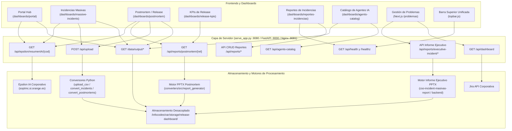

# Catálogo de APIs e Integraciones de Dashboards

Este documento describe todas las APIs, rutas y servicios backend que consumen los distintos dashboards de la plataforma:
- Los dashboards estáticos bajo [`dashboards/`](file:///c:/Users/jose.delafuente/proyectos/release-dashboard-application/dashboards/):
  - **Portal Hub** (`dashboards/portal/`)
  - **Incidencias Masivas** (`dashboards/massive-incidents/`)
  - **Postmortem / Release** (`dashboards/postmortem/`)
  - **KPIs de Release** (`dashboards/release-kpis/`)
  - **Reportes de Incidencias** (`dashboards/reportes-incidencias/`)
  - **Catálogo de Agentes IA y Skills** (`dashboards/agents-catalog/`)
  - **Informes Específicos** (`dashboards/informes/incidencias-pdtes-r9-2026/`)
- La aplicación Next.js de **Gestión de Problemas** bajo `/problemas` (alojada en el repositorio hermano `gestion-problemas-dashboard`).
- Los componentes transversales de cliente: [`topbar.js`](file:///c:/Users/jose.delafuente/proyectos/release-dashboard-application/dashboards/assets/topbar.js) (sondeo de salud) y [`resumen-ia.js`](file:///c:/Users/jose.delafuente/proyectos/release-dashboard-application/dashboards/assets/resumen-ia.js) (Epsilon IA).

---

## 🏛️ Arquitectura de Comunicación



---

## 📋 Matriz de Consumo por Dashboard

| Dashboard | Ruta Web | APIs que invoca |
| :--- | :--- | :--- |
| **Portal Hub** | `/dashboards/portal/` | `GET /data/output/index.json`<br/>`GET /api/epsilon/resumenIA/{codigo}` (buscador) |
| **Incidencias Masivas** | `/dashboards/massive-incidents/` | `POST /api/upload`<br/>`GET /api/epsilon/resumenIA/{codigo}`<br/>`GET /data/output/index.json`<br/>`GET /data/output/*-massive.json` |
| **Postmortem de Release** | `/dashboards/postmortem/` | `POST /api/upload`<br/>`GET /api/reports/postmortem/{release_name}`<br/>`GET /api/epsilon/resumenIA/{codigo}`<br/>`GET /data/output/index.json`<br/>`GET /data/output/*-postmortem.json` |
| **KPIs de Release** | `/dashboards/release-kpis/` | `GET /api/reports/postmortem/{release_name}`<br/>*Nota: datos base leídos de `releases-data.js`* |
| **Reportes de Incidencias** | `/dashboards/reportes-incidencias/` | `GET /api/reports`<br/>`POST /api/reports`<br/>`GET /api/reports/{id}`<br/>`PUT /api/reports/{id}`<br/>`DELETE /api/reports/{id}`<br/>`POST /api/reports/{id}/duplicate?new_week={week}`<br/>`GET /api/reports/{id}/export`<br/>`GET /api/reports/{id}/legacy-pptx`<br/>`GET /api/health` |
| **Catálogo de Agentes IA** | `/dashboards/agents-catalog/` | `GET /api/agents-catalog`<br/>`GET /data/output/agents_catalog.json` (fallback estático) |
| **Gestión de Problemas** | `/problemas` | `GET /api/dashboard` (Jira)<br/>`POST /api/reports/executive-incident`<br/>`GET /api/reports/executive-incident/{ref}/status`<br/>`GET /api/reports/executive-incident/{ref}`<br/>`GET /api/healthz` y `GET /api/readyz` |
| **Consola de Triaje y Emergencias IT (Cockpit)** | `/dashboards/emergency-triage-console/` | `GET /api/incident-manager/pending`<br/>`GET /api/incident-manager/emergency-cockpit`<br/>`GET /api/logs/ingestion`<br/>`POST /api/ingestion/retry-ia` (alias `/api/epsilon/retry`)<br/>`GET /data/output/high_priority_notifications.json`<br/>`GET /data/output/ingestion_audit_summary.json` |
| **Barra Superior Unificada** | *Compartida en todos* | `GET /api/health` (fallback a `GET /healthz`) |

---

## 🔌 Detalle de Endpoints

### 1. Ingesta y Subida de Archivos CSV

#### `POST /api/upload`
* **Invocado por**: Modales de subida de CSV en `massive-incidents` y `postmortem`.
* **Formato petición**: `multipart/form-data`
  * `file`: Archivo `.csv` con la exportación de incidencias de Remedy.
  * `type`: `"massive"` o `"postmortem"`.
  * `release_name`: Obligatorio si el tipo es `"postmortem"` (ej: `"2026R7"`).
* **Respuesta exitosa (`200 OK`)**:
  ```json
  {
    "success": true,
    "message": "Conversión completada",
    "output_file": "2026R7-postmortem.json"
  }
  ```
* **Procesamiento y almacenamiento**:
  * El archivo se deposita en el directorio de almacenamiento desacoplado:
    * **Producción**: `/infocodes/var/storage/release-dashboard/input/`
    * **Desarrollo**: `data/input/` (o ruta indicada por `RELEASE_DASHBOARD_STORAGE_DIR`).
  * Se invoca la función `run_upload()` de [`converters/cli/upload_csv.py`](file:///c:/Users/jose.delafuente/proyectos/release-dashboard-application/converters/cli/upload_csv.py).
  * El conversor genera el JSON estructurado en `output/` y actualiza automáticamente `output/index.json`.

---

### 2. Generación y Descarga de Informes Postmortem (.pptx)

#### `GET /api/reports/postmortem/{release_name}`
* **Invocado por**: Botón *"Descargar informe PPT"* en `dashboards/postmortem/index.html` y botones de descarga directa en la tabla de `dashboards/release-kpis/app.js`.
* **Respuesta**: Stream binario con cabecera `Content-Type: application/vnd.openxmlformats-officedocument.presentationml.presentation` y descarga del fichero:
  `{release_name}-postmortem-report.pptx` (ej: `2026R7-postmortem-report.pptx`).
* **Ubicación de almacenamiento**:
  * **Producción**: `/infocodes/var/storage/release-dashboard/reports/{release_name}-postmortem-report.pptx`
  * **Desarrollo**: `data/reports/{release_name}-postmortem-report.pptx`
* **Optimización de Caché**: Si el informe ya existe y su fecha de modificación es igual o posterior a la de `releases-data.js`, se sirve inmediatamente desde disco sin regenerar las gráficas con Plotly/Kaleido.

---

### 3. Informes Ejecutivos de Incidencias (PowerPoint Corporativo Orange)

#### `POST /api/reports/executive-incident` (o `/api/v1/reports/executive-incident`)
* **Invocado por**: Modal de informe ejecutivo (`ExecutiveReportModal.tsx`) en el dashboard de Gestión de Problemas.
* **Formato petición**: `application/json`
  ```json
  {
    "incidentRef": "2606S77393",
    "title": "Corte pasarela de pagos",
    "url": "https://confluence.si.orange.es/display/...",
    "htmlContent": "...",
    "mode": "confluence"
  }
  ```
* **Respuesta (`200 OK`)**:
  ```json
  {
    "success": true,
    "incidentRef": "2606S77393",
    "filename": "RESUMEN_EJECUTIVO_2606S77393.pptx",
    "downloadUrl": "/api/reports/executive-incident/2606S77393",
    "generatedAt": "2026-10-20T10:30:00Z",
    "sizeBytes": 145820,
    "slideCount": 3
  }
  ```

#### `GET /api/reports/executive-incident/{incident_ref}/status`
* **Invocado por**: `ExecutiveReportModal.tsx` al abrir el modal para comprobar si ya existe un informe generado.
* **Respuesta**:
  ```json
  {
    "exists": true,
    "incidentRef": "2606S77393",
    "filename": "RESUMEN_EJECUTIVO_2606S77393.pptx",
    "downloadUrl": "/api/reports/executive-incident/2606S77393",
    "sizeBytes": 145820
  }
  ```

#### `GET /api/reports/executive-incident/{incident_ref}`
* **Invocado por**: Navegador o cliente para descargar directamente el binario PowerPoint generado.
* **Respuesta**: `200 OK` con cabeceras `Content-Type: application/vnd.openxmlformats-officedocument.presentationml.presentation` y `Content-Disposition: attachment; filename="RESUMEN_EJECUTIVO_{incident_ref}.pptx"`.
* **Almacenamiento**: Los ficheros se generan en `/infocodes/var/storage/executive_pptx/` (enlazado simbólicamente con `/infocodes/var/storage/release-dashboard/reports/executive/`).

---

### 4. API de Reportes de Incidencias (`/api/reports/*`)

Invocada por el cliente [`dashboards/reportes-incidencias/api-client.js`](file:///c:/Users/jose.delafuente/proyectos/release-dashboard-application/dashboards/reportes-incidencias/api-client.js):

| Método | Endpoint | Propósito |
|---|---|---|
| `GET` | `/api/reports` | Listar todos los reportes operativos registrados |
| `POST` | `/api/reports` | Crear un nuevo reporte semanal o mensual |
| `GET` | `/api/reports/{id}` | Obtener el detalle estructurado de un reporte por identificador |
| `PUT` | `/api/reports/{id}` | Actualizar datos, incidencias o hitos de un reporte existente |
| `DELETE` | `/api/reports/{id}` | Eliminar un reporte |
| `POST` | `/api/reports/{id}/duplicate?new_week={week}` | Duplicar la estructura de un reporte previo para una nueva semana |
| `GET` | `/api/reports/{id}/export` | Exportación completa del reporte en formato JSON |
| `GET` | `/api/reports/{id}/legacy-pptx` | Descarga de la presentación PowerPoint ejecutiva generada |

---

### 5. Inteligencia Artificial (Epsilon / Remedy)

#### `POST /api/epsilon/generate` (y alias `/api/epsilon/resumen`)
* **Propósito**: Genera y valida un resumen técnico de incidencia IT ejecutando el motor oficial de Epsilon IA con validación estricta Pydantic (`converters/src/epsilon_service.py`), integrando soporte con Claude Sonnet (Anthropic LiteLLM MasOrange), OpenAI y Mock offline.
* **Formatos de Entrada Soportados**:
  * **Formato A (Directo)**: Objeto JSON íntegro con los campos Remedy de la incidencia (`ID de incidencia`, `Descripción`, `Estatus`, `Prioridad`, etc.). Admite parámetro de consulta `?mock=true`.
  * **Formato B (Wrapper)**:
    ```json
    {
      "incident_data": {
        "ID de incidencia": "INC000004174655",
        "Descripción": "Fallo de sincronización en Ficha de Cliente...",
        "Estatus": "Asignado",
        "Prioridad": "Crítica"
      },
      "mock": false,
      "provider": "anthropic",
      "model": "claude-sonnet-4-5"
    }
    ```
* **Códigos de Respuesta HTTP**:
  * `200 OK`: Resumen generado y validado con éxito. Si incluye código con prefijo `INC`, se persiste automáticamente en `data/.epsilon_cache/{codigo}.json` y en memoria (`EPSILON_CACHE`).
  * `400 Bad Request`: Cuerpo de solicitud vacío, JSON inválido o datos de incidencia insuficientes.
  * `422 Unprocessable Entity`: La respuesta del LLM no superó el contrato estricto de Pydantic (ej. `problema` excede 40 palabras o violación de orden cronológico). Devuelve `validation_errors` detallados.
  * `502 Bad Gateway`: Error de conectividad, autenticación o respuesta 4xx/5xx del proveedor LLM o proxy corporativo.
* **Estructura de Respuesta (200 OK)**:
  ```json
  {
    "success": true,
    "titulo": "Ficha de Cliente - Error en sincronización de teléfono",
    "estadoActual": "Asignado",
    "problema": "El módulo de recogidas de equipamiento fijo no propaga el teléfono de contacto modificado hacia PS y Siebel 8 debido a un fallo en MDG.",
    "impacto": "Medio. Afecta a la logística inversa de routers en bajas de fibra, con riesgo de envíos fallidos al transportista. Sin método alternativo disponible.",
    "solucion": "Bug identificado en microservicio MDG. Parche comprometido para despliegue en ventana release del 12/11/2026.",
    "sistemas": ["Ficha de Cliente", "Siebel 8", "MDG", "PS"],
    "hitosTecnicos": [
      "[02/11/2026 09:15:00]: Detección de inconsistencia entre Ficha de Cliente y sistemas downstream.",
      "[03/11/2026 14:00:00]: N2 aísla el error en el microservicio MDG y traslada requerimiento a desarrollo."
    ],
    "bloqueos": [
      "[Ventana Release]: Dependencia de entrega y despliegue de parche por proveedor planificado para release del 12/11/2026."
    ],
    "siguienteAccion": "Despliegue y validación del parche en ventana del 12/11/2026.",
    "meta": {
      "provider": "anthropic",
      "model": "claude-sonnet-4-5",
      "mock": false,
      "tokens": 620,
      "elapsed_seconds": 1.45,
      "timestamp": "2026-11-06T12:00:00Z"
    }
  }
  ```

---

#### `GET /api/epsilon/resumenIA/{codigo}`
* **Invocado por**: [`dashboards/assets/resumen-ia.js`](file:///c:/Users/jose.delafuente/proyectos/release-dashboard-application/dashboards/assets/resumen-ia.js) al hacer clic sobre cualquier identificador de incidencia o botón "Resumen IA" en el Portal y dashboards.
* **Propósito**: Actúa como proxy inteligente hacia el servicio corporativo de IA de Orange:
  `https://soptmc.si.orange.es/MonTMC/api/epsilon/resumenIA/{codigo}`
* **Fallback Inteligente y Detección de Obsolescencia (`LIFECYCLE_STATUS_MISMATCH`)**:
  1. Si se solicita `?force=true` o se recibe cabecera `Cache-Control: no-cache`, se omite la caché local y se fuerza la consulta en vivo.
  2. Si está en memoria (`EPSILON_CACHE`) o disco (`data/.epsilon_cache/{codigo}.json`), se sirve inmediatamente con cabecera `X-Cache-Status: MEMORY_HIT` o `DISK_HIT`.
  3. Se intenta consultar el servicio corporativo SOPTMC. Si responde `200 OK`, se cachea y se devuelve.
  4. Si SOPTMC falla o no está disponible, el servidor busca automáticamente la incidencia en los volcados locales más recientes (`data/output/*-massive.json` y `*-postmortem.json`).
  5. Si se localizan los datos, genera el resumen al vuelo con el motor local (`converters/src/epsilon_service.py`), añade advertencia de frescura (`is_stale_warning: true` si el volcado tiene más de 2 horas) y devuelve `200 OK` con metadatos:
     ```json
     {
       "success": true,
       "meta": {
         "source": "local_dump_fallback",
         "dump_file": "2026-10-30-massive.json",
         "dump_timestamp": "2026-10-30T10:15:00Z",
         "is_stale_warning": true,
         "stale_reason": "El resumen se ha generado a partir de un volcado local con 72.5 horas de antigüedad; el estado en Remedy en vivo podría diferir."
       }
     }
     ```
  6. Si no existe en SOPTMC ni en los volcados locales, responde `502 Bad Gateway`.
* **Invalidación de Caché**:
  * Al procesar una subida exitosa de CSV en `POST /api/upload`, se invoca automáticamente `EPSILON_CACHE.clear()` para garantizar que los tickets modificados o reabiertos en el nuevo CSV no sirvan datos cacheados obsoletos.
* **Topología de Ejecución**:
  * **Desarrollo**: Servido directamente por `serve_app.py` en el puerto `:8080`.
  * **Producción (VPS)**: Proxificado por Nginx en `:8081` (`location /api/epsilon/`) hacia el backend FastAPI en `:8000` montando el router oficial [`converters/src/fastapi_epsilon_router.py`](file:///c:/Users/jose.delafuente/proyectos/release-dashboard-application/converters/src/fastapi_epsilon_router.py).

---

### 6. Datasets y Catálogo JSON

#### `GET /data/output/index.json`
* **Invocado por**: `dashboards/portal/index.html` y selectores de versión en los dashboards de Incidencias Masivas y Postmortem.
* **Propósito**: Devuelve el índice completo de datasets disponibles, ordenados cronológicamente:
  ```json
  {
    "massive": [
      { "filename": "20260213-massive.json", "date": "2026-02-13", "records": 482 }
    ],
    "postmortem": [
      { "release": "2026R7", "filename": "2026R7-postmortem.json", "records": 34 }
    ],
    "last_updated": "2026-10-20T14:30:00Z"
  }
  ```

#### `GET /data/output/{filename}.json`
* **Invocado por**: Lógica de cliente en cada dashboard para descargar el dataset completo.
* **Ruta de almacenamiento**:
  * En producción, Nginx mapea `/data` como un alias a `/infocodes/var/storage/release-dashboard`.
  * En local, `serve_app.py` intercepta `/data/` y lo sirve desde `STORAGE_DIR` (`data/` o variable de entorno `RELEASE_DASHBOARD_STORAGE_DIR`).

---

### 7. Integración con Jira (Gestión de Problemas)

#### `GET /api/dashboard` (o `/problemas/api/dashboard`)
* **Invocado por**: Vista principal de Next.js (`page.tsx`) en el panel de Gestión de Problemas.
* **Parámetros**: `?refresh=true` (fuerza la recarga omitiendo la caché de Jira).
* **Propósito**: Conecta con la API REST de Jira para recuperar problemas, incidencias vinculadas, KPIs de resolución y tiempos de ciclo.

---

### 8. Monitorización y Salud del Sistema

#### `GET /api/health`
* **Invocado por**: [`dashboards/assets/topbar.js`](file:///c:/Users/jose.delafuente/proyectos/release-dashboard-application/dashboards/assets/topbar.js) y [`api-client.js`](file:///c:/Users/jose.delafuente/proyectos/release-dashboard-application/dashboards/reportes-incidencias/api-client.js).
* **Propósito**: Valida que la API REST (FastAPI) está viva. Actualiza el indicador visual circular de la barra superior a verde (`API OK`) o rojo (`API Offline`).

#### `GET /healthz` y `GET /readyz`
* **Invocado por**: Topbar (como fallback de salud) y sondas de infraestructura de servidor o balanceador.

---

### 9. Catálogo de Agentes IA y Skills

#### `GET /api/agents-catalog`
* **Invocado por**: [`dashboards/agents-catalog/agents-catalog.js`](file:///c:/Users/jose.delafuente/proyectos/release-dashboard-application/dashboards/agents-catalog/agents-catalog.js).
* **Propósito**: Proporciona el catálogo interactivo de agentes de IA y habilidades técnicas (*skills*) de la biblioteca corporativa (`biblioteca-agentes`), correlacionando qué agentes emplean cada skill, métricas de reusabilidad y comando de despliegue.
* **Respuesta (`200 OK`)**: Estructura Envelope (`success`, `data`, `metadata`). Si la biblioteca externa no está presente localmente (entorno VPS), sirve de forma transparente el dataset estático generado en `data/output/agents_catalog.json`.
* **Esquema**:
  ```json
  {
    "success": true,
    "data": {
      "agents": [ ... ],
      "skills": [ ... ],
      "domains": [ ... ],
      "kpis": {
        "total_agents": 5,
        "total_skills": 6,
        "total_domains": 2,
        "skills_coverage_percent": 100.0
      },
      "deployment": {
        "command_template": ".\\deploy-agents.cmd \"<TargetRepo>\" -Agents \"<AgentName>\"",
        "source_repo": "C:\\Users\\jose.delafuente\\Claude\\Projects\\biblioteca-agentes"
      }
    },
    "metadata": {
      "generated_at": "2026-10-22T16:30:00+02:00",
      "version": "1.0.0",
      "source": "biblioteca-agentes"
    }
  }
  ```

---

### 10. Auditoría de Ingesta y Telemetría Semántica

#### `GET /api/logs/ingestion`
* **Invocado por**: Consola de Auditoría y Telemetría IA en el Cockpit del Incident Manager (<kbd>Shift</kbd> + <kbd>I</kbd>).
* **Parámetros**: `?lines=N` (número de líneas a leer desde el final del log; por defecto `100`, máximo `1000`).
* **Propósito**: Devuelve en tiempo real las últimas líneas de [`data/logs/ingestion_audit.log`](file:///c:/Users/jose.delafuente/proyectos/release-dashboard-application/data/logs/ingestion_audit.log) para diagnóstico de la carga de ficheros CSV, tiempos de conversión, llamadas a Epsilon y estado de enriquecimiento.
* **Respuesta (`200 OK`)**: Texto plano estructurado (`text/plain; charset=utf-8`) o JSON envelope conteniendo las trazas.

#### `POST /api/ingestion/retry-ia` (alias: `POST /api/epsilon/retry`)
* **Invocado por**: Botón *"Forzar Refresco / Reintentar Resumen IA"* en la Consola de Auditoría.
* **Payload JSON (opcional)**:
  ```json
  {
    "incident_ids": ["INC000004167733", "INC000004152079"],
    "force": true
  }
  ```
* **Propósito**: Relanza de forma controlada el enriquecimiento semántico mediante Epsilon IA para aquellas incidencias activas que hayan quedado en estado `PARCIAL` o `INCOMPLETA` (por errores transitorios de red o timeouts).
* **Comportamiento**:
  1. Filtra automáticamente las incidencias en estado terminal (evitando peticiones redundantes).
  2. Consulta Epsilon IA actualizando la caché local en `.epsilon_cache/`.
  3. Regenera [`data/output/high_priority_notifications.json`](file:///c:/Users/jose.delafuente/proyectos/release-dashboard-application/data/output/high_priority_notifications.json) y [`data/output/ingestion_audit_summary.json`](file:///c:/Users/jose.delafuente/proyectos/release-dashboard-application/data/output/ingestion_audit_summary.json).
  4. Registra el detalle del reintento en `data/logs/ingestion_audit.log`.
* **Respuesta (`200 OK`)**:
  ```json
  {
    "success": true,
    "message": "Reintento de Resumen IA ejecutado correctamente",
    "processed_count": 18,
    "enriched_count": 18,
    "failed_count": 0
  }
  ```

---

## ⚙️ Diferencias entre Entornos

| Concepto | Desarrollo Local (`serve_app.py`) | Producción (Nginx + FastAPI + Next.js) |
| :--- | :--- | :--- |
| **Servidor Principal** | Python `http.server` enriquecido en **puerto `8080`** (`SERVE_APP_PORT`) | **Nginx en puerto `8081`** (`nginx.conf`) |
| **Backend de APIs** | Delega a FastAPI (`:8000`) si está levantado; si no, ejecuta fallback local en proceso sobre el motor de `cso-incident-masivas-report` | **FastAPI (`uvicorn` en puerto `8000`)**, enrutado por Nginx vía `conf.d/cso-incident.conf` |
| **Almacenamiento Persistente** | Directorio `data/` en la raíz del repo (o variable `RELEASE_DASHBOARD_STORAGE_DIR`) | Directorio desacoplado **`/infocodes/var/storage/release-dashboard/`** (`input/`, `output/`, `reports/`) |
| **Informes Ejecutivos PPTX** | `data/reports/executive/` | **`/infocodes/var/storage/executive_pptx/`** (symlink en `reports/executive`) |
| **Proxy Epsilon IA** | Emulado en `serve_app.py` con caché en memoria `EPSILON_CACHE` (15 min) | Configurado en `nginx.conf` (`location /api/epsilon/`) con `proxy_cache` compartido (15 min) y stale-on-error |
| **Gestión de Problemas** | Proxy en `serve_app.py` reenviando `/problemas` a `http://localhost:3001` (o `:3000`) | Proxy en Nginx (`location /problemas`) hacia upstream `localhost:3001` con cabeceras de proxy y caché |
| **Servicio de Ficheros `/data`** | `serve_app.py` intercepta `/data/` y lee de `STORAGE_DIR` | Nginx sirve directamente mediante directiva `alias /infocodes/var/storage/release-dashboard;` |
