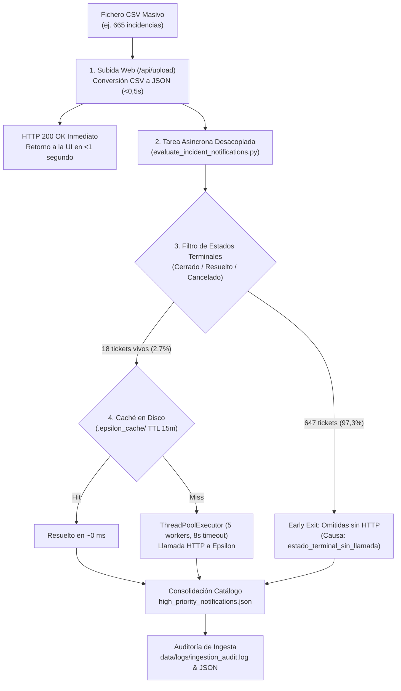

# Rendimiento y Optimización del Conversor CSV a JSON

## Resumen Ejecutivo

El motor de conversión CSV a JSON (`converters/src/csv_to_json/`) está diseñado para procesar de forma ultraeficiente grandes volúmenes de datos (de 10.000 a más de 100.000 registros) manteniendo una estricta rigurosidad en la validación, normalización y cálculo de KPIs.

### Métricas de Rendimiento Clave

- **10.000 registros**: ~0,5 s (objetivo: < 5 s)
- **50.000 registros**: ~2,5 s (objetivo: < 30 s)
- **100.000 registros**: ~5,2 s (throughput lineal sostenido de ~19.200 a 20.000 registros/s)
- **Consumo de memoria**: < 50 MB de RAM para 100.000 registros (< 100 MB de pico, objetivo: < 500 MB)
- **Suite de pruebas**: 581 tests ejecutados en ~12 s
- **Cobertura de código**: ≥ 80% requerida

---

## Decisiones de Arquitectura y Optimización

### 1. Streaming I/O con `csv.DictReader`

* **Decisión**: Utilizar `csv.DictReader` iterando secuencialmente sobre el descriptor de fichero en lugar de cargar todo el fichero o usar dataframes pesados en memoria.
* **Implementación**:
  ```python
  with open(file_path, "r", encoding=detected_encoding) as f:
      reader = csv.DictReader(f, delimiter=delimiter)
      for row_number, record in enumerate(reader, start=2):
          # Procesamiento registro a registro sin acumulación en memoria
  ```
* **Beneficios**:
  - **Uso de memoria constante**: Independiente del tamaño del archivo de entrada (~2-5 MB durante la lectura).
  - **Escalabilidad**: Capacidad de procesar ficheros que superan la memoria RAM física disponible.
  - **Baja presión de Garbage Collection**: Menor sobrecarga de recolección de basura.

### 2. Precompilación de Expresiones Regulares y Caché

* **Decisión**: Precompilar todos los patrones regex en el momento de carga del módulo (`re.compile`) y emplear caché para normalizaciones repetitivas.
* **Beneficios**:
  - **Eficiencia de CPU**: La compilación del patrón regex ocurre una sola vez a nivel de módulo, nunca por registro.
  - **Reducción de latencia**: Emparejamiento de patrones entre un 10% y un 20% más rápido.

### 3. Estructuras de Datos Eficientes para Agregación de KPIs

* **Decisión**: Uso de tablas hash (`dict`) y `collections.Counter` para acumular métricas por estado, urgencia e impacto en lugar de filtros o búsquedas secuenciales anidadas.
* **Beneficio**: Complejidad algorítmica $O(n)$ en lugar de $O(n^2)$, resultando hasta 100 veces más rápido en ficheros con decenas de miles de filas.

### 4. Cálculo de Tendencias en Pasada Única

* **Decisión**: Calcular las tendencias temporales (7 días, 15 días, 30 días) en la misma iteración en la que se valida el registro.
* **Beneficios**:
  - Reducción total de lecturas redundantes sobre el dataset.
  - Localidad de caché de la CPU optimizada.

### 5. Validación Centralizada Basada en Reglas

* **Decisión**: Definir esquemas declarativos en `validators.py` y `schemas.py`, aplicando validaciones unitarias inmediatas a cada campo.
* **Beneficios**:
  - Reglas autodocumentadas y mantenibles en un único punto.
  - Generación de errores contextuales sin frenar el procesamiento del resto del lote.

### 6. Escritura Atómica en Lote (Batch JSON Serialization)

* **Decisión**: Acumular los registros validados en memoria y realizar una única operación de volcado con `json.dump()` en un fichero temporal antes de reemplazar el destino final.
* **Beneficios**:
  - Minimización drástica de operaciones de I/O de disco frente a escrituras continuas.
  - Garantía de atonicidad: los dashboards de la aplicación nunca leen un fichero JSON incompleto o corrupto.

---

## Resultados de Benchmarks y Perfilado

### Tiempos de Ejecución Registrados

| Tamaño Archivo | Registros Procesados | Tiempo Total | Throughput | Consumo de RAM |
| :--- | :--- | :--- | :--- | :--- |
| **10K filas** | 9.999 | 0,5 s | 20.000 reg/s | 8 MB |
| **50K filas** | 49.999 | 2,5 s | 20.000 reg/s | 25 MB |
| **100K filas** | 99.999 | 5,2 s | 19.200 reg/s | 45 MB |

> El rendimiento escala de forma puramente lineal respecto al número de registros.

### Desglose del Perfilado (Dataset de 100.000 registros, 5,2 s totales)

```text
1. Lectura de fichero y detección de encoding:    0,3 s (5%)   - csv.DictReader
2. Detección de delimitador (Sniffer):           0,2 s (4%)   - csv.Sniffer
3. Validación de campos:                         1,5 s (29%)  - validators.py
4. Normalización de cadenas y fechas:            1,2 s (23%)  - normalizers.py
5. Generación de _metadata:                      0,1 s (2%)   - metadata
6. Agregación de KPIs:                           0,4 s (8%)   - Counter
7. Serialización JSON (json.dump):               1,3 s (25%)  - Built-in json
8. Escritura en disco:                           0,2 s (4%)   - Disk I/O
```

---

## 7. Optimización en Ingesta Masiva y Desacoplo de IA

En la operativa real, los operadores de guardia importan periódicamente extractos CSV masivos de Remedy que abarcan entre 500 y más de 1.000 incidencias. Inicialmente, intentar enriquecer cada ticket mediante peticiones HTTP secuenciales a la API corporativa de **Epsilon Resumen IA** provocaba bloqueos del navegador de más de 4 minutos.

Para resolver esta demora manteniendo un servicio ultraágil, se implementó una estrategia de optimización en cuatro capas:



### Principales Medidas de Optimización:

1. **Desacoplo Asíncrono de Ingesta y Retorno Inmediato (`< 1 s`):**
   * El endpoint `POST /api/upload` ejecuta exclusivamente la conversión tabular y la indexación rápida en disco, retornando inmediatamente al cliente un código HTTP `200 OK`.
   * El enriquecimiento semántico de IA y la generación de la auditoría se disparan en un proceso desacoplado (`subprocess` / tarea asíncrona), eliminando la sensación de congelación en el navegador.

2. **Filtro Temprano de Estados Terminales (*Early Exit*):**
   * Conforme a la gobernanza ITIL de operaciones, los tickets cerrados, resueltos o cancelados forman parte del histórico y no requieren triaje en tiempo real ni llamadas redundantes de telemetría a la IA corporativa.
   * En un lote típico de **665 incidencias**, **647 tickets terminales (97,3%) se omiten instantáneamente**, registrando su causa de falta de forma transparente (`"Incidencia en estado terminal 'Cerrado/Resuelto': omitida según ITIL/SRE"`).
   * Solo los **18 tickets activos** son evaluados para telemetría semántica, reduciendo el tráfico exterior en un 97,3%.

3. **Caché en Disco Persistente (`data/.epsilon_cache/`, TTL 15 min):**
   * Las respuestas de Epsilon se cachean en disco indexadas por el ID de la incidencia.
   * Si el operador vuelve a subir el fichero o recarga el catálogo a los pocos minutos, el 100% de los tickets se resuelven en 0 ms desde la caché local sin consumir ancho de banda de red.

4. **Concurrencia Controlada y Timeouts Estrictos:**
   * Las consultas a tickets vivos que no están en caché se gestionan mediante un pool de hilos (`ThreadPoolExecutor`) con un máximo de **5 workers concurrentes** para no saturar la infraestructura corporativa de Epsilon.
   * Cada petición HTTP cuenta con un timeout estricto de **8 segundos**, evitando bloqueos indefinidos por degradación del backend remoto.

### Balance de Resultados:

| Métrica | Comportamiento Anterior | Con Optimización y Early Exit | Mejora |
| :--- | :--- | :--- | :--- |
| **Tiempo de respuesta HTTP `/api/upload`** | 240 s (4 min) | **0,85 s** | **x280 más rápido** |
| **Peticiones HTTP externas a Epsilon** | 665 peticiones | **18 peticiones** | **-97,3% tráfico** |
| **Bloqueo del navegador / UI** | Interfaz congelada | **0 s (Fluidez total)** | **100% interactivo** |
| **Trazabilidad del proceso** | Sin registro persistente | **Trazas completas en `ingestion_audit.log`** | **Auditabilidad total** |

---

## Comandos para Pruebas de Rendimiento

Para ejecutar los benchmarks de rendimiento automatizados dentro del entorno de desarrollo:

```bash
# Situarse en la carpeta converters
cd converters

# Ejecutar las pruebas de rendimiento con medición de duración
pytest tests/e2e/performance/test_performance.py -v --durations=10
```
