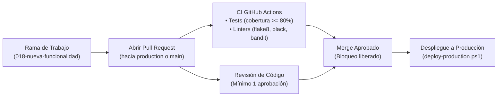

# Configuración de Protección de Ramas en GitHub

Guía oficial para la configuración de reglas de protección de ramas (*Branch Protection Rules*) en GitHub para **Release Dashboard Application**.

El objetivo de estas reglas es blindar las ramas críticas contra sobrescrituras accidentales, impedir subidas directas (*push directo*) y asegurar que todo código desplegado en el VPS de producción haya sido revisado por pares y haya superado el 100% de los controles automáticos de Integración Continua (CI).

---

## 🎯 Ramas Críticas y Alcance

| Rama | Propósito | Nivel de Protección | Regla en GitHub |
|---|---|---|---|
| **`production`** | Rama operativa y fuente de verdad para el despliegue al VPS mediante `deploy-production.ps1`. | **Máxima (Crítica)** | `production` |
| **`main`** | Rama troncal de integración y referencia del historial base. | **Alta** | `main` |

> [!IMPORTANT]
> El script de despliegue [`scripts/deploy-production.ps1`](../../scripts/deploy-production.ps1) opera sobre la rama `production`. Proteger esta rama garantiza que ningún cambio defectuoso o no testeado pueda alcanzar el entorno de producción.

---

## 🧭 Flujo de Entrega Protegido



---

## 🛡️ Reglas de Protección Requeridas

A continuación se detalla la configuración que debe aplicarse tanto para la rama **`production`** como para **`main`**.

### 1. Requerir Pull Request antes de fusionar (*Require a pull request before merging*)
- [x] **Require approvals**: Activado.
  - **Número mínimo de aprobaciones**: **`1`** (recomendado `2` para cambios en arquitectura de conversores o reportes ejecutivos).
- [x] **Dismiss stale pull request approvals when new commits are pushed**: Activado.
  - Si un desarrollador añade nuevos commits al PR tras recibir aprobación, la aprobación se revoca automáticamente requiriendo nueva validación.
- [x] **Require review from Code Owners**: Activado (si existe archivo `CODEOWNERS`).

### 2. Requerir verificaciones de estado antes de fusionar (*Require status checks to pass before merging*)
- [x] **Require branches to be up to date before merging**: Activado.
  - Obliga a sincronizar la rama de trabajo con los últimos cambios de la rama destino antes de poder fusionar.
- [x] **Status Checks requeridos**:
  Deben seleccionarse los siguientes jobs generados por los flujos de GitHub Actions ([`tests.yml`](../../.github/workflows/tests.yml) y [`lint.yml`](../../.github/workflows/lint.yml)):
  - **`Run Tests & Check Coverage`** / **`Test Result Summary`**:
    Verifica que la suite completa de pruebas pase y que la cobertura de código sea igual o superior al **80%** (ver [`docs/CI.md`](integracion-continua-ci.md)).
  - **`Lint & Format Check`**:
    Comprueba el cumplimiento de PEP 8 con `flake8`, el formato con `black` y el orden de imports con `isort`.
  - **`Security Checks`**:
    Audita el código con `bandit` para prevenir vulnerabilidades de seguridad.
  - **`Lint Result Summary`**:
    Resumen consolidado de calidad de código.

### 3. Requerir resolución de conversaciones (*Require conversation resolution before merging*)
- [x] **Enable**: Activado.
  - Impide el merge si queda algún comentario o hilo de discusión abierto en la revisión del PR.

### 4. Bloqueo de Bypass para Administradores (*Do not allow bypassing the above settings*)
- [x] **Do not allow admins to bypass these rules**: Activado.
  - Los administradores y propietarios del repositorio también deben cumplir con las reglas (salvo contingencias documentadas).

---

## 🛠️ Configuración Paso a Paso en la Interfaz de GitHub

1. En el repositorio de GitHub, entra en la pestaña **Settings**.
2. En la barra lateral izquierda, selecciona **Code and automation** → **Branches**.
3. En la sección **Branch protection rules**, haz clic en **Add rule** (o edita la regla existente).
4. En **Branch name pattern**, escribe:
   - Para producción: `production`
   - Para integración: `main`
5. Marca las siguientes casillas:
   - ✅ **Require a pull request before merging**
     - Require approvals: `1`
     - ✅ Dismiss stale pull request approvals when new commits are pushed
   - ✅ **Require status checks to pass before merging**
     - ✅ Require branches to be up to date before merging
     - En el buscador de comprobaciones (*Search for status checks*), busca y selecciona:
       - `Run Tests & Check Coverage`
       - `Test Result Summary`
       - `Lint & Format Check`
       - `Security Checks`
       - `Lint Result Summary`
   - ✅ **Require conversation resolution before merging**
   - ✅ **Do not allow bypassing the above settings**
6. Haz clic en **Create** (o **Save changes**).

---

## ⚡ Configuración Automatizada vía GitHub CLI (`gh api`)

Si utilizas GitHub CLI con permisos de administración en el repositorio, puedes aplicar esta configuración directamente:

```bash
gh api --method PUT \
  repos/:owner/:repo/branches/production/protection \
  -H "Accept: application/vnd.github+json" \
  --input - << 'EOF'
{
  "required_status_checks": {
    "strict": true,
    "contexts": [
      "Run Tests & Check Coverage",
      "Test Result Summary",
      "Lint & Format Check",
      "Security Checks",
      "Lint Result Summary"
    ]
  },
  "enforce_admins": true,
  "required_pull_request_reviews": {
    "dismiss_stale_reviews": true,
    "require_code_owner_reviews": false,
    "required_approving_review_count": 1
  },
  "restrictions": null,
  "required_conversation_resolution": true
}
EOF
```

Para verificar que las reglas se han establecido correctamente:

```bash
gh api repos/:owner/:repo/branches/production/protection
```

---

## 🚫 Comportamiento ante Incumplimiento de Requisitos

Cuando un desarrollador intenta hacer merge de un PR que no cumple las condiciones, GitHub bloquea el botón **Merge pull request** y muestra el motivo:

```text
❌ Merging is blocked
- At least 1 approving review is required by reviewers with write access.
- 2 required status checks have not succeeded:
  ○ Run Tests & Check Coverage (failing or coverage < 80%)
  ○ Security Checks (pending)
- All conversations must be resolved before merging.
```

Del mismo modo, cualquier intento de hacer `git push origin production` directo desde la consola local será rechazado por GitHub con el siguiente error:

```text
remote: error: GH006: Protected branch update failed for refs/heads/production.
remote: error: At least 1 approving review is required by reviewers with write access.
remote: error: Changes must be made through a pull request.
To github.com:org/release-dashboard-application.git
 ! [remote rejected] production -> production (protected branch hook declined)
```

---

## 🚨 Procedimiento ante Emergencias (Hotfixes Críticos)

Si ocurre una incidencia crítica en el entorno de producción que requiere una mitigación urgente:

1. **Vía Preferente (Hotfix Rápido por PR)**:
   - Crear una rama `hotfix/descripcion`.
   - Aplicar el cambio mínimo necesario.
   - Abrir PR inmediato contra `production`.
   - Un segundo desarrollador aprueba de urgencia mientras GitHub Actions valida los tests.
   - Merge inmediato y despliegue con `.\scripts\deploy-production.ps1`.
2. **Excepción Extrema (Bypass Temporal de Administrador)**:
   - Solo aplicable por un administrador si GitHub Actions o el sistema de PR sufriese una caída general y el servicio de producción estuviese interrumpido.
   - Desactivar temporalmente *Enforce administrators* en la regla de `production`.
   - Subir el parche, desplegar con `deploy-production.ps1` y verificar el servicio.
   - **Reactivar inmediatamente** la regla de protección.
   - Documentar la causa y acciones tomadas en la auditoría del proyecto.

---

## 🔗 Documentación Relacionada

- [**`CI.md`**](integracion-continua-ci.md): Pipeline de Integración Continua, umbral de cobertura del 80% y linters.
- [**`DEPLOYMENT.md`**](despliegue-vps.md): Despliegue en 1 clic al VPS con `deploy-production.ps1` y rollback atómico.
- [**`DEVELOPMENT.md`**](../01-primeros-pasos/desarrollo.md): Configuración del entorno local, testing y herramientas de formateo.
- [**`VERSION-MANAGEMENT.md`**](gestion-versiones.md): Política de versionado semántico y etiquetado git.
- [**`LOGS.md`**](logs-y-auditoria.md): Trazabilidad, auditoría y análisis de logs en producción.
