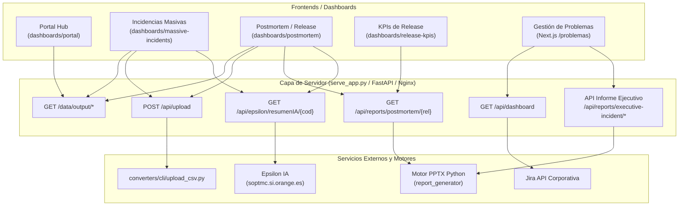

# Catálogo de APIs e Integraciones de Dashboards

Este documento describe todas las APIs, rutas y servicios backend que consumen los distintos dashboards de la plataforma (tanto los dashboards estáticos bajo `dashboards/` como la aplicación Next.js de Gestión de Problemas bajo `/problemas`).

---

## 🏛️ Arquitectura de Comunicación



---

## 📋 Matriz de Consumo por Dashboard

| Dashboard | Ruta Web | APIs que invoca |
| :--- | :--- | :--- |
| **Portal Hub** | `/dashboards/portal/` | `GET /data/output/index.json` |
| **Incidencias Masivas** | `/dashboards/massive-incidents/` | `POST /api/upload`<br/>`GET /api/epsilon/resumenIA/{codigo}`<br/>`GET /data/output/index.json`<br/>`GET /data/output/*-massive.json` |
| **Postmortem de Release** | `/dashboards/postmortem/` | `POST /api/upload`<br/>`GET /api/reports/postmortem/{release_name}`<br/>`GET /api/epsilon/resumenIA/{codigo}`<br/>`GET /data/output/index.json`<br/>`GET /data/output/*-postmortem.json` |
| **KPIs de Release** | `/dashboards/release-kpis/` | `GET /api/reports/postmortem/{release_name}`<br/>*Nota: datos leídos de `releases-data.js`* |
| **Gestión de Problemas** | `/problemas` | `GET /api/dashboard` (con Jira)<br/>`POST /api/reports/executive-incident`<br/>`GET /api/reports/executive-incident/{ref}/status`<br/>`GET /api/reports/executive-incident/{ref}/download`<br/>`GET /api/healthz` y `GET /api/readyz` |

---

## 🔌 Detalle de Endpoints

### 1. Ingesta y Subida de Archivos CSV

#### `POST /api/upload`
* **Invocado por**: Modales de subida de CSV en `massive-incidents` y `postmortem`.
* **Formato petición**: `multipart/form-data`
  * `file`: Archivo `.csv` con la exportación de incidencias.
  * `type`: `"massive"` o `"postmortem"`.
  * `release_name`: Obligatorio si el tipo es `"postmortem"` (ej: `"2026R7"`).
* **Respuesta exitosa (`200 OK`)**:
  ```json
  {
    "success": true,
    "message": "Conversión completada",
    "output_file": "2026R7-postmortem.json"
  }
  ```
* **Procesamiento backend**: El servidor guarda el archivo en `data/input/` e invoca la función `run_upload()` de [`converters/cli/upload_csv.py`](file:///c:/Users/jose.delafuente/proyectos/release-dashboard-application/converters/cli/upload_csv.py), la cual archiva la versión anterior en `data/archive/` y actualiza `data/output/index.json`.

---

### 2. Generación y Descarga de Informes PowerPoint (.pptx)

#### `GET /api/reports/postmortem/{release_name}`
* **Invocado por**: Botón *"Descargar informe PPT"* en `dashboards/postmortem/index.html` y enlaces directos en la tabla histórica de `dashboards/release-kpis/app.js`.
* **Respuesta**: Stream binario con cabecera `Content-Type: application/vnd.openxmlformats-officedocument.presentationml.presentation` y descarga del fichero `data/reports/Informe_Postmortem_{release_name}.pptx`.
* **Optimización de Caché**: Si el informe ya existe y su timestamp es posterior a la última modificación de los datos, se sirve de inmediato sin regenerar las gráficas.

#### `POST /api/reports/executive-incident` (o `/api/v1/reports/...`)
* **Invocado por**: Modal de informe ejecutivo ([`ExecutiveReportModal.tsx`](file:///c:/Users/jose.delafuente/proyectos/gestion-problemas-dashboard/components/ExecutiveReportModal.tsx)) en el dashboard de problemas.
* **Formato petición**: `application/json`
  ```json
  {
    "incidentRef": "2606S77393",
    "title": "Corte pasarela de pagos",
    "url": "https://confluence.si.orange.es/display/...",
    "htmlContent": "...",
    "mode": "confluence"
  }
  ```
* **Respuesta (`200 OK`)**:
  ```json
  {
    "success": true,
    "filename": "RESUMEN_EJECUTIVO_2606S77393.pptx",
    "downloadUrl": "/api/reports/executive-incident/2606S77393/download"
  }
  ```

#### `GET /api/reports/executive-incident/{incident_ref}/status`
* **Invocado por**: `ExecutiveReportModal.tsx` al abrir el modal para una incidencia.
* **Respuesta**:
  ```json
  {
    "exists": true,
    "filename": "RESUMEN_EJECUTIVO_2606S77393.pptx",
    "lastModified": "2026-10-14T10:30:00Z"
  }
  ```

#### `GET /api/reports/executive-incident/{incident_ref}/download`
* **Invocado por**: Navegador para descargar el archivo PowerPoint generado.

---

### 3. Inteligencia Artificial (Epsilon / Remedy)

#### `GET /api/epsilon/resumenIA/{codigo}`
* **Invocado por**: Componente cliente [`dashboards/assets/resumen-ia.js`](file:///c:/Users/jose.delafuente/proyectos/release-dashboard-application/dashboards/assets/resumen-ia.js) al pulsar sobre cualquier identificador de incidencia o botón "Resumen IA".
* **Propósito**: Actúa como proxy hacia el servicio corporativo de IA de Orange:
  `https://soptmc.si.orange.es/MonTMC/api/epsilon/resumenIA/{codigo}`
* **Caché**: En `serve_app.py`, almacena en memoria (`EPSILON_CACHE`) los resúmenes por código de incidencia para responder instantáneamente en llamadas repetidas y evitar sobrecarga del servicio corporativo.
* **Estructura de respuesta**:
  ```json
  {
    "titulo": "Degradación en pasarela de autenticación",
    "problema": "Incremento de errores 504 en el servicio de tokens...",
    "impacto": "Afectación al 12% de los clientes en app móvil...",
    "solucion": "Reinicio del pool de conexiones y failover a secundario...",
    "bloqueos": ["Pendiente de parche por parte del proveedor"],
    "siguienteAccion": "Monitorización reforzada durante las próximas 24h",
    "sistemas": ["SSO", "BFF", "APIGW"],
    "hitos": [
      { "fecha": "02/01/2026 08:15", "descripcion": "Detección de alarmas" },
      { "fecha": "02/01/2026 08:45", "descripcion": "Servicio restablecido" }
    ]
  }
  ```

---

### 4. Datasets y Catálogo JSON

#### `GET /data/output/index.json`
* **Invocado por**: `dashboards/portal/index.html` y selectores de versiones en los dashboards.
* **Propósito**: Devuelve el catálogo de datasets generados, ordenados de más reciente a más antiguo, clasificando por `massive` y `postmortem`.

#### `GET /data/output/{filename}.json`
* **Invocado por**: Lógica de cliente en cada dashboard para descargar el dataset completo a visualizar en tablas y gráficos.

---

### 5. Datos de Jira (Gestión de Problemas)

#### `GET /api/dashboard` (o `/problemas/api/dashboard`)
* **Invocado por**: Vista principal de Next.js (`page.tsx`).
* **Parámetros**: `?refresh=true` (opcional, para forzar recarga ignorando la caché de Jira).
* **Propósito**: Conecta con la API REST de Jira para recuperar los problemas, incidencias vinculadas, KPIs de resolución y tiempos de ciclo.

#### `GET /api/healthz` y `GET /api/readyz`
* **Invocado por**: Sondas de Kubernetes/Docker o monitorización de servidor para validar que la API y la base de datos están operativas.

---

## ⚙️ Diferencias entre Entornos

| Concepto | Desarrollo Local (`serve_app.py`) | Producción (FastAPI + Nginx) |
| :--- | :--- | :--- |
| **Servidor Web** | Servidor monolítico Python `http.server` enriquecido en puerto `8000` | Nginx sirviendo estáticos + proxy a FastAPI (`uvicorn`) |
| **Proxy Epsilon IA** | Emulado en `serve_app.py` con caché en memoria `EPSILON_CACHE` | Proxy configurado en Nginx (`location /api/epsilon/`) o en FastAPI |
| **Gestión de Problemas** | Proxy en `serve_app.py` redirigiendo `/problemas` a `http://localhost:3000` | Subdominio o ruta configurada en Nginx apuntando al contenedor de Next.js |

