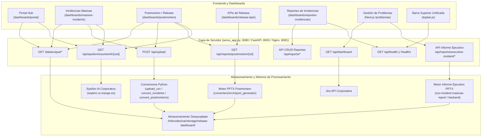

# Catálogo de APIs e Integraciones de Dashboards

Este documento describe todas las APIs, rutas y servicios backend que consumen los distintos dashboards de la plataforma:
- Los dashboards estáticos bajo [`dashboards/`](file:///c:/Users/jose.delafuente/proyectos/release-dashboard-application/dashboards/):
  - **Portal Hub** (`dashboards/portal/`)
  - **Incidencias Masivas** (`dashboards/massive-incidents/`)
  - **Postmortem / Release** (`dashboards/postmortem/`)
  - **KPIs de Release** (`dashboards/release-kpis/`)
  - **Reportes de Incidencias** (`dashboards/reportes-incidencias/`)
  - **Informes Específicos** (`dashboards/informes/incidencias-pdtes-r9-2026/`)
- La aplicación Next.js de **Gestión de Problemas** bajo `/problemas` (alojada en el repositorio hermano `gestion-problemas-dashboard`).
- Los componentes transversales de cliente: [`topbar.js`](file:///c:/Users/jose.delafuente/proyectos/release-dashboard-application/dashboards/assets/topbar.js) (sondeo de salud) y [`resumen-ia.js`](file:///c:/Users/jose.delafuente/proyectos/release-dashboard-application/dashboards/assets/resumen-ia.js) (Epsilon IA).

---

## 🏛️ Arquitectura de Comunicación



---

## 📋 Matriz de Consumo por Dashboard

| Dashboard | Ruta Web | APIs que invoca |
| :--- | :--- | :--- |
| **Portal Hub** | `/dashboards/portal/` | `GET /data/output/index.json`<br/>`GET /api/epsilon/resumenIA/{codigo}` (buscador) |
| **Incidencias Masivas** | `/dashboards/massive-incidents/` | `POST /api/upload`<br/>`GET /api/epsilon/resumenIA/{codigo}`<br/>`GET /data/output/index.json`<br/>`GET /data/output/*-massive.json` |
| **Postmortem de Release** | `/dashboards/postmortem/` | `POST /api/upload`<br/>`GET /api/reports/postmortem/{release_name}`<br/>`GET /api/epsilon/resumenIA/{codigo}`<br/>`GET /data/output/index.json`<br/>`GET /data/output/*-postmortem.json` |
| **KPIs de Release** | `/dashboards/release-kpis/` | `GET /api/reports/postmortem/{release_name}`<br/>*Nota: datos base leídos de `releases-data.js`* |
| **Reportes de Incidencias** | `/dashboards/reportes-incidencias/` | `GET /api/reports`<br/>`POST /api/reports`<br/>`GET /api/reports/{id}`<br/>`PUT /api/reports/{id}`<br/>`DELETE /api/reports/{id}`<br/>`POST /api/reports/{id}/duplicate?new_week={week}`<br/>`GET /api/reports/{id}/export`<br/>`GET /api/reports/{id}/legacy-pptx`<br/>`GET /api/health` |
| **Gestión de Problemas** | `/problemas` | `GET /api/dashboard` (Jira)<br/>`POST /api/reports/executive-incident`<br/>`GET /api/reports/executive-incident/{ref}/status`<br/>`GET /api/reports/executive-incident/{ref}`<br/>`GET /api/healthz` y `GET /api/readyz` |
| **Barra Superior Unificada** | *Compartida en todos* | `GET /api/health` (fallback a `GET /healthz`) |

---

## 🔌 Detalle de Endpoints

### 1. Ingesta y Subida de Archivos CSV

#### `POST /api/upload`
* **Invocado por**: Modales de subida de CSV en `massive-incidents` y `postmortem`.
* **Formato petición**: `multipart/form-data`
  * `file`: Archivo `.csv` con la exportación de incidencias de Remedy.
  * `type`: `"massive"` o `"postmortem"`.
  * `release_name`: Obligatorio si el tipo es `"postmortem"` (ej: `"2026R7"`).
* **Respuesta exitosa (`200 OK`)**:
  ```json
  {
    "success": true,
    "message": "Conversión completada",
    "output_file": "2026R7-postmortem.json"
  }
  ```
* **Procesamiento y almacenamiento**:
  * El archivo se deposita en el directorio de almacenamiento desacoplado:
    * **Producción**: `/infocodes/var/storage/release-dashboard/input/`
    * **Desarrollo**: `data/input/` (o ruta indicada por `RELEASE_DASHBOARD_STORAGE_DIR`).
  * Se invoca la función `run_upload()` de [`converters/cli/upload_csv.py`](file:///c:/Users/jose.delafuente/proyectos/release-dashboard-application/converters/cli/upload_csv.py).
  * El conversor genera el JSON estructurado en `output/` y actualiza automáticamente `output/index.json`.

---

### 2. Generación y Descarga de Informes Postmortem (.pptx)

#### `GET /api/reports/postmortem/{release_name}`
* **Invocado por**: Botón *"Descargar informe PPT"* en `dashboards/postmortem/index.html` y botones de descarga directa en la tabla de `dashboards/release-kpis/app.js`.
* **Respuesta**: Stream binario con cabecera `Content-Type: application/vnd.openxmlformats-officedocument.presentationml.presentation` y descarga del fichero:
  `{release_name}-postmortem-report.pptx` (ej: `2026R7-postmortem-report.pptx`).
* **Ubicación de almacenamiento**:
  * **Producción**: `/infocodes/var/storage/release-dashboard/reports/{release_name}-postmortem-report.pptx`
  * **Desarrollo**: `data/reports/{release_name}-postmortem-report.pptx`
* **Optimización de Caché**: Si el informe ya existe y su fecha de modificación es igual o posterior a la de `releases-data.js`, se sirve inmediatamente desde disco sin regenerar las gráficas con Plotly/Kaleido.

---

### 3. Informes Ejecutivos de Incidencias (PowerPoint Corporativo Orange)

#### `POST /api/reports/executive-incident` (o `/api/v1/reports/executive-incident`)
* **Invocado por**: Modal de informe ejecutivo (`ExecutiveReportModal.tsx`) en el dashboard de Gestión de Problemas.
* **Formato petición**: `application/json`
  ```json
  {
    "incidentRef": "2606S77393",
    "title": "Corte pasarela de pagos",
    "url": "https://confluence.si.orange.es/display/...",
    "htmlContent": "...",
    "mode": "confluence"
  }
  ```
* **Respuesta (`200 OK`)**:
  ```json
  {
    "success": true,
    "incidentRef": "2606S77393",
    "filename": "RESUMEN_EJECUTIVO_2606S77393.pptx",
    "downloadUrl": "/api/reports/executive-incident/2606S77393",
    "generatedAt": "2026-10-20T10:30:00Z",
    "sizeBytes": 145820,
    "slideCount": 3
  }
  ```

#### `GET /api/reports/executive-incident/{incident_ref}/status`
* **Invocado por**: `ExecutiveReportModal.tsx` al abrir el modal para comprobar si ya existe un informe generado.
* **Respuesta**:
  ```json
  {
    "exists": true,
    "incidentRef": "2606S77393",
    "filename": "RESUMEN_EJECUTIVO_2606S77393.pptx",
    "downloadUrl": "/api/reports/executive-incident/2606S77393",
    "sizeBytes": 145820
  }
  ```

#### `GET /api/reports/executive-incident/{incident_ref}`
* **Invocado por**: Navegador o cliente para descargar directamente el binario PowerPoint generado.
* **Respuesta**: `200 OK` con cabeceras `Content-Type: application/vnd.openxmlformats-officedocument.presentationml.presentation` y `Content-Disposition: attachment; filename="RESUMEN_EJECUTIVO_{incident_ref}.pptx"`.
* **Almacenamiento**: Los ficheros se generan en `/infocodes/var/storage/executive_pptx/` (enlazado simbólicamente con `/infocodes/var/storage/release-dashboard/reports/executive/`).

---

### 4. API de Reportes de Incidencias (`/api/reports/*`)

Invocada por el cliente [`dashboards/reportes-incidencias/api-client.js`](file:///c:/Users/jose.delafuente/proyectos/release-dashboard-application/dashboards/reportes-incidencias/api-client.js):

| Método | Endpoint | Propósito |
|---|---|---|
| `GET` | `/api/reports` | Listar todos los reportes operativos registrados |
| `POST` | `/api/reports` | Crear un nuevo reporte semanal o mensual |
| `GET` | `/api/reports/{id}` | Obtener el detalle estructurado de un reporte por identificador |
| `PUT` | `/api/reports/{id}` | Actualizar datos, incidencias o hitos de un reporte existente |
| `DELETE` | `/api/reports/{id}` | Eliminar un reporte |
| `POST` | `/api/reports/{id}/duplicate?new_week={week}` | Duplicar la estructura de un reporte previo para una nueva semana |
| `GET` | `/api/reports/{id}/export` | Exportación completa del reporte en formato JSON |
| `GET` | `/api/reports/{id}/legacy-pptx` | Descarga de la presentación PowerPoint ejecutiva generada |

---

### 5. Inteligencia Artificial (Epsilon / Remedy)

#### `GET /api/epsilon/resumenIA/{codigo}`
* **Invocado por**: [`dashboards/assets/resumen-ia.js`](file:///c:/Users/jose.delafuente/proyectos/release-dashboard-application/dashboards/assets/resumen-ia.js) al hacer clic sobre cualquier identificador de incidencia o botón "Resumen IA" en el Portal y dashboards.
* **Propósito**: Actúa como proxy hacia el servicio corporativo de IA de Orange:
  `https://soptmc.si.orange.es/MonTMC/api/epsilon/resumenIA/{codigo}`
* **Caché y Resiliencia**:
  * **En Producción (Nginx)**: Zona `my_cache` con TTL de 15 minutos (`proxy_cache_valid 200 15m;`) y directiva `proxy_cache_use_stale` para responder con contenido en caché si el servicio corporativo no responde.
  * **En Desarrollo (`serve_app.py`)**: Diccionario en memoria `EPSILON_CACHE` con expiración de 15 minutos (900 segundos).
* **Estructura de respuesta**:
  ```json
  {
    "titulo": "Degradación en pasarela de autenticación",
    "problema": "Incremento de errores 504 en el servicio de tokens...",
    "impacto": "Afectación al 12% de los clientes en app móvil...",
    "solucion": "Reinicio del pool de conexiones y failover a secundario...",
    "bloqueos": ["Pendiente de parche por parte del proveedor"],
    "siguienteAccion": "Monitorización reforzada durante las próximas 24h",
    "sistemas": ["SSO", "BFF", "APIGW"],
    "hitos": [
      { "fecha": "02/01/2026 08:15", "descripcion": "Detección de alarmas" },
      { "fecha": "02/01/2026 08:45", "descripcion": "Servicio restablecido" }
    ]
  }
  ```

---

### 6. Datasets y Catálogo JSON

#### `GET /data/output/index.json`
* **Invocado por**: `dashboards/portal/index.html` y selectores de versión en los dashboards de Incidencias Masivas y Postmortem.
* **Propósito**: Devuelve el índice completo de datasets disponibles, ordenados cronológicamente:
  ```json
  {
    "massive": [
      { "filename": "20260213-massive.json", "date": "2026-02-13", "records": 482 }
    ],
    "postmortem": [
      { "release": "2026R7", "filename": "2026R7-postmortem.json", "records": 34 }
    ],
    "last_updated": "2026-10-20T14:30:00Z"
  }
  ```

#### `GET /data/output/{filename}.json`
* **Invocado por**: Lógica de cliente en cada dashboard para descargar el dataset completo.
* **Ruta de almacenamiento**:
  * En producción, Nginx mapea `/data` como un alias a `/infocodes/var/storage/release-dashboard`.
  * En local, `serve_app.py` intercepta `/data/` y lo sirve desde `STORAGE_DIR` (`data/` o variable de entorno `RELEASE_DASHBOARD_STORAGE_DIR`).

---

### 7. Integración con Jira (Gestión de Problemas)

#### `GET /api/dashboard` (o `/problemas/api/dashboard`)
* **Invocado por**: Vista principal de Next.js (`page.tsx`) en el panel de Gestión de Problemas.
* **Parámetros**: `?refresh=true` (fuerza la recarga omitiendo la caché de Jira).
* **Propósito**: Conecta con la API REST de Jira para recuperar problemas, incidencias vinculadas, KPIs de resolución y tiempos de ciclo.

---

### 8. Monitorización y Salud del Sistema

#### `GET /api/health`
* **Invocado por**: [`dashboards/assets/topbar.js`](file:///c:/Users/jose.delafuente/proyectos/release-dashboard-application/dashboards/assets/topbar.js) y [`api-client.js`](file:///c:/Users/jose.delafuente/proyectos/release-dashboard-application/dashboards/reportes-incidencias/api-client.js).
* **Propósito**: Valida que la API REST (FastAPI) está viva. Actualiza el indicador visual circular de la barra superior a verde (`API OK`) o rojo (`API Offline`).

#### `GET /healthz` y `GET /readyz`
* **Invocado por**: Topbar (como fallback de salud) y sondas de infraestructura de servidor o balanceador.

---

## ⚙️ Diferencias entre Entornos

| Concepto | Desarrollo Local (`serve_app.py`) | Producción (Nginx + FastAPI + Next.js) |
| :--- | :--- | :--- |
| **Servidor Principal** | Python `http.server` enriquecido en **puerto `8080`** (`SERVE_APP_PORT`) | **Nginx en puerto `8081`** (`nginx.conf`) |
| **Backend de APIs** | Delega a FastAPI (`:8000`) si está levantado; si no, ejecuta fallback local en proceso sobre el motor de `cso-incident-masivas-report` | **FastAPI (`uvicorn` en puerto `8000`)**, enrutado por Nginx vía `conf.d/cso-incident.conf` |
| **Almacenamiento Persistente** | Directorio `data/` en la raíz del repo (o variable `RELEASE_DASHBOARD_STORAGE_DIR`) | Directorio desacoplado **`/infocodes/var/storage/release-dashboard/`** (`input/`, `output/`, `reports/`) |
| **Informes Ejecutivos PPTX** | `data/reports/executive/` | **`/infocodes/var/storage/executive_pptx/`** (symlink en `reports/executive`) |
| **Proxy Epsilon IA** | Emulado en `serve_app.py` con caché en memoria `EPSILON_CACHE` (15 min) | Configurado en `nginx.conf` (`location /api/epsilon/`) con `proxy_cache` compartido (15 min) y stale-on-error |
| **Gestión de Problemas** | Proxy en `serve_app.py` reenviando `/problemas` a `http://localhost:3001` (o `:3000`) | Proxy en Nginx (`location /problemas`) hacia upstream `localhost:3001` con cabeceras de proxy y caché |
| **Servicio de Ficheros `/data`** | `serve_app.py` intercepta `/data/` y lee de `STORAGE_DIR` | Nginx sirve directamente mediante directiva `alias /infocodes/var/storage/release-dashboard;` |
