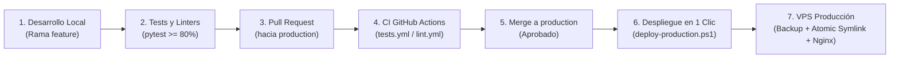

# Guía de Despliegue de Release Dashboard Application

Procedimiento de despliegue oficial y automatizado de Release Dashboard Application en el VPS de producción (`infocodes@10.132.26.96`).

El despliegue está basado en un **artefacto empaquetado selectivo (Standalone Runtime)** generado en la estación local de desarrollo, transferido por SCP y aplicado de forma atómica en el servidor, eliminando por completo operaciones de `git pull`, `git stash` o clonación en producción.

---

## 🧭 Flujo de Trabajo End-to-End



1. **Desarrollo**: Se trabaja en ramas de feature numeradas (ej: `018-feature-name`).
2. **Validación Previa**: Ejecución local de tests y linters antes del push (`pytest`, `flake8`, `bandit`). Consulta [`CI.md`](CI.md).
3. **Pull Request e Integración Continua**: Se abre PR contra la rama `production`. GitHub Actions ejecuta automáticamente `tests.yml` (cobertura $\ge$ 80%) y `lint.yml`.
4. **Merge**: Con los checks verdes y aprobación, se fusiona el PR en la rama `production`.
5. **Despliegue a Producción**: Desde la máquina Windows se ejecuta `.\scripts\deploy-production.ps1`.

---

## 🏛️ Principios de la Arquitectura de Despliegue

1. **Standalone Runtime (Empaquetado Selectivo)**:
   - Solo se sube al servidor lo estrictamente necesario para la ejecución (`dashboards/`, `converters/`, `scripts/`, `nginx.conf`, `requirements.txt`, `VERSION`).
   - Se excluyen suites de test (`tests/`), especificaciones (`specs/`), historial de control de versiones (`.git/`), archivos `.md` de documentación y binarios de prueba (`*.pptx` locales).
   - El artefacto pasa de ocupar cientos de megas a solo **~2.3 MB**, agilizando la transferencia y el despliegue.
2. **Cero Git en Producción**:
   - Sin dependencias de conectividad de red externa desde el VPS a GitHub.
   - Sin riesgo de conflictos de merge, `git stash`, o sobreescritura accidental de datos dinámicos.
3. **Persistencia Estricta y Desacoplamiento de Datos**:
   - Los datos dinámicos están totalmente desacoplados del código en `/infocodes/var/storage/release-dashboard/` (`input/`, `output/`, `reports/`, `errors/`, `archive/`).
   - Los informes ejecutivos PPTX se centralizan en `/infocodes/var/storage/executive_pptx` (con symlink en `reports/executive`).
   - Los logs residen fuera del árbol de releases en `/infocodes/var/log/release-dashboard/` (ver [`LOGS.md`](LOGS.md)).
   - En la raíz del proyecto y en cada release se mantienen symlinks transparentes hacia estas ubicaciones para garantizar 100% de retrocompatibilidad.
4. **Copia Preventiva y Rollback Instantáneo**:
   - Cada despliegue genera automáticamente una copia de seguridad comprimida en `/infocodes/var/backups/release-dashboard-application/backup_YYYYMMDD_HHMMSS.tar.gz`.
   - Se mantiene una política de rotación automática conservando las últimas 5 copias.
   - Posibilidad de rollback atómico instantáneo con conmutación de enlace simbólico.
5. **Sincronización y Validación Segura de Nginx**:
   - `nginx.conf` se valida sintácticamente (`nginx -t`) antes de recargar.
   - Si la configuración es válida, se recarga en caliente (`nginx -s reload`) sin cortar conexiones ni requerir permisos de `root`.
   - Si `nginx -t` detecta algún error de sintaxis, se aborta y se revierte automáticamente a la configuración previa.

---

## 📁 Topología y Estructura en el Servidor VPS

```
/infocodes/
├── project/release-dashboard-application/            # Raíz del proyecto en el servidor
│   ├── current -> releases/release_YYYYMMDD_HHMMSS  # Symlink atómico a la versión activa
│   ├── releases/                                     # Historial de versiones desplegadas
│   │   ├── release_20261015_145000/
│   │   └── release_20261020_153000/                  # Versión activa actual
│   │       ├── dashboards/                           # HTML/CSS/JS estáticos
│   │       ├── converters/                           # Scripts Python y CLI
│   │       ├── scripts/                              # Herramientas de administración
│   │       ├── data -> /infocodes/var/storage/...    # Symlink a datos persistentes
│   │       └── logs -> /infocodes/var/log/...        # Symlink a logs
│   ├── status.sh                                     # Script rápido de estado
│   ├── rollback.sh                                   # Script de rollback atómico
│   └── VERSION                                       # Versión semántica activa
│
├── var/
│   ├── storage/
│   │   ├── release-dashboard/                        # Almacenamiento desacoplado (Persistente)
│   │   │   ├── input/                                # CSVs subidos desde web o CLI
│   │   │   ├── output/                               # JSONs estructurados e index.json
│   │   │   ├── reports/                              # Postmortems PPTX ({release}-postmortem-report.pptx)
│   │   │   │   └── executive -> /infocodes/var/storage/executive_pptx
│   │   │   ├── errors/                               # CSVs erróneos detectados en batch
│   │   │   └── archive/                              # Histórico de CSVs procesados
│   │   └── executive_pptx/                           # Informes ejecutivos generados (Single Source of Truth)
│   │
│   ├── log/
│   │   ├── release-dashboard/                        # Logs de aplicación y cron batch
│   │   │   ├── dashboards-cron.log
│   │   │   └── dashboards-generation-YYYYMMDD.log
│   │   └── nginx/                                    # Logs de Nginx (infocodes.access.log)
│   │
│   └── backups/release-dashboard-application/        # Backups preventivos rotativos (.tar.gz)
│
└── nginx/conf/nginx.conf                             # Configuración activa de Nginx
```

---

## 📦 Qué se despliega desde este repositorio

| Ruta servida | Origen | Contenido |
|---|---|---|
| `/dashboards/portal/` | `dashboards/portal/` | Portal central de accesos y buscador global |
| `/dashboards/massive-incidents/` | `dashboards/massive-incidents/` | Dashboard de Incidencias Masivas |
| `/dashboards/postmortem/` | `dashboards/postmortem/` | Dashboard de Informes Postmortem / Releases |
| `/dashboards/release-kpis/` | `dashboards/release-kpis/` | Dashboard de KPIs por Release |
| `/dashboards/reportes-incidencias/` | `dashboards/reportes-incidencias/` | Frontend de gestión y análisis de reportes de incidencias |
| `/dashboards/informes/` | `dashboards/informes/` | Informes específicos (p. ej. incidencias pendientes R9) |
| `/data/` | `/infocodes/var/storage/release-dashboard/` | JSONs de incidencias/postmortems y reportes PPTX |
| `/api/epsilon/*` | Proxy en Nginx | Proxy reverso con caché a la API de Epsilon IA |

Servicios hermanos en el mismo Nginx (despliegues independientes):
- **`/api`** → Proxy al backend FastAPI (`localhost:8000`), del repositorio hermano `cso-incident-masivas-report`.
- **`/problemas`** → Proxy al backend Next.js (`localhost:3001`) de Gestión de Problemas.

---

## ⚡ Despliegue en 1 Clic desde Windows (Recomendado)

### Prerrequisitos en la Máquina de Desarrollo
- Sistema operativo Windows con **PowerShell 5.1** o superior.
- Cliente **OpenSSH** instalado y disponible en el PATH (`ssh`, `scp`).
- Acceso por clave SSH pública/privada configurado hacia `infocodes@10.132.26.96` (sin solicitud interactiva de contraseña).
- Estar situado en la rama **`production`**.

### Comando de Despliegue
Desde tu terminal de PowerShell en la raíz del proyecto:

```powershell
.\scripts\deploy-production.ps1
```

### Opciones y Parámetros del Script

| Parámetro | Descripción |
|---|---|
| *(sin parámetros)* | Proceso completo: valida git local, push a GitHub, empaqueta artefacto, sube por SCP, aplica en el VPS, valida Nginx y comprueba sondas de salud. |
| `-VerifyOnly` | Solo consulta el estado de Nginx, estadísticas de datos y sondas HTTP remotas sin tocar ningún archivo ni recargar. |
| `-Rollback` | Restaura instantáneamente la release o copia de seguridad más reciente y recarga Nginx. |
| `-SkipPush` | Salta el `git push origin production` y empaqueta/despliega directamente el estado local. |
| `-SkipBuild` | Salta la generación del tarball local y sube el `dist/release-dashboard-runtime.tar.gz` existente. |
| `-SkipUpload` | Utiliza el tarball ya presente en `/tmp/release-dashboard-runtime.tar.gz` en el VPS. |
| `-DryRun` | Muestra los pasos y el script bash remoto que se ejecutaría sin aplicar ningún cambio. |

---

## 🛠️ Herramientas de Control en el VPS

En el propio servidor (`/infocodes/project/release-dashboard-application`), se dispone de scripts directos de administración:

### 1. Comprobación de Estado (`./status.sh`)
```bash
./status.sh
```
Muestra:
- Versión desplegada (`VERSION`).
- Estado de configuración del proceso Nginx (puerto 8081).
- Volúmenes de datos (`CSV` en input, `JSON` en output, `PPTX` en reports).
- Sondas de salud HTTP para todos los dashboards y endpoints de proxy.

### 2. Rollback Inmediato (`./rollback.sh`)
El script [`scripts/rollback.sh`](file:///c:/Users/jose.delafuente/proyectos/release-dashboard-application/scripts/rollback.sh) cuenta con un **doble mecanismo de reversión**:

1. **Reversión Atómica por Symlink (Prioritaria y en milisegundos)**:
   Conmuta el enlace simbólico `current` a la release anterior presente en `releases/`, restaura symlinks de datos y recarga Nginx.
2. **Restauración desde Archivo Comprimido (Fallback)**:
   Si no hubiera releases disponibles, extrae automáticamente el backup `.tar.gz` más reciente desde `/infocodes/var/backups/release-dashboard-application/`.

```bash
# Revertir a la versión anterior automáticamente:
./rollback.sh

# Revertir a una release específica:
./rollback.sh release_20261015_145000

# Restaurar desde un archivo de backup comprimido específico:
./rollback.sh backup_20261015_145000.tar.gz
```

---

## 🛡️ Proxy y Caché de Epsilon IA (Nginx)

Nginx actúa como proxy seguro y protector de la API de Epsilon IA mediante una caché compartida (`keys_zone=my_cache:10m`):

```nginx
location /api/epsilon/ {
    proxy_pass https://soptmc.si.orange.es/MonTMC/api/epsilon/;
    proxy_ssl_verify off;
    proxy_ssl_server_name on;
    proxy_set_header Host soptmc.si.orange.es;
    proxy_connect_timeout 15s;
    proxy_read_timeout 30s;

    # Caché compartida para no saturar la API de Epsilon IA
    proxy_cache my_cache;
    proxy_cache_valid 200 15m;
    proxy_cache_valid 404 1m;
    proxy_cache_use_stale error timeout updating http_500 http_502 http_503 http_504;
    proxy_cache_lock on;
    proxy_cache_lock_timeout 5s;
    proxy_ignore_headers Cache-Control Expires Set-Cookie;
    proxy_cache_bypass $http_cache_control;
    add_header X-Cache-Status $upstream_cache_status always;
}
```

- **TTL de 15 minutos (`proxy_cache_valid 200 15m`)**: Nginx responde en milisegundos directamente sin saturar Epsilon.
- **`proxy_cache_lock on`**: Evita avalanchas concurrentes agrupando peticiones en vuelo.
- **`proxy_cache_use_stale`**: Resiliencia total ante caídas o lentitud de la API externa (sirve contenido en caché en lugar de error).
- **`add_header X-Cache-Status`**: Inspeccionable en DevTools (`HIT` o `MISS`).

---

## 🔄 Conversión Batch de CSV (Cron en el VPS)

La generación periódica de los JSONs que consumen los dashboards se realiza con [`scripts/generate-dashboards.sh`](file:///c:/Users/jose.delafuente/proyectos/release-dashboard-application/scripts/generate-dashboards.sh), configurado en el crontab del usuario `infocodes`:

```bash
# Ejecución diaria a las 2 AM:
0 2 * * * /infocodes/project/release-dashboard-application/scripts/generate-dashboards.sh >> /infocodes/var/log/release-dashboard/dashboards-cron.log 2>&1
```

---

## 🔗 Documentación Relacionada

- [**`CI.md`**](CI.md): Pipeline de Integración Continua, tests con pytest, umbral de cobertura (80%) y linters en GitHub Actions.
- [**`LOGS.md`**](LOGS.md): Gestión de logs, rotación, comandos de diagnóstico y trazabilidad en producción.
- [**`DASHBOARDS-API.md`**](DASHBOARDS-API.md): Catálogo de APIs, rutas y servicios consumidos por los frontends.
- [**`PROJECT-STRUCTURE.md`**](PROJECT-STRUCTURE.md): Organización física del repositorio y convenciones de estructura.
- [**`VERSION-MANAGEMENT.md`**](VERSION-MANAGEMENT.md): Política de versionado semántico y etiquetado git.
