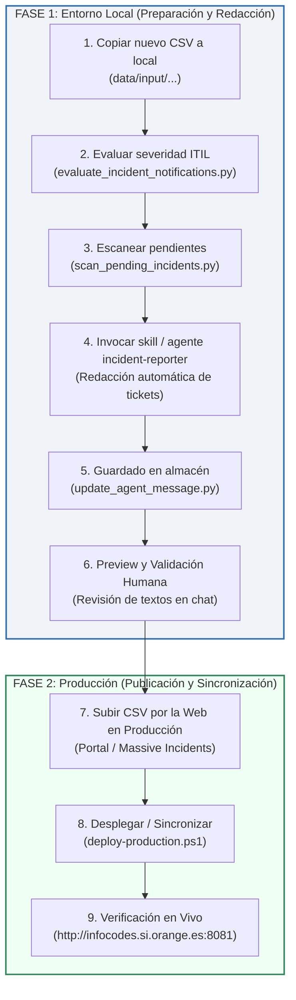

# Guía Operativa: Redacción y Despliegue de Notificaciones Ejecutivas de Incidencias

Esta guía describe el procedimiento paso a paso que debes seguir **cada vez que recibas un nuevo fichero CSV de incidencias Remedy**, para redactar las comunicaciones oficiales de alta prioridad para Dirección (P1, P2 y discrepancias) y publicarlas de forma 100% segura y coherente en producción.

---

## 🎯 Principios y Reglas Clave

1. **El operador manda sobre los datos (Single Source of Truth):**
   * El CSV se procesa **primero en local** para redactar y revisar los mensajes sin prisa.
   * La publicación en producción es una **acción controlada y desacoplada** de la redacción.
2. **Estándar Ejecutivo Estricto:**
   * **Mensaje para Dirección:** Exactamente **1 único párrafo**, máximo **90 palabras**.
   * **Versión breve (SMS / Guardia):** Máximo **30 palabras**.
   * **Regla Anti-Alucinación:** No inventar horas, causas técnicas ni cifras de afectados no presentes en el ticket.
3. **Persistencia Acumulativa:**
   * Todos los mensajes redactados por la IA se guardan de por vida en `data/agent_executive_messages.json` para que nunca se pierdan ni se sobreescriban al subir nuevos ficheros.

---

## 🗺️ Mapa Visual del Proceso



---

## 🛠️ Procedimiento Paso a Paso

### FASE 1: Entorno Local (Preparación y Redacción)

#### Paso 1: Copiar el CSV a tu entorno local
Descarga o coloca tu nuevo archivo CSV de incidencias en la carpeta de entrada:
```text
data/input/CS-Informe incidencias P1,  P2 y P3 - 2026 - <FECHA>.csv
```

#### Paso 2: Evaluar la severidad ITIL del nuevo archivo
Abre tu terminal en la raíz del proyecto y ejecuta la evaluación de prioridades:
```powershell
python converters/evaluate_incident_notifications.py
```
*Este comando analiza todos los tickets, detecta discrepancias de severidad, cruza con los mensajes existentes y genera `data/output/high_priority_notifications.json`.*

#### Paso 3: Escanear incidencias pendientes de redacción
Comprueba qué tickets de alta prioridad no disponen aún de mensaje oficial:
```powershell
python .agents/skills/incident-executive-notifications/scripts/scan_pending_incidents.py
```
*Si faltan tickets por redactar, el script listará los IDs, sistemas y estado de Epsilon IA.*

#### Paso 4: Invocar la Skill de Asistente (Redacción IA)
Pide a Antigravity en el chat:
> *"He cargado un nuevo CSV de incidencias. Activa la skill incident-executive-notifications para redactar las comunicaciones oficiales pendientes."*

El asistente:
1. Inspeccionará los datos técnicos y resúmenes de Epsilon IA de cada ticket pendiente.
2. Adoptará el rol `incident-reporter` y redactará los dos niveles obligatorios ($\le 90$ palabras monopárrafo y $\le 30$ palabras breve).
3. Guardará automáticamente las salidas validadas en `data/agent_executive_messages.json` usando `update_agent_message.py`.

#### Paso 5: Revisión de Textos y Validación Humana (*Human-in-the-Loop*)
1. El asistente te presentará en el chat el resumen de todos los mensajes generados.
2. Si deseas ajustar manualmente la redacción de alguna incidencia concreta:
   ```powershell
   python converters/cli/update_agent_message.py --id INC000004XXXXXX --phase apertura --raw "**Mensaje para Dirección (versión completa):**
   Tu nuevo texto formal aquí...

   **Versión aún más breve:**
   P1: Alerta breve ajustada."
   ```
3. Verifica que el escáner informe que todo está listo:
   ```powershell
   python .agents/skills/incident-executive-notifications/scripts/scan_pending_incidents.py
   ```
   *(Debe mostrar: `✅ Todas las incidencias activas disponen de mensajes ejecutivos oficiales`)*

---

### FASE 2: Servidor de Producción (Publicación y Sincronización)

Una vez que los mensajes y los datos están validados en local, sigue este orden para evitar desincronizaciones:

#### Paso 6: Subir el CSV en la web de producción
1. Abre tu navegador y accede al dashboard de incidencias masivas en producción:
   **[http://infocodes.si.orange.es:8081/dashboards/massive-incidents/](http://infocodes.si.orange.es:8081/dashboards/massive-incidents/)**
2. Arrastra o selecciona el nuevo fichero CSV en el botón **"Seleccionar archivo"**.
3. Espera a que termine la subida y conversión a JSON en el servidor.

#### Paso 7: Desplegar y sincronizar los mensajes al servidor
Ejecuta el script de despliegue desde PowerShell:
```powershell
powershell -ExecutionPolicy Bypass -File scripts/deploy-production.ps1 -AgentsLibraryPath . -SkipPush
```
*(Si deseas subir además los commits a Git, retira el flag `-SkipPush`)*.

**¿Qué hace este script en este paso?**
* Empaqueta el runtime y los catálogos actualizados.
* Sube el paquete al servidor VPS (`10.132.26.96`).
* **Sincroniza `agent_executive_messages.json`** y `high_priority_notifications.json` en el almacenamiento persistente `/infocodes/var/storage/release-dashboard/`.
* Reinicia el backend y realiza las comprobaciones de salud HTTP (todas en `200 OK`).

#### Paso 8: Verificación en Vivo
Accede al portal y comprueba que la campana de notificaciones y los modales ejecutivos muestran los textos redactados:
* **Portal Principal:** [http://infocodes.si.orange.es:8081/dashboards/portal/](http://infocodes.si.orange.es:8081/dashboards/portal/)
* **Incidencias Masivas:** [http://infocodes.si.orange.es:8081/dashboards/massive-incidents/](http://infocodes.si.orange.es:8081/dashboards/massive-incidents/)

---

## 🧰 Comandos Útiles y Rescate (CheatSheet)

| Acción | Comando |
| :--- | :--- |
| **Escanear pendientes** | `python .agents/skills/incident-executive-notifications/scripts/scan_pending_incidents.py` |
| **Pendientes en formato JSON** | `python .agents/skills/incident-executive-notifications/scripts/scan_pending_incidents.py --json` |
| **Ver contexto y prompt de un ticket** | `python .agents/skills/incident-executive-notifications/scripts/scan_pending_incidents.py --id <INC>` |
| **Guardar redacción manual** | `python converters/cli/update_agent_message.py --id <INC> --phase apertura --raw "<texto>"` |
| **Guardar desde archivo borrador** | `python converters/cli/update_agent_message.py --id <INC> --phase apertura --file "borrador.txt"` |
| **Reevaluar notificaciones** | `python converters/evaluate_incident_notifications.py` |
| **Ejecutar tests unitarios** | `python -m pytest converters/tests/unit/test_update_agent_message.py -v` |
| **Desplegar a producción** | `powershell -ExecutionPolicy Bypass -File scripts/deploy-production.ps1 -AgentsLibraryPath .` |

---

## 📁 Archivos Involucrados

* **Almacén acumulativo de mensajes oficiales:** [`data/agent_executive_messages.json`](file:///c:/Users/jose.delafuente/proyectos/release-dashboard-application/data/agent_executive_messages.json)
* **Catálogo de notificaciones para el frontend:** [`data/output/high_priority_notifications.json`](file:///c:/Users/jose.delafuente/proyectos/release-dashboard-application/data/output/high_priority_notifications.json)
* **Skill de redacción:** [`.agents/skills/incident-executive-notifications/SKILL.md`](file:///c:/Users/jose.delafuente/proyectos/release-dashboard-application/.agents/skills/incident-executive-notifications/SKILL.md)
* **Escáner auxiliar:** [`.agents/skills/incident-executive-notifications/scripts/scan_pending_incidents.py`](file:///c:/Users/jose.delafuente/proyectos/release-dashboard-application/.agents/skills/incident-executive-notifications/scripts/scan_pending_incidents.py)
* **CLI de actualización:** [`converters/cli/update_agent_message.py`](file:///c:/Users/jose.delafuente/proyectos/release-dashboard-application/converters/cli/update_agent_message.py)
* **Script de despliegue:** [`scripts/deploy-production.ps1`](file:///c:/Users/jose.delafuente/proyectos/release-dashboard-application/scripts/deploy-production.ps1)

