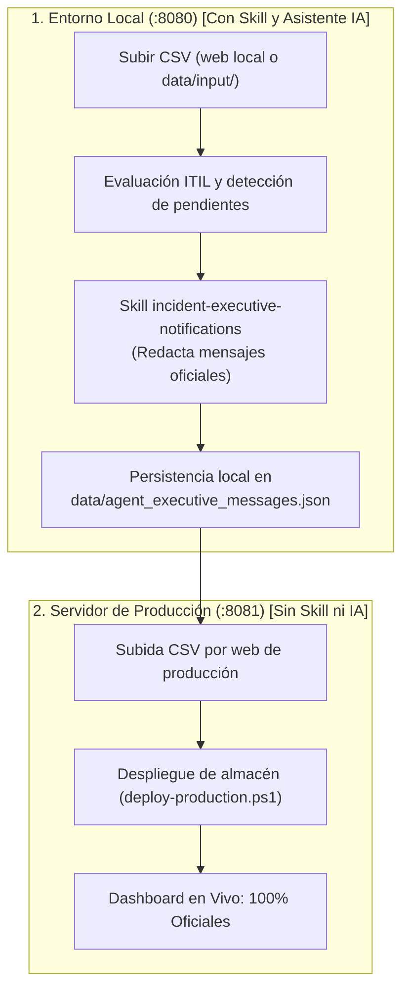
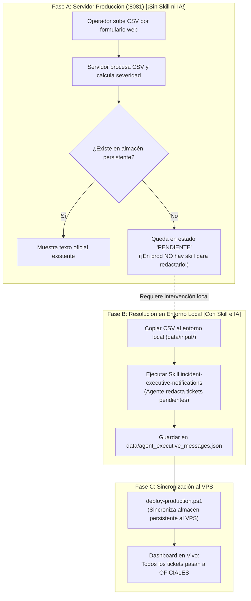

# Guía Operativa: Redacción y Despliegue de Notificaciones Ejecutivas de Incidencias

Esta guía describe el procedimiento paso a paso que debes seguir **cada vez que recibas un nuevo fichero CSV de incidencias Remedy**, para redactar las comunicaciones oficiales de alta prioridad para Dirección (P1, P2 y discrepancias) y publicarlas de forma 100% segura y coherente en producción.

---

## 🎯 Principios y Reglas Clave

1. **El operador manda sobre los datos (Single Source of Truth):**
   * El CSV se procesa **primero en local** para redactar y revisar los mensajes sin prisa.
   * La publicación en producción es una **acción controlada y desacoplada** de la redacción.
2. **Estándar Ejecutivo Estricto:**
   * **Mensaje para Dirección:** Exactamente **1 único párrafo**, máximo **90 palabras**.
   * **Versión breve (SMS / Guardia):** Máximo **30 palabras**.
   * **Regla Anti-Alucinación:** No inventar horas, causas técnicas ni cifras de afectados no presentes en el ticket.
3. **Persistencia Acumulativa:**
   * Todos los mensajes redactados por la IA se guardan de por vida en `data/agent_executive_messages.json` para que nunca se pierdan ni se sobreescriban al subir nuevos ficheros.

---

## 🗺️ Mapa Visual de Procesos

### ESCENARIO 1: Flujo Habitual (Local Primero -> Producción)



---

### ESCENARIO 2: Subida Directa por Web en Producción



---

## 🛠️ Procedimiento Paso a Paso

### ESCENARIO 1: Flujo Habitual (Preparación en Local -> Publicación en Producción)

#### FASE 1: Entorno Local (Preparación y Redacción)

#### Paso 1: Ingesta del nuevo CSV en Local (Elige una opción)

* **Opción A (Recomendada: A través del Formulario Web Local):**
  1. Asegúrate de tener arrancado el servidor local: `python serve_app.py` (puerto `8080`).
  2. Abre en tu navegador el dashboard local de incidencias masivas:  
     **[http://localhost:8080/dashboards/massive-incidents/](http://localhost:8080/dashboards/massive-incidents/)**  
     *(o el Portal Central: [http://localhost:8080/dashboards/portal/](http://localhost:8080/dashboards/portal/))*.
  3. En la barra superior, haz clic en **"Seleccionar archivo"** (o arrastra el CSV).
  4. La aplicación web local automáticamente:
     * Guarda el CSV en `data/input/`.
     * Convierte el archivo a JSON masivo en `data/output/`.
     * Dispara en segundo plano `evaluate_incident_notifications.py` actualizando el catálogo de alertas.
  * *¡Listo! Si usas esta opción, puedes saltar directamente al Paso 3.*

* **Opción B (Alternativa manual por terminal):**
  1. Copia tu nuevo archivo CSV a la carpeta:
     ```text
     data/input/CS-Informe incidencias P1,  P2 y P3 - 2026 - <FECHA>.csv
     ```
  2. Ejecuta manualmente la evaluación de prioridades:
     ```powershell
     python converters/evaluate_incident_notifications.py
     ```

#### Paso 2: Escanear incidencias pendientes de redacción
Comprueba qué tickets de alta prioridad no disponen aún de mensaje oficial:
```powershell
python .agents/skills/incident-executive-notifications/scripts/scan_pending_incidents.py
```
*Si faltan tickets por redactar, el script listará los IDs, sistemas y el estado de enriquecimiento de Epsilon IA.*

#### Paso 3: Invocar la Skill de Asistente (Redacción IA)
Pide a Antigravity en el chat:
> *"He cargado un nuevo CSV de incidencias. Activa la skill incident-executive-notifications para redactar las comunicaciones oficiales pendientes."*

El asistente:
1. Inspeccionará los datos técnicos y resúmenes de Epsilon IA de cada ticket pendiente.
2. Adoptará el rol `incident-reporter` y redactará los dos niveles obligatorios ($\le 90$ palabras monopárrafo y $\le 30$ palabras breve).
3. Guardará automáticamente las salidas validadas en `data/agent_executive_messages.json` usando `update_agent_message.py`.

#### Paso 4: Revisión de Textos y Validación Humana (*Human-in-the-Loop*)
1. El asistente te presentará en el chat el resumen de todos los mensajes generados.
2. Si deseas ajustar manualmente la redacción de alguna incidencia concreta:
   ```powershell
   python converters/cli/update_agent_message.py --id INC000004XXXXXX --phase apertura --raw "**Mensaje para Dirección (versión completa):**
   Tu nuevo texto formal aquí...

   **Versión aún más breve:**
   P1: Alerta breve ajustada."
   ```
3. Verifica que el escáner informe que todo está listo:
   ```powershell
   python .agents/skills/incident-executive-notifications/scripts/scan_pending_incidents.py
   ```
   *(Debe mostrar: `✅ Todas las incidencias activas disponen de mensajes ejecutivos oficiales`)*

---

#### FASE 2: Servidor de Producción (Publicación y Sincronización)

Una vez que los mensajes y los datos están validados en local, sigue este orden para evitar desincronizaciones:

#### Paso 5: Subir el CSV en la web de producción
1. Abre tu navegador y accede al dashboard de incidencias masivas en producción:
   **[http://infocodes.si.orange.es:8081/dashboards/massive-incidents/](http://infocodes.si.orange.es:8081/dashboards/massive-incidents/)**
2. Haz clic en **"Seleccionar archivo"** y sube el mismo fichero CSV que procesaste en local.
3. Espera a que termine la barra de carga y la conversión a JSON en el servidor.

#### Paso 6: Desplegar y sincronizar el almacén al servidor
Ejecuta el script de despliegue desde PowerShell:
```powershell
powershell -ExecutionPolicy Bypass -File scripts/deploy-production.ps1 -AgentsLibraryPath . -SkipPush
```
*(Si deseas subir además los commits a Git, retira el flag `-SkipPush`)*.

**¿Qué hace este script en este paso?**
* Empaqueta el runtime y los catálogos actualizados.
* Sube el paquete al servidor VPS (`10.132.26.96`).
* **Sincroniza `agent_executive_messages.json`** y `high_priority_notifications.json` en el almacenamiento persistente `/infocodes/var/storage/release-dashboard/`.
* Reinicia el backend y realiza las comprobaciones de salud HTTP (todas en `200 OK`).

#### Paso 7: Verificación en Vivo
Accede al portal y comprueba que la campana de notificaciones y los modales ejecutivos muestran los textos redactados:
* **Portal Principal:** [http://infocodes.si.orange.es:8081/dashboards/portal/](http://infocodes.si.orange.es:8081/dashboards/portal/)
* **Incidencias Masivas:** [http://infocodes.si.orange.es:8081/dashboards/massive-incidents/](http://infocodes.si.orange.es:8081/dashboards/massive-incidents/)

---

### ESCENARIO 2: Subida Directa del CSV a través del Formulario Web en Producción

Este escenario ocurre cuando un operador o usuario **sube un nuevo CSV directamente desde el formulario web de producción** ([http://infocodes.si.orange.es:8081](http://infocodes.si.orange.es:8081)) antes de que los mensajes hayan sido procesados en local.

> [!IMPORTANT]
> **En el servidor de producción NO existen skills ni agentes de IA.**
> El VPS de producción (`10.132.26.96`) opera de manera puramente determinista (Python y Nginx). No tiene conexión a modelos de lenguaje (LLM), no dispone del asistente Antigravity, ni tiene desplegada la carpeta de skills (`.agents/`).
> Por este motivo, **la subida web en producción por sí sola NUNCA redacta comunicaciones oficiales**. Su único cometido es convertir el CSV, evaluar la severidad ITIL por reglas fijas y consultar si los tickets ya existen en el almacén persistente.

---

#### Fase A: Lo que ocurre automáticamente en Producción (¡Sin Skill ni IA!)

1. El backend web guarda el archivo en `/infocodes/var/storage/release-dashboard/input/` y genera el JSON masivo.
2. Automáticamente ejecuta `evaluate_incident_notifications.py` en el VPS.
3. **Comportamiento según el almacén persistente**:
   * **Incidencias ya redactadas previamente:** Se cargan desde `/infocodes/var/storage/release-dashboard/agent_executive_messages.json` mostrando su **texto oficial**.
   * **Incidencias nuevas:** Dado que en el VPS no hay ninguna skill para redactarlas, quedan marcadas con **`"estado": "pendiente"`** (con un badge de alerta y su prompt técnico preparado a la espera de redacción).

---

#### Fase B: Resolución de Tickets Pendientes en Local (Donde SÍ reside la Skill y el Asistente)

Para convertir esas incidencias pendientes en comunicaciones oficiales validadas, debes intervenir desde tu entorno de desarrollo local:

#### Paso 1: Disponer del fichero CSV en tu entorno local
Si ya tienes el fichero CSV en tu máquina:
* Cópialo a tu carpeta local `data/input/`.

*(Si no dispones del fichero localmente, descárgalo directamente del VPS por SCP)*:
```powershell
scp infocodes@10.132.26.96:"/infocodes/var/storage/release-dashboard/input/CS-Informe*.csv" data/input/
```

#### Paso 2: Evaluar y escanear los tickets pendientes en local
Ejecuta la evaluación ITIL local para identificar exactamente los tickets que quedaron pendientes en el servidor:
```powershell
python converters/evaluate_incident_notifications.py
python .agents/skills/incident-executive-notifications/scripts/scan_pending_incidents.py
```
El escáner listará las incidencias nuevas que requieren redacción.

#### Paso 3: Redactar los tickets pendientes con la Skill en Local
Pide al asistente en el chat local de Antigravity:
> *"He sincronizado el CSV subido a producción. Activa la skill incident-executive-notifications para redactar las incidencias pendientes."*

El asistente ejecutará la skill en local, adoptará el rol `incident-reporter`, redactará los mensajes (≤ 90 palabras para Dirección y ≤ 30 palabras versión breve) y los guardará en el almacén acumulativo local `data/agent_executive_messages.json`.

---

#### Fase C: Sincronización y Publicación en Producción

#### Paso 4: Desplegar el almacén actualizado a Producción
Sincroniza el almacén de mensajes con el servidor ejecutando el script de despliegue desde PowerShell:
```powershell
powershell -ExecutionPolicy Bypass -File scripts/deploy-production.ps1 -AgentsLibraryPath .
```
El script transferirá el almacén actualizado a `/infocodes/var/storage/release-dashboard/agent_executive_messages.json` y actualizará automáticamente el catálogo de notificaciones.

#### Paso 5: Verificación en el Navegador
Recarga la web en producción:
* **[http://infocodes.si.orange.es:8081/dashboards/massive-incidents/](http://infocodes.si.orange.es:8081/dashboards/massive-incidents/)**

Verás que las incidencias que antes figuraban en estado `"pendiente"` ahora muestran el badge verde con el texto oficial completo y breve listo para Dirección.

---

## 🖥️ Consola Operativa: Monitor de Incidentes Mayores (Cockpit Incident Manager)

Para facilitar la supervisión del estado de las redacciones de agente sin depender exclusivamente de comandos de terminal, el sistema cuenta con un **Frontal Web de Monitorización del Incident Manager** (*Cockpit IM*).

### Acceso a la Consola
* **Entorno de Desarrollo Local:** [http://localhost:8080/dashboards/incident-manager-monitor/](http://localhost:8080/dashboards/incident-manager-monitor/)
* **Entorno de Producción VPS:** [http://infocodes.si.orange.es:8081/dashboards/incident-manager-monitor/](http://infocodes.si.orange.es:8081/dashboards/incident-manager-monitor/)

> [!NOTE]
> **Aislamiento Estricto:** Esta herramienta es de uso exclusivo para el Incident Manager y el equipo de guardia operativa. **No aparece enlazada en el portal general público** (`/dashboards/portal/`) para mantener limpio el panel de negocio. Su acceso se realiza mediante URL directa o marcadores de navegador.

### Capacidades del Cockpit:
1. **Barra de KPIs en Tiempo Real:**
   * Contador de incidencias pendientes de redacción con alerta visual dinámica (rojo si $> 0$, verde si $= 0$).
   * Desglose de oficiales emitidos, total de activas, criticidad P1/P2 y discrepancias de triaje (subescalaciones N1).
2. **Cola Operativa Filtrable:**
   * Conmutador inmediato entre *"Solo Pendientes"* (vista por defecto enfocada al turno) y *"Todas las Activas"*.
   * Filtros dinámicos por Severidad (P1, P2), por Proceso Crítico de Negocio (6 procesos ITIL), checkbox de discrepancias y buscador de texto libre con respuesta instantánea.
3. **Inspección de Contexto y Copia de Prompts en 1 Clic:**
   * Muestra el Proceso Crítico y Criterio asignado, sistemas afectados y acceso directo al modal interactivo de Epsilon IA (`Ver Resumen Epsilon`).
   * Pestañas de Fase (`Apertura`, `Seguimiento`, `Cierre`) con visor del prompt precalculado para `incident-reporter` y botón **"Copiar Prompt para el Agente"** con feedback temporal al portapapeles.
4. **Asistente de Ingesta Integrado con Validación Reactiva:**
   * Contadores en vivo de longitud de palabras para la Versión Completa ($\le 90$ palabras, monopárrafo) y Versión Breve ($\le 30$ palabras).
   * Botón **"Guardar en Almacén Oficial"** que persiste directamente vía API en `data/agent_executive_messages.json` y regenera el catálogo en vivo.
   * Botón de contingencia **"Copiar Comando CLI"** que genera la sintaxis exacta de `update_agent_message.py` lista para pegar en terminal si se opera sin conectividad API.

---

## ❓ Preguntas Frecuentes y Diagnóstico (FAQ)

### 1. ¿Por qué la subida web de un CSV en producción no genera los textos del agente automáticamente?
* **Diseño sin LLM en el servidor**: Por motivos de gobernanza, costes y prevención de alucinaciones, en el VPS de producción no corre ningún modelo de lenguaje desatendido.
* **Separación de responsabilidades**: La redacción ejecutiva formal para Dirección la genera el agente `incident-reporter` en el entorno local (con supervisión humana).
* **Comportamiento esperado**: Cuando el backend web de producción procesa un CSV, evalúa la severidad ITIL y busca los mensajes en el almacén persistente `/infocodes/var/storage/release-dashboard/agent_executive_messages.json`. Cualquier incidencia nueva que no esté en dicho almacén se marca automáticamente como `"estado": "pendiente"` con su prompt técnico listo para ser procesado.

### 2. ¿Por qué al ejecutar `deploy-production.ps1 -SkipPush` no veía los ficheros JSON actualizados en producción?
* **Seguridad de Git**: El script de despliegue verifica que el estado de Git esté limpio (`git status --porcelain`). Si tienes modificaciones locales no commiteadas o una confirmación interactiva esperando en terminal, el script aborta antes de empaquetar o conectar por SSH al VPS.
* **Ubicación en el servidor**: Los datos persistentes no residen dentro del árbol de código estático de la release, sino en el storage desacoplado:
  * Notificaciones activas: `/infocodes/var/storage/release-dashboard/output/high_priority_notifications.json`
  * Almacén de redacciones: `/infocodes/var/storage/release-dashboard/agent_executive_messages.json`
* **Sincronización en el script**: Asegúrate de que el script copie tanto `high_priority_notifications.json` como `agent_executive_messages.json` hacia `$STORAGE_BASE` antes de recrear el symlink `data/`.

---

## 🧰 Comandos Útiles y Rescate (CheatSheet)

| Acción | Comando |
| :--- | :--- |
| **Escanear pendientes** | `python .agents/skills/incident-executive-notifications/scripts/scan_pending_incidents.py` |
| **Pendientes en formato JSON** | `python .agents/skills/incident-executive-notifications/scripts/scan_pending_incidents.py --json` |
| **Ver contexto y prompt de un ticket** | `python .agents/skills/incident-executive-notifications/scripts/scan_pending_incidents.py --id <INC>` |
| **Guardar redacción manual** | `python converters/cli/update_agent_message.py --id <INC> --phase apertura --raw "<texto>"` |
| **Guardar desde archivo borrador** | `python converters/cli/update_agent_message.py --id <INC> --phase apertura --file "borrador.txt"` |
| **Reevaluar notificaciones** | `python converters/evaluate_incident_notifications.py` |
| **Ejecutar tests unitarios** | `python -m pytest converters/tests/unit/test_update_agent_message.py -v` |
| **Desplegar a producción** | `powershell -ExecutionPolicy Bypass -File scripts/deploy-production.ps1 -AgentsLibraryPath .` |

---

## 📁 Archivos Involucrados

* **Almacén acumulativo de mensajes oficiales:** [`data/agent_executive_messages.json`](file:///c:/Users/jose.delafuente/proyectos/release-dashboard-application/data/agent_executive_messages.json)
* **Catálogo de notificaciones para el frontend:** [`data/output/high_priority_notifications.json`](file:///c:/Users/jose.delafuente/proyectos/release-dashboard-application/data/output/high_priority_notifications.json)
* **Skill de redacción:** [`.agents/skills/incident-executive-notifications/SKILL.md`](file:///c:/Users/jose.delafuente/proyectos/release-dashboard-application/.agents/skills/incident-executive-notifications/SKILL.md)
* **Escáner auxiliar:** [`.agents/skills/incident-executive-notifications/scripts/scan_pending_incidents.py`](file:///c:/Users/jose.delafuente/proyectos/release-dashboard-application/.agents/skills/incident-executive-notifications/scripts/scan_pending_incidents.py)
* **CLI de actualización:** [`converters/cli/update_agent_message.py`](file:///c:/Users/jose.delafuente/proyectos/release-dashboard-application/converters/cli/update_agent_message.py)
* **Script de despliegue:** [`scripts/deploy-production.ps1`](file:///c:/Users/jose.delafuente/proyectos/release-dashboard-application/scripts/deploy-production.ps1)

