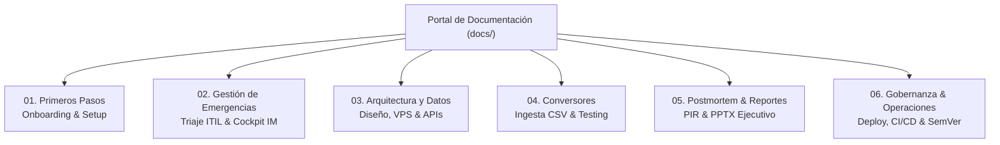

# Portal de Documentación Técnica y Operativa

📖 **Release Dashboard Application** · MasOrange / Orange Tech Operations

Bienvenido al centro unificado de documentación técnica, arquitectura de software, manuales tácticos de guardia y guías de despliegue para la suite de dashboards y gestión de emergencias IT.

---

## 🧭 Mapa General de Navegación

---

## 📚 Índice por Áreas Temáticas

### [01. Primeros Pasos y Entorno Local](01-primeros-pasos/README.md)
* **[Puesta en Marcha Rápida (Quickstart)](01-primeros-pasos/quickstart.md)**: Configuración en 5 minutos, venv, ejecución de `serve_app.py` en puerto `8080` y primeros comandos.
* **[Guía de Desarrollo](01-primeros-pasos/desarrollo.md)**: Manual técnico de desarrollo en Python 3.10+/3.11/3.12, linters (`flake8`, `black`, `isort`) y pre-commit.
* **[Diagnóstico y Troubleshooting](01-primeros-pasos/troubleshooting.md)**: Resolución paso a paso de fallos frecuentes en local, VPS, permisos de sockets y conversores.

### [02. Gestión de Emergencias IT y Triaje](02-gestion-emergencias/README.md)
* **[Triaje ITIL Automatizado](02-gestion-emergencias/triaje-itil-automatizado.md)**: Motor algorítmico determinista (`SeverityEvaluator`), 10 procesos críticos, cálculo de severidad SL1-SL4, reglas de oro y detección de discrepancias N1.
* **[Manual del Operador en Consola Operativa](02-gestion-emergencias/manual-consola-operativa.md)**: Manual táctico para el Incident Manager en `/dashboards/incident-manager-monitor/`: acciones en 1 clic (Remedy/War Room/IA), cronómetros anti-drift y cockpit de crisis.
* **[Flujo de Gestión de Incidencias](02-gestion-emergencias/flujo-gestion-incidencias.md)**: Ciclo de vida integral, estados operativos, escalados telefónicos (45m/105m) y gobernanza de workarounds autorizados por IM-CSO.
* **[Notificaciones Ejecutivas Oficiales](02-gestion-emergencias/notificaciones-ejecutivas.md)**: Protocolo oficial para Dirección mediante el agente `incident-reporter` ($\le 90$ palabras completo, $\le 30$ palabras breve) y actualización segura del catálogo.
* **[Especificación del Catálogo de Alta Prioridad](02-gestion-emergencias/catalogo-alta-prioridad.md)**: Detalle del contrato JSON `high_priority_notifications.json` (`_metadata` + `data`), campos y reglas de validación.

### [03. Arquitectura del Sistema y Contratos de Datos](03-arquitectura-y-datos/README.md)
* **[Estructura y Organización del Proyecto](03-arquitectura-y-datos/estructura-proyecto.md)**: Arquitectura atómica en producción (`releases/` + symlink `current`), storage desacoplado y matriz "quién sirve qué".
* **[Infraestructura y Requisitos VPS](03-arquitectura-y-datos/vps-infraestructura.md)**: Topología de red (`10.132.26.96:8081`), directivas Nginx y entorno compartido.
* **[Catálogo de APIs de Dashboards](03-arquitectura-y-datos/dashboards-api.md)**: Endpoints del backend, integraciones proxy con Epsilon Resumen IA y backend CSO (`:8000`).
* **[Migración y Evolución de Esquemas](03-arquitectura-y-datos/migracion-esquemas.md)**: Historial de evolución de datos JSON masivos y postmortem con retrocompatibilidad frontend.

### [04. Conversores y Tratamiento de Datos](04-conversores/README.md)
* **[Estructura de la Suite de Tests](04-conversores/estructura-tests.md)**: Organización de los más de 590 tests unitarios, fixtures comunes y aislamiento de ejecución.
* **[Buenas Prácticas de Testing](04-conversores/buenas-practicas-testing.md)**: Directrices para escribir nuevos tests en pytest, parametrización y mockeo.
* **[Rendimiento y Optimización](04-conversores/rendimiento.md)**: Streaming de ficheros masivos CSV, análisis de memoria y benchmarks de parsing.
* **[Diagrama de Estructura de Tests](04-conversores/test-structure-diagram.txt)**: Esquema visual de suites unitarias y de integración.

### [05. Postmortem, Reportes Ejecutivos y PIR](05-postmortem-y-reportes/README.md)
* **[Informe Ejecutivo PowerPoint Individual](05-postmortem-y-reportes/informe-ejecutivo-postmortem.md)**: Generación del informe PowerPoint ejecutivo individual por incidencia (Single Source of Truth en backend CSO y storage `/infocodes/var/storage/executive_pptx/`).
* **[Informe Postmortem Batch por Release](05-postmortem-y-reportes/informe-ppt-batch.md)**: Generación masiva batch del informe PPT postmortem por ventana de despliegue (PAP/MESA).

### [06. Operaciones, Despliegue y Gobernanza](06-operaciones-y-gobernanza/README.md)
* **[Manual Integral de Despliegue en VPS](06-operaciones-y-gobernanza/despliegue-vps.md)**: Empaquetado Standalone Runtime, ejecución de `deploy-production.ps1`, Zero Git en servidor y protocolo de rollback en 1 clic.
* **[Política de Gestión de Versiones](06-operaciones-y-gobernanza/gestion-versiones.md)**: SemVer 2.0.0, archivo `VERSION` y trazabilidad obligatoria mediante Git tags.
* **[Estándar de Logs y Auditoría](06-operaciones-y-gobernanza/logs-y-auditoria.md)**: Ubicación unificada en `/infocodes/var/log/`, estructura de eventos y políticas de rotación.
* **[Integración Continua (CI)](06-operaciones-y-gobernanza/integracion-continua-ci.md)**: Flujos automáticos de GitHub Actions (`tests.yml` y `lint.yml`) para ramas `main` y `production`.
* **[Protección de Ramas en GitHub](06-operaciones-y-gobernanza/proteccion-ramas.md)**: Reglas de protección estricta, revisiones obligatorias y status checks bloqueantes.
* **[Guía de Contribución](06-operaciones-y-gobernanza/contributing.md)**: Flujo de trabajo Git, ramas de características y estándares de código para colaboradores.

---

## 🎯 Catálogo de Dashboards del Sistema

| Dashboard | Ruta Relativa | Puerto Local / Prod | Propósito Principal |
| :--- | :--- | :--- | :--- |
| **Portal General Hub** | `/dashboards/portal/` | `:8080` / `:8081` | Centro neurálgico con buscador global, métricas agregadas y modal de Epsilon IA. |
| **Consola Emergencias IT (IM)** | `/dashboards/incident-manager-monitor/` | `:8080` / `:8081` | Consola operativa táctica aislada para el Incident Manager: triaje cuantitativo, ciclo de 4 estados, herramientas 1-clic y gobernanza de crisis. |
| **Incidencias Masivas** | `/dashboards/massive-incidents/` | `:8080` / `:8081` | Análisis temporal y evolutivo con gráficos Plotly y filtros avanzados. |
| **Postmortem / Despliegues** | `/dashboards/postmortem/` | `:8080` / `:8081` | Seguimiento de incidencias por release (PAP/MESA), tiempos de resolución y exportación. |
| **Release KPIs (Histórico)** | `/dashboards/release-kpis/` | `:8080` / `:8081` | Serie histórica de KPIs por release y análisis de tendencias. |
| **Reportes de Incidencias** | `/dashboards/reportes-incidencias/` | `:8080` / `:8081` | Gestión tabular, reportes de impacto y exportación de informes ejecutivos PowerPoint. |
| **Catálogo de Agentes IA** | `/dashboards/agents-catalog/` | `:8080` / `:8081` | Catálogo de agentes IA y skills, visor de prompts/fichas técnicas y generador de comandos CLI. |

---

## 💡 Visor Interactivo Web

Esta documentación está optimizada para leerse directamente en el repositorio de código o a través del visor web integrado (Docsify).
Para abrir la wiki interactiva local con buscador en tiempo real:

1. Ejecuta el servidor local: `python serve_app.py`
2. Abre en tu navegador: [http://localhost:8080/docs/](http://localhost:8080/docs/)
