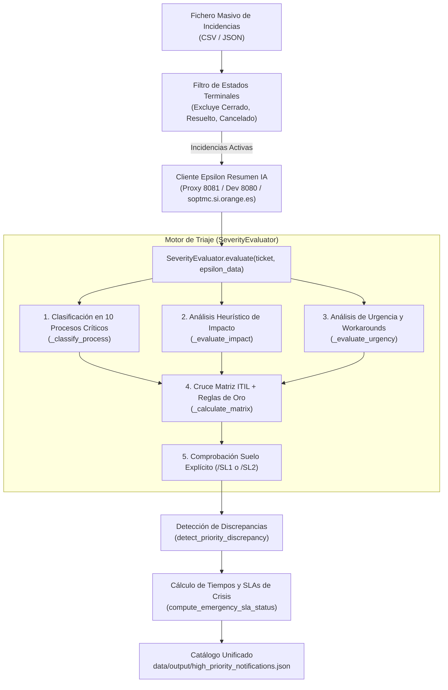
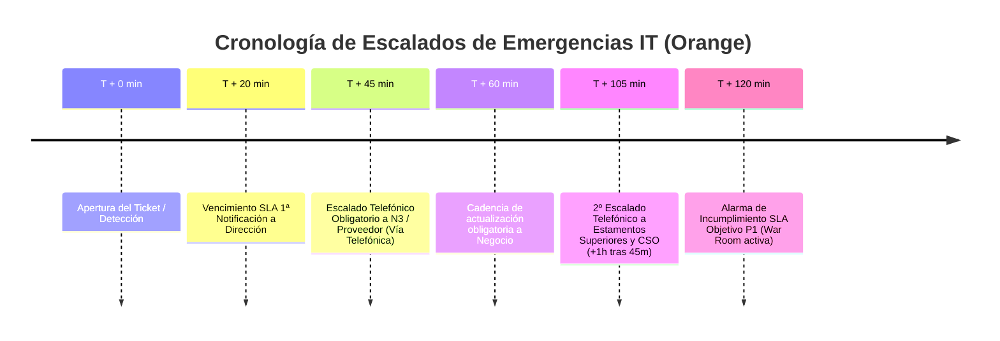

# Guía de Triaje ITIL Automatizado y Matriz de Criticidad

📖 **Manual técnico y operacional del motor de triaje determinista para la priorización y gestión de emergencias IT en Orange.**

---

## 1. Introducción y Propósito

En grandes infraestructuras de telecomunicaciones y servicios, la clasificación manual inicial de incidencias en soporte de primer nivel (**N1**) suele adolecer de dispersión y **subescalación**: incidencias con cortes severos o degradaciones críticas de frontales se catalogan nominalmente en Remedy como *Prioridad Media (P3)* o *Baja (P4)*, retrasando la intervención de los equipos de guardia y la convocatoria del Incident Manager.

El **Triaje ITIL Automatizado** es el motor algorítmico y determinista que evalúa el **impacto real sobre el negocio y los servicios** de cada incidencia activa, aplicando de forma estricta:
1. La **Matriz de Severidad y Criticidad IT** ([`.agents/skills/it-severity-matrix/SKILL.md`](file:///c:/Users/jose.delafuente/proyectos/release-dashboard-application/.agents/skills/it-severity-matrix/SKILL.md)).
2. El **Marco Operativo de Gestión de Emergencias IT de Orange** ([`.agents/skills/orange-it-emergency-management/SKILL.md`](file:///c:/Users/jose.delafuente/proyectos/release-dashboard-application/.agents/skills/orange-it-emergency-management/SKILL.md)).
3. La detección automática de **Discrepancias de Prioridad** (alertando al Incident Manager cuando la prioridad sugerida supera la nominal del ticket).

---

## 2. Arquitectura del Motor de Triaje

El motor se implementa en la clase [`SeverityEvaluator`](file:///c:/Users/jose.delafuente/proyectos/release-dashboard-application/converters/cli/evaluate_incident_notifications.py#L152) dentro de la utilidad CLI [`converters/cli/evaluate_incident_notifications.py`](file:///c:/Users/jose.delafuente/proyectos/release-dashboard-application/converters/cli/evaluate_incident_notifications.py):



---

## 3. Las 5 Fases del Algoritmo de Triaje

### Fase 1: Ingesta y Filtrado de Estados Terminales
El evaluador analiza cada ticket del informe masivo y descarta de forma inmediata los tickets en estados finales para no sobrecargar a los operadores ni desvirtuar los SLAs activos:
* Estados omitidos: `Cerrado`, `Cerrada`, `Closed`, `Resuelto`, `Resuelta`, `Resolved`, `Cancelado`, `Cancelada`, `Cancelled`, `Canceled`.
* Métrica resultante: `_metadata.kpis.terminal_skipped_count`.

### Fase 2: Enriquecimiento Contextual Dual (Remedy + Epsilon IA)
Para superar la brevedad o ambigüedad del título de Remedy, el evaluador construye un corpus textual unificado combinando:
* **Metadatos Remedy**: `Descripción`, `Impacto`, `Urgencia`, `Grupo Asignado`, `Fecha de Envío`.
* **Diagnóstico Epsilon IA**: `problema`, `impacto`, `solucion`, `sistemas`, `bloqueos`, `siguienteAccion`.

> [!NOTE]
> Gracias al cliente [`EpsilonClient`](file:///c:/Users/jose.delafuente/proyectos/release-dashboard-application/converters/cli/evaluate_incident_notifications.py#L762) con fallback inteligente y caché en disco ([`data/.epsilon_cache/`](file:///c:/Users/jose.delafuente/proyectos/release-dashboard-application/data/.epsilon_cache/)), si el microservicio Epsilon no estuviera disponible, el sistema degrada elegantemente y realiza el triaje usando únicamente los campos nativos de Remedy.

---

### Fase 3: Clasificación en los 10 Procesos Críticos de Negocio

La función `_classify_process` escanea el corpus del ticket y lo asigna a uno de los 10 dominios de criticidad de Orange:

| # | Proceso Crítico | Sistemas y Grupos Resolutores Típicos | Criterio de Activación de Emergencia (SL1) |
| :---: | :--- | :--- | :--- |
| **3.1** | **Atención al Cliente (ATC)** | `Ficha de Cliente Orange`, `DES_SOE_FICHA`, `APL_MOV_SOE`, `IVR`, `CTI`, `Siebel 8`, `CRM Jazztel`, `CRM4TELCO`, `LivePerson`, `Djingo`, `Onuris`. | Frontales/CRM con desviación >20% en 30 min, o IVR descartando >20% llamadas. |
| **3.2** | **Ventas** | `CERES`, `NEG_CAMP_CERES`, `ECONTRATO`, `PANGEA`, `Televenta`, `updateCommercialActSPA`, canal comercial. | Afectación >30% del volumen de operaciones, o caída >15% de ventas diarias. |
| **3.3** | **Prepago** | `RECARGAS APRS`, `OCS`, `SOP_OCS`, altas de líneas/eSIM prepago. | >10% de errores o >30 minutos sin recargas/altas. |
| **3.4** | **Portabilidad** | Flujo nocturno 2:00 AM, entidad de referencia, `POMV`, `NCRN`. | Fallo en arranque flujo 2 AM o >2 horas de retraso con entidad de referencia. |
| **3.5** | **Provisión y Cobertura** | `TEIDE`, `SOP_SMC_TEIDE`, `LUNA`, `IP24`, `SIGMA`, `ALTAIR a BRÚJULA`, `MYADDRESS`, `GIS Fibra`. | Órdenes en error (>20% móvil / >30% fijo), o 100% provisiones paradas >10 min. |
| **3.6** | **Facturación y Cobros** | `BSCS`, `OPEN COBROS`, `EXCALIBUR`, `HPFMS` (Fraude), `SAP`, `Mediación HP-IUM`. | >3 horas sin tarificación online, o indisponibilidad en ventana ±3 días de ciclo. |
| **3.7** | **Middleware Transversal** | `APIGEE`, `OPENAPI`, `TIBCO`, `GC Middleware`, `Datapower`, conectores `OCCI`, `SBL_EAI`. | Caída, saturación de hilos o errores masivos (504/500) en el bus de integración. |
| **3.8** | **Conectividad de Sedes y Tiendas** | `RTV-TECSE RED DATOS`, `GNOC`, circuitos `Ulises` y `Meneses`, Call Centers / `MSC`, tiendas. | Aislamiento total de sede/MSC, o caída simultánea de circuitos principal y backup. |
| **3.9** | **Infraestructura Core IT y Cloud** | `Atlas_Soporte_Unix` (`PSeries Power9`), `VMware ESX`, clúster `Exadata`, `OCI`, `GCP`, SAN `HWSAN`. | Corte troncal Cloud (OCI/GCP), o caída de servidor/hipervisor sin absorción por HA. |
| **3.10**| **Identidad y Automatización** | `GDU`, `EVIDIAN`, `GDU/ACM`, `ROBOTFACTORY`, SSO corporativo. | Caída global de autenticación/SSO o bloqueo en factoría de robots de backoffice. |

---

### Fase 4: Evaluación Heurística de Impacto, Urgencia y Workaround

#### A. Nivel de Impacto (`_evaluate_impact`)
* **Alto (`Alto`)**: 
  * Se activa si el ticket contiene expresiones de interrupción total: `caída total`, `corte total`, `indisponibilidad total`, `sin servicio`, `afectación global`, `bloqueo general`, `más del 50%`, `>50%`.
  * O si el campo nativo de Remedy es `Impacto: Masiva`.
  * *Excepción de seguridad*: Se degrada a `Bajo` si el texto indica explícitamente "fallo cosmético" o "error tipográfico".
* **Medio (`Medio`)**:
  * Se activa si hay términos de afectación parcial: `degradación`, `lentitud`, `retraso`, `parcial`, `10%`, `20%`, `30%`, `40%`.
  * O si el campo nativo de Remedy es `Impacto: Alto` o `Medio`.
* **Bajo (`Bajo`)**: Afectación acotada a componentes secundarios o usuarios aislados.

#### B. Nivel de Urgencia (`_evaluate_urgency`)
* **Detección de Workaround**:
  * `Sí`: El texto menciona `workaround`, `solución temporal`, `solucion alternativa`, `export alternativo`.
  * `No`: El texto indica expresamente `sin alternativa`, `sin workaround`.
  * `Desconocido`: No se dispone de mención explícita.
* **Alta (`Alta`)**: Presencia de términos críticos en vivo (`en curso`, `afectando en vivo`, `urgente`, `crítico`, `intervención inmediata`) o campo Remedy `Urgencia: Crítica` / `Alta`.
* **Media (`Media`)**: Incidencias en tratamiento activo (`en curso`, `asignado`) con contención operativa transitoria.
* **Baja (`Baja`)**: Baja sensibilidad temporal o sin bloqueo activo.

---

### Fase 5: Matriz de Cruce ITIL y Reglas de Oro de Orange

#### Matriz de Cruce Estándar
La función `_calculate_matrix(impact, urgency, has_workaround)` cruza las variables según la tabla normativa:

| Nivel de Impacto | Nivel de Urgencia | ¿Existe Workaround? | Prioridad Calculada | Severidad Oficial | SLA Máximo Resolución |
| :---: | :---: | :---: | :---: | :---: | :---: |
| **Alto** | **Alta** | Cualquiera | **P1** | **SL1 — Emergencia Crítica** | 120 min (2 h) |
| **Alto** | **Media** | Cualquiera | **P1** | **SL1 — Emergencia Crítica** | 120 min (2 h) |
| **Alto** | **Baja** | Cualquiera | **P2** | **SL2 — Incidencia Mayor** | 240 min (4 h) |
| **Medio** | **Alta** | Cualquiera | **P2** | **SL2 — Incidencia Mayor** | 240 min (4 h) |
| **Medio** | **Media** | **No** o **Desconocido** | **P2** | **SL2 — Incidencia Mayor** | 240 min (4 h) |
| **Medio** | **Media** | **Sí** | **P3** | **SL3 — Incidencia Menor** | 480 min (8 h) |
| **Medio** | **Baja** | Cualquiera | **P3** | **SL3 — Incidencia Menor** | 480 min (8 h) |
| **Bajo** | **Alta** / **Media** | Cualquiera | **P3** | **SL3 — Incidencia Menor** | 480 min (8 h) |
| **Bajo** | **Baja** | Cualquiera | **P4** | **SL4 — Informativa** | 1440 min (24 h) |

#### Las Reglas de Oro de Orange
1. **Principio de Precaución (Regla de Oro N1):**
   > En caso de duda sobre el alcance de una afectación en un proceso crítico, se clasifica preventivamente como **SL1 / P1**. Solo se desescalará cuando se confirme fehacientemente que el impacto es acotado.
2. **Suelo Mínimo por Etiquetado Explícito (`/SL1` y `/SL2`):**
   Si el título del ticket contiene la etiqueta `/SL1` (ej. `INDISPONIBILIDAD // FICHA // SL1`) o `/SL2`, el evaluador establece **P1** o **P2** como suelo mínimo no negociable, invalidando campos erróneos de Remedy (`Prioridad: Media` o `Urgencia: Baja`).
3. **Gobernanza Estricta de Workarounds:**
   > [!WARNING]
   > La aplicación de un workaround en una incidencia de Impacto Alto **NO reduce automáticamente la severidad del ticket**. La emergencia SL1 solo se da por finalizada cuando el impacto sobre el negocio ha desaparecido en su totalidad y el Incident Manager con el CSO autorizan el cierre.

---

## 4. Detección de Discrepancias (Subescalación N1)

Una de las aportaciones más críticas del motor es la detección de tickets mal clasificados en origen:

```python
def detect_priority_discrepancy(original_priority: Optional[str], calculated_priority: str) -> bool:
    norm_orig = normalize_priority(original_priority)
    norm_calc = normalize_priority(calculated_priority)
    orig_rank = PRIORITY_RANKS.get(norm_orig, 3)   # P1=1, P2=2, P3=3, P4=4
    calc_rank = PRIORITY_RANKS.get(norm_calc, 3)
    # Si el rango calculado es menor (mayor severidad) que el original -> DISCREPANCIA
    return calc_rank < orig_rank
```

### Casos de Discrepancia Típicos
* **Subescalación Crítica (Ticket P3 $\to$ Triaje P1):**
  Un operador registra en Remedy un ticket como *Prioridad Media (P3)* con título `FICHA DE CLIENTE // SEVILLA // ERROR FUNCIONAL`. El triaje detecta que afecta a 20+ sedes y 1.500 operadores en proceso crítico ATC $\to$ Se reclasifica de oficio a **P1 (SL1)** y se marca `es_discrepancia = true`.
* **Pérdida de Redundancia (Ticket P3 $\to$ Triaje P2):**
  Caída de un circuito de sede o nodo de hipervisor que mantiene el servicio por el circuito de backup $\to$ Se clasifica como **P2 (SL2)** para alertar del riesgo de corte total ante un segundo fallo.

---

## 5. Control de SLAs Operativos y Escalados de Crisis

Para cada ticket evaluado en alta prioridad (P1, P2 o Discrepancia), la función `compute_emergency_sla_status` calcula los cronómetros oficiales de Orange IT Emergency Management:



* **`minutos_desde_apertura`**: Tiempo transcurrido desde la creación en Remedy.
* **`sla_primera_notificacion_vencido`**: `True` si han transcurrido más de **20 minutos** sin emitir comunicación oficial.
* **`requiere_escalado_telefonico`**: `True` si han transcurrido **$\ge$ 45 minutos** (exige llamada telefónica obligatoria, no correo ni chat).
* **`escalado_estamentos_superiores`**: `True` si han transcurrido **$\ge$ 105 minutos** (45 min + 1 hora adicional sin resolución).

---

## 6. Salida Estructurada en el Catálogo JSON

El resultado del triaje se almacena dentro de cada incidencia en el campo `"evaluacion"` del fichero [`high_priority_notifications.json`](file:///c:/Users/jose.delafuente/proyectos/release-dashboard-application/data/output/high_priority_notifications.json):

```json
{
  "id": "INC000004122710",
  "titulo": "FICHA DE CLIENTE // OEST OVIEDO // ERROR FUNCIONAL",
  "sistemas": ["Ficha de Cliente", "TEIDE", "PeopleSoft", "MDG", "Siebel 8"],
  "prioridad_original": "Media",
  "prioridad_sugerida": "P1",
  "es_alta_prioridad": true,
  "es_discrepancia": true,
  "evaluacion": {
    "proceso": "Atención al Cliente (ATC)",
    "criterio": "ATC (3.1): Frontales/CRM (>20% desviación en 30m) o Regla de Oro N1",
    "impacto": "Alto",
    "impacto_justificacion": "Afectación crítica o corte global sobre el servicio principal sin alternativa viable.",
    "urgencia": "Alta",
    "urgencia_justificacion": "Impacto activo en vivo que requiere restablecimiento inmediato.",
    "workaround": "No",
    "workaround_gobernanza": "Sin workaround (Resolución directa requerida)",
    "sla_objetivo_minutos": 120,
    "fecha_apertura": "14/10/2026 13:26",
    "minutos_desde_apertura": 4240,
    "sla_primera_notificacion_vencido": true,
    "requiere_escalado_telefonico": true,
    "escalado_estamentos_superiores": true,
    "proxima_ventana_update_minutos": 20
  }
}
```

---

## 7. Ejecución y Diagnóstico CLI

El triaje se ejecuta automáticamente en cada subida de CSV o puede ejecutarse manualmente desde la consola:

### Modo estándar (con fallback inteligente a Epsilon IA)
```powershell
python converters/cli/evaluate_incident_notifications.py
```

### Forzar fichero de entrada específico y salida
```powershell
python converters/cli/evaluate_incident_notifications.py `
    --input "data/output/CS-Informe incidencias P1,  P2 y P3 - 2026 - 30 Oct 2026-massive.json" `
    --output "data/output/high_priority_notifications.json"
```

### Ejecución en modo simulador (Dry Run)
Permite inspeccionar los KPIs de triaje y discrepancias en pantalla sin escribir en disco:
```powershell
python converters/cli/evaluate_incident_notifications.py --dry-run
```

---

## 8. Documentos y Referencias Relacionadas

* **[CATALOGO-INCIDENCIAS-ALTA-PRIORIDAD.md](CATALOGO-INCIDENCIAS-ALTA-PRIORIDAD.md)**: Especificación técnica integral del catálogo JSON `high_priority_notifications.json`.
* **[INCIDENT-EXECUTIVE-NOTIFICATIONS-WORKFLOW.md](INCIDENT-EXECUTIVE-NOTIFICATIONS-WORKFLOW.md)**: Flujo de redacción de mensajes oficiales para Dirección con la skill `incident-executive-notifications`.
* **[MANUAL-OPERADOR-CONSOLA-OPERATIVA.md](MANUAL-OPERADOR-CONSOLA-OPERATIVA.md)**: Manual del Incident Manager en la Consola de Emergencias IT.
* **[it-severity-matrix SKILL.md](file:///c:/Users/jose.delafuente/proyectos/release-dashboard-application/.agents/skills/it-severity-matrix/SKILL.md)**: Matriz cuantitativa oficial de severidades IT.
* **[orange-it-emergency-management SKILL.md](file:///c:/Users/jose.delafuente/proyectos/release-dashboard-application/.agents/skills/orange-it-emergency-management/SKILL.md)**: Protocolos operativos de escalado, War Room y gobernanza RACI.

