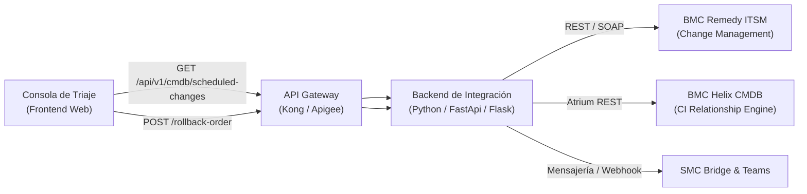

# Especificación Técnica de API REST: Consulta de Trabajos Programados (PaP / CRQ) y Rollback

**Código del Documento:** `SPEC-API-REMEDY-PAP-01`  
**Versión:** 1.0.0  
**Fecha:** 30 de Octubre de 2026  
**Área Responsable:** Orange IT Tech Operations / SMC Architecture & Automation  
**Estado:** Definición Técnica de Interfaz (Ready for Implementation / Mock Replacement)  
**Consumidor:** Consola de Triaje de Emergencias IT (`dashboards/emergency-triage-console/triage.js`)  

---

## 1. Objetivo y Alcance

El propósito de esta especificación es definir los contratos de interfaz REST, modelos de datos y directivas de seguridad para la sustitución del catálogo estático de datos simulados (`data/scheduled_changes_pap.json`) por un servicio backend real conectado a **BMC Helix ITSM (Remedy Change Management)** y la **CMDB de Orange**.

Esta integración permite al **Módulo 2 (Orquestador del Proceso Operativo de Emergencias)**:

1. **Cruzar automáticamente** en tiempo real los sistemas y CIs afectados por una incidencia declarada en **SL1/P1** con las peticiones de cambio (**CRQ / PaP**) ejecutadas en las últimas horas (ventana estándar: 6 horas).
2. **Proveer información auditable** del plan de reversión (*Rollback Plan*), tiempos de ejecución y contactos de guardia de soporte resolutor.
3. **Despachar órdenes formales de rollback** desde la consola al SMC Operations Bridge y a los equipos resolutores.

> [!IMPORTANT]
> **Cumplimiento de la Regla Anti-Alucinación (`AGENTS.md`):**  
> Todo dato de cambio, tiempo estimado o contacto que no proceda de la respuesta certificada de este API debe llevar el flag `is_mock: true` y la etiqueta visible `[MOCK / PENDIENTE API CMDB]`. Nunca se presentarán datos simulados como si fueran hechos de producción verificados.

---

## 2. Arquitectura de Integración



---

## 3. Catálogo de Endpoints

### 3.1. Consulta de Cambios Recientes (PaP / CRQ)

Permite consultar los trabajos programados y cambios de infraestructura ejecutados en una ventana horaria móvil sobre una lista de Configuration Items (CIs) o nombres de sistemas.

- **Método:** `GET`
- **Ruta:** `/api/v1/cmdb/scheduled-changes`
- **Autenticación:** Bearer Token (OAuth2 / JWT) con ámbito `operations:pap:read`

#### Parámetros de Consulta (Query Parameters)

| Parámetro | Tipo | Requerido | Valor por Defecto | Descripción |
| :--- | :--- | :--- | :--- | :--- |
| `systems` | `string` | **No** | *Vacío (todos)* | Lista de sistemas o CIs separados por coma (ej. `CRM4TELCO,Ficha multimarca`). |
| `window_hours` | `integer` | **No** | `6` | Ventana de inspección hacia atrás en horas (mín: `1`, máx: `48`). |
| `status` | `string` | **No** | `ALL_ACTIVE` | Filtro por estado del cambio: `EXECUTED`, `OBSERVATION`, `COMPLETED`, `ALL_ACTIVE`. |
| `risk` | `string` | **No** | `ALL` | Filtro por nivel de riesgo: `CRITICAL`, `HIGH`, `MEDIUM`, `LOW`, `ALL`. |
| `limit` | `integer` | **No** | `50` | Límite máximo de registros devueltos. |

#### Respuesta Exitosa (`200 OK`)

```json
{
  "_metadata": {
    "version": "1.0.0",
    "timestamp": "2026-10-30T19:30:00+01:00",
    "source": "Remedy ITSM Change Management API",
    "filter_window_hours": 6,
    "queried_systems": ["CRM4TELCO", "Ficha multimarca"],
    "total_changes": 1,
    "is_mock": false,
    "data_source_mode": "PRODUCTION_LIVE"
  },
  "changes": [
    {
      "crq": "CRQ000000190422",
      "titulo": "Despliegue parche v24.8 catálogo terminales y microservicios CRM4TELCO",
      "sistemas": ["CRM4TELCO", "Ficha multimarca"],
      "proceso_relacionado": "Atención al Cliente (ATC)",
      "fecha_ejecucion": "2026-10-30T17:15:00+01:00",
      "ventana": "Ventana Ordinaria (17:00 - 18:00)",
      "horas_desde_ejecucion": 2.25,
      "estado": "Ejecutado / En Observación",
      "responsable": "Laura Menéndez (DevOps CRM Digital)",
      "equipo": "Sistemas Comerciales y Frontales",
      "riesgo": "Medio",
      "rollback_plan": "Revertir despliegue de pods Kubernetes a la imagen v24.7 y reiniciar endpoints de sincronización con Ficha multimarca.",
      "tiempo_rollback_estimado": "12 minutos",
      "contacto_guardia": "Guardia CRM Frontales (+34 91 222 3401)",
      "is_mock": false,
      "data_source": "REMEDY_PROD",
      "mock_tag": null
    }
  ]
}
```

#### Respuestas de Error

- `400 Bad Request`: Parámetro `window_hours` fuera del rango permitido [1..48] o formato de fecha inválido.
- `401 Unauthorized`: Token no proporcionado o expirado.
- `403 Forbidden`: Permisos insuficientes para consultar la CMDB de operaciones.
- `502 Bad Gateway`: Error de conectividad temporal hacia BMC Remedy ITSM. En este caso el frontend recurrirá al modo fallback documentado.

---

### 3.2. Despacho de Orden Formal de Rollback

Permite al Incident Manager (IM) ordenar la reversión inmediata de un cambio ante una indisponibilidad de criticidad SL1/P1.

- **Método:** `POST`
- **Ruta:** `/api/v1/cmdb/scheduled-changes/{crq}/rollback-order`
- **Autenticación:** Bearer Token con ámbito `operations:pap:rollback`

#### Cuerpo de la Petición (`Content-Type: application/json`)

```json
{
  "incident_id": "INC000004171670",
  "ordered_by": "Carlos Morales",
  "role": "Incident Manager On-Call CSO",
  "reason": "Indisponibilidad crítica del proceso Atención al Cliente (ATC) tras despliegue de CRQ000000190422",
  "severity": "SL1",
  "client_timestamp": "2026-10-30T19:35:00+01:00"
}
```

#### Respuesta Exitosa (`201 Created`)

```json
{
  "status": "ORDER_REGISTERED_AND_DISPATCHED",
  "order_id": "RBO-20261030-94812",
  "crq": "CRQ000000190422",
  "incident_id": "INC000004171670",
  "dispatched_to": [
    {
      "channel": "SMC_OPERATIONS_BRIDGE",
      "status": "DELIVERED",
      "target": "smc-bridge@orange.com"
    },
    {
      "channel": "TEAMS_WAR_ROOM",
      "status": "ANNOUNCED",
      "target": "War Room INC000004171670"
    },
    {
      "channel": "REMEDY_WORKLOG",
      "status": "APPENDED",
      "entry_id": "WKL0000098172"
    }
  ],
  "server_timestamp": "2026-10-30T19:35:02+01:00",
  "is_mock": false
}
```

---

### 3.3. Consulta de Guardia On-Call (Incident Manager)

Permite consultar la asignación dinámica del Incident Manager en turno de guardia activo según los cuadrantes de Customer & Service Ops (CSO).

- **Método:** `GET`
- **Ruta:** `/api/v1/operations/on-call/incident-manager`

#### Respuesta Exitosa (`200 OK`)

```json
{
  "on_call_im": {
    "name": "Carlos Morales",
    "role": "Incident Manager On-Call",
    "shift": "Tarde / Turno Activo CSO",
    "shift_start": "2026-10-30T15:00:00+01:00",
    "shift_end": "2026-10-30T23:00:00+01:00",
    "phone": "+34 91 123 4567",
    "email": "carlos.morales@orange.com"
  },
  "is_mock": false
}
```

---

### 3.4. Generación Dinámica de Sala Microsoft Teams (Graph API)

Permite solicitar la reserva de un puente de War Room en Teams mediante la Microsoft Graph API oficial del tenant corporativo.

- **Método:** `POST`
- **Ruta:** `/api/v1/collaboration/teams/warroom`

#### Request Body

```json
{
  "incident_id": "INC000004171670",
  "subject": "War Room Orange IT · INC000004171670 · Emergencia P1",
  "organizer_email": "im-cso-coordinator@orange.com"
}
```

#### Response (`201 Created`)

```json
{
  "join_url": "https://teams.microsoft.com/l/meetup-join/...",
  "conference_id": "948123#",
  "dial_in_number": "+34 91 222 3400",
  "is_mock": false
}
```

---

## 4. Guía de Transición en el Frontend (`triage.js`)

Para pasar de los datos mock locales (`data/scheduled_changes_pap.json`) al consumo directo del API:

```javascript
// Sustitución en dashboards/emergency-triage-console/triage.js
async function loadScheduledChangesPaP(systems = []) {
  const querySystems = systems.length > 0 ? `?systems=${encodeURIComponent(systems.join(','))}` : '';
  const apiEndpoint = `/api/v1/cmdb/scheduled-changes${querySystems}`;

  try {
    const res = await fetch(apiEndpoint, {
      headers: {
        'Accept': 'application/json',
        'Authorization': 'Bearer ' + getSessionToken()
      }
    });

    if (res.ok) {
      const data = await res.json();
      if (data && Array.isArray(data.changes)) {
        state.paps = data.changes;
        state.papsMetadata = data._metadata || {};
        return;
      }
    }
  } catch (err) {
    console.warn('Fallo en conexión con API Remedy CMDB, activando dataset de contingencia/mock:', err);
  }

  // Fallback con marca explícita de mock
  loadMockPaPDataset();
}
```

---

## 5. Matriz de Auditoría y Verificación de Datos

| Componente | Origen de Datos Actual | Marca / Badge Actual | API Objetivo de Reemplazo |
| :--- | :--- | :--- | :--- |
| **Catálogo de Cambios Recientes** | `data/scheduled_changes_pap.json` | `🧪 Mock Data · Pendiente API CMDB` | `GET /api/v1/cmdb/scheduled-changes` |
| **Incident Manager Asignado** | `state.defaultIncidentManager` | `🧪 Mock On-Call · Pendiente API Guardias` | `GET /api/v1/operations/on-call/incident-manager` |
| **Enlace de Teams War Room** | Plantilla URL generada en cliente | `🧪 Mock Puente · Pendiente Graph API` | `POST /api/v1/collaboration/teams/warroom` |
| **Orden de Rollback Inmediato** | Simulación frontend & Bitácora local | Banner de advertencia en modal | `POST /api/v1/cmdb/scheduled-changes/{crq}/rollback-order` |

---
*Documento mantenido bajo la gobernanza del repositorio de operaciones y consola de triaje ITIL.*
