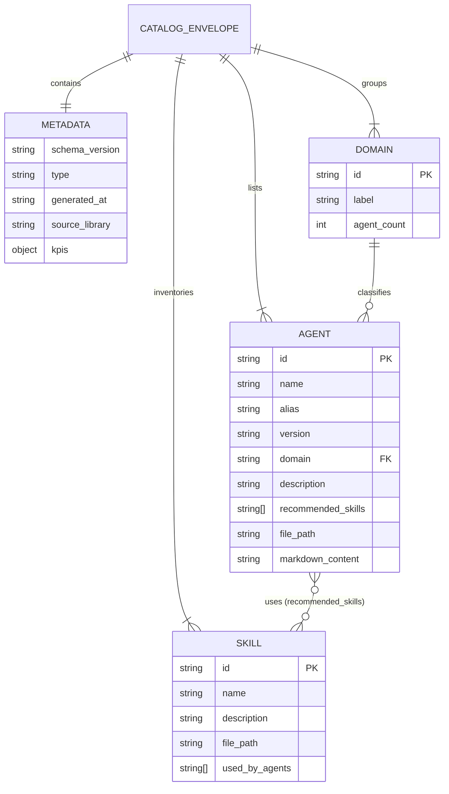

# Data Model: Catálogo y Dashboard de Agentes y Skills IA (011-agents-skills-catalog)

**Feature**: `011-agents-skills-catalog`
**Date**: 2026-10-22

---

## 1. Esquema General de Envelope (`CatalogEnvelope`)

El fichero generado en `data/output/agents_catalog.json` sigue el patrón canónico del proyecto:
- `_metadata`: Información de telemetría, auditoría, ruta de origen y KPIs agregados.
- `data`: Colecciones normalizadas de agentes, skills y dominios.

```json
{
  "_metadata": {
    "schema_version": "1.0.0",
    "type": "agents_catalog",
    "generated_at": "2026-10-22T16:00:00Z",
    "source_library": "C:\\Users\\jose.delafuente\\Claude\\Projects\\biblioteca-agentes",
    "kpis": {
      "total_agents": 5,
      "total_domains": 2,
      "total_skills": 6
    }
  },
  "data": {
    "domains": [ ... ],
    "agents": [ ... ],
    "skills": [ ... ]
  }
}
```

---

## 2. Entidades Principales

### 2.1 Entidad `Agent` (Agente IA)

Representa un agente declarativo definido en un archivo Markdown de la biblioteca.

| Campo | Tipo | Obligatorio | Descripción | Ejemplo |
| :--- | :--- | :---: | :--- | :--- |
| `id` | `string` | Sí | Identificador canónico (kebab-case) | `"incident-analyzer"` |
| `name` | `string` | Sí | Nombre del agente según frontmatter | `"incident-analyzer"` |
| `alias` | `string` | No | Nombre alternativo o alias en español | `"analizador-incidencias-it"` |
| `version` | `string` | Sí | Versión semántica del agente | `"1.2.0"` |
| `domain` | `string` | Sí | Dominio funcional al que pertenece | `"it-incidents"` |
| `domain_label` | `string` | Sí | Nombre legible del dominio | `"Incidencias IT"` |
| `description` | `string` | Sí | Resumen ejecutivo del rol del agente | `"Analiza incidencias y genera diagnósticos..."` |
| `recommended_skills`| `string[]` | Sí | Lista de identificadores de skills vinculadas | `["it-severity-matrix", "postmortem-pir-workflow"]` |
| `file_path` | `string` | Sí | Ruta relativa dentro del repositorio fuente | `"agents/it-incidents/incident-analyzer.md"` |
| `markdown_content` | `string` | No | Texto completo de las directrices e instrucciones | `"# Incident Analyzer Agent\n\n## Instrucciones..."` |
| `tools` | `string[]` | No | Lista de herramientas o plugins autorizados | `["read_file", "search_web"]` |

---

### 2.2 Entidad `Skill` (Habilidad Operativa)

Representa una skill definida en `.agents/skills/<nombre>/SKILL.md`.

| Campo | Tipo | Obligatorio | Descripción | Ejemplo |
| :--- | :--- | :---: | :--- | :--- |
| `id` | `string` | Sí | Identificador de la skill | `"it-severity-matrix"` |
| `name` | `string` | Sí | Nombre de la skill | `"it-severity-matrix"` |
| `description` | `string` | Sí | Propósito y condiciones de activación | `"Calcula y justifica el nivel de Severidad..."` |
| `file_path` | `string` | Sí | Ruta relativa del fichero | `".agents/skills/it-severity-matrix/SKILL.md"` |
| `used_by_agents` | `string[]` | Sí | Lista de agentes que requieren o recomiendan esta skill | `["incident-analyzer", "incident-reporter"]` |
| `markdown_content` | `string` | No | Contenido Markdown completo de la skill | `"# IT Severity Matrix..."` |

---

### 2.3 Entidad `Domain` (Dominio Temático)

Agrupación lógica de agentes para organización y filtrado.

| Campo | Tipo | Obligatorio | Descripción | Ejemplo |
| :--- | :--- | :---: | :--- | :--- |
| `id` | `string` | Sí | Clave única del dominio | `"it-incidents"` |
| `label` | `string` | Sí | Nombre para presentación visual | `"Gestión de Incidencias IT"` |
| `description` | `string` | No | Breve descripción del área de operaciones | `"Agentes para triaje, análisis y postmortems"` |
| `agent_count` | `number` | Sí | Número de agentes pertenecientes al dominio | `4` |
| `color_tag` | `string` | No | Color o clase visual asociada | `"tag-incident"` |

---

## 3. Diagrama de Relaciones



---

## 4. Modelos en Python (Pydantic / Dataclasses)

Para el script conversor `converters/cli/build_agents_catalog.py`:

```python
from dataclasses import dataclass, field
from typing import List, Dict, Any, Optional

@dataclass
class AgentModel:
    id: str
    name: str
    alias: str
    version: str
    domain: str
    domain_label: str
    description: str
    recommended_skills: List[str]
    file_path: str
    markdown_content: str = ""
    tools: List[str] = field(default_factory=list)

@dataclass
class SkillModel:
    id: str
    name: str
    description: str
    file_path: str
    used_by_agents: List[str] = field(default_factory=list)
    markdown_content: str = ""

@dataclass
class DomainModel:
    id: str
    label: str
    agent_count: int

@dataclass
class CatalogKPIs:
    total_agents: int
    total_domains: int
    total_skills: int

@dataclass
class CatalogMetadata:
    schema_version: str
    type: str
    generated_at: str
    source_library: str
    kpis: CatalogKPIs

@dataclass
class CatalogEnvelope:
    _metadata: CatalogMetadata
    data: Dict[str, Any]
```

