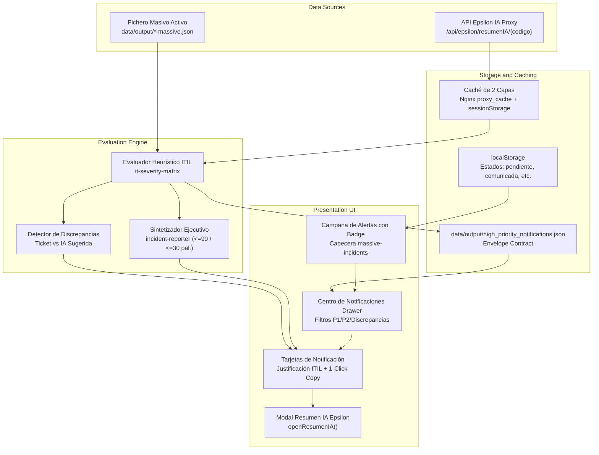

# Research & Technical Architecture: Sistema de Notificación de Incidencias de Alta Prioridad (012-high-priority-incident-notifications)

**Feature**: `012-high-priority-incident-notifications` | **Date**: 2026-10-26

---

## 1. Arquitectura del Flujo de Datos

---

## 2. Decisiones de Investigación y Alternativas Evaluadas

### Decisión 1: Integración Frontend vs Backend en la Evaluación
- **Alternativa A (Solo Backend)**: Un cron o servicio backend evalúa periódicamente y escribe un fichero JSON estático.
  - *Problema*: Si el usuario filtra por un subconjunto específico de incidencias en el dashboard o sube un CSV nuevo, no vería las notificaciones actualizadas hasta la siguiente ejecución batch.
- **Alternativa B (Solo Frontend)**: El navegador del usuario consulta Epsilon para cada fila y evalúa con JavaScript.
  - *Problema*: Al abrir el dashboard con 1.500 incidencias, el navegador dispararía cientos de peticiones, saturando Epsilon y ralentizando la carga inicial.
- **Decisión Adoptada (Híbrida Asíncrona Progresiva)**:
  1. **Pre-cálculo CLI / Backend**: Un conversor Python (`converters/cli/evaluate_incident_notifications.py`) genera `data/output/high_priority_notifications.json` pre-evaluando las incidencias abiertas/pendientes.
  2. **Evaluación Progresiva en Cliente**: `incident-notifications.js` carga ese JSON para ofrecer respuesta instantánea (0 ms). Al interactuar con el dashboard o al solicitar "Escanear / Actualizar", evalúa incidencias en cola con control de concurrencia (máx. 3 hilos) y caché en `sessionStorage` reutilizando el proxy existente `/api/epsilon/resumenIA/{codigo}`.

### Decisión 2: Implementación de la Matriz de Severidad (`it-severity-matrix`)
- **Regla oficial**: Cruce de Impacto en el Negocio (Alto, Medio, Bajo) $\times$ Urgencia Operativa (Alta, Media, Baja).
- **Criterios de extracción desde Epsilon IA y Ticket Masivo**:
  - **Impacto Alto**:
    - Epsilon `impacto` o `problema` contiene: `caída total`, `indisponibilidad masiva`, `bloqueo de autorizaciones`, `pasarela caída`, `pérdida de datos`, `afectación a más del 50%`, `crítico`, o `sin workaround`.
    - Ticket CSV: `Impacto` catalogado como `Masiva` y afectación troncal/core.
  - **Impacto Medio**:
    - Degradación severa, afectación parcial (10%-50%), lentitud con workaround manual.
  - **Impacto Bajo**:
    - Incidencias aisladas, consultas o entornos de pruebas (`DEV`, `QA`).
  - **Urgencia Alta**:
    - Incidencia abierta (`Estatus != 'Cerrado'`), en horario pico o afectación en curso en vivo.
  - **Urgencia Media**:
    - Operativa afectada pero contenida temporalmente unas horas.
  - **Urgencia Baja**:
    - Incidencia cerrada o cosmética.
- **Cruce ITIL**:
  - `Alto x Alta` $\rightarrow$ **P1 (Crítica)**
  - `Alto x Media` $\rightarrow$ **P1 (Crítica)** o **P2 (Alta)** (P1 si servicio cara a cliente)
  - `Alto x Baja` $\rightarrow$ **P2 (Alta)**
  - `Medio x Alta` $\rightarrow$ **P2 (Alta)**
  - `Medio x Media` $\rightarrow$ **P2** o **P3** (P2 si afecta departamento clave)
  - `Medio x Baja` $\rightarrow$ **P3 (Media)**
  - `Bajo x Alta/Media` $\rightarrow$ **P3 (Media)**
  - `Bajo x Baja` $\rightarrow$ **P4 (Baja)**
- **Filtro de Alta Prioridad**: Solo las incidencias con resultado **P1** o **P2** generan notificación activa.

### Decisión 3: Formato de Notificación Ejecutiva (`incident-reporter`)
- Cumple estrictamente con las reglas de [`agents/it-incidents/incident-reporter.md`](file:///c:/Users/jose.delafuente/proyectos/release-dashboard-application/agents/it-incidents/incident-reporter.md):
  - **Versión completa (Dirección)**: Un solo párrafo de **hasta 90 palabras**.
    - Estructura: `[Incidencia/Código] [Qué ha pasado] [Sistemas y usuarios afectados] [Impacto negocio] [Acciones en curso] [Próxima actualización/resolución estimada]`.
  - **Versión breve (Asunto / SMS)**: **Hasta 30 palabras**.
    - Estructura: `[P1/P2 - Código] [Impacto clave] [Estado actual]`.
  - **Fases operativas**: Apertura, Seguimiento, Cierre.
  - **Validación anti-alucinación**: Solo incorpora datos verificados en Epsilon o en el ticket; nunca inventa causas ni métricas.

### Decisión 4: Gestión de Estado y Persistencia Operativa
- Las notificaciones admiten los estados:
  - `pendiente`: Recién detectada, no gestionada (incrementa badge rojo en la campana).
  - `comunicada`: El operador ha generado y copiado el mensaje para emitirlo a Dirección.
  - `en_seguimiento`: Se están esperando actualizaciones o comité técnico.
  - `descartada`: Falso positivo o descartada por el operador con motivo registrado.
- Se persiste en `localStorage` bajo la clave `rd_incident_notifications_state_v1`, vinculada al código de incidencia y timestamp.

---

## 3. Consideraciones de Rendimiento y Seguridad

1. **Rendimiento de Red**:
   - Limitador de tasa: Máximo 3 peticiones concurrentes a `/api/epsilon/resumenIA/{codigo}` con una pausa de 100 ms entre lotes.
   - TTL de caché: 15 minutos en `sessionStorage` y en Nginx (`proxy_cache_valid 200 15m`).
   - Evita la saturación del servicio Epsilon de backend.
2. **Seguridad y XSS**:
   - Todo texto proveniente de Epsilon o del CSV se sanitiza mediante `escapeHtml` antes de insertarlo en el DOM.
   - La copia al portapapeles usa la API estándar `navigator.clipboard.writeText` con fallback a `textarea` oculto.

