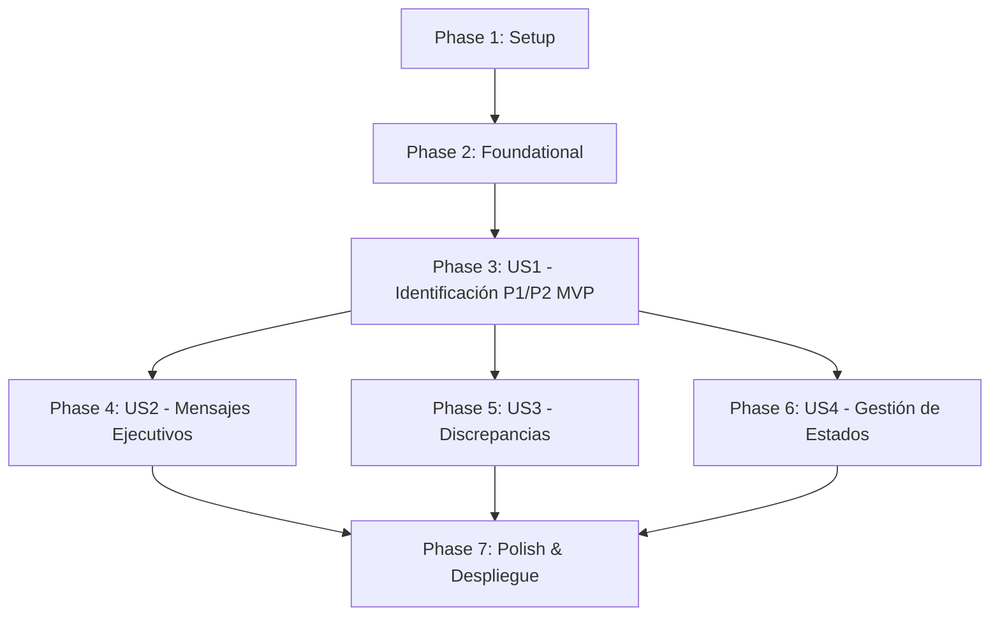

# Tasks: Sistema de Notificaciones de Incidencias de Alta Prioridad

**Feature**: `012-high-priority-incident-notifications` | **Date**: 2026-10-26  
**Input**: Design documents from [`specs/012-high-priority-incident-notifications/`](./plan.md)  
**Prerequisites**: [`plan.md`](./plan.md), [`spec.md`](./spec.md), [`research.md`](./research.md), [`data-model.md`](./data-model.md), [`contracts/`](./contracts/), [`quickstart.md`](./quickstart.md)

---

## Format: `[ID] [P?] [Story] Description`

- **[P]**: Ejecutable en paralelo (archivos independientes, sin bloqueo por dependencias previas).
- **[Story]**: Historia de usuario a la que pertenece (`[US1]`, `[US2]`, `[US3]`, `[US4]`).
- Todos los caminos de archivos son explícitos respecto a la raíz del repositorio.

---

## Phase 1: Setup (Shared Infrastructure)

**Purpose**: Preparación de estructura base, fixtures de prueba y estilos compartidos para el evaluador y el frontend.

- [x] T001 Inicializar estructura de archivos para el módulo CLI en `converters/cli/evaluate_incident_notifications.py` y assets frontend en `dashboards/assets/incident-notifications.js` y `dashboards/assets/incident-notifications.css`.
- [x] T002 [P] Crear archivo base de pruebas unitarias `converters/tests/unit/test_evaluate_incident_notifications.py` con fixtures de incidencias masivas y respuestas mock de Epsilon.
- [x] T003 [P] Crear archivo base de estilos corporativos `dashboards/assets/incident-notifications.css` con variables y tokens Orange (`#FF7900`, `#F16E00`, `#000000`).

---

## Phase 2: Foundational (Blocking Prerequisites)

**Purpose**: Infraestructura central que DEBE completarse antes de implementar las historias de usuario.

**⚠️ CRITICAL**: El evaluador por lotes y los componentes de visualización dependen de estos módulos fundamentales.

- [x] T004 Implementar cliente HTTP con caché local (`EpsilonClient`) en `converters/cli/evaluate_incident_notifications.py` con soporte para timeout, fallback silencioso si Epsilon está offline y persistencia en `data/.epsilon_cache/`.
- [x] T005 [P] Implementar el motor de inferencia de la Matriz de Severidad ITIL (`SeverityEvaluator`) en `converters/cli/evaluate_incident_notifications.py` aplicando el cruce Impacto $\times$ Urgencia conforme a [`contracts/severity-evaluation-contract.md`](./contracts/severity-evaluation-contract.md).
- [x] T006 [P] Implementar el serializador y validación de esquema del catálogo conforme a [`contracts/high-priority-notifications-contract.md`](./contracts/high-priority-notifications-contract.md) en `converters/cli/evaluate_incident_notifications.py`.

**Checkpoint**: Base funcional lista: cliente Epsilon, evaluador ITIL y validador de catálogo preparados para conectar con las historias de usuario.

---

## Phase 3: User Story 1 - Identificación y Visualización de Incidencias de Alta Prioridad (Priority: P1) 🎯 MVP

**Goal**: Permitir al operador identificar inmediatamente las incidencias masivas clasificadas como P1 (Crítica) y P2 (Alta) mediante evaluación con Epsilon y visualizarlas en el dashboard con campana y panel lateral.

**Independent Test**: Ejecutar el evaluador CLI sobre un lote de incidencias, generar `data/output/high_priority_notifications.json` y verificar en `dashboards/massive-incidents/` que la campana muestra el badge con el conteo de P1/P2 y el drawer despliega las tarjetas con su justificación ITIL y acceso al modal de Resumen IA.

### Tests for User Story 1 ⚠️

> **NOTA: Escribir estos tests primero y asegurar que fallen antes de completar la implementación.**

- [x] T007 [P] [US1] Tests unitarios de inferencia ITIL en `converters/tests/unit/test_evaluate_incident_notifications.py`:
  - `test_should_classify_p1_critical_when_high_impact_and_high_urgency`
  - `test_should_classify_p2_high_when_high_impact_and_medium_urgency`
  - `test_should_classify_p3_medium_when_low_impact_and_workaround_exists`
- [x] T008 [P] [US1] Tests unitarios de tolerancia a desconexión y fallback de Epsilon en `converters/tests/unit/test_evaluate_incident_notifications.py`:
  - `test_should_fallback_to_ticket_metadata_when_epsilon_unreachable`
  - `test_should_generate_valid_catalog_schema_when_batch_processed`

### Implementation for User Story 1

- [x] T009 [US1] Implementar función de procesamiento por lotes `evaluate_incidents_batch()` en `converters/cli/evaluate_incident_notifications.py` que lee el último archivo masivo desde `data/output/index.json` y genera `data/output/high_priority_notifications.json`.
- [x] T010 [US1] Implementar interfaz de línea de comandos en `converters/cli/evaluate_incident_notifications.py` con argumentos `--input`, `--output`, `--limit`, `--force` y `--dry-run`.
- [x] T011 [US1] Implementar en `dashboards/assets/incident-notifications.js` el componente de campana de notificaciones con badge dinámico para el header del dashboard.
- [x] T012 [US1] Implementar en `dashboards/assets/incident-notifications.js` y `dashboards/assets/incident-notifications.css` el drawer lateral accesible (apertura con animación suave, cierre con tecla Escape o botón de cerrar, lista de tarjetas P1/P2).
- [x] T013 [US1] Integrar la campana y carga de `incident-notifications.js` en `dashboards/massive-incidents/index.html` y conectar el botón de apertura del modal nativo `openResumenIA(id)`.

**Checkpoint**: User Story 1 funcional de forma independiente (MVP completado): evaluación CLI operativa, catálogo generado y Centro de Notificaciones visible con tarjetas P1/P2 en el dashboard.

---

## Phase 4: User Story 2 - Generación de Notificaciones Ejecutivas para Dirección (Priority: P2)

**Goal**: Generar automáticamente a partir del análisis propuestas de comunicación ejecutiva para Dirección en 3 fases (*Apertura*, *Seguimiento*, *Cierre*) con versiones completa ($\le$ 90 palabras) y breve ($\le$ 30 palabras) y copiado en 1 clic.

**Independent Test**: Seleccionar una incidencia en el drawer, abrir la pestaña de notificación ejecutiva, verificar que los textos de apertura, seguimiento y cierre cumplen con los límites de palabras monopárrafo y que el botón de copiar transfiere el contenido al portapapeles.

### Tests for User Story 2 ⚠️

- [x] T014 [P] [US2] Tests unitarios del generador de mensajes ejecutivos en `converters/tests/unit/test_evaluate_incident_notifications.py`:
  - `test_should_generate_single_paragraph_under_90_words_when_full_message_requested`
  - `test_should_generate_brief_message_under_30_words_when_brief_requested`
  - `test_should_include_required_elements_for_apertura_seguimiento_and_cierre`
  - `test_should_not_hallucinate_unknown_metrics_when_data_missing`

### Implementation for User Story 2

- [x] T015 [US2] Implementar el generador determinístico `ExecutiveMessageGenerator` en `converters/cli/evaluate_incident_notifications.py` conforme a [`contracts/executive-notification-contract.md`](./contracts/executive-notification-contract.md).
- [x] T016 [US2] Implementar en `dashboards/assets/incident-notifications.js` las pestañas interactivas de fases (*Apertura*, *Seguimiento*, *Cierre*) dentro del panel de detalle de cada tarjeta en el drawer.
- [x] T017 [US2] Implementar la función de copiado al portapapeles en 1 clic (`navigator.clipboard.writeText`) con feedback visual mediante tooltip ("Copiado al portapapeles") en `dashboards/assets/incident-notifications.js` y `dashboards/assets/incident-notifications.css`.

**Checkpoint**: User Story 2 funcional: mensajes ejecutivos generados automáticamente, validados en longitud y copiables al portapapeles desde el drawer.

---

## Phase 5: User Story 3 - Detección de Discrepancias de Prioridad (Priority: P3)

**Goal**: Identificar y resaltar visualmente incidencias cuya prioridad calculada por IA supera la prioridad asignada nominalmente en el ticket (ej. Ticket: P3 pero IA: P1/P2) y permitir su filtrado específico.

**Independent Test**: Cargar una incidencia masiva registrada como Media/P3 cuyo texto describe una caída crítica de servicio; verificar que el badge de discrepancia ("⚠️ Ticket: P3 → Calculada: P1") aparece destacado y que el filtro "Solo discrepancias" aísla estos casos.

### Tests for User Story 3 ⚠️

- [x] T018 [P] [US3] Tests unitarios de detección de discrepancias en `converters/tests/unit/test_evaluate_incident_notifications.py`:
  - `test_should_flag_discrepancy_when_ticket_is_p3_but_calculated_is_p1`
  - `test_should_not_flag_discrepancy_when_ticket_and_calculated_priorities_match`
  - `test_should_calculate_discrepancy_kpi_accurately_in_metadata`

### Implementation for User Story 3

- [x] T019 [US3] Implementar la función `detect_priority_discrepancy()` y cálculo de KPIs en el metadata del catálogo dentro de `converters/cli/evaluate_incident_notifications.py`.
- [x] T020 [US3] Implementar el badge visual de discrepancia y el botón de filtro "Solo discrepancias" en la barra superior del drawer en `dashboards/assets/incident-notifications.js` y `dashboards/assets/incident-notifications.css`.

**Checkpoint**: User Story 3 funcional: discrepancias identificadas en el catálogo y destacadas con badges y filtros en la interfaz.

---

## Phase 6: User Story 4 - Gestión del Estado de las Notificaciones y Persistencia (Priority: P4)

**Goal**: Permitir a los operadores marcar el estado de cada notificación (*Pendiente*, *Comunicada*, *En seguimiento*, *Descartada*), persistir estos cambios en `localStorage` y actualizar dinámicamente el badge de la campana.

**Independent Test**: Marcar una notificación P1 como "Comunicada", recargar la página del dashboard y verificar que la notificación se mantiene marcada y que el badge de la campana descuenta la notificación atendida.

### Implementation for User Story 4

- [x] T021 [P] [US4] Implementar el gestor de persistencia `NotificationStateManager` en `dashboards/assets/incident-notifications.js` con lectura y escritura en `localStorage` (`hp_incident_notifications_state_v1`).
- [x] T022 [US4] Implementar el selector de estado interactivo (*Pendiente*, *Comunicada*, *En seguimiento*, *Descartada*) en cada tarjeta del drawer en `dashboards/assets/incident-notifications.js`.
- [x] T023 [US4] Implementar actualización reactiva del contador del badge de la campana (descontando notificaciones que ya no están pendientes) y pestaña/filtro "Gestionadas" en `dashboards/assets/incident-notifications.js`.

**Checkpoint**: Todas las historias de usuario (US1-US4) implementadas, integradas y funcionales.

---

## Phase 7: Polish & Cross-Cutting Concerns

**Purpose**: Verificación integral, cumplimiento de la Constitución, rendimiento y automatización de despliegue.

- [x] T024 [P] Validar el flujo de operación documentado en [`specs/012-high-priority-incident-notifications/quickstart.md`](./quickstart.md) ejecutando el evaluador CLI en modo real y modo `--dry-run`.
- [x] T025 Ejecutar la suite completa de pruebas unitarias (`pytest converters/tests/unit/ -v`) asegurando que todos los tests pasen con cobertura $\ge 80\%$.
- [x] T026 [P] Integrar el paso de ejecución de `evaluate_incident_notifications.py` en el script de despliegue a producción `scripts/deploy-production.ps1`.
- [x] T027 Revisión final de estilos y tokens Orange (`#FF7900`), responsive design y navegación por teclado (cierre con tecla Escape, foco en inputs) en el Centro de Notificaciones.

---

## Dependencies & Execution Order

### Phase Dependencies

### User Story Dependencies

- **US1 (MVP)**: Depende únicamente de la Fase 2 (Foundational). Bloquea el resto de historias ya que proporciona el catálogo y el componente UI base.
- **US2**: Depende de US1 (agrega pestañas de mensajes ejecutivos y copiado sobre las tarjetas existentes).
- **US3**: Depende de US1 (agrega badges de discrepancia y filtros en el drawer). Puede desarrollarse en paralelo con US2.
- **US4**: Depende de US1 (añade persistencia local y selectores de estado a las tarjetas). Puede desarrollarse en paralelo con US2 y US3.

---

## Implementation Strategy

### MVP First (User Story 1 Only)
1. Completar Setup (T001-T003) y Foundational (T004-T006).
2. Completar User Story 1 (T007-T013).
3. **Validar MVP**: Ejecutar CLI, generar `high_priority_notifications.json` y verificar campana + drawer en `serve_app.py`.

### Incremental Delivery
1. Añadir US2 (Mensajes Ejecutivos y 1-click copy): T014-T017.
2. Añadir US3 (Detección de Discrepancias y filtros): T018-T020.
3. Añadir US4 (Gestión de Estados y persistencia en `localStorage`): T021-T023.
4. Pulido, tests completos y despliegue: T024-T027.

