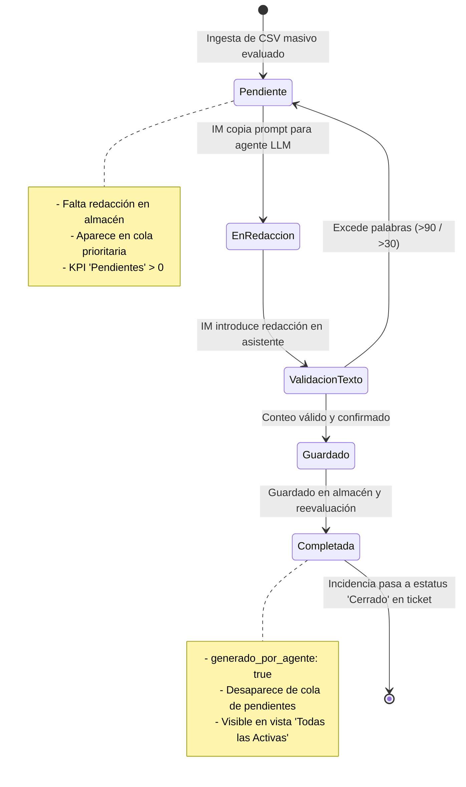

# Data Model: Frontal Web de Monitorización para Incident Manager (013-incident-manager-monitor)

**Feature**: `013-incident-manager-monitor` | **Date**: 2026-10-28  
**Spec Reference**: [`specs/013-incident-manager-monitor/spec.md`](./spec.md)

Este documento detalla los modelos de datos, esquemas JSON y representaciones de estado utilizadas por el Frontal de Monitorización del Incident Manager.

---

## 1. Entidad: `PendingIncidentQueueItem` (Vista de Incidencia en Cola)

Representación en el frontend de cada ticket evaluado que se clasifica como pendiente de redacción o disponible para supervisión activa.

```json
{
  "id": "INC000004168775",
  "titulo": "INDISPONIBILIDAD // MIDDLEWARE // SL1",
  "sistemas": [
    "SPAIN ALMACENAMIENTO"
  ],
  "prioridad_original": "Crítica",
  "prioridad_sugerida": "P2",
  "es_alta_prioridad": true,
  "es_discrepancia": false,
  "estatus": "Pendiente",
  "fecha_envio": "27/10/2026 18:21 a",
  "evaluacion": {
    "proceso": "Sistemas Core",
    "criterio": "SL2 Mayor: Degradación funcional o afectación en sede sin indisponibilidad global",
    "impacto": "Alto",
    "impacto_justificacion": "Afectación crítica o corte global sobre el servicio principal sin alternativa viable.",
    "urgencia": "Baja",
    "urgencia_justificacion": "Incidencia de baja sensibilidad temporal o sin bloqueo activo.",
    "workaround": "Desconocido",
    "sla_objetivo_minutos": 60
  },
  "resumen_ia": null,
  "tiene_epsilon": false,
  "is_pending": true,
  "fases": {
    "apertura": {
      "estado": "pendiente",
      "generado_por_agente": false,
      "prompt_agente": "Actúa como el agente incident-reporter (comunicación ejecutiva para Dirección, versión completa de hasta 90 palabras y versión breve de hasta 30 palabras)...",
      "completo": null,
      "breve": null,
      "conteo_palabras_completo": 0,
      "conteo_palabras_breve": 0
    },
    "seguimiento": {
      "estado": "pendiente",
      "generado_por_agente": false,
      "prompt_agente": "...",
      "completo": null,
      "breve": null,
      "conteo_palabras_completo": 0,
      "conteo_palabras_breve": 0
    },
    "cierre": {
      "estado": "pendiente",
      "generado_por_agente": false,
      "prompt_agente": "...",
      "completo": null,
      "breve": null,
      "conteo_palabras_completo": 0,
      "conteo_palabras_breve": 0
    }
  }
}
```

### Campos Clave:
- `id` (string): Identificador único Remedy (`INC00000XXXXXX`).
- `prioridad_sugerida` (string): `"P1"` o `"P2"`.
- `es_discrepancia` (boolean): `true` cuando `prioridad_sugerida` difiere de la nominal (subescalación o ajuste).
- `evaluacion.proceso` (string): Uno de los 6 procesos críticos de negocio de Orange:
  - `Atención al Cliente (ATC)`
  - `Venta y Contratación`
  - `Facturación y Cobros`
  - `Provisión y Activación`
  - `Servicios y Conectividad de Red`
  - `Sistemas Core`
- `evaluacion.criterio` (string): Umbral aplicado según la skill `it-severity-matrix`.
- `is_pending` (boolean): `true` si la fase `apertura` no tiene `generado_por_agente: true` o no figura en `agent_executive_messages.json`.

---

## 2. Entidad: `MonitorKPISummary` (Métricas de Cabecera)

Métricas calculadas en tiempo real para el resumen operativo del Incident Manager:

```typescript
interface MonitorKPISummary {
  total_active: number;        // Total incidencias activas de alta prioridad (P1 + P2)
  completed_count: number;     // Incidencias con mensaje oficial aprobado
  pending_count: number;       // Incidencias pendientes de redacción de agente
  p1_count: number;            // Total de críticas P1 activas
  p2_count: number;            // Total de altas P2 activas
  discrepancies_count: number; // Total con discrepancia de triaje detectada
  generated_at: string;        // ISO 8601 de la última ejecución del evaluador
  source_file: string;         // Nombre del fichero masivo origen (ej. '...28 Oct 2026-massive.json')
}
```

---

## 3. Entidad: `AgentMessageInputPayload` (Carga Útil de Guardado)

Estructura enviada desde el asistente de ingesta hacia la API de backend o generada en el comando CLI:

```json
{
  "incident_id": "INC000004168775",
  "phase": "apertura",
  "completo": "Se declara incidencia P2 (INC000004168775) por afectación en SPAIN ALMACENAMIENTO...",
  "breve": "Apertura P2 (INC000004168775): Degradación en middleware de almacenamiento...",
  "origen": "incident-reporter"
}
```

### Reglas de Validación en Esquema:
- `incident_id`: No vacío, formato `^INC\d{12}$` (case-insensitive).
- `phase`: Enum obligatorio: `"apertura"` | `"seguimiento"` | `"cierre"`.
- `completo`: String de texto no vacío.
  - Conteo de palabras: $1 \le \text{palabras} \le 90$.
  - Monopárrafo: Sin saltos de línea consecutivos (`\n\n`).
- `breve`: String de texto no vacío.
  - Conteo de palabras: $1 \le \text{palabras} \le 30$.

---

## 4. Entidad: `AgentExecutiveMessagesStore` (Almacén Persistente)

Fichero: `data/agent_executive_messages.json`

```json
{
  "_metadata": {
    "version": "1.0.0",
    "description": "Almacén oficial de redacciones ejecutivas generadas por el Agente incident-reporter",
    "source": "agents/it-incidents/incident-reporter.md",
    "updated_at": "2026-10-28T10:14:00Z"
  },
  "incidents": {
    "INC000004168775": {
      "apertura": {
        "completo": "...",
        "breve": "...",
        "generado_por_agente": true,
        "origen": "incident-reporter",
        "conteo_palabras_completo": 82,
        "conteo_palabras_breve": 24
      },
      "seguimiento": { ... },
      "cierre": { ... }
    }
  }
}
```

---

## 5. Estados y Transiciones de una Incidencia en el Monitor



