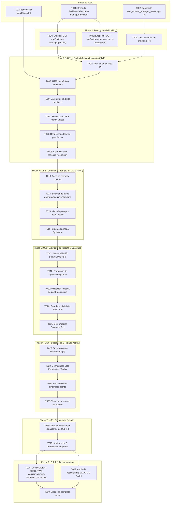

# Tasks: Frontal Web de Monitorización para Incident Manager

**Feature**: `013-incident-manager-monitor` | **Date**: 2026-10-28  
**Input**: Design documents from [`specs/013-incident-manager-monitor/`](./plan.md)  
**Prerequisites**: [`plan.md`](./plan.md), [`spec.md`](./spec.md), [`research.md`](./research.md), [`data-model.md`](./data-model.md), [`contracts/`](./contracts/), [`quickstart.md`](./quickstart.md)

---

## Format: `[ID] [P?] [Story] Description`

- **[P]**: Ejecutable en paralelo (archivos independientes, sin bloqueo por dependencias previas).
- **[Story]**: Historia de usuario a la que pertenece (`[US1]`, `[US2]`, `[US3]`, `[US4]`, `[US5]`).
- Todos los caminos de archivos son explícitos respecto a la raíz del repositorio.

---

## Phase 1: Setup (Shared Infrastructure)

**Purpose**: Preparación de la estructura de directorios, suite base de pruebas y archivos de estilos compartidos para el Frontal de Monitorización del Incident Manager.

- [x] T001 Crear estructura de directorios del nuevo frontal en `dashboards/incident-manager-monitor/`.
- [x] T002 [P] Crear archivo base de pruebas unitarias y de integración `converters/tests/unit/test_incident_manager_monitor.py` con fixtures mock de `high_priority_notifications.json` y `agent_executive_messages.json`.
- [x] T003 [P] Crear archivo base de estilos corporativos `dashboards/incident-manager-monitor/monitor.css` importando variables y estilos compartidos (`../assets/topbar.css`, `../assets/shared.css`, `../assets/resumen-ia.css`).

---

## Phase 2: Foundational (Blocking Prerequisites)

**Purpose**: Infraestructura backend y servicios API que DEBEN completarse antes de conectar la interfaz de usuario.

**⚠️ CRITICAL**: El frontal web y los tests de guardado dependen de los endpoints implementados en `serve_app.py`.

- [x] T004 Implementar endpoint `GET /api/incident-manager/pending` en `serve_app.py` conforme a [`contracts/incident-manager-api-contract.md`](./contracts/incident-manager-api-contract.md), calculando KPIs globales y filtrando incidencias con redacción pendiente.
- [x] T005 [P] Implementar endpoint `POST /api/incident-manager/save-message` en `serve_app.py` conforme a [`contracts/incident-manager-api-contract.md`](./contracts/incident-manager-api-contract.md), validando límites de palabras ($\le$ 90 palabras monopárrafo completo, $\le$ 30 palabras breve), invocando `update_agent_store()` y reevaluando el catálogo con `run_re_evaluation()`.
- [x] T006 [P] Tests unitarios de endpoints en `converters/tests/unit/test_incident_manager_monitor.py` verificando respuestas 200 OK, 400 Bad Request por sobrelongitud y cálculo correcto de KPIs.

**Checkpoint**: Endpoints `/api/incident-manager/pending` y `/api/incident-manager/save-message` operativos y validados con pruebas unitarias.

---

## Phase 3: User Story 1 - Cockpit de Detección y Monitorización de Incidencias Pendientes (Priority: P1) 🎯 MVP

**Goal**: Permitir al Incident Manager vigilar en tiempo real qué incidencias de alta prioridad activas (P1/P2) están pendientes de redacción de agente, mostrando métricas KPI globales y alertas de subescalación.

**Independent Test**: Cargar `/dashboards/incident-manager-monitor/` en el navegador y verificar que la barra de KPIs muestra el conteo exacto de pendientes, la cola exhibe las tarjetas con badges de severidad (P1 rojo, P2 ámbar, subescalación) y el estado vacío ("Zero Active Incidents") cuando no hay alertas pendientes.

### Tests for User Story 1 ⚠️

> **NOTA: Escribir estos tests primero y asegurar que fallen antes de completar la implementación.**

- [x] T007 [P] [US1] Tests unitarios de detección de incidencias pendientes y cálculo de KPIs en `converters/tests/unit/test_incident_manager_monitor.py`:
  - `test_should_identify_pending_incident_when_apertura_estado_is_pendiente`
  - `test_should_identify_pending_incident_when_not_in_agent_store`
  - `test_should_calculate_correct_kpis_summary_counts`
  - `test_should_detect_discrepancy_badge_when_ticket_nominal_is_lower`

### Implementation for User Story 1

- [x] T008 [US1] Implementar la estructura semántica HTML en `dashboards/incident-manager-monitor/index.html` (cabecera con título y auto-refresco, barra de KPIs, contenedor de cola `.queue-container` y plantilla de estado vacío).
- [x] T009 [US1] Implementar en `dashboards/incident-manager-monitor/monitor.js` la lógica de carga de datos híbrida (petición a `/api/incident-manager/pending` con fallback a fetch estático directo de `high_priority_notifications.json` y `agent_executive_messages.json`).
- [x] T010 [US1] Implementar en `dashboards/incident-manager-monitor/monitor.js` y `dashboards/incident-manager-monitor/monitor.css` el renderizado reactivo de la barra de KPIs (`.im-kpi-bar`) con alerta roja si pendientes $> 0$ y verde si $= 0$.
- [x] T011 [US1] Implementar en `dashboards/incident-manager-monitor/monitor.js` y `dashboards/incident-manager-monitor/monitor.css` el renderizado de tarjetas de incidencias pendientes con badges de criticidad (SL1 Rojo `#D32F2F`, SL2 Ámbar `#E65100`), badge de subescalación y SLA objetivo.
- [x] T012 [US1] Implementar selector de auto-refresco (Desactivado, cada 30s, cada 60s), botón de refresco manual e indicador visual de conectividad (`🟢 Conectado` / `🟡 Sincronizando` / `🔴 Sin conexión`) en `dashboards/incident-manager-monitor/monitor.js`.

**Checkpoint**: User Story 1 operativa de forma independiente (MVP completado): monitor funcional mostrando KPIs y lista reactiva de incidencias pendientes.

---

## Phase 4: User Story 2 - Inspección de Contexto Operativo y Copia del Prompt de Agente (Priority: P1) 🎯 MVP

**Goal**: Permitir al Incident Manager inspeccionar el desglose contextual de la incidencia (Proceso de Negocio, Criterio ITIL, Sistemas y Epsilon IA) y copiar en un solo clic el prompt preconfigurado de cada fase (`Apertura`, `Seguimiento`, `Cierre`) para el agente `incident-reporter`.

**Independent Test**: Pulsar sobre una tarjeta en la cola, alternar entre las pestañas "Apertura", "Seguimiento" y "Cierre", pulsar "Copiar Prompt para el Agente" y verificar que el portapapeles contiene el texto formateado con feedback visual temporal ("¡Prompt copiado!").

### Tests for User Story 2 ⚠️

- [x] T013 [P] [US2] Tests unitarios de generación y consistencia de prompts en `converters/tests/unit/test_incident_manager_monitor.py`:
  - `test_should_include_process_and_criterion_in_generated_prompt`
  - `test_should_include_systems_and_rules_in_prompt`
  - `test_should_contain_90_words_and_single_paragraph_instruction`

### Implementation for User Story 2

- [x] T014 [US2] Implementar en `dashboards/incident-manager-monitor/monitor.js` el selector de pestañas interactivas de fases (`Apertura`, `Seguimiento`, `Cierre`) dentro de cada tarjeta de incidencia.
- [x] T015 [US2] Implementar en `dashboards/incident-manager-monitor/monitor.js` y `dashboards/incident-manager-monitor/monitor.css` el visor de prompt con formato monoespaciado y botón `Copiar Prompt para el Agente` con `navigator.clipboard.writeText`, feedback temporal de 2 segundos y soporte accesible `aria-live="polite"`.
- [x] T016 [US2] Integrar el modal nativo de Epsilon IA en `dashboards/incident-manager-monitor/index.html` importando `dashboards/assets/resumen-ia.js` y `dashboards/assets/resumen-ia.css`, conectando el botón "Ver Resumen IA" a `window.openResumenIA(id)`.

**Checkpoint**: User Stories 1 y 2 operativas: contexto completo accesible y prompts de redacción ejecutiva listos para copiar en 1 clic.

---

## Phase 5: User Story 3 - Asistente de Ingesta y Persistencia en el Almacén Oficial (Priority: P2)

**Goal**: Proveer un asistente integrado en cada tarjeta para pegar las respuestas del agente, validar reactivamente el conteo de palabras ($\le$ 90 versión completa monopárrafo y $\le$ 30 versión breve), persistir en `data/agent_executive_messages.json` y regenerar notificaciones.

**Independent Test**: Pegar una redacción de prueba en el asistente de ingesta, verificar que los contadores validan en verde si cumplen o en rojo si superan los límites, pulsar "Guardar en Almacén Oficial" y constatar que la incidencia se marca como completada y desaparece de la cola de pendientes.

### Tests for User Story 3 ⚠️

- [x] T017 [P] [US3] Tests unitarios de validación de longitud de palabras y normalización monopárrafo en `converters/tests/unit/test_incident_manager_monitor.py`:
  - `test_should_validate_word_count_within_limits`
  - `test_should_reject_word_count_exceeding_90_words_for_complete`
  - `test_should_reject_word_count_exceeding_30_words_for_brief`
  - `test_should_normalize_multiple_paragraphs_into_single_paragraph`

### Implementation for User Story 3

- [x] T018 [US3] Implementar en `dashboards/incident-manager-monitor/monitor.js` y `dashboards/incident-manager-monitor/monitor.css` el componente colapsable del Asistente de Ingesta con áreas de texto para Versión Completa y Versión Breve.
- [x] T019 [US3] Implementar en `dashboards/incident-manager-monitor/monitor.js` la validación reactiva de palabras con listeners en evento `input`: contadores dinámicos "X/90 palabras" y "Y/30 palabras" con clases CSS `.valid` (verde) y `.invalid` (rojo).
- [x] T020 [US3] Implementar en `dashboards/incident-manager-monitor/monitor.js` la acción "Guardar en Almacén Oficial" enviando payload a `POST /api/incident-manager/save-message`, gestionando spinners de carga, confirmación y actualización reactiva de la cola.
- [x] T021 [US3] Implementar en `dashboards/incident-manager-monitor/monitor.js` el botón "Copiar Comando CLI" como mecanismo de contingencia para terminal, generando el comando `python converters/cli/update_agent_message.py --id <INC> --phase <FASE> --completo "..." --breve "..."` con codificación UTF-8 adecuada.

**Checkpoint**: User Story 3 operativa: ciclo completo de validación en vivo, guardado en almacén oficial y contingencia CLI disponible.

---

## Phase 6: User Story 4 - Supervisión Integral y Filtrado de Incidencias Activas (Priority: P2)

**Goal**: Permitir al Incident Manager o Coordinador de Turno alternar entre "Solo Pendientes" y "Todas las Activas", filtrando por severidad (P1 / P2), por Proceso de Negocio, por discrepancia o por búsqueda libre de ticket.

**Independent Test**: Conmutar a la vista "Todas las Activas", aplicar filtro por Proceso "Facturación y Cobros", escribir un ID de ticket en el buscador y verificar que la lista se filtra instantáneamente en cliente sin recargar la página.

### Tests for User Story 4 ⚠️

- [x] T022 [P] [US4] Tests de lógica de filtrado en cliente en `converters/tests/unit/test_incident_manager_monitor.py`:
  - `test_should_filter_by_severity_p1_and_p2`
  - `test_should_filter_by_critical_business_process`
  - `test_should_filter_by_search_query_matching_id_or_system`
  - `test_should_filter_only_discrepancies`

### Implementation for User Story 4

- [x] T023 [US4] Implementar en `dashboards/incident-manager-monitor/monitor.js` y `dashboards/incident-manager-monitor/index.html` el conmutador de pestañas de cola: **"Solo Pendientes"** (vista por defecto) y **"Todas las Activas"**.
- [x] T024 [US4] Implementar en `dashboards/incident-manager-monitor/monitor.js` y `dashboards/incident-manager-monitor/monitor.css` la barra de filtros dinámicos (selector de Severidad, selector de Proceso Crítico, checkbox de Solo Discrepancias e input de búsqueda en vivo con debounce de 150ms).
- [x] T025 [US4] Implementar en `dashboards/incident-manager-monitor/monitor.js` el visor de mensajes oficiales aprobados para incidencias completadas en la vista general (mostrando textos de Apertura, Seguimiento y Cierre registrados).

**Checkpoint**: User Story 4 operativa: filtrado instantáneo multidimensional y supervisión de incidencias activas con mensajes oficiales.

---

## Phase 7: User Story 5 - Aislamiento Estricto del Portal General (Priority: P3)

**Goal**: Garantizar que el Frontal de Monitorización del Incident Manager no aparezca en el menú ni en las tarjetas públicas del portal general (`dashboards/portal/index.html`), asegurando su uso exclusivo por el personal de operaciones.

**Independent Test**: Ejecutar test estático y comprobar que no existe ningún enlace, botón ni referencia a `incident-manager-monitor` en `dashboards/portal/index.html` ni en `dashboards/index.html`.

### Tests for User Story 5 ⚠️

- [x] T026 [P] [US5] Implementar test automatizado de aislamiento en `converters/tests/unit/test_incident_manager_monitor.py`:
  - `test_should_guarantee_zero_references_to_monitor_in_portal_index_html`
  - `test_should_guarantee_zero_references_to_monitor_in_root_index_html`
  - `test_should_guarantee_monitor_files_exist_in_dedicated_directory`

### Implementation for User Story 5

- [x] T027 [US5] Auditar y verificar que los archivos de portal (`dashboards/portal/index.html`, `dashboards/portal/portal.js`, etc.) permanezcan estrictamente intactos sin enlaces ni referencias hacia `incident-manager-monitor`.

**Checkpoint**: Aislamiento estricto verificado y protegido contra regresiones mediante tests automatizados.

---

## Phase 8: Polish & Documentation (Transversal)

**Purpose**: Documentación operativa para el equipo de Incident Management, validación de accesibilidad WCAG y ejecución de la suite completa de pruebas.

- [x] T028 [P] Actualizar la guía operativa [`docs/INCIDENT-EXECUTIVE-NOTIFICATIONS-WORKFLOW.md`](file:///c:/Users/jose.delafuente/proyectos/release-dashboard-application/docs/INCIDENT-EXECUTIVE-NOTIFICATIONS-WORKFLOW.md) documentando la URL directa de la herramienta (`/dashboards/incident-manager-monitor/`), el flujo de trabajo y la operativa del Incident Manager.
- [x] T029 [P] Validar accesibilidad WCAG 2.1 AA (contraste de colores corporativos `#FF7900` / `#000000` / `#D32F2F`, navegación por teclado con tabulación e indicador de foco visible) en `dashboards/incident-manager-monitor/monitor.css` y `dashboards/incident-manager-monitor/index.html`.
- [x] T030 Ejecutar suite de pruebas completa con `pytest converters/tests/unit/test_incident_manager_monitor.py -v` y validar 100% de éxito.

---

## Dependencies & Execution Graph

---

## Parallel Execution Opportunities

- **Fase 1 Setup**: `T002` (test base) y `T003` (estilos base) pueden realizarse en paralelo una vez creado el directorio (`T001`).
- **Fase 2 Foundational**: `T004` (endpoint GET) y `T005` (endpoint POST) operan en métodos diferentes de `serve_app.py` y pueden implementarse independientemente. `T006` puede redactarse en paralelo.
- **Fase 3 US1 (MVP)**: `T007` (tests) se ejecuta antes de la implementación; `T008` (HTML) y `T010` (CSS de KPIs) avanzan en paralelo.
- **Fase 4 US2**: `T013` (tests de prompts) y `T016` (integración Epsilon modal) pueden ejecutarse en paralelo con la lógica del selector de fases.
- **Fase 5 US3**: `T017` (tests de validación de palabras) y `T021` (generador CLI) son desacoplables.
- **Fase 6 US4**: `T022` (tests de filtros) y `T024` (diseño de selectores de filtro) son independientes.
- **Fase 7 US5**: `T026` (test estático de aislamiento) puede ejecutarse de manera inmediata.
- **Fase 8 Polish**: `T028` (documentación) y `T029` (accesibilidad) son tareas no bloqueantes que pueden correr en paralelo antes de la validación final `T030`.

