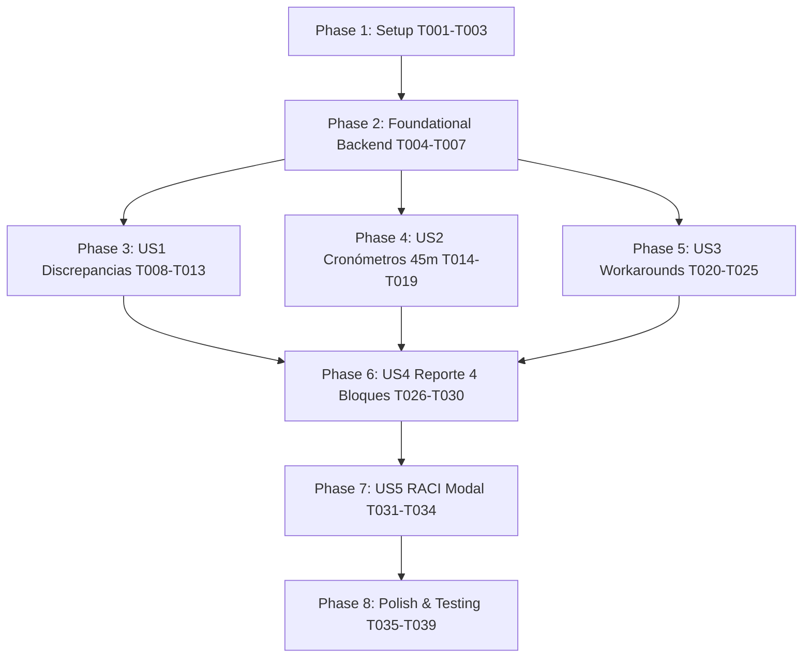

# Tasks: Consola Operativa de Emergencias Orange en Tiempo Real (014-emergency-operations-console)

**Input**: Design documents from [`specs/014-emergency-operations-console/`](./plan.md)  
**Prerequisites**: [`plan.md`](./plan.md), [`spec.md`](./spec.md), [`research.md`](./research.md), [`data-model.md`](./data-model.md), [`contracts/`](./contracts/), [`quickstart.md`](./quickstart.md)  

---

## Format: `[ID] [P?] [Story] Description`

- **[P]**: Ejecutable en paralelo (archivos independientes, sin bloqueo por dependencias previas).
- **[Story]**: Historia de usuario a la que pertenece (`[US1]`, `[US2]`, `[US3]`, `[US4]`, `[US5]`).
- Todos los caminos de archivos son explícitos respecto a la raíz del repositorio.

---

## Phase 1: Setup (Shared Infrastructure)

**Purpose**: Preparación de fixtures de prueba compartidas, constantes de emergencias y variables de diseño en la consola existente.

- [x] T001 [P] Crear fixtures de prueba con casos de emergencias SL1/SL2, discrepancias de facturación/provisión y workarounds en `converters/tests/unit/test_incident_manager_monitor.py`.
- [x] T002 [P] Definir constantes de estilo corporativo de emergencias (rojo SL1, ámbar SL2, candado de bloqueo, estilos monospaced para reportes) en `dashboards/incident-manager-monitor/monitor.css`.
- [x] T003 [P] Configurar constantes de tiempos y umbrales de los 6 Procesos Críticos de Negocio en `dashboards/incident-manager-monitor/monitor.js`.

---

## Phase 2: Foundational (Blocking Prerequisites)

**Purpose**: Infraestructura backend y servicios API que DEBEN completarse antes de desplegar las vistas de emergencias en la interfaz.

**⚠️ CRITICAL**: El frontal web y los tests de telemetría dependen de los endpoints implementados en `serve_app.py`.

- [x] T004 Implementar el endpoint `GET /api/incident-manager/emergency-cockpit` en `serve_app.py` conforme a [`contracts/emergency-console-api-contract.md`](./contracts/emergency-console-api-contract.md), devolviendo KPIs consolidados, timestamps epoch UTC y objetos enriquecidos de timeline y workaround.
- [x] T005 [P] Extender el endpoint existente `GET /api/incident-manager/pending` en `serve_app.py` para incluir `apertura_epoch_ms`, `discrepancia`, `timeline`, `workaround` y `reporte_emergencia` manteniendo compatibilidad hacia atrás.
- [x] T006 [P] Tests unitarios en `converters/tests/unit/test_incident_manager_monitor.py` verificando el contrato JSON y códigos de estado (200 OK, KPIs calculados) de los endpoints de `serve_app.py`.
- [x] T007 Implementar función centralizada de parseo de fechas Remedy (`DD/MM/YYYY HH:mm` y formatos 12h/24h) a epoch UTC en `dashboards/incident-manager-monitor/monitor.js`.

**Checkpoint**: Endpoints y base de datos temporal listos; la implementación de historias de usuario puede comenzar.

---

## Phase 3: User Story 1 - Detección y Análisis de Discrepancias con Métricas Cuantitativas Exactas (Priority: P1) 🎯 MVP

**Goal**: Identificar visualmente tickets subescalados en Remedy (Media/Baja) y mostrar la severidad real ITIL/Orange (SL1/SL2), el Proceso Crítico afectado y el umbral numérico exacto superado.

**Independent Test**: Cargar una incidencia discrepante (ej. `INC000004152079` o `INC000004169386`) y comprobar que la tarjeta despliega la tabla comparativa de severidades y el criterio numérico de facturación/provisión sin ambigüedad.

### Tests for User Story 1 ⚠️

> **NOTE: Escribir estos tests primero y asegurar que fallen antes de la implementación.**

- [x] T008 [P] [US1] Test unitario en `converters/tests/unit/test_incident_manager_monitor.py` que valide la extracción y formateo del Proceso Crítico y umbral cuantitativo para tickets con discrepancia.
- [x] T009 [P] [US1] Test de integración en `converters/tests/unit/test_incident_manager_monitor.py` que compruebe que los KPIs de discrepancia desglosan correctamente casos SL1 vs SL2.

### Implementation for User Story 1

- [x] T010 [P] [US1] Diseñar estilos CSS para la tabla de triaje comparativo (`.im-discrepancy-table`, badge de subescalación y bordes de criticidad) en `dashboards/incident-manager-monitor/monitor.css`.
- [x] T011 [US1] Implementar función de renderizado de la tabla de discrepancia con métricas exactas de los 6 Procesos Críticos en `dashboards/incident-manager-monitor/monitor.js`.
- [x] T012 [US1] Actualizar la tarjeta KPI de Discrepancias en `dashboards/incident-manager-monitor/index.html` para exhibir el total con desglose SL1/SL2.
- [x] T013 [US1] Conectar el filtro dinámico de la consola para permitir aislar "Solo Discrepancias Cuantitativas" en `dashboards/incident-manager-monitor/monitor.js`.

**Checkpoint**: User Story 1 operativa: el operador distingue al instante tickets subescalados y fundamenta el triaje en métricas exactas.

---

## Phase 4: User Story 2 - Cronometraje y Control de Tiempos de Escalado Telefónico (45 min y +1h) (Priority: P1) 🎯 MVP

**Goal**: Cronometrar en tiempo real los minutos transcurridos desde la apertura del ticket, disparando alertas de 1er escalado a los 45 min y de 2º escalado a +1h, recordando la Regla de Oro del canal telefónico obligatorio en SL1.

**Independent Test**: Simular un ticket con más de 45 minutos y otro con más de 105 minutos; verificar que los badges temporales muestran las alertas de escalado telefónico y el estamento convocado.

### Tests for User Story 2 ⚠️

- [x] T014 [P] [US2] Test unitario en `converters/tests/unit/test_incident_manager_monitor.py` que verifique la asignación de fases temporales (`<20m`, `45m`, `105m`) y el cálculo de minutos transcurridos.
- [x] T015 [P] [US2] Test unitario en `converters/tests/unit/test_incident_manager_monitor.py` que verifique que toda incidencia SL1 exige `canal_telefonico = true`.

### Implementation for User Story 2

- [x] T016 [P] [US2] Estilos CSS para cronómetros reactivos, animaciones de alerta pulsante (`.im-timer-pulse-warning`, `.im-timer-pulse-critical`) y banners de escalado en `dashboards/incident-manager-monitor/monitor.css`.
- [x] T017 [US2] Implementar el motor de cronometraje en vivo (`setInterval` cada 10 segundos con cálculo anti-drift sobre epoch) en `dashboards/incident-manager-monitor/monitor.js`.
- [x] T018 [US2] Implementar la lógica de evaluación de hitos (SLA 1ª notif <20m, 1er escalado 45m a N2/N3, 2º escalado 105m a Dirección vía IM-CSO) en `dashboards/incident-manager-monitor/monitor.js`.
- [x] T019 [US2] Añadir contadores KPI de "Alertas Escalado 45m" en `dashboards/incident-manager-monitor/index.html` vinculados reactivamente a las incidencias en alerta.

**Checkpoint**: User Stories 1 y 2 completadas: MVP funcional con detección de discrepancias y cronometraje de escalado en tiempo real.

---

## Phase 5: User Story 3 - Gobernanza de Workarounds y Bloqueo de Desescaladas Indebidas (Priority: P1)

**Goal**: Identificar mitigaciones provisionales (workarounds), auditar su autorización por Customer & Service Ops (IM-CSO) y bloquear en la UI cualquier desescalada o cierre indebido mientras el impacto persista.

**Independent Test**: Cargar una incidencia con mitigación provisional; comprobar que la interfaz muestra el banner con icono de candado, bloquea controles de desescalada y exige erradicación total o validación CSO.

### Tests for User Story 3 ⚠️

- [x] T020 [P] [US3] Test unitario en `converters/tests/unit/test_incident_manager_monitor.py` que valide el bloqueo de desescalada (`desescalada_bloqueada == true`) ante workarounds sin erradicación de impacto conforme a [`contracts/workaround-governance-contract.md`](./contracts/workaround-governance-contract.md).
- [x] T021 [P] [US3] Test unitario en `converters/tests/unit/test_incident_manager_monitor.py` verificando la detección de workarounds pendientes de autorización de IM-CSO.

### Implementation for User Story 3

- [x] T022 [P] [US3] Estilos CSS para el banner institucional de candado (`.im-gov-lock-banner`), badges de estatus CSO (`.badge-cso-pending`, `.badge-cso-approved`) en `dashboards/incident-manager-monitor/monitor.css`.
- [x] T023 [US3] Implementar la lógica de detección de workarounds y asignación de estados de gobernanza en `dashboards/incident-manager-monitor/monitor.js`.
- [x] T024 [US3] Implementar el bloqueo visual y funcional de desescalada (deshabilitación de selectores y renderizado del banner con la Regla de Oro) en `dashboards/incident-manager-monitor/monitor.js`.
- [x] T025 [US3] Añadir la tarjeta KPI "Workarounds Pendientes CSO" en `dashboards/incident-manager-monitor/index.html`.

**Checkpoint**: User Story 3 completada: Regla de Oro de gobernanza y bloqueo de desescalada plenamente operativa.

---

## Phase 6: User Story 4 - Consola Operativa en Tiempo Real con Reporte Normalizado de 4 Bloques (Priority: P2)

**Goal**: Visualizar y copiar en 1 clic el Reporte de Emergencia IT oficial en 4 bloques para su difusión a comités de crisis y canales de Teams.

**Independent Test**: Desplegar el reporte de emergencia en una tarjeta activa, verificar que contiene los 4 bloques estructurados y pulsar "Copiar Reporte", comprobando el contenido del portapapeles.

### Tests for User Story 4 ⚠️

- [x] T026 [P] [US4] Test unitario en `converters/tests/unit/test_incident_manager_monitor.py` verificando que el reporte de emergencia contiene las 4 secciones normalizadas obligatorias.

### Implementation for User Story 4

- [x] T027 [P] [US4] Estilos monospaced y contenedor colapsable tipo terminal (`.im-emergency-report-box`) en `dashboards/incident-manager-monitor/monitor.css`.
- [x] T028 [US4] Implementar el botón de despliegue/ocultación y el renderizado del Reporte de Emergencia en `dashboards/incident-manager-monitor/monitor.js`.
- [x] T029 [US4] Implementar la acción de copia en 1 clic del Reporte de Emergencia al portapapeles con feedback accesible en `dashboards/incident-manager-monitor/monitor.js`.
- [x] T030 [US4] Integrar selector de vistas en `dashboards/incident-manager-monitor/index.html` para alternar entre vista compacta y vista de emergencias expandida.

**Checkpoint**: User Story 4 completada: Reporte en 4 bloques accesible y listo para difusión operativa.

---

## Phase 7: User Story 5 - Panel de Mandos RACI y Enlaces a Matrices de Contacto (Priority: P3)

**Goal**: Facilitar la consulta inmediata de responsabilidades operativas (RACI: IM vs IM-CSO) y proveer enlaces a matrices de contacto en GRIAL (Orange) y Confluence (MasMóvil).

**Independent Test**: Pulsar sobre el botón "Protocolo & Contactos" en la cabecera y comprobar que se abre el modal/drawer con la tabla RACI y accesos a repositorios documentales.

### Implementation for User Story 5

- [x] T031 [P] [US5] Crear la estructura HTML del modal/drawer de gobernanza RACI y matrices de contacto en `dashboards/incident-manager-monitor/index.html`.
- [x] T032 [P] [US5] Estilos CSS accesibles para el modal/drawer (`.im-raci-modal`, `.im-raci-table`) en `dashboards/incident-manager-monitor/monitor.css`.
- [x] T033 [US5] Implementar los manejadores de apertura, cierre (vía teclado Escape y clic fuera) y accesibilidad ARIA en `dashboards/incident-manager-monitor/monitor.js`.
- [x] T034 [P] [US5] Test de aislamiento en `converters/tests/unit/test_incident_manager_monitor.py` garantizando que el portal general (`dashboards/portal/index.html`) no contenga referencias a esta consola.

**Checkpoint**: Todas las historias de usuario implementadas y operativas.

---

## Phase 8: Polish & Cross-Cutting Concerns

**Purpose**: Optimización del rendimiento del cliente, validaciones de accesibilidad WCAG 2.1 AA y verificación final de la suite de pruebas.

- [x] T035 [P] Auditar y optimizar el rendimiento del temporizador en `monitor.js` para asegurar que el uso de CPU permanezca por debajo del 1% con múltiples incidencias activas.
- [x] T036 [P] Comprobar el contraste de color WCAG 2.1 AA en badges de alerta roja/ámbar y en el banner de candado institucional en `monitor.css`.
- [x] T037 Ejecutar la suite completa de tests de la consola (`pytest converters/tests/unit/test_incident_manager_monitor.py -v`) y asegurar 100% de tests passing.
- [x] T038 Ejecutar las suites de evaluación de incidencias (`test_evaluate_incident_notifications.py` y `test_update_agent_message.py`) para confirmar ausencia de regresiones.
- [x] T039 [P] Actualizar la guía operativa [`docs/INCIDENT-EXECUTIVE-NOTIFICATIONS-WORKFLOW.md`](file:///c:/Users/jose.delafuente/proyectos/release-dashboard-application/docs/INCIDENT-EXECUTIVE-NOTIFICATIONS-WORKFLOW.md) reflejando las nuevas capacidades de la consola de emergencias Orange.

---

## Dependencies & Execution Order

### Parallel Opportunities

- **Phase 1**: `T001` (fixtures tests), `T002` (CSS constantes) y `T003` (JS constantes) pueden ejecutarse simultáneamente.
- **Phase 2**: `T005` (endpoint pending) y `T006` (tests backend) pueden ejecutarse en paralelo una vez definida la firma de `T004`.
- **Phase 3 (US1)**: `T008` (test unitario) y `T010` (estilos CSS) en paralelo.
- **Phase 4 (US2)**: `T014`, `T015` (tests) y `T016` (estilos timer) en paralelo.
- **Phase 5 (US3)**: `T020`, `T021` (tests) y `T022` (estilos banner candado) en paralelo.
- **Phase 6 (US4)**: `T026` (test) y `T027` (estilos reporte) en paralelo.
- **Phase 7 (US5)**: `T031`, `T032` y `T034` en paralelo.

---

## Implementation Strategy (MVP First)

1. **Incremento 1 (MVP)**: Completar Fases 1, 2, 3 (US1) y 4 (US2).
   - *Resultado*: Consola con detección de discrepancias cuantitativas exactas y cronometraje en vivo de los 45 minutos y +1h.
2. **Incremento 2**: Completar Fase 5 (US3 - Gobernanza de Workarounds y Bloqueo de Desescalada).
   - *Resultado*: Blindaje contra desescaladas indebidas y trazabilidad de autorización IM-CSO.
3. **Incremento 3**: Completar Fase 6 (US4 - Reporte de Emergencia en 4 Bloques) y Fase 7 (US5 - RACI Modal).
   - *Resultado*: Consola de misión crítica completa, integrable en comités de crisis y guardias operativas.
4. **Incremento 4**: Completar Fase 8 (Polish, tests globales y documentación).
