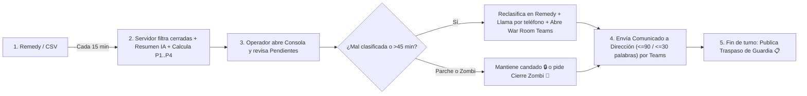
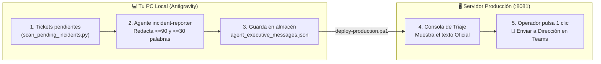

Analyzed manual-consola-operativa.md:L1-120
Analyzed sync-remedy-cron.sh:L1-54
Analyzed manual-consola-operativa.md:L190-310
Analyzed sync_montmc_incidents.py:L1-85

Imagina urgencias de un hospital: llegan muchos pacientes a la vez y una enfermera decide **quién necesita entrar al quirófano ya** y **quién puede esperar**. En IT, **hacer el triaje** es exactamente eso, pero con averías informáticas de Orange.

El problema habitual es que en la herramienta donde se abren los tickets (**BMC Remedy**) muchas averías entran con una prioridad equivocada (por ejemplo, marcadas como *"prioridad media / P3"* cuando en realidad tienen bloqueadas las ventas en 5 tiendas). La **Consola de Triaje en Producción** hace de "detector inteligente" y guía al operador (**Incident Manager**) paso a paso.

Aquí tienes todo el proceso explicado desde cero, dividido en **lo que hace la máquina sola** y **lo que hace la persona paso a paso**.

---

### Parte A: ¿Qué hace el servidor solo antes de que tú mires la pantalla?

En el servidor de producción (`infocodes.si.orange.es:8081`), el sistema trabaja en piloto automático mediante tres pasos:

1. **Recoge las averías recientes:**
   * **Automático:** Cada 15 minutos ([sync-remedy-cron.sh](file:///c:/Users/jose.delafuente/proyectos/release-dashboard-application/scripts/sync-remedy-cron.sh)) consulta a Remedy/MonTMC las incidencias nuevas o modificadas.
   * **Manual (opcional):** El operador también puede pulsar el botón **Sincronizar Remedy** o subir un Excel/CSV exportado de Remedy pulsando `Shift + U`.
2. **Limpia el ruido y resume con IA:**
   * Descarta automáticamente los tickets que ya están *Resueltos*, *Cerrados* o *Cancelados* para no saturar la pantalla.
   * Para las averías vivas, pide a **Epsilon IA** que lea todas las notas técnicas largas y saque un resumen limpio: *qué falla, a quién afecta y si hay algún bloqueo*.
3. **Calcula la gravedad real (Motor de Reglas):**
   * El motor ([evaluate_incident_notifications.py](file:///c:/Users/jose.delafuente/proyectos/release-dashboard-application/converters/cli/evaluate_incident_notifications.py)) cruza cada avería contra el catálogo oficial de Orange y calcula qué prioridad **debería** tener (`P1 Crítica`, `P2 Alta`, `P3 Media`, `P4 Baja`), dejando el resultado listo en la web.

---

### Parte B: Lo que hace el Operador en Producción (Paso a Paso)

#### Paso 1. Entrar a la Consola y leer el "marcador" superior

El operador abre en su navegador:
👉 `http://infocodes.si.orange.es:8081/dashboards/emergency-triage-console/`

Arriba del todo ve una fila de contadores (**KPIs**) que le resumen el turno en 3 segundos:

* **Pendientes:** Averías nuevas o desatendidas que requieren su acción ahora mismo.
* **P1 / P2:** Cuántas emergencias graves hay vivas.
* **Subescaladas (Discrepancias):** Averías que en Remedy parecen leves pero que la consola ha detectado que son graves.

---

#### Paso 2. Revisar la bandeja y cazar "Discrepancias" (Averías mal clasificadas)

El operador filtra por **Solo Pendientes** y revisa la lista de tickets activos:

* **¿Qué mira primero?** Si una fila tiene aviso de **Discrepancia** (por ejemplo: *en Remedy pone P3, pero la consola sugiere P1 porque hay 5 tiendas caídas*).
* **¿Qué hace?**
  * Si hay duda sobre el alcance real, aplica la **Regla de Oro**: *ante la duda, se trata como emergencia máxima (P1)* hasta demostrar lo contrario.
  * Pulsa el botón **📋 Copiar Solicitud Reclasificación Remedy** y pega ese texto en Remedy para que suban oficialmente la prioridad del ticket.
  * Si tras revisarla ve que es una falsa alarma o un ticket duplicado, cambia su selector de estado a **`Descartada`**.

---

#### Paso 3. Vigilar el reloj y activar a los equipos técnicos

Cada incidencia tiene un cronómetro en vivo desde que se abrió:

* **A los 45 minutos sin solución (Aviso Ámbar):**
  * **Llamada telefónica obligatoria** al equipo técnico responsable (en emergencias graves no basta con mandar un correo o un chat).
  * Pulsa el botón **🚨 Convocatoria War Room** para publicar en Microsoft Teams una tarjeta con enlace directo a una sala de reunión de crisis.
* **A la 1 hora y 45 minutos / 105 min (Alarma Roja):**
  * Escala por teléfono a los responsables de guardia (**IM-CSO**) y Dirección.
* **Si los técnicos llevan muchas horas sin escribir avances (+6h / +12h / +24h):**
  * Pulsa el botón **📢 Reclamación Work Log**, que envía un aviso directo por Teams al canal del equipo técnico pidiendo que actualicen el estado en Remedy.

---

#### Paso 4. Gestionar los 3 casos especiales (Candados, Planificadas y Zombis)

La consola avisa visualmente si el ticket entra en una de estas tres situaciones:

1. **Hay un "parche temporal" (*Workaround*) 🔒:** Por ejemplo, han reiniciado un servidor y de momento funciona, pero el fallo de fondo sigue ahí. La consola muestra un **candado**: **prohibido bajar la prioridad o cerrar la emergencia** sin permiso expreso de `IM-CSO` y hasta que el fallo real desaparezca.
2. **Está "Planificada" para una actualización futura 📅:** El arreglo ya está programado para instalarse una noche concreta. La consola le pone un tope máximo de `P2` y apaga las alarmas de tiempo para no tratarla como un incendio en vivo.
3. **Es un ticket "Zombi" 🧟:** Los desarrolladores ya dieron el trabajo por terminado o cancelado en su herramienta (Jira), pero alguien olvidó cerrar el ticket en Remedy. El operador pulsa **🧟 Solicitud Cierre Zombi** para pedir por Teams su cierre administrativo.

---

#### Paso 5. Avisar a Dirección (Comunicado Ejecutivo)

Cuando una incidencia es grave (`P1` o `P2`), la Dirección de Orange necesita saber qué pasa sin tecnicismos:

1. El operador abre el panel de comunicación de esa incidencia y elige la fase (**Apertura**, **Seguimiento**, **Reapertura** o **Cierre**). *Nota: el sistema impide publicar un "Cierre" si en Remedy el ticket sigue abierto.*
2. Pulsa **✨ Sugerir Borrador IA** (o edita el borrador preparado). El sistema genera dos versiones obligatorias y cuenta las palabras en vivo:
   * **Versión completa:** Un único párrafo de **máximo 90 palabras** (qué falla, impacto en negocio, qué se está haciendo y cuándo habrá próxima actualización).
   * **Versión breve:** Un titular telegráfico de 1 sola línea y **máximo 30 palabras**.
3. Guarda el mensaje y pulsa **📣 Notificación Dirección**, que envía la tarjeta oficial al canal de Dirección en Microsoft Teams.
4. Cambia el estado de la incidencia en la tabla de `Pendiente` a **`Comunicada`** o **`En Seguimiento`**.

---

#### Paso 6. Cambio de turno (Traspaso de Guardia)

Cuando termina su jornada y entra el siguiente compañero:

1. El operador pulsa el botón **📋 Traspaso Guardia**.
2. La consola recopila automáticamente todas las emergencias activas, en qué estado están y qué bloqueos tienen, y publica el **Informe de Relevo** en el canal de Teams de los *Incident Managers* para que el turno entrante no pierda el hilo.

---

### Resumen visual en 1 minuto

Si quieres profundizar en algún botón o protocolo concreto, tienes toda la referencia detallada en el [manual-consola-operativa.md](file:///c:/Users/jose.delafuente/proyectos/release-dashboard-application/docs/02-gestion-emergencias/manual-consola-operativa.md) (también navegable en `http://infocodes.si.orange.es:8081/docs/`).

Analyzed notificaciones-ejecutivas.md:L1-120
Analyzed notificaciones-ejecutivas.md:L121-240
Ran check auto-draft and executive-messages endpoints

La forma más sencilla de entenderlo es pensar en un periódico:

* **La Consola de Producción** es la **imprenta y la sala de control** (detecta qué noticias son urgentes, lleva los relojes y tiene el botón de enviar a Teams).
* **El agente `incident-reporter`** ([incident-reporter.md](file:///c:/Users/jose.delafuente/proyectos/release-dashboard-application/agents/it-incidents/incident-reporter.md)) es el **redactor jefe experto** que escribe los comunicados para Dirección sin tecnicismos, sin inventar datos y clavando el límite de palabras.

Lo más importante que debes saber es **dónde vive cada uno**:

> [!IMPORTANT]
> **`incident-reporter` NO corre dentro del servidor de producción.**  
> El servidor de producción (`infocodes.si.orange.es:8081`) solo tiene Python y Nginx (reglas matemáticas fijas, sin IA redactora).  
> **`incident-reporter` vive en tu entorno local (Antigravity)** y se conecta con Producción a través de un archivo puente: [data/agent_executive_messages.json](file:///c:/Users/jose.delafuente/proyectos/release-dashboard-application/data/agent_executive_messages.json).

---

### Cómo encaja `incident-reporter` en el proceso (Paso a Paso)

1. **El Motor de Triaje detecta "qué falta por escribir":**
   Cuando entran tickets nuevos (`P1`, `P2` o discrepancias), el motor ([evaluate_incident_notifications.py](file:///c:/Users/jose.delafuente/proyectos/release-dashboard-application/converters/cli/evaluate_incident_notifications.py)) comprueba si ese `INC...` ya tiene un comunicado guardado en `agent_executive_messages.json`. Si no lo tiene, lo marca como **`pendiente`** y deja preparado un paquete con todos los datos técnicos y el Resumen IA de Epsilon.

2. **`incident-reporter` entra en acción en Local:**
   Cuando pides en el chat de Antigravity redactar las incidencias pendientes (activando su skill [incident-executive-notifications](file:///c:/Users/jose.delafuente/proyectos/release-dashboard-application/.agents/skills/incident-executive-notifications/SKILL.md)), el asistente asume el rol de **`incident-reporter`** y aplica 4 reglas estrictas que un humano con prisa suele pasar por alto:
   * **Elige la fase correcta** (`apertura`, `seguimiento`, `reapertura` o `cierre`), teniendo **prohibido** escribir un cierre si en Remedy el ticket sigue abierto.
   * **Traduce la jerga técnica a impacto de negocio** usando las matrices de Orange ([it-severity-matrix](file:///c:/Users/jose.delafuente/proyectos/release-dashboard-application/.agents/skills/it-severity-matrix/SKILL.md) y [incident-triage-review](file:///c:/Users/jose.delafuente/proyectos/release-dashboard-application/.agents/skills/incident-triage-review/SKILL.md)).
   * **Elimina datos prohibidos:** Cero nombres de personas/clientes/teléfonos (PII) y cero horas de arreglo inventadas (regla anti-alucinación).
   * **Clava los dos formatos obligatorios:**
     * *Versión completa:* **1 solo párrafo** de **máximo 90 palabras**.
     * *Versión breve:* **1 sola línea** de **máximo 30 palabras**.

3. **Se sincroniza a Producción y abastece el Paso 5 del Triaje:**
   `incident-reporter` guarda los mensajes en `data/agent_executive_messages.json`. Al lanzar `deploy-production.ps1`, ese almacén sube al servidor de producción. Así, cuando el operador abre la Consola de Triaje en el **Paso 5 (Avisar a Dirección)**, ya se encuentra los comunicados **oficiales y validados**, listos para pulsar **📣 Notificación Dirección** y publicarlos en Teams.

---

### ¿Y qué pasa si salta una emergencia nueva en Producción y no estás en tu PC local?

Para que el operador de guardia nunca se quede bloqueado esperando a `incident-reporter`:

* **Salida de emergencia en vivo (en la web de Producción):** La consola tiene el botón **✨ Sugerir Borrador IA**, que construye al instante una plantilla segura en el navegador con los datos de Remedy/Epsilon y un contador de palabras en vivo (90 / 30). El operador puede revisarla y enviarla a Teams en menos de 1 minuto.
* **Consolidación posterior:** Más tarde, cuando procesas los tickets en local con `incident-reporter` y despliegas, ese borrador de urgencia queda sustituido en el almacén histórico por la redacción ejecutiva oficial.

Tienes este flujo local ↔ producción documentado en detalle en [notificaciones-ejecutivas.md](file:///c:/Users/jose.delafuente/proyectos/release-dashboard-application/docs/02-gestion-emergencias/notificaciones-ejecutivas.md).
